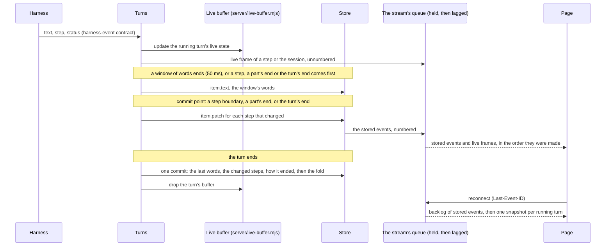

# Live-only progress

**Status:** built, 18 November 2026: every step in “Order of work” has landed, each with the pull request it names ([`rooms-at-scale.md`](../rooms-at-scale.md), “Live state”). The owner decided the restart question on 17 November 2026: a commit point at a graceful shutdown (“A restart mid-turn”).

## Why

A running turn writes its progress to the event log as it goes:
- each text delta as `item.text`;
- each step as an `item.patch` with `activityStep`;
- each change to its tool calls, current step, glimpse and subagents as a `session.patch`.

The log is the record ([store.md](store.md)), so all of it is kept, replayed at every start, and counted in every snapshot. Most of it is never read again: when the turn ends, its steps fold to the record the reply keeps (`foldSteps`, `server/turn-steps.mjs`).

**Measured on `main` at 7460688d** with `node tools/measure-progress.mjs`. It replays the 25 recorded Claude Code streams in `tests/fixtures/claude-code/` through the real stream mapper into a runtime, and sums each event’s bytes as the log writes it. Progress is what this design makes live; a session’s `state` stays stored, so it isn’t counted. Six runs gave 43.7% to 44.4%, varying with the glimpse’s timing. This is one:

| What | Bytes | Events | Share of the log |
|---|---|---|---|
| Progress: `session.patch` of calls, step, glimpse and subagents | 66,608 | 389 | 17% |
| Progress: `item.patch` with `activityStep` | 57,719 | 179 | 15% |
| Progress: `item.text` deltas | 43,307 | 376 | 11% |
| **All progress** | **167,634** | **944** | **43.9%** |
| Everything else | 214,065 | 795 | 56.1% |

- The replies’ final text was 8,020 characters, carried by 43 KB of deltas: most of the cost is per-event overhead on small writes.
- The folded records the replies keep came to 17,333 bytes.
- This matches the UAT run `2026-11-08T06-08-26-real-q1`, where progress was about half the log (`rooms-at-scale.md`, “Live state”).

## The decision

Progress goes to the page on live frames that aren’t stored. The log keeps the conversation, plus **commit points** of each running reply’s steps: the steps that changed since the last one. A reply’s words are stored a window at a time, every 50 ms (“Text in windows”). A graceful shutdown stores what every running reply holds, so a planned restart loses nothing, and a crash loses at most a window of words and the step updates since the last commit point (“A restart mid-turn”).

**What stays stored:**
- messages, replies (their text a window at a time, “Text in windows”), blocks, asks, entries, the work ledger;
- a session’s `state` (`think`, `gen`, `tool`, `needs`, `failed`, `stopping`, `idle`) and `ctx`, as today. Many readers decide on `state`: needs, Delivery’s start, `card-needs.mjs`’s release (`busy`), and the UAT’s `tools/uat/turns.mjs`, which tells `gen` from `think`. A `state` change is one small patch, and it stays.
- every write at a turn’s edges, as today: `turn-needs.mjs`’s “Waiting for you”, `turn-finish.mjs`’s “Failed”, `turn-stop.mjs`’s “Stopping”, the restart sweep’s and the store outage’s steps, with the `glimpse`, `subagents` and `currentStep` they set;
- the folded record of a turn’s steps at its end.

**What becomes live only:**
- text deltas between commit points;
- each update to a step between commit points;
- while a turn runs, `toolCalls`, `toolCount`, `currentStep`, `glimpse` and `subagents`.

**Which wins.** A stored write of a live field during a turn, such as “Waiting for you” while it waits on a card, also replaces the buffer’s value. It does so when the write is made (`Sessions.update` tells the buffer, `onSessionWrite`), not when the store publishes it, so a write held behind a commit can’t undo a newer live value. Stored events and live frames reach the page in the order they were made (“Order”), so the last one wins on the page as in the buffer, and a snapshot reads the buffer.

**One frame a tick.** A turn’s session changes in one tick go as one frame at the tick’s end: a harness reports a call’s end and the words after it together, and the page draws only the last. Anything that must follow the frame sends it first: a stored write of the session, a commit point, and the turn’s end or Stop.

**The turn’s end** sends a last session frame that puts each live field back to what’s stored, since the edge writes that clear a glimpse or the subagents write the same `''` and `[]` the store already has, and aren’t stored or sent. Then it sends an end frame that no page sees, by which each stream forgets the reply’s steps.

### Commit points

A commit point writes, in one `commit`:
- `item.text` with the words held since the last window, when it has any (“Text in windows”). This is the same event as today, so the reducer and every reader of the log take it unchanged (`tools/uat/inbox-measures.mjs`, `picture-choice.mjs` and `checks-assets.mjs` append or match `item.text`);
- one `item.patch` with `activityStep` for each step that is new or changed since the last commit point, the same event as today, so `checks-assets.mjs` still finds a step’s words. Each costs what that step’s change costs, never the steps before it, so a turn of `n` steps writes `O(n)` step records, not `O(n²)`.

The steps it stores keep `at` and `part`, which place them among the words (`app/js/activity-live.mjs`, `textFrom`). A commit point drops only what `foldedStep` drops besides those: `input`, `output` and `diff`, the live view’s detail. It keeps `detail` whole, since a page merges the stored step over the live one and a thought is shown whole while its turn runs; the fold at the turn’s end cuts it to `STEP_TEXT.detail`, as it always has. The buffer keeps the newest call’s full detail across a commit point that comes on time alone, so the live view’s newest call doesn’t lose its input and output mid-call. So a reload, a second tab or a conversation opened mid-turn places every stored step as the live view does. The fold at the turn’s end drops `at` and `part`, as today, and the restart sweep’s `foldCutOff`, which folds any step still holding them (`liveDetail`), folds a cut-off reply’s steps as it does now.

**On the wire, a change crosses once.** A page that was sent a step live since its last commit point isn’t sent that commit point’s `item.patch` (`server/live-sent.mjs`). A running turn’s change of `state` or `ctx` is stored as ever, and rides on the session frame sent with it, so its `session.patch` isn’t sent to a page either, and nor is the turn’s end’s write of the tool calls and their count, which the pages had live. Both are skipped per stream: a session’s only for a stream that has been sent that session’s frames, a step’s only for one sent that step since its last commit point. A cursor would only move the page’s place on, which its next numbered frame does, and a reconnect that replays such an event changes nothing the page has. A reconnect is a new stream: it has been sent nothing, so it’s spared nothing, and it gets the backlog whole, then the running turns’ snapshots (“A page that reconnects”). A page that opened after the step went live, a page without the conversation open, and a tool’s stream, which names no open conversations, get the stored events whole. A write that changes nothing isn’t stored, since it would store and send its `updatedAt` alone.

A commit point of the steps comes:
- at a step boundary: a new step of the agent’s own;
- when the buffer holds `LIVE_CAPS.steps` changed steps;
- at the turn’s end, a graceful shutdown’s included (“A restart mid-turn”).

A reply’s words aren’t held to a commit point: they’re stored when their window ends, or earlier, before a step, a part’s end or the turn’s end (“Text in windows”).

**At the end of a turn,** the last commit point, the settling patch, a failed reply’s `held` record (#1451, `server/turn-held.mjs`) and the fold are one `commit`, so a restart sees all of them or none.

## Text in windows

**The owner’s decision** (17 November 2026), in their words “Yes, rework it”, to the question whether to send a turn’s words at a fixed rate and only to open pages. It replaces this design’s plan for words, the `text` frame with its `at`, the per-stream word spans and the snapshot’s words, which #1502 built first, and measured as costing more per word than `main`.

- **A turn holds its deltas for a window** of `LIVE_TEXT.windowMs`, 50 ms (`shared/limits.mjs`), and stores them as one `item.text` when it ends (`server/live-text.mjs`). The next words open the next window. So the words reach the page at a fixed rate, at most a window behind, and the log grows a window at a time, never by more than `main`’s one `item.text` a delta.
- **Only open pages get the words.** A stored `item.text` goes whole to a stream with its conversation open and as a cursor to every other, as any item event does (#1155), so no frame carries the words and a page is never ahead of its stream.
- **The words held are stored early** so what reads them reads them whole and in order:
  - before a step goes to the page, since a step’s `at` places it among the words before it;
  - before a part settles: `threads.patchItem` calls the store’s settle hook (`itemSettling`, `server/store-live.mjs`), so `item.final` and the mentions in its last words read the whole text;
  - when the words go to another part;
  - at the turn’s end.
- **A reload or a page that opens mid-turn** gets the words to the last window from the store, and the rest a window later. A crash loses at most a window of words.

## Order

Stored events wait behind a commit in flight (`server/store-held.mjs`), and `POSTBOX_STREAM_LAG` holds every stored event back on the stream (`server/live-streams.mjs`). A live frame sent past both could overtake the commit point it follows, or the `item.add` of the reply it names, so words would go missing or show twice.

**So live frames take the same queue.** The store holds every emit made while a commit is queued or in flight, or a snapshot is written, in one global FIFO (`emit`, `server/store.mjs`), and numbers, applies and broadcasts each in its turn once that settles. A live frame made while anything is held joins that FIFO as an unnumbered job: when its turn comes it’s broadcast, not numbered, applied or written. The stream sends it through the same lag as stored events. So the page gets stored events and live frames in the order Turns made them. A send the lag holds back goes only to the streams open when it was made (`held`, `server/live-streams.mjs`): a stream that opened meanwhile has it already, in its backlog, its snapshot or the state its page loaded. Sent it again, its page would be ahead of its stream, which no page is without the lag, and would drop what came then (`behind` in `client.mjs`), while the server, having sent a step live, doesn’t send that page its commit point (#1505).

**And each frame says where it goes,** for a page that joins midway:
- a `step` frame carries the step’s `rev`, which Turns bumps on each change. The page keeps the highest;
- a frame for an item the page doesn’t have yet waits, until the item arrives or the turn ends. At most 200 frames wait per turn; past that the page drops what waits for that turn and asks for its snapshot (`/api/live/:turnId`, through `publicLive`), which replaces it whole.

## What reaches the browser

This crosses a security boundary ([security-boundaries.md](security-boundaries.md), “What reaches the browser”). It’s decided where events are, and it can’t drift from them.

**One new frame, `live`,** unnumbered like `header` and `status`. Its name joins `STREAM` in `shared/state.mjs`, so no event type can take it. Its data is `{ kind, … }`.

**Each kind mirrors an event type, and takes that type’s `public` flag from `EVENTS`.** There’s no second table of flags to drift: `LIVE` in `shared/live-kinds.mjs` maps a kind to its event type and its fields. A test holds that each kind’s `public` is its event’s, and fails closed for a kind whose type isn’t in `EVENTS`. A kind also names the state keys its data belongs to, `items` for an item’s kinds and `sessions` for a session’s, and needs them in `PUBLIC_STATE_KEYS`. Each kind’s shape keeps a field only as a scalar, or as an object or a list whose entries are picked by their own shape, so no nested value gets past its list.

| Kind | Mirrors | Fields, the only ones sent |
|---|---|---|
| `step` | `item.patch` (`activityStep`) | `threadId`, `itemId`, `rev`, and `step`, an object of the step’s `id`, `label`, `tool`, `state`, `ms`, `who`, `parent`, `detail`, `kind`, `job`, `input`, `output`, `part`, `at`, `added`, `deleted`, `diff` |
| `session` | `session.patch` | `sessionId`, `toolCalls`, `toolCount`, `currentStep`, `glimpse`, `subagents`, and the `state`, `ctx` and `updatedAt` of a change stored with them |
| `snapshot` | the two above | `turnId`, `sessionId`, `threadId`, `itemId`, and the turn’s `steps` and `session`, each as its kind’s fields |

A step frame names no `turnId`: the page places a step by its item, and the snapshot names the turn. A step frame sends a step whole the first time after a commit point, then only the fields that changed, with its `id`; a session frame sends only the fields that changed.

**No field reaches the browser that doesn’t today.** Each is one a public event carries now. A test builds every kind from a buffer full of extra keys, and holds that a frame’s keys are a subset of its kind’s list.

**`server/public-state.mjs` decides it,** with `publicLiveFrame(frame, open)`:
1. The kind must map to a public event type, or the frame is dropped.
2. `step` and `snapshot` frames go only to a stream that has their thread open, as item events do (#1155, `publicFrame`’s `open`).
3. `session` frames go to every stream, as `session.patch` does.
4. `/api/state` adds `live`, the running turns’ snapshots, from `publicLive(buffers, open)` by the same rules. `tests/public-state.test.mjs`, which builds `/api/state` from `emptyState()`, covers the new key.
5. `/api/live/:turnId`, which a page asks when its frames for a turn overflow (“Order”), answers that turn’s snapshot through `publicLive`, by the same rules: nothing for a turn in a conversation it doesn’t have open, or for one that has ended. It goes through the request gate like every route.

**Tests:** beside `tests/public-state.test.mjs` and `tests/live-streams-public.test.mjs`, one holds that a kind whose event is private goes out as nothing, at both, as they hold a private event type sent only as a cursor.

**Agent content stays data.** Text reaches the DOM through `renderMarkdown()` and steps through `h()`, as now. `security-boundaries.md` changes in the pull request that ships the frame, not after it.

## The buffer, and what a page that joins gets

**`server/live-buffer.mjs` keeps one buffer per running turn,** in memory, and drops it when the turn ends. It’s Turns’ module, not `turn-context.mjs`, which is near its size limit. Its bounds are in `shared/limits.mjs`:
- **steps:** the steps changed since the last commit point, in full, each with its `rev`;
- **session fields:** one set, the latest.

A turn holds at most a window of words beside the buffer (“Text in windows”).

**A page that reconnects** asks for everything after its Last-Event-ID, as now. It gets the backlog of stored events, which now includes each commit point. Then it gets one `snapshot` per running turn in a conversation it has open, and a `session` frame for every other running session. So does a stream opened for a conversation the page opens mid-turn, a side or topic thread included, and one closed for `UNREAD_MS` that connects again. A page that resyncs gets the same from `/api/state`’s `live`. A snapshot’s steps are whole, so a step frame after it, which carries only what changed, applies over a whole step.

**A tab that opens a conversation mid-turn,** or a second tab, may get a snapshot before the conversation’s items load (`/api/threads/:id/items`, #1155). The page holds it until `loaded(threadId)`, then applies it. A frame for an item still not there waits, as in “Order”.

**On the page, `app/js/live-frames.mjs`** applies frames and snapshots. It isn’t in `client.mjs` or `activity-live.mjs`, which are near their limits.

## A restart mid-turn

**A turn on this computer** can’t outlive Postbox: its harness is a child of the server, and a restart ends it (`settleInterrupted`, `server/restart-sweep.mjs`). **The owner’s decision** (17 November 2026, “Flush at shutdown”), against intent.md’s second principle, “Streaming that never loses a message”:
- **A planned restart loses nothing.** A graceful shutdown takes a commit point for every running reply, with its words, its changed steps and its session fields, before its turn is stopped: in `close()` (`server/index.mjs`), ahead of `rt.stopTurns()`, so the store writes it before `store.close()` flushes and releases the folder.
- **Nor does the ledger.** `settleLedger` waits 4 seconds (`ledgerGraceMs`) for the turns’ ledger records. Before step 5 it then closed the store, so a record that ended later, such as a turn’s end waiting on a slow file read or on a `git` call near its 10-second timeout (`runGit`), was dropped, and the turn read as interrupted after the restart. Now, once the grace is over, `closeLedger` (`server/ledger-end.mjs`) writes each turn’s end it still has, with its status, time, tool calls and spend but without the changes still being read, and the reply’s line of its work. The ledger then writes nothing more, keeps no copy and runs no `git`, all before `store.close()`; a record that finishes later is dropped (“Order of work”, 5). No turn on this computer ends after that: each was stopped before it, and a turn on a host goes on there and is attached again after the restart.
- **Only a crash can lose words:** at most a window of them, 50 ms (“Text in windows”), and the step updates since the last commit point. That’s as today, when streamed text is written on the fast path, unsynced ([store.md](store.md)), so a crash can already lose a reply’s newest words.

After either:
- the reply keeps its text to the last window and its steps to the last commit point, which is the shutdown’s own after a planned restart;
- it reads as cut off by a restart, as today, and the entries the turn took reopen once as a resend (Delivery’s start, [services.md](services.md), “Delivery and Turns, built as the inbox”), so the agent picks the work up again.

**#1451’s record of a reply cut off with no words** (`heldOfCutOff`, `server/turn-held.mjs`) is built from what was stored: the reply’s steps and the entries its turn took. With this design, those steps are the ones to the last commit point.

**A turn on a host** goes on there. Postbox attaches again after the restart and replays the turn from the host’s `out.jsonl`, replacing what the reply had (`reattach`, `server/remote/turns-resume.mjs`). The replay goes through the same commit points, at its boundaries, so the reply comes back whole, as today.

## What reads the store while a turn runs

**Server code that reads what goes live:**
- `subagent-end.mjs` reads stored `se.subagents` to find the subagent the person ends (#229). It reads Turns’ buffer for the running turn instead, or End would always answer 409.
- `card-needs.mjs`’s `releaseNeed` restores `busy` from `state`, which stays stored.
- The edge writers named in “What stays stored” keep writing what they write.
- `job-records.mjs` reads a job’s step from the live turn while it runs, and from the stored item after it ends. The stored item has the step, so this is unchanged.

**Other readers of the store:**
- **Other agents** (catch-up, `read_message`, `read_conversation`) read the stored text to the last window, and the line says the reply is still being written and that `read_message` with its id reads all of it once it’s done (`writingNote`, `server/item-lines.mjs`; `tests/reply-being-written.test.mjs`). Before this design they read every delta as it landed.
- **Host agents’ reads** refresh on stored item events (`onStoreEvent`, `server/remote/turns-snapshot.mjs`). They refresh at commit points, which is enough, since they read stored text.
- **Search, fork, share and export** read stored items. While a turn runs they get its text to the last window; after it ends, all of it.
- **Other `item.text` writers stay stored:** the person’s commands’ output (`shell-runs.mjs`) and an attached Claude Code terminal’s mirror (`claude-mirror.mjs`).
- **The UAT checks** read the log:
  - `checks-assets.mjs`’s scan for an agent’s own words (#722) matches `activityStep` and `item.text` in the log, which commit points keep. But a call’s `input` and `output`, and the glimpse, would be on live frames only. The UAT runner records every live frame its stream receives into the run’s files beside the log, for the ATIF trajectories. The scan for an asset’s content outside its file doesn’t read them: they’re never stored, and a tool call’s preview (a write’s input, a read’s output) is no copy (#1655);
  - `inbox-measures.mjs` and `picture-choice.mjs` append `item.text`, unchanged;
  - `room-events.mjs` and `history.mjs` replay events, unchanged;
  - `tools/uat/turns.mjs` reads `state`, which stays stored.

  `tests/uat-live-log.test.mjs` holds them to `main`’s results: it replays every recorded turn in `tests/fixtures/` through the real runtime into a store on disk, and what the checks rebuild of each reply from the log (`itemsOf`, which `inbox-measures.mjs` and `picture-choice.mjs` read) is every word the stream gave that reply, as `main` stored them a delta at a time, each stored before the reply settles.

## Proving it costs nothing new

Each code pull request is measured against `main`, back to back on the same machine, with the numbers in its body. A number worse than `main` on any row fails it. The scale target is 10x to 100x real rooms.

| What | How it’s measured | At |
|---|---|---|
| Log bytes and events a turn | `tools/measure-progress.mjs`, extended to the Codex, Kiro and Antigravity fixtures (`tests/fixtures/codex-app-server/`, `kiro-cli/`, `antigravity-cli/`) | 1x |
| A long turn | A fixture of 300 and of 1,000 steps: log bytes, step records written, time a commit point | 1x, 10x |
| A crowded room | The fixtures replayed at once by 8 and by 40 agents in one room, and 100 running turns across rooms: log bytes, server event-loop time a delta | 10x, 100x |
| A crowd, warm | Each crowd alone in a process, run 4 times and then measured 8: the median CPU, event-loop and mappers’ time (`steady`, `tools/measure-progress/steady.mjs`). The crowded room’s rows run nine crowds in one process, so where the JIT and the GC land among them moves its times as much as a change does; these read the time a long-running Postbox pays | 1x, 10x, 100x |
| Restart | Start on a log built from those turns: replay time, heap after start, store snapshot size | 1x, 10x, 100x |
| The page’s work | `tests/browser/live-cost.spec.mjs` and `live-event-cost.spec.mjs`: layouts a step, the page’s time a turn | 1x, 10x, 100x |
| The wire | Bytes and frames a page receives a turn, with 1, 3 and 10 tabs open | 1x, 10x |
| Joining | Time from reconnect to the running turns drawn, and the frames sent, with 1, 10 and 100 running turns and 1 and 10 tabs reconnecting at once; `/api/state` time and size at 100 running turns | 1x, 10x, 100x |
| Hosts | What a host sends a turn, and the laptop’s commit points for a host turn and its replay | 1x |
| The buffers | Heap held at 100 running turns | 100x |

The first code pull request extends the tool and records `main`’s numbers before any change, so every later one compares with the same baseline.

**`main`’s baseline,** Postbox at a33cc5b0, from `node tools/measure-progress.mjs --runs 3`. Each run is in a fresh process, on a virtual clock that advances 50 ms after each recorded line, with a crowd’s agents interleaved. The log is counted as the store writes it, in UTF-8 bytes (a test holds that the count equals the disk). The clock never runs ahead of real time while the store flushes or closes, so its bounds on disk work trip only when the disk stalls. Times are given as least to most of the runs. The ledger’s git calls answer as git does in a folder that isn’t a repository, the project’s here, without starting a process: real ones were about a third of a crowd’s profile, none of it Postbox’s own. This run’s times came with the machine under load (a load average of 10 to 15, other sessions’ browser specs), so they show the spread a busy machine gives; a step’s times are compared only in pairs with `main`’s (“Worse than `main`”).

| Section | Log bytes | Progress | Mixed | A page’s bytes, frames | Event loop busy, ms | CPU, ms | Mappers’ µs a delta |
|---|---|---|---|---|---|---|---|
| Claude Code, 19 recorded turns | 407,441 | 45.1% | 8.9% | 353,101, 1,793 | 193–214 | 100–110 | 7.9–10.0 |
| Codex, 8 recorded turns | 80,586 | 24.7% | 11.0% | 59,734, 358 | 60–62 | 19–20 | 9.1–9.9 |
| Kiro, 11 recorded turns | 136,196 | 34.3% | 13.0% | 106,428, 675 | 89–91 | 32–33 | 6.8–7.9 |
| Antigravity, 11 recorded turns | 163,499 | 43.6% | 10.1% | 132,491, 905 | 88–90 | 34–36 | 7.9–8.9 |
| One turn of 300 steps, with input, output, detail and diffs | 649,174 | 67.0% | 30.8% | 635,954, 1,837 | 97–287 | 107–177 | 11.8–33.6 |
| One turn of 1,000 steps | 2,144,179 | 68.0% | 31.1% | 2,105,759, 6,037 | 267–479 | 284–405 | 13.4–26.0 |
| 1x: 4 agents in a room, 1 to 10 tabs | 59,405–59,411 | 30.5% | 10.1% | 52,570–52,576, 276 | 11–36 | 9–34 | 9.7–32.9 |
| 10x: 40 agents in a room, 1 to 10 tabs | 652,578–652,632 | 40.0–40.1% | 10.0% | 610,409–610,463, 2,979 | 32–61 | 39–81 | 4.5–8.8 |
| 100x: 100 agents across 25 rooms, 1 to 10 tabs | 1,485,077–1,485,503 | 44.9% | 11.0% | 951,105–951,373, 7,695–7,697 (one room open) | 64–75 | 94–119 | 3.9–4.7 |

- **Progress** is a session patch of only live fields (with or without `updatedAt`), an `activityStep` patch, or an `item.text`.
- **Mixed** is a session patch that sets a stored field, such as `state`, beside live ones. Its stored part stays.
- `compacting` stays stored.
- A recording that streams no words or step, such as Codex’s model list or a run that failed before any output, isn’t a turn, and is reported apart (the tool prints it).
- A page’s bytes don’t change with the number of tabs, except by the digits of a time.
- **Event loop busy** is `performance.eventLoopUtilization()`’s active time, and **CPU** `process.cpuUsage()`’s user and system time, both from the first turn’s start until every turn and its ledger record have settled: the store’s writes, the wire to every tab and the timers, not only the mappers. Both include the virtual clock’s own stepping, which is the same on every branch, so they’re compared between branches and never read as Postbox’s alone. **Mappers’ µs a delta** is the time in the adapters’ mappers only.

**A restart mid-turn,** with each agent half through its turn, in rooms of 4. Postbox is started with `start({ listen: false })`. A graceful stop is its own `close()`, with `ledgerGraceMs` raised so the virtual clock doesn’t run the ledger’s grace out; a crash kills the process once the store has flushed. “Written” is every byte of the log, counted from `start()`; “without the snapshot” loads a copy of that whole log with no snapshot, so it’s comparable whenever a snapshot is taken. A crash is judged at 8 points at fixed phases of the snapshot interval of 5,000 events, 0, 625, … 4,375 events past a snapshot, each the last such point up to the crash (`tools/measure-progress/crash-points.mjs`, #1512): the crash’s whole log is replayed through the branch’s own store, which snapshots by its own rule, and the folder is loaded at each point. The row judges the mean and the worst load, and the mean and the most replayed across the points; one crash point decided the load by where the last snapshot happened to fall. At fixed phases the points replay the same whatever a log’s length, so two sides whose logs differ are judged at the same distances from their snapshots; points counted back from the crash moved with the length, and a log 400 events shorter came out 9.5% worse. On the machine these were measured on, a crash after 400 agents loads in 13 ms on the mean and 16 to 17 ms at worst, under the 20 ms floor below which a time isn’t judged, so its times are reported and only its bytes are judged there.

| Scale and stop | Shutdown | Written | Snapshot | Replayed with it: bytes, events | Load with it | Load without it: bytes, events, time | Heap after load | Sweep |
|---|---|---|---|---|---|---|---|---|
| 4 agents, graceful | 8–67 ms | 55,408 | none | 55,408, 176 | 7–83 ms | 55,408, 176, 7–61 ms | 0.14–0.63 MB | 0.09–0.10 ms |
| 4 agents, crash | | 48,811 | none | 48,811, 138 | 12–100 ms | 48,811, 138, 6–39 ms | 0.17 MB | 1.1–1.4 ms |
| 40 agents, graceful | 128–245 ms | 372,987 | none | 372,987, 1,608 | 12–33 ms | the same, 8–20 ms | 0.32–0.49 MB | 0.16–0.29 ms |
| 40 agents, crash | | 312,491 | none | 312,491, 1,342 | 10–70 ms | the same, 11–29 ms | 0.31–0.32 MB | 1.5–2.4 ms |
| 400 agents, graceful | 634–1,361 ms | 3,462,779–3,472,089 | 1,208,653–1,227,826 | 91,185–556,939, 356–2,494 | 24–42 ms | 3,462,779–3,472,089, 16,605–16,676, 32–60 ms | 2.1–2.3 MB | 0.38–0.75 ms |
| 400 agents, crash | | 2,917,430–2,919,005 | 1,207,757–1,208,541 | 0, 0: the snapshot came after the last event | 14–74 ms | 2,917,430–2,919,005, 14,189–14,196, 25–38 ms | 2.0 MB | 14–16 ms |

The restart’s times came with the machine at its busiest (a load average of 7 to 11), and spread up to tenfold; they’re compared only in pairs. The restart’s ledger git calls answer without a process too, so the ledger’s git work isn’t measured anywhere.

Below 400 agents no snapshot is taken, so every event is replayed. At 400, when the snapshot is taken depends on how the store’s writes batch between real I/O, so the snapshot and what’s replayed after it split the log differently from run to run, from a third of the log to none. Those two are bands only; what a step compares at 400 is the whole log’s bytes and events and its load without the snapshot, which held to within 0.3%. The 400-agent shutdown is the real `close()`, which stops 400 turns and writes what they end with.

**Joining mid-turn,** with 1, 10 and 100 turns running, half through each, in rooms of up to 4: `/api/state` as a new page loads it, and tabs reconnecting at once to the first room, after a long drop (they missed everything since the turns started) or a short one (since 45% of each turn). For one reconnecting tab, what its connect sends, the running turns’ live snapshot within it (frames named `live`, none on `main`; the tabs’ stream is told the runtime’s running turns, as Postbox’s is, so a step that sends one has it counted), and what it’s sent after, to the turns’ end:

| Running turns, drop | `/api/state` bytes | Connect: bytes, frames | Snapshot: bytes, frames | After, to the end: bytes, frames | 1 tab reconnecting | 10 at once |
|---|---|---|---|---|---|---|
| 1, long | 6,124 | 6,494, 39 | 0, 0 | 5,187, 37 | 0.21–0.26 ms | 0.9–2.2 ms |
| 1, short | 6,124 | 472, 6 | 0, 0 | 5,188, 37 | 0.05–0.16 ms | 0.23–0.32 ms |
| 10, long | 33,625–33,630 | 70,488–70,493, 417 | 0, 0 | 80,693, 630 | 0.9–1.3 ms | 5.8–6.0 ms |
| 10, short | 33,621 | 5,349, 35 | 0, 0 | 80,698, 630 | 0.14–0.16 ms | 0.5–1.9 ms |
| 100, long | 214,805–214,856 | 457,951–458,002, 3,275 | 0, 0 | 484,284–484,287, 4,354 | 3.3–6.4 ms | 38–68 ms |
| 100, short | 214,931 | 36,925, 325 | 0, 0 | 484,573, 4,361 | 0.42–0.79 ms | 3.2–5.0 ms |

`/api/state` takes 0.1 to 4.2 ms at these sizes.

**Worse than `main`,** for a step’s comparison: `node tools/measure-progress.mjs --against <main’s checkout>`, which runs `main`’s tool and the step’s in 8 pairs, alternating ABBA so a machine growing busier or calmer weighs on both, and gives each number a verdict (`tools/measure-progress/compare.mjs`):
- **Bytes and counts** (the log, written, the snapshot, the page’s, the connect, the live snapshot, a reconnected tab’s to the end, and `/api/state`) are worse when the step’s least is above `main`’s most by more than 0.1% or 64 bytes, whichever is more. Runs differ only by the digits of times, and at 400 agents by what the stops write.
- **Times** (event loop busy, CPU, the mappers’ time, shutdown, load, sweep, `/api/state` and reconnecting) are worse when the median of the pairs’ ratios, step over `main`, and the ratio of the least runs are both above 1.10. A real cost moves both; noise seldom does.
  - A time under 20 ms in `main`’s least run is reported and not judged: run against itself, the mappers’ 2.5 to 4 ms in a crowd came out 11 to 16% apart on noise alone.
  - The time a delta is the mappers’ time over a count that doesn’t change, so it’s judged once, as the mappers’ time.
  - A section with a number worse runs a second round of pairs, and the number is worse only if that round agrees.
- **Crowds are gated warm.** `steady`’s rows are the CPU gate for crowds: each crowd alone in a process, warmed before it’s measured. `crowded`’s times are reported as the cold-process view and not judged (`UNGATED_TIMES`, `tools/measure-progress/compare.mjs`); its bytes are judged as ever. It runs nine crowds one after another in a fresh process, so where the JIT’s tiering and the GC land among them moves its times as much as a change does (#1508): on #1502, 10x with 1 tab came out ×1.49 there and ×1.000 alone and warm. The owner accepted one-time compile costs on 17 November 2026, in their words “Yes, accept it” (see step 3’s one-time compile, below), and a Postbox server pays the warm time.
- **Why paired:** a rule that held one band’s median against the other’s most let a real 11 to 16% CPU cost pass on a busy machine.
- **The tool against itself** (`--against .`, every section, a load average of 7 to 11): 40 times judged, none worse, no second round, and the smaller of each time’s two ratios reached 1.072 at most. It catches #1471’s 100x cost, at ratios of 1.13 to 1.31, in both rounds. On a busier machine a single round can find main worse than itself, a time or two just past 1.10; the second round is what keeps main against main passing under load, since noise seldom lands on the same number twice. A cost near 10% needs a calmer machine or more pairs (`--pairs`) to call.
- The snapshot and the replay with it at 400 agents aren’t compared, for the reason above.

**Step 3’s one-time compile, accepted.** Step 3 (#1471) is level with `main` in steady state and costs more only the first time its code runs in a process, which the owner accepted on 17 November 2026:
- **The cold first pass costs more.** Each of the tool’s runs is a fresh process, so its crowd rows include V8 compiling the step’s new code the first time it’s hot: about 76 more functions optimized a process. They land at 100x, the section’s largest, at ×1.10 to ×1.20 CPU, though the tool’s verdict on a quiet machine was nothing worse than `main`.
- **The warm second pass is level.** The crowd section run twice in one process, 32 ABBA pairs, process CPU: 100x with 1 tab ×1.05 (more in 19 of 32), with 3 tabs ×0.99, with 10 tabs ×0.94; on the main thread, ×0.97, ×1.04 and ×0.99. The cold pass in the same runs was ×1.17, ×1.06 and ×1.12.
- **Why it’s one-time:** with V8’s background compiling off, the cold gap moves onto the main thread. With its GC helpers off, it stays. GC and disk writes equal `main`’s. A Postbox server runs for hours, so it pays the compile once.

## Order of work

Each item is its own pull request, test first:
1. **The measurement** (built, #1461): `tools/measure-progress.mjs` extended as above, with `main`’s numbers. It changes nothing in Postbox.
2. **`LIVE`, the `live` frame, `publicLiveFrame` and `publicLive`** (built, #1462), with the public-derivation, field-subset and private-kind tests, and `security-boundaries.md` updated in the same change, before anything is sent on it.
3. **`server/live-buffer.mjs`, commit points, and the session fields and steps going live** (built, #1471), with the shared queue, the lag, `rev`, and `subagent-end.mjs` reading the buffer. The page’s handling of step and session frames (`app/js/live-frames.mjs`), the snapshot of steps and session fields, and `/api/state`’s `live` come with it, so a page that reloads or opens mid-turn never loses what changed since the last commit point (the integrator’s condition on #1471: step 3 ships no gap).
4. **Text in windows** (built, #1502; “Text in windows”): a turn’s words stored once a window, with the settle hook.
5. **The shutdown commit point** (built, #1517, `tests/shutdown-commit.test.mjs`), with a test that fails without it: a reply stopped cleanly mid-stream, Postbox started again on the same store, and every word the reply had said is there. For text, nothing is left to build: a graceful shutdown stops each running turn, whose end stores the words it holds (`liveEnd`, step 4), so this step adds only the test that holds it. **And the ledger at shutdown:** once closing begins, the ledger starts no new work and writes what it has before `store.close()`, with a test through the real `start()` and `close()` and a short grace, such as `ledgerGraceMs` of 30 ms and a record that writes after 150 ms, which `main` drops.
6. **The readers** (built): catch-up’s line for a reply still being written, the UAT checks held to `main`’s results, this document’s “Status” moved to built, and `architecture.md`’s summary (“Streamed text is emitted on a fast path”) updated.

## What this doesn’t do

- **It doesn’t store less of what finished turns keep.** The folded record is the same.
- **It doesn’t change how a host turn is recorded on its host.**
- **It doesn’t add Postbox’s own tool calls as steps, or a step’s elapsed time,** which rooms-at-scale lists beside this. Both ride the `step` frame once it exists, as their own changes.

## Open questions

1. **Whether a commit point should also come when the person opens the conversation,** so a page that joins reads more from the store and less from the snapshot. That trades writes for a smaller snapshot.

## When to revisit

- If a commit-point interval that keeps the log under `main` loses more than a step of words on a restart, in a recorded run.
- If a reader is found that needs a reply’s words between commit points.
