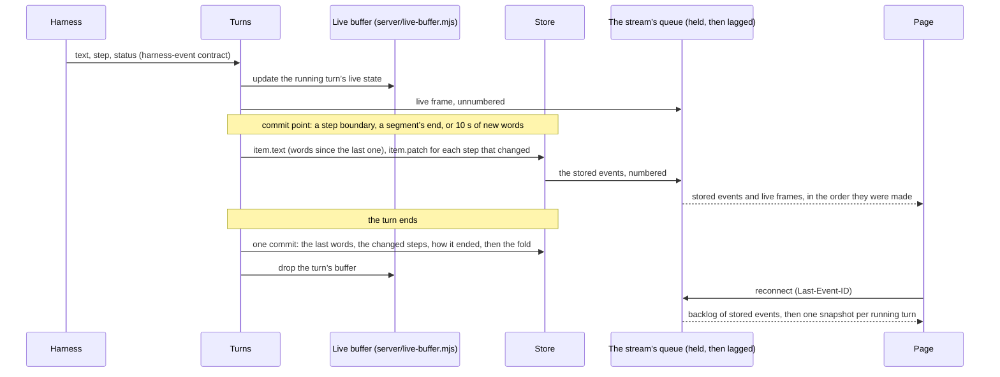

# Live-only progress

**Status:** design, for review before any code ([`rooms-at-scale.md`](../rooms-at-scale.md), “Live state”, “Still to do”). Nothing here is built. The owner decided the restart question on 17 November 2026: a commit point at a graceful shutdown (“A restart mid-turn”).

## Why

A running turn writes its progress to the event log as it goes:
- each text delta as `item.text`;
- each step as an `item.patch` with `activityStep`;
- each change to its tool calls, current step, glimpse and subagents as a `session.patch`.

The log is the record ([store.md](store.md)), so all of it is kept, replayed at every start, and counted in every snapshot. Most of it is never read again: when the turn ends, its steps fold to the record the reply keeps (`foldSteps`, `server/turn-steps.mjs`).

**Measured on `main` at 7460688d** with `node tools/measure-progress.mjs`. It replays the 25 recorded Claude Code streams in `tests/fixtures/claude-code/` through the real stream mapper into a runtime, and sums each event’s bytes as the log writes it. Progress is what this design makes live; a session’s `state` stays stored, so it isn’t counted. Six runs gave 43.7% to 44.4%, varying with the glimpse’s timing. This is one:

| What | Bytes | Events | Share of the log |
|---|---|---|---|
| Progress: `session.patch` of calls, step, glimpse and subagents | 66,608 | 389 | 17% |
| Progress: `item.patch` with `activityStep` | 57,719 | 179 | 15% |
| Progress: `item.text` deltas | 43,307 | 376 | 11% |
| **All progress** | **167,634** | **944** | **43.9%** |
| Everything else | 214,065 | 795 | 56.1% |

- The replies’ final text was 8,020 characters, carried by 43 KB of deltas: most of the cost is per-event overhead on small writes.
- The folded records the replies keep came to 17,333 bytes.
- This matches the UAT run `2026-11-08T06-08-26-real-q1`, where progress was about half the log (`rooms-at-scale.md`, “Live state”).

## The decision

Progress goes to the page on live frames that aren’t stored. The log keeps the conversation, plus **commit points** of each running reply: what it has said, and the steps that changed, since the last one. A graceful shutdown takes a commit point for every running reply, so a planned restart loses nothing, and only a crash can lose the words since the last one, as today (“A restart mid-turn”).

**What stays stored:**
- messages, replies (their text at each commit point and at the end), blocks, asks, entries, the work ledger;
- a session’s `state` (`think`, `gen`, `tool`, `needs`, `failed`, `stopping`, `idle`) and `ctx`, as today. Many readers decide on `state`: needs, Delivery’s start, `card-needs.mjs`’s release (`busy`), and the UAT’s `tools/uat/turns.mjs`, which tells `gen` from `think`. A `state` change is one small patch, and it stays.
- every write at a turn’s edges, as today: `turn-needs.mjs`’s “Waiting for you”, `turn-finish.mjs`’s “Failed”, `turn-stop.mjs`’s “Stopping”, the restart sweep’s and the store outage’s steps, with the `glimpse`, `subagents` and `currentStep` they set;
- the folded record of a turn’s steps at its end.

**What becomes live only:**
- text deltas between commit points;
- each update to a step between commit points;
- while a turn runs, `toolCalls`, `toolCount`, `currentStep`, `glimpse` and `subagents`.

**Which wins.** A stored write of a live field during a turn, such as “Waiting for you” while it waits on a card, also replaces the buffer’s value. Stored events and live frames reach the page in the order they were made (“Order”), so the last one wins on the page as in the buffer, and a snapshot reads the buffer.

### Commit points

A commit point writes, in one `commit`:
- `item.text` with the words since the last commit point. This is the same event as today, so the reducer and every reader of the log take it unchanged (`tools/uat/inbox-measures.mjs`, `picture-choice.mjs` and `checks-assets.mjs` append or match `item.text`);
- one `item.patch` with `activityStep` for each step that is new or changed since the last commit point, the same event as today, so `checks-assets.mjs` still finds a step’s words. Each costs what that step’s change costs, never the steps before it, so a turn of `n` steps writes `O(n)` step records, not `O(n²)`.

The steps it stores keep `at` and `part`, which place them among the words (`app/js/activity-live.mjs`, `textFrom`). A commit point drops only what `foldedStep` drops besides those: `input`, `output` and `diff`, the live view’s detail. It cuts `detail` to `STEP_TEXT.detail` (1,200 characters), as the fold does, so a thought’s longer detail stays live only. The buffer keeps the newest call’s full detail across a commit point that comes on time alone, so the live view’s newest call doesn’t lose its input and output mid-call. So a reload, a second tab or a conversation opened mid-turn places every stored step as the live view does. The fold at the turn’s end drops `at` and `part`, as today, and the restart sweep’s `foldCutOff`, which folds any step still holding them (`liveDetail`), folds a cut-off reply’s steps as it does now.

A commit point comes:
- at a step boundary: when a call starts, the words before it are whole;
- at a reply segment’s end, before the patch that settles the segment. `item.final` (`threads.mjs`, `patchItem`) then reads the whole text, and the mentions in its last words wake their agents (`mention-entries.mjs`);
- after 10 s of new words with no step, so a long reply with no calls loses no more than that;
- early, when the buffer’s text reaches 64 KB;
- for every running reply at a graceful shutdown, before its turn is stopped (“A restart mid-turn”).

The interval and the ceiling are constants in `shared/limits.mjs`. The measurement decides their values, within the bound that the commit points of a turn together write less than `main` writes for it.

**At the end of a turn,** the last commit point, the settling patch, a failed reply’s `held` record (#1451, `server/turn-held.mjs`) and the fold are one `commit`, so a restart sees all of them or none.

## Order

Stored events wait behind a commit in flight (`server/store-held.mjs`), and `POSTBOX_STREAM_LAG` holds every stored event back on the stream (`server/live-streams.mjs`). A live frame sent past both could overtake the commit point it follows, or the `item.add` of the reply it names, so words would go missing or show twice.

**So live frames take the same queue.** The store holds every emit made while a commit is queued or in flight, or a snapshot is written, in one global FIFO (`emit`, `server/store.mjs`), and numbers, applies and broadcasts each in its turn once that settles. A live frame made while anything is held joins that FIFO as an unnumbered job: when its turn comes it’s broadcast, not numbered, applied or written. The stream sends it through the same lag as stored events. So the page gets stored events and live frames in the order Turns made them.

**And each frame says where it goes,** for a page that joins midway:
- a `text` frame names the offset in the reply’s text where its words start (`at`). The page appends only at its stored text’s end, buffers a frame ahead of it, and drops what it already has;
- a `step` frame carries the step’s `rev`, which Turns bumps on each change. The page keeps the highest;
- a frame for an item the page doesn’t have yet waits, until the item arrives or the turn ends. At most 200 frames wait per turn; past that the page drops what waits for that turn and asks for its snapshot (`/api/live/:turnId`, through `publicLive`), which replaces it whole.

## What reaches the browser

This crosses a security boundary ([security-boundaries.md](security-boundaries.md), “What reaches the browser”). It’s decided where events are, and it can’t drift from them.

**One new frame, `live`,** unnumbered like `header` and `status`. Its name joins `STREAM` in `shared/state.mjs`, so no event type can take it. Its data is `{ kind, … }`.

**Each kind mirrors an event type, and takes that type’s `public` flag from `EVENTS`.** There’s no second table of flags to drift: `LIVE` in `shared/live-kinds.mjs` maps a kind to its event type and its fields. A test holds that each kind’s `public` is its event’s, and fails closed for a kind whose type isn’t in `EVENTS`. A kind also names the state keys its data belongs to, `items` for an item’s kinds and `sessions` for a session’s, and needs them in `PUBLIC_STATE_KEYS`. Each kind’s shape keeps a field only as a scalar, or as an object or a list whose entries are picked by their own shape, so no nested value gets past its list.

| Kind | Mirrors | Fields, the only ones sent |
|---|---|---|
| `text` | `item.text` | `threadId`, `itemId`, `turnId`, `at`, `text` |
| `step` | `item.patch` (`activityStep`) | `threadId`, `itemId`, `turnId`, `rev`, and `step`, an object of the step’s `id`, `label`, `state`, `ms`, `who`, `parent`, `detail`, `kind`, `job`, `input`, `output`, `part`, `at`, `added`, `deleted`, `diff` |
| `session` | `session.patch` | `sessionId`, `toolCalls`, `toolCount`, `currentStep`, `glimpse`, `subagents` |
| `snapshot` | the three above | `turnId`, `sessionId`, `threadId`, `itemId`, and the turn’s `text` (with its `at`), `steps` and `session`, each as its kind’s fields |

**No field reaches the browser that doesn’t today.** Each is one a public event carries now. A test builds every kind from a buffer full of extra keys, and holds that a frame’s keys are a subset of its kind’s list.

**`server/public-state.mjs` decides it,** with `publicLiveFrame(frame, open)`:
1. The kind must map to a public event type, or the frame is dropped.
2. `text`, `step` and `snapshot` frames go only to a stream that has their thread open, as item events do (#1155, `publicFrame`’s `open`).
3. `session` frames go to every stream, as `session.patch` does.
4. `/api/state` adds `live`, the running turns’ snapshots, from `publicLive(buffers, open)` by the same rules. `tests/public-state.test.mjs`, which builds `/api/state` from `emptyState()`, covers the new key.
5. `/api/live/:turnId`, which a page asks when its frames for a turn overflow (“Order”), answers that turn’s snapshot through `publicLive`, by the same rules: nothing for a turn in a conversation it doesn’t have open, or for one that has ended. It goes through the request gate like every route.

**Tests:** beside `tests/public-state.test.mjs` and `tests/live-streams-public.test.mjs`, one holds that a kind whose event is private goes out as nothing, at both, as they hold a private event type sent only as a cursor.

**Agent content stays data.** Text reaches the DOM through `renderMarkdown()` and steps through `h()`, as now. `security-boundaries.md` changes in the pull request that ships the frame, not after it.

## The buffer, and what a page that joins gets

**`server/live-buffer.mjs` keeps one buffer per running turn,** in memory, and drops it when the turn ends. It’s Turns’ module, not `turn-context.mjs`, which is near its size limit. Its bounds are in `shared/limits.mjs`:
- **text:** the words since the last commit point, at most 64 KB, since a commit point comes early at that;
- **steps:** the steps changed since the last commit point, in full, each with its `rev`;
- **session fields:** one set, the latest.

At 100 running turns, the ceiling is 6.4 MB of text. The measurement records the real figure.

**A page that reconnects** asks for everything after its Last-Event-ID, as now. It gets the backlog of stored events, which now includes each commit point. Then it gets one `snapshot` per running turn in a conversation it has open, and a `session` frame for every running session. A page that resyncs gets the same from `/api/state`’s `live`. A snapshot replaces that turn’s live state on the page; it’s never applied on top.

**A tab that opens a conversation mid-turn,** or a second tab, may get a snapshot before the conversation’s items load (`/api/threads/:id/items`, #1155). The page holds it until `loaded(threadId)`, then applies it. A frame for an item still not there waits, as in “Order”.

**On the page, `app/js/live-frames.mjs`** applies frames and snapshots. It isn’t in `client.mjs` or `activity-live.mjs`, which are near their limits.

## A restart mid-turn

**A turn on this computer** can’t outlive Postbox: its harness is a child of the server, and a restart ends it (`settleInterrupted`, `server/restart-sweep.mjs`). **The owner’s decision** (17 November 2026, “Flush at shutdown”), against intent.md’s second principle, “Streaming that never loses a message”:
- **A planned restart loses nothing.** A graceful shutdown takes a commit point for every running reply, with its words, its changed steps and its session fields, before its turn is stopped: in `close()` (`server/index.mjs`), ahead of `rt.stopTurns()`, so the store writes it before `store.close()` flushes and releases the folder.
- **Nor does the ledger,** which `main` doesn’t hold today: `settleLedger` waits 4 seconds (`ledgerGraceMs`) for the turns’ ledger records and then closes the store, so a record that ends later, such as a `git` call near its 10-second timeout (`runGit`), is dropped at a graceful shutdown. Once closing begins, the ledger starts no new work and writes what it has before `store.close()` (“Order of work”, 5).
- **Only a crash can lose words:** those since the last commit point, at most 64 KB or 10 s of them, and the step updates since. That’s as today, when streamed text is written on the fast path, unsynced ([store.md](store.md)), so a crash can already lose a reply’s newest words.

After either:
- the reply keeps its text and its steps to the last commit point, which is the shutdown’s own after a planned restart;
- it reads as cut off by a restart, as today, and the entries the turn took reopen once as a resend (Delivery’s start, [services.md](services.md), “Delivery and Turns, built as the inbox”), so the agent picks the work up again.

**#1451’s record of a reply cut off with no words** (`heldOfCutOff`, `server/turn-held.mjs`) is built from what was stored: the reply’s steps and the entries its turn took. With this design, those steps are the ones to the last commit point.

**A turn on a host** goes on there. Postbox attaches again after the restart and replays the turn from the host’s `out.jsonl`, replacing what the reply had (`reattach`, `server/remote/turns-resume.mjs`). The replay goes through the same commit points, at its boundaries, so the reply comes back whole, as today.

## What reads the store while a turn runs

**Server code that reads what goes live:**
- `subagent-end.mjs` reads stored `se.subagents` to find the subagent the person ends (#229). It reads Turns’ buffer for the running turn instead, or End would always answer 409.
- `card-needs.mjs`’s `releaseNeed` restores `busy` from `state`, which stays stored.
- The edge writers named in “What stays stored” keep writing what they write.
- `job-records.mjs` reads a job’s step from the live turn while it runs, and from the stored item after it ends. The stored item has the step, so this is unchanged.

**Other readers of the store:**
- **Other agents** (catch-up, `read_message`, `read_conversation`) read the stored text to the last commit point, and the line says the reply is still being written. Today they read every delta as it lands.
- **Host agents’ reads** refresh on stored item events (`onStoreEvent`, `server/remote/turns-snapshot.mjs`). They refresh at commit points, which is enough, since they read stored text.
- **Search, fork, share and export** read stored items. While a turn runs they get its text to the last commit point; after it ends, all of it.
- **Other `item.text` writers stay stored:** the person’s commands’ output (`shell-runs.mjs`) and an attached Claude Code terminal’s mirror (`claude-mirror.mjs`).
- **The UAT checks** read the log:
  - `checks-assets.mjs`’s scan for an agent’s own words (#722) matches `activityStep` and `item.text` in the log, which commit points keep. But a call’s `input` and `output`, and the glimpse, would be on live frames only. So the UAT runner records every live frame its stream receives into the run’s files beside the log, and the scan reads them as it reads events;
  - `inbox-measures.mjs` and `picture-choice.mjs` append `item.text`, unchanged;
  - `room-events.mjs` and `history.mjs` replay events, unchanged;
  - `tools/uat/turns.mjs` reads `state`, which stays stored.

  The first code PR runs each check over a log written with commit points, and holds its result to `main`’s.

## Proving it costs nothing new

Each code pull request is measured against `main`, back to back on the same machine, with the numbers in its body. A number worse than `main` on any row fails it. The scale target is 10x to 100x real rooms.

| What | How it’s measured | At |
|---|---|---|
| Log bytes and events a turn | `tools/measure-progress.mjs`, extended to the Codex, Kiro and Antigravity fixtures (`tests/fixtures/codex-app-server/`, `kiro-cli/`, `antigravity-cli/`) | 1x |
| A long turn | A fixture of 300 and of 1,000 steps: log bytes, step records written, time a commit point | 1x, 10x |
| A crowded room | The fixtures replayed at once by 8 and by 40 agents in one room, and 100 running turns across rooms: log bytes, server event-loop time a delta | 10x, 100x |
| Restart | Start on a log built from those turns: replay time, heap after start, store snapshot size | 1x, 10x, 100x |
| The page’s work | `tests/browser/live-cost.spec.mjs` and `live-event-cost.spec.mjs`: layouts a step, the page’s time a turn | 1x, 10x, 100x |
| The wire | Bytes and frames a page receives a turn, with 1, 3 and 10 tabs open | 1x, 10x |
| Joining | Time from reconnect to the running turns drawn, and the frames sent, with 1, 10 and 100 running turns and 1 and 10 tabs reconnecting at once; `/api/state` time and size at 100 running turns | 1x, 10x, 100x |
| Hosts | What a host sends a turn, and the laptop’s commit points for a host turn and its replay | 1x |
| The buffers | Heap held at 100 running turns | 100x |

The first code pull request extends the tool and records `main`’s numbers before any change, so every later one compares with the same baseline.

**`main`’s baseline,** Postbox at 07db980e, from `node tools/measure-progress.mjs --runs 3`. Each run is in a fresh process, on a virtual clock that advances 50 ms after each recorded line, with a crowd’s agents interleaved. The log is counted as the store writes it, in UTF-8 bytes (a test holds that the count equals the disk). The clock never runs ahead of real time while the store flushes or closes, so its bounds on disk work trip only when the disk stalls. Times are given as least to most of the runs. This run’s times came with the machine under load (a load average near 9, other sessions’ browser specs), so they show the spread a busy machine gives; a step’s times are compared only back to back with `main`’s (“Worse than `main`”).

| Section | Log bytes | Progress | Mixed | A page’s bytes, frames | Event loop busy, ms | CPU, ms | Mappers’ µs a delta |
|---|---|---|---|---|---|---|---|
| Claude Code, 19 recorded turns | 407,440 | 45.1% | 8.9% | 353,100, 1,793 | 271–311 | 166–193 | 16.1–19.2 |
| Codex, 8 recorded turns | 80,587 | 24.7% | 11.0% | 59,735, 358 | 77–84 | 30–35 | 20.2–23.9 |
| Kiro, 11 recorded turns | 136,196 | 34.3% | 13.0% | 106,428, 675 | 123–173 | 48–72 | 12.9–25.3 |
| Antigravity, 11 recorded turns | 163,495 | 43.6% | 10.1% | 132,487, 905 | 125–199 | 49–87 | 13.6–26.9 |
| One turn of 300 steps, with input, output, detail and diffs | 649,174 | 67.0% | 30.8% | 635,954, 1,837 | 101–102 | 112–113 | 12.2–12.6 |
| One turn of 1,000 steps | 2,144,179 | 68.0% | 31.1% | 2,105,759, 6,037 | 263–271 | 281–293 | 13.0–13.6 |
| 1x: 4 agents in a room, 1 to 10 tabs | 59,405–59,411 | 30.5% | 10.1% | 52,570–52,576, 276 | 22–38 | 18–38 | 24.6–50.0 |
| 10x: 40 agents in a room, 1 to 10 tabs | 652,578–652,632 | 40.0–40.1% | 10.0% | 610,409–610,463, 2,979 | 95–284 | 105–173 | 10.3–31.2 |
| 100x: 100 agents across 25 rooms, 1 to 10 tabs | 1,485,503 | 44.9% | 11.0% | 951,373, 7,697 (one room open) | 202–510 | 246–360 | 9.9–17.5 |

- **Progress** is a session patch of only live fields (with or without `updatedAt`), an `activityStep` patch, or an `item.text`.
- **Mixed** is a session patch that sets a stored field, such as `state`, beside live ones. Its stored part stays.
- `compacting` stays stored.
- A recording that streams no words or step, such as Codex’s model list or a run that failed before any output, isn’t a turn, and is reported apart (the tool prints it).
- A page’s bytes don’t change with the number of tabs, except by the digits of a time.
- **Event loop busy** is `performance.eventLoopUtilization()`’s active time, and **CPU** `process.cpuUsage()`’s user and system time, both from the first turn’s start until every turn and its ledger record have settled: the store’s writes, the wire to every tab and the timers, not only the mappers. Both include the virtual clock’s own stepping, which is the same on every branch, so they’re compared between branches and never read as Postbox’s alone. **Mappers’ µs a delta** is the time in the adapters’ mappers only.

**A restart mid-turn,** with each agent half through its turn, in rooms of 4. Postbox is started with `start({ listen: false })`. A graceful stop is its own `close()`, with `ledgerGraceMs` raised so the virtual clock doesn’t run the ledger’s grace out; a crash kills the process once the store has flushed. “Written” is every byte of the log, counted from `start()`; “without the snapshot” loads a copy of that whole log with no snapshot, so it’s comparable whenever a snapshot is taken.

| Scale and stop | Shutdown | Written | Snapshot | Replayed with it: bytes, events | Load with it | Load without it: bytes, events, time | Heap after load | Sweep |
|---|---|---|---|---|---|---|---|---|
| 4 agents, graceful | 30–39 ms | 55,408 | none | 55,408, 176 | 30–33 ms | 55,408, 176, 25–29 ms | 0.14 MB | 0.09–0.10 ms |
| 4 agents, crash | | 48,811 | none | 48,811, 138 | 8.9–110 ms | 48,811, 138, 6.4–30 ms | 0.17 MB | 1.0–1.4 ms |
| 40 agents, graceful | 106–137 ms | 372,984–372,986 | none | 372,984–372,986, 1,608 | 9.2–14 ms | the same, 8.8–12 ms | 0.31–0.32 MB | 0.13–0.48 ms |
| 40 agents, crash | | 312,715–312,944 | none | 312,715–312,944, 1,343–1,344 | 12–35 ms | the same, 8.9–12 ms | 0.31–0.32 MB | 1.8–2.5 ms |
| 400 agents, graceful | 862–1,602 ms | 3,462,785–3,476,169 | 1,055,746–1,232,726 | 79,945–1,256,004, 300–5,939 | 32–52 ms | 3,462,785–3,476,169, 16,605–16,691, 54–59 ms | 2.0–2.4 MB | 0.51–0.63 ms |
| 400 agents, crash | | 2,911,035–2,913,211 | 1,043,956–1,140,947 | 390,892–792,423, 2,061–3,895 | 20–38 ms | 2,911,035–2,913,211, 14,167–14,176, 23–64 ms | 2.1 MB | 10–16 ms |

Below 400 agents no snapshot is taken, so every event is replayed. At 400, when the snapshot is taken depends on how the store’s writes batch between real I/O, so the snapshot and what’s replayed after it split the log differently from run to run, up to fifteenfold for a graceful stop. Those two are bands only; what a step compares at 400 is the whole log’s bytes and events and its load without the snapshot, which held to within 0.4%. The 400-agent shutdown is the real `close()`, which stops 400 turns and writes what they end with.

**Worse than `main`,** for a step’s comparison, run back to back with `main` on the same machine, `--runs 3` each:
- **Bytes** (the log, written, the snapshot and the page’s) are worse when the step’s least is above `main`’s most by more than 0.1% or 64 bytes, whichever is more. Runs differ only by the digits of times, and at 400 agents by what the stops write.
- **Times** (event loop busy, CPU, mappers’ time a delta, shutdown, load and sweep) are worse when the step’s median is above `main`’s most by more than 10%. A row that fails is run again, back to back, and fails only if it fails twice. The snapshot and the replay with it at 400 agents aren’t compared, for the reason above.

## Order of work

Each item is its own pull request, test first:
1. **The measurement:** `tools/measure-progress.mjs` extended as above, with `main`’s numbers. It changes nothing in Postbox.
2. **`LIVE`, the `live` frame, `publicLiveFrame` and `publicLive`,** with the public-derivation, field-subset and private-kind tests, and `security-boundaries.md` updated in the same change, before anything is sent on it.
3. **`server/live-buffer.mjs`, commit points, and the session fields and steps going live,** with the shared queue, the lag, `rev`, and `subagent-end.mjs` reading the buffer.
4. **Text going live,** with `at`, the snapshot, `/api/state`’s `live`, and `app/js/live-frames.mjs`.
5. **The shutdown commit point,** with a test that fails without it: a reply stopped cleanly mid-stream, Postbox started again on the same store, and every word the reply had said is there. **And the ledger at shutdown:** once closing begins, the ledger starts no new work and writes what it has before `store.close()`, with a test through the real `start()` and `close()` and a short grace, such as `ledgerGraceMs` of 30 ms and a record that writes after 150 ms, which `main` drops.
6. **The readers:** catch-up’s line for a reply still being written, the UAT checks held to `main`’s results, this document’s “Status” moved to built, and `architecture.md`’s summary (“Streamed text is emitted on a fast path”) updated.

## What this doesn’t do

- **It doesn’t store less of what finished turns keep.** The folded record is the same.
- **It doesn’t change how a host turn is recorded on its host.**
- **It doesn’t add Postbox’s own tool calls as steps, or a step’s elapsed time,** which rooms-at-scale lists beside this. Both ride the `step` frame once it exists, as their own changes.

## Open questions

1. **The interval and the ceiling** (10 s, 64 KB) are a first guess, until the measurement decides them.
2. **Whether a commit point should also come when the person opens the conversation,** so a page that joins reads more from the store and less from the snapshot. That trades writes for a smaller snapshot.

## When to revisit

- If a commit-point interval that keeps the log under `main` loses more than a step of words on a restart, in a recorded run.
- If a reader is found that needs a reply’s words between commit points.
