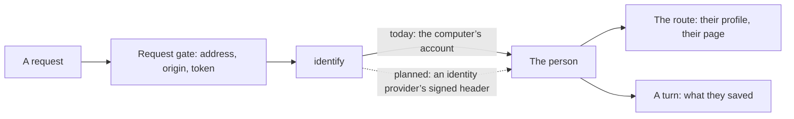

# People: who is asking, and what Postbox keeps of them

Part of [the architecture](../architecture.md). How Postbox knows who a request is from, what a person’s record holds, and what agents are told of them. The request gate it sits behind is in [security-boundaries.md](security-boundaries.md), “This computer alone” and “Writes need the page’s token”.

**Status.** Built for [#558](https://github.com/HJeon139/postbox/issues/558): the seam, the local provider, a person’s record and profile. A second provider, for a Postbox hosted for one trusting team behind a sign-in allow list ([#1733](https://github.com/HJeon139/postbox/issues/1733)), is planned and not built. Direction set by the owner on 23–25 November 2026: preserve the run on your own computer while the hosted one is built, with no shortcut or back door for one over the other, in one system that handles both.

## One seam, and nothing past it asks how Postbox is run

**Decision.** `identify(req)` answers who is asking, as a principal: an issuer, a subject, and the name a person’s record starts from (`server/identity/index.mjs`). The request gate asks it once per request, after its `Host`, `Origin` and token checks. Everything past it reads the person that principal is, never a name from the request’s body, and never which provider answered.

- **`local`, the only provider today:** the account Postbox runs as (`server/identity/unix.mjs`). Nothing is proved beyond what the gate already holds: Postbox listens on 127.0.0.1 and a write carries the page’s token, so whoever reaches it is treated as that account, as before there were people.
- **A provider is a function from a request to a principal,** so another is a module and a line in `PROVIDERS`. A hosted Postbox adds one; it doesn’t add a branch anywhere else.
- **A person is keyed by issuer and subject.** The two together are the only stable key (OpenID Connect Core, [section 5.7](https://openid.net/specs/openid-connect-core-1_0.html#ClaimStability)); a name or an email is a default, never a key.

**What it rests on.** One person on their own computer is not a special case: it is the same record, route and turn as any person’s, with a provider that always gives the same answer. So the local run is exercised by every test of the general path, and a hosted run can’t drift from it.

**No stand-in in production.** A test, the demo and the screenshot tools pass the provider a fixture person through `start()`’s `account` (`tools/fixture-person.mjs`), as they pass a fake host manager or a temp home. There is no environment variable or header that says who is asking.

## A person’s record

**Decision.** Each principal is one person (`server/people.mjs`). Their id comes from the issuer and subject that are them, so it is the same on every request. Their record is kept in the event log, as `state.people`, from the first time they have something to keep: a saved profile, or a message they sent ([#1742](https://github.com/HJeon139/postbox/issues/1742)):

| Field | What it is |
|---|---|
| `identity` | The provider, issuer and subject that are them |
| `username`, `name` | What the provider calls them, as it was when the record was first kept: on this computer, the account’s login and full name. A default they see, in the top bar’s initials and the Profile tab, and can change |
| `unsaved` | Set on a record kept because they sent a message, and gone at their first save. Until then their profile starts from the provider’s name, as it does with no record |
| `profile` | What they saved ([#558](https://github.com/HJeon139/postbox/issues/558)): a name, other names that are theirs and what each is, pronouns, a time zone and preferences (`shared/profile.mjs`) |

**Asking who someone is writes nothing.** Until a person has a record, they are who their provider says they are, with nothing saved, and the page is given that (`config.me`). So loading a page stays a read, on a local run and for a person signing in to a hosted one for the first time, and a store that can’t be written still knows who is asking. Once kept, the record is theirs: a later request reads nothing over it.

- **Agents are told only what a person saved.** The provider’s name for them is kept and shown to them, and is in no turn. A fresh install’s turn is byte for byte what it was before people (`tests/people.test.mjs`), which keeps intent’s principle 7: nothing enters an agent’s context that the person didn’t write or send.
- **The profile adds to what an agent knows; Postbox can’t make one know nothing.** An agent’s harness may know the person anyway, from the workspace’s git user or the computer’s account. In the first real run of the profile scenario (25 November 2026) an agent named the person before any profile was saved, from the workspace’s git user, though Postbox had sent nothing. The name they save is the one that counts. And clearing a field stops Postbox telling agents; an agent that already heard it keeps it for that conversation, since its session is its memory (intent, principle 7), and a new conversation starts clean.
- **What a turn says** is in [rooms-at-scale.md](../rooms-at-scale.md), “What a turn is given”: one part, “About the person, from the profile they saved in Settings (not said in this conversation)”, or with several people who saved a profile, “About the people here, each from the profile they saved in Settings (not said in this conversation)”. The heading says where the words come from, so no agent takes them as said in the room.
- **A person’s message carries who sent it** ([#1742](https://github.com/HJeon139/postbox/issues/1742)): `personId` on the item, set by the server from who is asking once the message has posted, never from the request’s body. A send that is refused keeps nothing. A message no person’s request sent (one typed in a terminal, one from before senders were kept) carries none.
- **The sender reads “The person” while this Postbox knows one person,** byte for byte what it was (`tests/people-sender.test.mjs`): one person is never two things in a turn. **With more than one it reads “The person Robin”:** the name they saved, else their user name, never the provider’s full name (`senderName` in `shared/profile.mjs`). The two words stay in front so no name reads as an agent’s handle or as Postbox. It is in a turn’s entries, the conversation’s lines (`read_conversation`, the tail) and the thread summary’s input. On the page, your own message reads “You” and another person’s has their name.
- **Not yet named:** a person’s answer to a block, a review, a reaction, and the lines Postbox writes about what “the person” did to a card. They read “The person” with any number of people, until the queue for each actor lands.
- **`people` is a public state key** (`shared/state.mjs`, [security-boundaries.md](security-boundaries.md), “What reaches the browser”): every person of a Postbox sees every other’s record. On this computer that is the one person’s own. Hosted for a team it is each member’s, which is intended (the owner, 25 November 2026): a Postbox is one trusting team, and for something private a room has no human members.

**What it costs.** One lookup per request. A data folder written by this version can’t be read by a build from before it, which doesn’t know the `person` event ([running.md](../running.md), “Known limits”).

**What’s next, in order.** The main menu’s People and Members, showing the one person on a local run; people as seats in a room ([#1742](https://github.com/HJeon139/postbox/issues/1742): the sender named when there is more than one, which is built; then an @-mention of a person and their queue as “needs you”); then the hosted provider, which starts only with a sign-in allow list ([#1733](https://github.com/HJeon139/postbox/issues/1733)).

**Revisit when** two accounts share one data folder on one computer: today each is a person, and both see everything.
