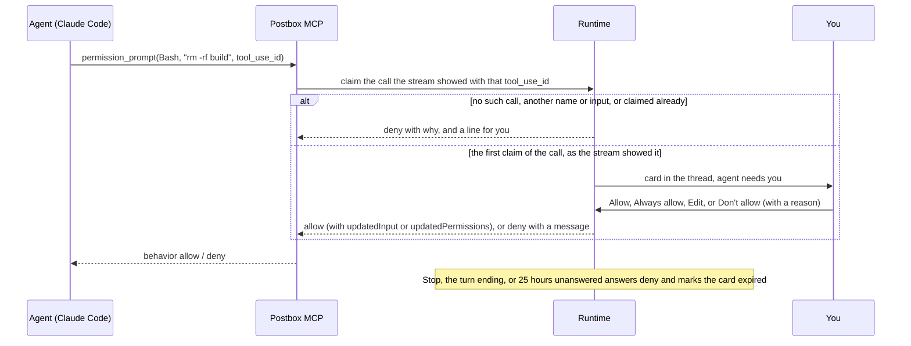
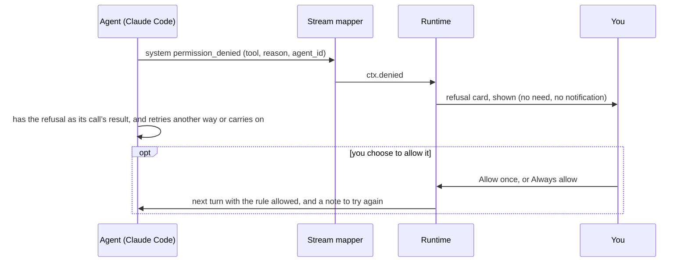

# Permissions: a card in the thread, and an explicit mode

Part of [the architecture](../architecture.md).

**Decision.** Each persona has a permission mode: auto (the default), ask, accept edits, or run everything. Postbox doesn’t judge calls itself: in auto it adds no ask rules of its own (harness first: [agent-setup.md](agent-setup.md), “Writes outside Postbox”, and intent.md’s principle 8), so a card comes only when the harness asks. In auto mode, Claude Code’s classifier approves routine actions and sends what it can’t decide to the same place ask mode does: a card in the thread that shows the exact command, while the call waits for your answer:
- **Claude Code:** through `--permission-prompt-tool`, an MCP tool that doesn’t return until you answer, for up to 25 hours (`POSTBOX_TIMEOUT_MS`, [#217](https://github.com/HJeon139/postbox/issues/217)). That’s the timeout Postbox gives its MCP server, so Claude Code waits that long for the call. The card expires a minute sooner (`CARD_WAIT_MS`, [`server/permission-cards.mjs`](../../server/permission-cards.mjs)), saying how long it waited ([#220](https://github.com/HJeon139/postbox/issues/220)): Claude Code’s clock starts when it sends the call and the card’s only when the call arrives, so with the same length the card could still take an answer after Claude Code had stopped waiting for it. The other real backends (the Agent SDK, Kiro, Codex, Antigravity) declare `capabilities.promptTool: false`: they aren’t offered the tool, and a call to it is refused at once. The backend is the one the turn started on, so a persona moved mid-turn doesn’t cut off the running CLI’s prompts.
- **Agent SDK:** through `canUseTool`. Its card expires at the same time, though the SDK sets no limit of its own.

## A prompt counts only for a call its stream showed

From [#353](https://github.com/HJeon139/postbox/issues/353) and [#665](https://github.com/HJeon139/postbox/issues/665). The turn’s token is in the CLI’s arguments (`--mcp-config`), so a command the agent runs can post `permission_prompt` too, with any tool and input. So before a rule, the write judge and its budget, or a card sees a prompt, [`server/prompt-claim.mjs`](../../server/prompt-claim.mjs) claims the call it names, for the laptop’s prompts and a host’s alike:
- **The binding rule.** Its `tool_use_id` is one the turn’s stream showed as a `tool_use`, the agent’s own or a subagent’s, still without a result; its `tool_name` is that call’s, exactly; its `input` is deep-equal to the call’s, whatever the key order (a recorded Edit’s prompt orders its keys unlike its stream, [`permission-edit-prompts.json`](../../tests/fixtures/claude-code/permission-edit-prompts.json)); and it’s the first claim of that call. Anything else is refused at once with a deny in the CLI’s shape, and the person sees a line that names the stream’s call, never anything the prompt said. The card draws the stream’s name and input, and who asks; the prompt’s `permission_suggestions` are never read, so Always allow is Postbox’s own rule for the stream’s call.
- **The hold.** The CLI can ask before Postbox has read the call’s line, so a prompt for an ID not seen yet waits for that line, at most `PROMPT_CALL_WAIT_MS` (5 s), and at most `PROMPT_HOLDS_MAX` (8) wait in a turn: one more is refused at once. On a host, while the stream is still being read up to where the host has it (a replay after a restart or a reconnect), the 5 s wait starts once the read has caught up, and the wait ends `PROMPT_REPLAY_WAIT_MS` (60 s) after the prompt first came, whatever the read does. A prompt the host ends while it waits gets no card ([`shared/limits.mjs`](../../shared/limits.mjs)).
- **On a host,** the daemon names each prompt itself (its `entry`), and Postbox tells a resend from another prompt by that, never by the shim’s ID. The shim’s prompt IDs are random, and the daemon sends an answer only to the connections of the shim that asked, which it knows by the key in its hello ([remote-hosts.md](remote-hosts.md), “Postbox’s tools on the host: a stdio shim”).
- **Antigravity is exempt** (`capabilities.promptHook`): its prompts come from Postbox’s own PreToolUse hook, with an ID of the hook’s that no stream line carries, so the rule would refuse every one. Its follow-up has the hook pass the ID of the call its stream shows, which needs a recorded hook event.
- **What it leaves:**
  - A PreToolUse hook that rewrites a call’s input, an organization’s managed one included, makes the CLI’s own prompt differ from the call. It fails closed: no card, the call is denied, and the line names the keys that differ.
  - A copy that takes a real call’s ID and input from the transcript, and claims first, gets nothing beyond that call: its card shows exactly the stream’s call. The CLI’s own prompt is then refused, visibly, so the call is denied.
  - A flood that keeps 8 prompts waiting can get a genuine prompt that came before its own line refused at once, visibly.
  - Antigravity’s hook keeps the old path, so #665’s attack still works there until its follow-up.
  - A host on an older Postbox names no entry and sends each answer to every connection of a turn, until it’s installed again with this version.
  - A shim’s key is what tells it from another client of its turn. It’s in no file and no argument: the shim process holds it in memory and sends it only to the daemon, which keeps its hash. But a command the agent runs is the turn’s own user, who can read what that user’s processes and files hold (a debugger, or `/proc` where the system allows it), so one that finds a key can speak as that shim: get its results, end its prompts, or take its IDs. The key keeps out a client that has only the turn’s token, not the same user ([#908](https://github.com/HJeon139/postbox/issues/908)).

## What it rests on

- **The mode is always passed.** Left out, Claude Code would take `permissions.defaultMode` from your own settings, or `auto`, and an agent you set to ask could stop asking.
- **Every permission tool call is a blocking call, and the only one.** All other Postbox tools return at once. A blocked call must always end, so Stop, the end of a turn and the card’s wait (`CARD_WAIT_MS`, a minute short of `POSTBOX_TIMEOUT_MS`) release it with a no.
- **Agents start in their project’s root folder**, as [intent.md](../intent.md) decides, unless the persona names another. Permission mode is what protects that folder: the first live test allowed a command that wrote a file into the sample project’s folder.
- **The card is Postbox’s, not a catalog block.** Your answer goes to the waiting tool call, not to the agent as a message.

## Refusals

Claude Code also refuses calls without asking anyone: auto mode’s classifier, a deny rule, the mode, or a background subagent that can’t ask. It reports each refusal as a `permission_denied` event (with `agent_id` when a subagent was refused), and lists them all in the result’s `permission_denials`. Postbox turns each into a refusal card ([#65](https://github.com/HJeon139/postbox/issues/65)). The card shows what happened; it never makes the agent need you, notifies, or waits for an acknowledgment, because the agent already has the refusal as its tool’s result and retries or works around it (intent.md, principle 8: an alarm you can’t act on is tedium, and a refused call used to pulse “needs you” until the person pressed Leave it, though there was nothing they had to decide). What it offers, if you choose:
- **Allow once and retry:** the exact call (`Bash(rm copy.txt)`) is passed with `--allowedTools`, or the SDK’s `allowedTools`, for the next turn only. The agent is told to try it again exactly as before. A rule that matches a call settles it before auto mode’s classifier runs ([permission modes](https://code.claude.com/docs/en/permission-modes), “How the classifier evaluates actions”; narrow rules such as `Bash(npm test)` stay in effect in auto mode), so this answers most of the classifier’s refusals too. Not all: the same page lists writes to protected paths, critical-path removals and commands with per-command allowed domains as going to the classifier anyway, and `autoMode.classifyAllShell` in your own settings sends every shell command there ([auto mode config](https://code.claude.com/docs/en/auto-mode-config)). Postbox doesn’t detect those yet, so the card still offers Allow once for them.
- **A chained command gets neither** Allow once nor Always allow ([#238](https://github.com/HJeon139/postbox/issues/238)). Claude Code matches each part of `a && b`, `a | b`, `a; b` or `a &` against the rules on its own ([permissions](https://code.claude.com/docs/en/permissions), “Compound commands”), so a rule for the whole line never matches it. Postbox takes a command substitution as a part too, since the same section says deny and ask rules find a command there. A heredoc is read as the shell reads it ([`shared/command-chains.mjs`](../../shared/command-chains.mjs)): its word after quote removal ends the body, which isn’t a part, unless the word is unquoted and the body holds a command substitution, which runs, or a shell on its line runs the body. So are a comment (a quote in it opens nothing), `$''` and a process substitution `<( )`, which runs a command as `$( )` does. The card says so, and suggests asking the agent to run the parts as separate commands. A permission card from the CLI’s prompt tool offers no Always allow for one, for the same reason; the Agent SDK’s own suggestions, which are per part, still go to Always allow. The CLI’s own “don’t ask again” saves a rule per part instead; Postbox doesn’t, since rules for the parts of `echo … | base64 -d | bash` would allow every other line made of them.
- **Always allow:** a broader rule (`Bash(rm:*)`, `WebFetch(domain:example.com)`, built in [`server/permission-rules.mjs`](../../server/permission-rules.mjs)) goes into `.claude/settings.local.json` in the agent’s folder. That’s where the CLI saves “don’t ask again”, so the terminal and Postbox share it.

- **A call you declined isn’t a refusal.** The result’s list includes calls you said no to on a permission card. The prompt tool passes the call’s `tool_use_id`, the card keeps it, and the runtime skips those.
- **A deny rule still wins.** Claude Code checks deny before allow, so Always allow can’t override your own deny rules, and the card says so.

## Answers on a permission card

From [#66](https://github.com/HJeon139/postbox/issues/66) and [#10](https://github.com/HJeon139/postbox/issues/10). The waiting call gets one of four answers:
- **Allow:** `{ behavior: "allow", updatedInput }`, as asked.
- **Always allow:** allow, and keep allowing calls like it. The card says the rule and where it’s saved before you click.
  - The Agent SDK passes Claude Code’s own suggestions (`canUseTool`’s `suggestions`), and they go back as `updatedPermissions`. Rules go to the folder’s local settings: one suggested for the session only would end with the turn, since each Postbox turn is a new session, and one for the project’s shared settings belongs to the person’s team. The card says when it moved one. A mode is offered only for the rest of the turn, never saved as a default. When the SDK sends no suggestions, or says a saved rule would grant more than the call (`suppressAlwaysAllowRule`), there’s no Always allow.
  - The CLI’s prompt tool gets no suggestions and no agent id: a real turn recorded only `tool_name`, `input` and `tool_use_id`, for the agent’s call and for a subagent’s ([`permission-prompts.json`](../../tests/fixtures/claude-code/permission-prompts.json)). So Postbox makes the rule as it does for a refusal ([`server/permission-rules.mjs`](../../server/permission-rules.mjs)) and saves it in `.claude/settings.local.json` itself. Any suggestions a prompt carries are ignored, since a copy of the CLI’s prompt could carry any (“A prompt counts only for a call its stream showed”, above). A rule too long to keep (a command with a heredoc only ever gets its exact text) isn’t offered.
  - **On a host** ([#120](https://github.com/HJeon139/postbox/issues/120)), where with harness first a card comes only when the host’s Claude Code itself asks, Always allow offers the same rule, but Postbox saves it in its own store, for that persona on that host, and sends it in each later host turn’s `--settings` as an allow rule ([`server/host-rules.mjs`](../../server/host-rules.mjs)): nothing is written on the host or in the folder here, a local turn and another host never get it, and the permissions panel lists it with its host and removes it. A refusal card on a host still offers Allow once only.
- **Edit:** allow with the input you changed, as `updatedInput`: the command for Bash, with the call’s other fields kept, else the input’s JSON, which has to parse. An input too large to keep on the card (16,000 characters) can’t be edited, only allowed as it is. The recorded turn ran the edited command.
- **Don’t allow:** `{ behavior: "deny", message }`, with your reason in the message, when you give one.

A subagent’s prompt names the subagent. The SDK passes its id (`agentID`, the task’s id, as a refusal’s `agent_id`); the CLI passes only the call’s id, but the subagent’s `tool_use` streams before its prompt arrives, so the stream mapper already knows who made the call.

## The permissions panel

The panel shows one agent in one conversation: its mode, its rules, its folders and its MCP servers. It’s reached from the conversation’s ⋯ and the persona editor.
- **Rules** come from where Claude Code reads them, each with its source: the person’s user settings (only when the persona loads their setup), the project’s shared `.claude/settings.json` (shown, never written), the folder’s `.claude/settings.local.json`, this conversation, and the persona’s Tools (#5) as deny rules. So a rule made in the panel shows in the CLI’s `/permissions`, and the reverse.
- **Saving:** in the folder’s local settings by default, as the CLI saves “don’t ask again”; or for this conversation only, kept on the session and passed with every turn (allow as `--allowedTools`, deny as `--disallowedTools`, ask in the `--settings` overlay’s `permissions.ask`); or in the person’s user settings. Changes to one file run one at a time, and each is written atomically, beside the real file: a settings file that’s a link stays a link. One that isn’t valid JSON is named and left alone. User settings follow `CLAUDE_CONFIG_DIR`, as Claude Code’s do.
- **Folders** added for a conversation go to `--add-dir` (the SDK’s `additionalDirectories`) from the next turn.
- **The mode** is the persona’s, so it reaches running conversations from their next turn, as [intent.md](../intent.md) says. On an Agent SDK turn that’s running, Postbox also tries the query’s `setPermissionMode`; the SDK documents it for streaming input only, and Postbox sends one prompt string, so the panel says whether it applied now.
- **Which rule decides** a typed call is answered in Claude Code’s order: deny, then ask, then allow, then the mode, with the rule forms Claude Code documents ([`shared/permission-match.mjs`](../../shared/permission-match.mjs)). The panel says Claude Code has the final say: hooks, managed settings and its own checks aren’t modeled.

**Revisit when** the CLI’s stream carries a call’s suggestions (then the CLI’s cards can use them too; a prompt’s own can’t be trusted), Antigravity’s hook can name the call its stream shows, or Postbox runs SDK turns with streaming input, so the mode and rules can change during a turn.
