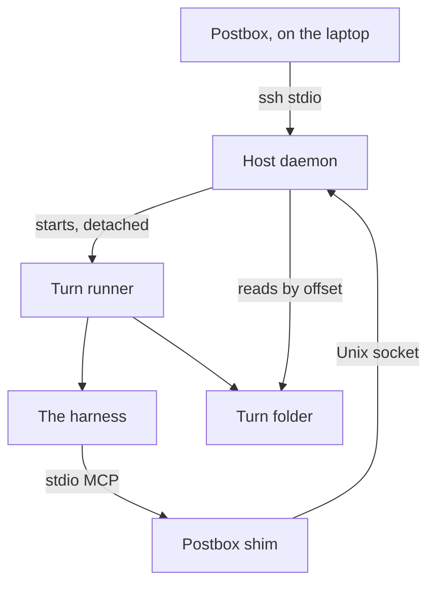
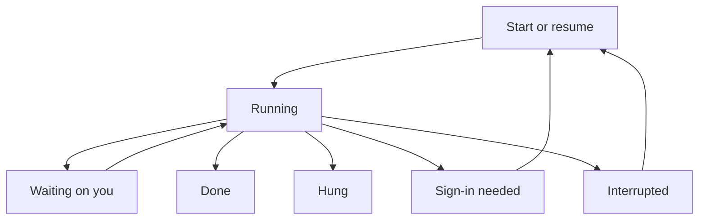
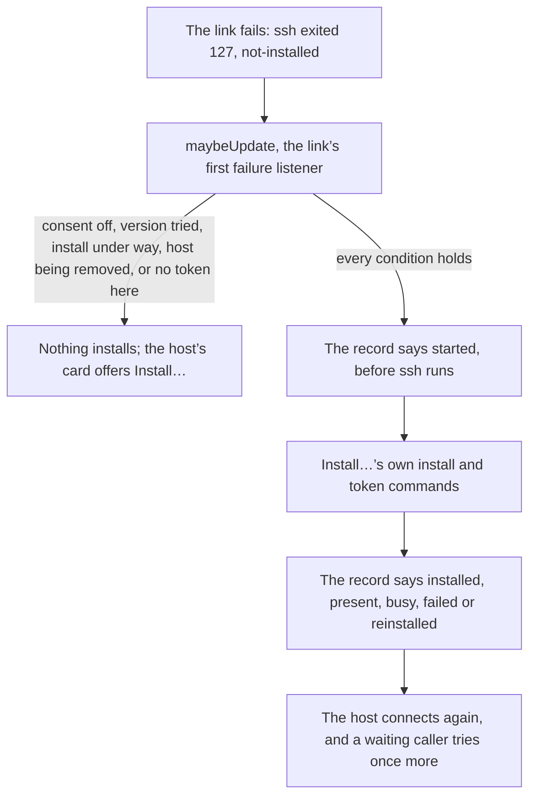

# Remote hosts

Part of [the architecture](../architecture.md).

**Status:** built, for [#120](https://github.com/HJeon139/postbox/issues/120), and run end to end with only `ssh` replaced (“What the tests show”, below). What only a real host can show is in “Still to confirm”. It condenses [the design](https://github.com/HJeon139/postbox/issues/120#issuecomment-6371251024), corrected by [the check against the official docs](https://github.com/HJeon139/postbox/issues/120#issuecomment-6371712349), and rests on [probes on real hosts](https://github.com/HJeon139/postbox/issues/120#issuecomment-6368886246). Where a number is still being measured, “Still to confirm” below says so.

**Decision.** An agent’s turns can run on another machine, a host reached with the person’s own `ssh`, while Postbox stays on the laptop. Only the agent’s process moves. The first version supports Linux hosts: it needs `/proc` and the boot ID, and uses a systemd user scope only where logind kills a user’s processes at logout. It covers the Claude Code, Kiro CLI and Codex backends.

- **Postbox** drives one daemon per host, over the stdio of an `ssh` it starts itself. The adapters stay on the laptop.
- **The daemon** starts turns, serves the shim, and hands Postbox everything it missed.
- **A runner per turn** owns the harness’s process, keeps its output in a file, and records how it ended. It doesn’t need the daemon.
- **The shim** is Postbox’s MCP server on the host, over stdio, one per turn.

**The adapters stay; only the process moves.**
- **A remote process** takes `spawn`’s place: an object with the same `stdin`, `stdout`, `kill` and exit events, backed by the daemon. The stream mappers don’t change, and the adapters build their arguments as they do today, except where they name Postbox’s server or a folder.
- **It has no local process ID.** `stopTurn` and `signalGroup` in [`server/adapters/process-group.mjs`](../../server/adapters/process-group.mjs) signal `-child.pid` and read the laptop’s `ps`, and a host’s process ID there would stop an unrelated local process group. So a remote process leaves `pid` unset and marks itself remote, its `kill` sends the daemon’s `stop`, and `stopTurn` has a remote branch that never calls the local `kill` or `ps`.
- **Only chosen variables move.** The harness gets the daemon’s environment on the host plus the variables the adapter sets on purpose, which its `capabilities.remote` names (such as `KIRO_HOME`), never the laptop’s environment.
- **A folder on the host:** the project’s folder for that host, set per host in Projects, else `~/postbox-work/<handle>`. It must be an absolute path.
- **The laptop sleeps:** on wake, the remote process reconnects and feeds lines from the last offset it delivered; the adapter sees a pause. **Postbox restarts:** the runtime finds the turn still running, starts a fresh mapper and replays `out.jsonl` from the start, replacing the partial reply. Codex also rebuilds its thread ID, turn ID, next request ID and unanswered requests from `out.jsonl` and `in.jsonl`, or the turn shows as Interrupted.
- **The work ledger** keeps what it reads from the stream (commands, commits, pushes, effort). Files on the host aren’t recorded, and the Work view says so.
- **A host in the agents list is a badge** of up to 8 characters, since an SSH destination can fill the row: the short name the person gives the host in its settings, or else the start of its machine’s name ([`shared/host-badge.mjs`](../../shared/host-badge.mjs)). The connection shows beside it in words only when it isn’t Connected. The whole line, with the destination and when Postbox last heard from the host, is in the badge’s tooltip, in what a screen reader hears, and in the agent’s panel.
- **Not covered:** the Agent SDK backend runs `query()` inside Postbox’s process, so it can’t move; Antigravity CLI waits until it can be tested on a host.
- **A backend can be on the host alone.** Claude Code, Kiro CLI and Codex are registered even when their CLI isn’t on the laptop, marked as running only on a host ([`server/index.mjs`](../../server/index.mjs)), so an agent can run them there. A persona on this computer still needs its CLI here, and a host is refused for a persona whose CLI that host’s daemon didn’t find, naming where it looked.
- **Each adapter says how it runs remotely** in `capabilities.remote`, beside its other capabilities ([#117](https://github.com/HJeon139/postbox/issues/117)):

| | Claude Code | Kiro CLI | Codex |
|---|---|---|---|
| Process per turn | `claude -p`, stream-json | `kiro-cli chat --output-format stream-json` | `codex app-server --listen stdio://`, JSON-RPC |
| stdin | A file: one message, then end of file | None: the message is the last argument, after `--` | Held: a pipe the runner keeps open until `turn/completed` |
| Postbox’s server | `--mcp-config`, as `stdio` | The custom agent file’s `mcpServers` | `-c mcp_servers.postbox.*` |
| Permission prompts | The shim’s `permission_prompt` | None headless ([#136](https://github.com/HJeon139/postbox/issues/136)) | JSON-RPC requests, answered on stdin |
| Resume | `--resume <session>` | `--resume-id <session>` | `thread/resume` |
| Sign of work while quiet | `tool_progress` every 30 s | An open `tool_call`; stdout is silent | The model’s checks on a background command, about every 5 min |
| Sign-in error | `authentication_failed` | Not recorded | Not recorded |

**A turn doesn’t depend on anything staying connected.** The daemon starts each turn as a runner in its own session (`spawn` with `detached: true`, which makes the child “the leader of a new process group and session”, per [Node’s `child_process`](https://nodejs.org/docs/latest-v22.x/api/child_process.html); a new session “has no controlling terminal”, per [setsid(2)](https://man7.org/linux/man-pages/man2/setsid.2.html)). The runner starts the harness from the adapter’s argument list, never a command string, appends its stdout to `out.jsonl` and its stderr to `err.log`, and writes `exit.json` (code, signal, time) when it exits. It also listens on a Unix socket in the turn folder, which answers liveness checks with its turn ID and, for Codex, takes the lines for the held stdin, appending each to `in.jsonl`. The daemon can restart or crash and the SSH connection can drop while a turn runs.
- **Where logind kills at logout** (`KillUserProcesses=yes`, the upstream default per [logind.conf(5)](https://www.freedesktop.org/software/systemd/man/latest/logind.conf.html)), the runner also goes into a systemd user scope (`systemd-run --user --scope`). Without lingering, that scope still ends at the last logout: “After the user logs out of the last session, `user@.service` and all services underneath it are terminated” ([systemd-run(1)](https://www.freedesktop.org/software/systemd/man/latest/systemd-run.html)). So the daemon checks for lingering and, without it, says turns end with the person’s last session and how to turn it on. [loginctl(1)](https://www.freedesktop.org/software/systemd/man/latest/loginctl.html) doesn’t list `Linger` as a `show-user` property, so the command is checked on a real host first.
- **Kiro’s message goes on stdin.** Kiro CLI 2.34.x reads a non-interactive message from stdin, including with `--resume-id`, so a remote turn writes it to the turn’s temporary stdin file instead of putting it in the process arguments. This removes the 128 KiB per-argument limit and keeps other users on the host from reading the message in `/proc/<pid>/cmdline`.
- **No cap on a turn in flight.** A turn ends when it finishes, when the person stops it, or when it’s judged hung.

**The daemon.** A small Node program in `~/.postbox-remote/<version>/`, run as the SSH user, never as root.
- **Started by Postbox, never by login scripts.** The command line is fixed (`ssh <host> ~/.postbox-remote/<version>/server/remote/host/host attach`), and everything else goes as JSON on stdin, so the login shell never parses a prompt, a path or a setting. `host` is a `/bin/sh` launcher, not a Node script, because a non-interactive `ssh` often skips the profile that puts nvm’s or mise’s `node` on `PATH`: it takes the first Node 22 or later from the host’s `nodePath` (written at install as `node-path`), `PATH`, nvm, mise, Volta, `/usr/local/bin` and `/usr/bin`, and with none it answers with the `no-node` error, naming where it looked.
- **One daemon per version.** Each `host attach` is only a relay between the SSH channel and the daemon’s Unix socket: the daemon outlives the attach, and sshd keeps a session open while the channel’s output is open, so a daemon holding it would keep Postbox’s `ssh` open after it dropped. With no daemon answering, the attach takes the version’s start lock and starts `host serve` detached, which logs to `daemon.log` in the version’s folder and holds `daemon.pid` (its process ID, boot ID and start time) for its life. The start lock is `~/.postbox-remote/locks/<version>.lock`, outside the version’s folder, because the installer holds the same lock while it checks and replaces that folder, which it renames into place. It holds its owner’s record and is broken only once that owner is gone, never for its age alone.
- **Finding programs.** It looks for `node` (22 or later), `claude`, `kiro-cli` and `codex` in the configured paths, then the usual per-user install folders, and reports what it found and where it looked. It also reports `claude`’s version: the MCP timeout behavior below depends on it, and the repo pins only the Agent SDK.
- **One writer** at a time; a second Postbox gets a clear message and can take over.
- **Its own lifetime.** It exits after `idleTimeout` with no turn running and no client attached. Postbox closes its own session 2 minutes after nothing needs the host, so back-to-back turns share one. A runner never waits for it.
- **Restart from disk.** It scans the turn folders: `exit.json` is finished, a turn that `turnRunning` finds running is running, and one that’s neither is interrupted. A turn is running if its runner’s socket answers with its turn’s ID, or, while it doesn’t, if `runner.json` still names a live process of this boot and the silence is shorter than `RUNNER_SILENT_MAX_MS` (60 s, on the daemon’s monotonic clock), so a runner stopped or starved for a moment isn’t ended while its agent still runs ([#738](https://github.com/HJeon139/postbox/issues/738)). At the ceiling its group and its tool shells’ groups are sent SIGKILL, as Stop’s, and the turn ends as interrupted once its process is gone, so the laptop resumes it alone; one still there `KILL_WAIT_MS` (5 s) later ends anyway, with `unkilled: true` on `ended` and on its turn in the scan’s `welcome`, and the laptop leaves its resume to the person ([#872](https://github.com/HJeon139/postbox/issues/872)). During a silence a process check stands for `PROCESS_CHECK_MS` (5 s), since on macOS each one runs `sysctl` and `ps` and holds up the daemon; the ceiling’s decision takes a fresh one. The silence’s start is kept in the turn folder (`silence.json`: the runner’s PID, the boot ID and the wall-clock time), so a daemon restarted on the same boot, with the same runner, goes on from it, and one restarted again and again still reaches the ceiling; on another boot it starts over. The follower uses the same rule, and ends a turn at its second miss in a row, or at once if Stop found its process gone. It signals a process group only when the recorded process ID, boot ID and start time all still match, since a process ID alone can belong to another process after a reboot. A process that has exited and waits only to be reaped (state `Z` in `/proc/<pid>/stat`) counts as gone: in a container whose first process doesn’t reap, a killed daemon stays a zombie for good, and counting it as alive would stop a new one from ever starting.
- **Version skew.** A new Postbox installs its version beside the old one, and the old daemon retires when its turns are done. `hello` carries the protocol’s version, an integer (3), not Postbox’s package version, which names the code folder; a mismatch is the `version` error, and the person is told to install this Postbox’s version. The remote read contract ([#530](https://github.com/HJeon139/postbox/issues/530)) raised the protocol to 3, one version at a time, so a host on protocol 2 is unavailable from Postbox’s update until the host updates; a host the person opted in to gets the new version by itself (“Keeping a host up to date”, below).

**Postbox and the daemon** speak JSON lines over the SSH channel’s stdio. No socket is forwarded and no port opened on either machine.

| From Postbox | Does |
|---|---|
| `hello { version, token, settings, instance?, takeover? }` | Checks the daemon’s token (a `0600` file) and the protocol version, and passes the settings the host enforces. `takeover` replaces another Postbox, which is otherwise refused as `busy`. `instance` is the Postbox’s own name for itself, kept in its data folder (`remote-instance`, `0600`): a hello with the driver’s replaces that connection without `takeover`, since it’s the same Postbox back after its ssh died before the host noticed |
| `snapshot`, `snapshot-items` | The conversation the reading tools answer from while offline: the whole of it before `start`, then what changed |
| `start { turn, harness, folder, argv, env, stdin, files, agentFile?, attachments? }` | Writes the turn folder and its files, then starts the runner. `attachments` are the files the person attached to the message, as base64, written to `attachments/<name>` in the turn folder, since the agent can’t read a path on the laptop; the message names those copies. At most 16, 3 MiB each and 3.5 MiB in all (decoded), so a start at every limit still fits in one 16 MiB line; Postbox refuses a message over one before the turn starts |
| `read { turn, from }` | Sends `out.jsonl` lines from that byte offset, then follows new ones |
| `write { turn, line }` | A line for a held stdin |
| `answer { turn, prompt, result }` | Answers a permission prompt waiting in the shim. A prompt’s identity is its turn and its ID, since each turn’s shim picks its own IDs; the daemon also names each one (`entry`), which is what Postbox tells a resend from another prompt by ([#353](https://github.com/HJeon139/postbox/issues/353)) |
| `reply { turn, id, ok, text }` | Answers a tool call the daemon passed on, such as `search_assets` |
| `check` | Runs the host’s `signInCheck`, as an argument list with no shell |
| `stop { turn }` | SIGINT to the turn’s process group, then SIGKILL after a grace period, once the runner is matched. For Codex, `turn/interrupt` first |
| `ack { turn, upTo }` | Postbox has applied lines up to that offset |
| `remove` | Stops everything and deletes `~/.postbox-remote`. If a runner is still alive after Stop’s grace period and a further wait, it deletes nothing and says so: deleting its records and the token would leave it running with nothing on either machine able to stop it |

The daemon sends back stream lines with their offsets, turn endings, queued tool calls and waiting prompts. A line’s offset is its identity, so on reconnect Postbox asks for everything after the last one it applied, and applies each once.

**Stop sends SIGINT.** “To end the turn instead, send SIGINT”; SIGTERM exits with code 143 and records no result for the turn ([headless](https://code.claude.com/docs/en/headless)). The shim is stopped the way the MCP spec stops a stdio server: close its input, then SIGTERM, then SIGKILL ([lifecycle](https://modelcontextprotocol.io/specification/2025-06-18/basic/lifecycle)). Two Claude Code Stop features are declined for remote turns in the first version:
- **Keeping background jobs on Stop** ([#164](https://github.com/HJeon139/postbox/issues/164), `keepJobs`) isn’t offered: a remote turn’s Stop is always a plain stop, and the Stop control says the host’s background jobs stop with the turn, before you stop. If `keepJobs` reaches the adapter for a remote turn anyway, it reports each job as stopped, not kept.
- **A background job’s own Stop** (`stopJobUnder`) isn’t offered for a remote turn.

**Postbox’s tools on the host: a stdio shim.** One stdio MCP server, `postbox`, a script the daemon ships. It serves exactly the laptop’s tools and limits, speaks JSON to the daemon over a Unix socket in a `0700` folder, and carries the turn’s token, so a call from a stopped turn is refused, as on the laptop ([#126](https://github.com/HJeon139/postbox/issues/126)). Host code imports only `node:` modules and `shared/`, because it ships without the server.
- **Why stdio.** HTTP MCP over a Unix socket didn’t load in Claude Code in any form the probes tried, and a TCP port is ruled out (below). All three harnesses loaded a stdio shim.
- **`server/discover`** gets “method not found”, so Kiro CLI falls back to `initialize` at once.
- **UI tools return once the host has taken them.** The daemon validates each with `shared/catalog.mjs`, records it and queues it, so a block shown while the laptop sleeps appears on reconnect. The call waits only for the daemon, not for Postbox: a refusal on the host returns as the tool’s error, and Postbox tells the agent of its own refusal at its next turn (#827). `schedule_wake`, `cancel_wake` and `wake_agent` don’t: each waits for Postbox’s answer (`ask`), since a scheduled wake’s answer carries the id `cancel_wake` takes (#458), and Postbox may send a wake, hold it on a card or refuse it, and only its answer says which (#439).
- **`bring_to_conversation` is listed where the laptop lists it:** only for a turn the person started in a side or topic thread, which the runtime tells the shim with `--bring`. Whether it may post depends on the thread and the turn, which only Postbox knows, so a call waits for Postbox’s answer (`ask`), as `search_assets` does, `review_block` (#133), whose comments go on a review block only Postbox has, and `open_topic` (#637), whose answer carries the topic thread’s id, which only Postbox has.
- **Reading tools ask Postbox while it is attached, and answer from a snapshot if it goes away or is slow.** The snapshot is the conversation as Postbox gave the daemon at turn start, kept current. A read that Postbox has not answered in 100 s, or that is open when the link drops, is answered from it at once, with a note that newer items may be missing; the 100 s keeps the answer inside the 120 s after which Kiro gives up a call (#582). The asset tools, `search_assets` among them, go to Postbox when it’s connected, and otherwise return an error that says so.
- **It reconnects** if the daemon restarts, so a waiting prompt survives that.
- **A prompt’s answer goes only to the shim that asked it** ([#353](https://github.com/HJeon139/postbox/issues/353)). Any client with the turn’s token can connect as one of its shims, so a prompt’s ID is random, and each hello carries the shim process’s own random key, the same on each reconnect. The daemon keeps, for each prompt, the connections that sent it, and sends its answer to those alone; another key asking the same is refused. `prompts.jsonl` keeps the key’s SHA-256, never the key, and a record an older daemon wrote, with none, goes to the first shim that sends it again.
- **A call’s result goes only to the shim that made it, and only that shim can end its prompt** ([#908](https://github.com/HJeon139/postbox/issues/908)). Each call records its shim’s key hash, in `tools.jsonl` too, and its result, live or read from the snapshot, goes to each connection with that key, so a shim that reconnected gets it without asking again; another key sending its ID is refused with none of it. A call an older daemon wrote down goes to the first shim that sends it again, and that take is written down. An expiry or cancel notice from another key gets exactly the reply an unknown ID gets, and changes nothing, nor does one for a prompt the person already answered. A hello with no key is refused (`version`): a shim reaches only its own version’s daemon, so only older code or a client hiding which shim it is sends one. Call IDs are random, as prompt IDs are, so none can be guessed and claimed first.
- **Resumes pass it again.** `--mcp-config` and `--settings` aren’t restored on `--resume` ([sessions](https://code.claude.com/docs/en/sessions)), so every turn passes them, as the local adapter already does.

**Permission prompts while nobody is connected.** A prompt never auto-approves because nobody is connected. The host enforces `permissionWaitMax`, since the laptop may be asleep when it runs out: the shim (Claude Code) or the daemon through the held stdin (Codex) denies, and records the expiry, which the card shows on reconnect. Kiro CLI refuses headless and has nothing to wait on.
- **Claude Code: the per-server `timeout` is the mechanism.** By the [MCP docs](https://code.claude.com/docs/en/mcp), it “is a hard wall-clock limit per tool call, and progress notifications from the server don’t extend it”, and a value of at least 1000 ms also sets a floor under the idle window. The idle window is 5 minutes for HTTP servers and 30 minutes for stdio, adjustable with `CLAUDE_CODE_MCP_TOOL_IDLE_TIMEOUT` from v2.1.187; the default wall-clock limit is about 28 hours ([environment variables](https://code.claude.com/docs/en/env-vars)). An HTTP server also has a per-request timer to its first response byte, 60 seconds unless the server’s `timeout` or `MCP_TIMEOUT` is greater (MCP docs, “Time limits on MCP tool calls”). The shim is stdio, so that timer doesn’t apply to it. So the shim’s `timeout` is `permissionWaitMax` plus a margin, and the adapter refuses a `claude` older than that behavior needs, naming the version it found.
- **Progress is a backup** for the idle window: a notification every 60 seconds while a prompt waits, with a `progress` value that increases every time, as the [MCP spec](https://modelcontextprotocol.io/specification/2025-06-18/basic/utilities/progress) requires.
- **Codex** writes its approval requests to stdout, so they’re in `out.jsonl` when Postbox reconnects, and the answer goes through the held stdin. The app-server sent nothing while a probe waited 45 minutes.
- **The control channel stays in reserve, undocumented.** `--permission-prompt-tool stdio` (a `can_use_tool` request on stdout, the answer on stdin) passed a 45-minute wait, but the [CLI reference](https://code.claude.com/docs/en/cli-reference) documents the flag only as taking an MCP tool name, so it could change in any release. It’s used only if the 24-hour wait over the shim fails.
- **The laptop first.** Postbox’s own HTTP server set no `timeout` and sends no progress, so a card left unanswered failed for local Claude Code CLI agents. A repro with Claude Code 2.1.308 measured the cut-off at 60 seconds, the per-request timer above, not the 5-minute idle window: the agent got “The operation timed out”. Postbox now sets the server’s `timeout` to 25 hours in `--mcp-config`, which raises both limits.

**Turn states.**

| State | How the daemon knows | What the person sees |
|---|---|---|
| Running | The runner is alive and the turn isn’t hung | The agent’s ring, with the host and when it was last heard from |
| Waiting on you | A prompt is pending in the shim, or a Codex request has no answer | The permission card, on reconnect if it came while disconnected |
| Hung | No stdout event for `stallTimeout`, no prompt pending, no tool call open | “Stopped: no output for 15 min”, with the last event’s time |
| Sign-in needed | The harness’s sign-in error | “Sign-in needed on <host>”, and Resume |
| Interrupted | Neither a live runner nor `exit.json`, such as after a reboot, or a runner silent past 60 s that the daemon killed. If its process was still there 5 s after the kill (`unkilled`), it may still be running | “Interrupted on <host>”, and Resume; after `unkilled`, only the person’s Resume |
| Done | `exit.json`, and the harness’s end of turn | The reply, as today |

- **Hung, not quiet.** Stdout is the signal, judged by each adapter’s sign of work (the table above). An open tool call counts as work. A Claude Code endpoint that never answers gets an `api_retry` about every 6 minutes, so `stallTimeout` stays well above that. A hung turn is stopped with SIGINT, then SIGKILL.
- **Resuming says why.** A resume after Sign-in needed or Interrupted starts with a line telling the agent its last turn stopped and why; without it, a resumed agent assumed the new message had interrupted it.
- **Sign-in stays the host’s.** Postbox never moves a credential. An expired Claude Code sign-in ends the turn at its next model request with `error: authentication_failed`. An optional per-host `signInCheck` command warns before a turn that would outlive the sign-in.

**The SSH connection.** Postbox starts its own `ssh` with `-o BatchMode=yes -o ControlPath=none -o ForwardAgent=no -o ServerAliveInterval=15 -o ServerAliveCountMax=3`, and `-o ClearAllForwardings=yes -o ForwardX11=no -o ForwardX11Trusted=no -o PermitLocalCommand=no -o Tunnel=no -o StrictHostKeyChecking=yes` (`HARDENING` in `server/remote/ssh-args.mjs`). The person’s `~/.ssh/config` supplies the rest (`ProxyJump`, certificates, known hosts), since command-line options take precedence ([ssh_config(5)](https://man.openbsd.org/ssh_config)).
- **Nothing from the config opens a way back.** A `RemoteForward` to Postbox’s port, a `LocalForward` or `DynamicForward` listener, X11, a `LocalCommand` or a tunnel would each break “One way only” and “No new listeners” (below), so the command line turns them off, and `ClearAllForwardings` drops the config’s forwards. A host key must be known and unchanged even where the config says `StrictHostKeyChecking no`, which BatchMode alone doesn’t stop, since the hello hands over the daemon’s token.
- **Its own connection,** because on a multiplexed connection the leader’s port forwards stay open and its host key was checked as it was opened; the session still sends its own agent and X11 choices (openssh-portable’s `mux.c`). `ControlPath none` turns sharing off.
- **It never asks.** `BatchMode=yes` turns off password and host-key prompts, so `ssh` fails instead of waiting forever. Postbox tells a sign-in failure (“Sign in to <host>”, with the command to run in a terminal) from a host key it doesn’t know (the command to connect once and check the key).
- **Keepalives of 15 s × 3** drop a dead connection “after approximately 45 seconds” (same source). Postbox reconnects with backoff while a remote turn runs or a prompt waits.
- **`!` commands stay local** ([#67](https://github.com/HJeon139/postbox/issues/67)), in the project’s folder on the laptop, and their output says they didn’t run on the host.

**Security.**
- **No new listeners,** on Postbox’s own connection (`dedicatedConnection`, the default). Nothing listens on TCP on either machine. The only sockets are the daemon’s and the runners’ Unix sockets, in `0700` folders, created `0600`.
- **One way only,** likewise. Postbox calls the daemon; nothing on the host gets a route to Postbox’s API on the laptop, so there’s no reverse forward to `127.0.0.1:4173`, and “Writes need the page’s token” still holds. With `dedicatedConnection` off, the session shares the person’s multiplexed connection, whose port forwards stay open (above): that mode gives up these two guarantees, by the person’s choice, and the setting’s help says so.
- **A token per daemon,** required on every connection from Postbox and the runners, and **a token per turn** for its shims: the daemon writes it in the turn’s folder as the turn starts, and takes no other from a shim, so one turn’s shim can’t speak for another’s.
- **The boundary is the host’s OS user.** The socket and file modes (`0700` folders, `0600` files, and the launcher `0700`) limit access to the user Postbox signs in as. Within that, the token keeps out accidental connections and other users’ processes, but not another process already running as the same user, which can read `~/.postbox-remote/token` as easily as the daemon can.
- **The laptop’s environment and credentials stay,** and agent forwarding is off by default. Turned on, it copies no private key, but while Postbox is connected any process running as the person on the host, the agent and its commands included, can use the laptop’s ssh agent to sign in elsewhere ([ssh_config(5)](https://man.openbsd.org/ssh_config): “Agent forwarding should be enabled with caution”).
- **No shell strings.** The SSH command line is fixed, argument lists and files go as JSON, and the runner starts the harness without a shell.
- **What the host keeps:** each turn’s message, attachments, conversation snapshot and logs, in a `0700` folder of `0600` files. A Kiro message is still visible through its arguments (above).

**Keeping a host up to date** ([#464](https://github.com/HJeon139/postbox/issues/464)). Postbox always runs its own version’s launcher on the host, so after the person upgrades Postbox a host has only the older version, and the next attach exits 127, `not-installed`, which doesn’t retry. A host the person opted in to gets this Postbox’s version by itself, once per version, and connects again; nothing installs on any other host. Turns started under the old version, and a fallback for hosts without the consent (#732), are their own issues.

- **The consent** is `keepUpdated` in the host’s record on this computer, set only through `PUT /api/hosts/:id/keep-updated` with exactly `{ on: true }` or `{ on: false }`, from the host editor’s “Keep Postbox up to date on this host”. It isn’t in the host’s settings: `checkHostSettings` refuses a key it doesn’t know, so a new setting would make an older Postbox, after a rollback, throw on every attach to that host.
- **The rule** (`maybeUpdate`, `server/remote/hosts-update.mjs`) is the first failure listener of a host’s link. It installs only for exit status 127, never for a `version` mismatch or a 126, and only with the consent on, this version not yet tried, no install of the host under way, the host not being removed and a token on this computer. It is synchronous until the install is in `m.updating`, so a caller that hears the same failure finds it there, and it never throws, so the link still reaches `stopped`.
- **The record** is one file per host, `<data folder>/remote-installs/<host id>`, `0600` in a `0700` folder, written to a temporary file and renamed, holding the consent and the 16 newest tries. A try is written `started` before ssh runs, then rewritten with how it ended; with no record, nothing installs. A version is tried when the newest try is that version’s, so one version installs once however often its folder disappears, and a rollback and back installs it once more. The read fails closed: a file over 8 KB, a link, or any other shape is no consent. Each host’s writes go through one promise chain, so the consent and an install’s notes never overwrite each other.
- **The same install as the button.** An automatic install runs Install…’s own commands, manifest check and per-version lock, and shares `m.updating` with it, so one runs at a time per host. It adds only its own version’s folder, so a downgrade works too, and removing other versions stays with the host’s cleanup. Exit 75, another attach or install holding the lock, is `busy`, and the host connects once more.
- **The waiting caller.** Every caller that needs the host goes through `ensureWelcome` (`server/remote/hosts-links.mjs`). While an install runs it waits, at most the install’s and the token step’s timeouts, then tries once more, so the turn that found the version missing runs on it. The turn’s status says “Installing Postbox <version> on <host>…”; a failed install shows the installer’s own reason and next step, with Install….
- **A reinstall with a new token.** When `~/.postbox-remote` is gone but this computer still has a token, the install makes a new token and notes `reinstalled`, and for a day, while the host is connected, its card says turns that ran there before are gone. It never shows the token.
- **Who can start one.** Only the page changes the consent: its route needs the page’s token, and no MCP tool edits hosts. The consent is kept only on this computer and never sent to the host (`helloSettings` builds only from the settings). The server starts an install only from an ssh exit status it saw itself, but anything with a shell on the host, an agent there included, can cause one: removing `~/.postbox-remote/<version>` makes the next attach exit 127, and removing `~/.postbox-remote` causes a reinstall with a new token. That harm is bounded: only this Postbox’s own checked code, at most once per version, and something with a shell there can already do far more.
- **Closing and removing.** Closing Postbox aborts every install and leaves its record `started`, so the next Postbox doesn’t try that version again by itself. Remove waits for an install under way, and `forget()` drops the host’s record with its token.

**Files and cleanup.** An idle agent holds no process; the next turn resumes the harness’s session. A turn’s logs are deleted once it has ended and Postbox has acknowledged all of it, after `logRetention` regardless, and at a size cap. The message, its attachments, the snapshot and a Kiro agent file go when the turn ends. Each harness’s own sessions stay; a Claude Code transcript past `cleanupPeriodDays` (30 days by default, per [sessions](https://code.claude.com/docs/en/sessions)) makes the next turn start over once and say so. “Remove Postbox from host” stops the daemon and its turns and deletes `~/.postbox-remote`, and only then does the laptop forget the host and its token; until the host confirms, the removal is refused and both stay, so it can be tried again. Deleting a conversation stops its remote turns.

**Settings,** per host:

| Setting | Default | Change it when |
|---|---|---|
| `stallTimeout` | 15 min | Tools or models stay quiet for longer |
| `permissionWaitMax` | 24 h | A waiting turn shouldn’t hold the host that long, or should wait longer |
| `idleTimeout` | 30 min | A resident daemon is unwelcome, or cheap |
| `logRetention`, `logMaxBytes` | 7 days, and 256 MiB a log | The host is short of disk |
| `keepAlive` | 15 s × 3 | The network drops keepalives |
| `dedicatedConnection` | on | The person needs their multiplexed connection, such as a jump host they can’t reopen |
| `forwardAgent` | off | Turns must reach other hosts with the person’s keys |
| `nodePath`, `claudePath`, `kiroPath`, `codexPath` | detect | Installs in unusual places |
| `detach` | own session, plus a user scope where logind kills at logout | Hosts without systemd |
| `signInCheck` | none | The host’s sign-in expires on a schedule |
| `denyPrompts` | off | Turns run unattended: Claude Code denies what it would ask about (`--permission-prompts none`) instead of waiting |

**What the tests show.** `npm run test:integration`, the last step of `npm run check`, runs the host’s programs as real processes in a temporary home folder, over pipes and Unix sockets, never the network. Where a test stands in for `ssh`, it runs the remote command with `/bin/sh -c`, as sshd hands it to the login shell.
- **`remote-pipeline`:** a Claude Code turn through the real runtime, host manager, adapter and link, the installed launcher, daemon, runner and shim, with a stand-in harness that replays recorded Claude Code lines. The turn streams, shows a block, asks and is allowed. It survives an `ssh` drop, a killed daemon and a Postbox restart, with no line applied twice, checked line for line against what the stand-in wrote. Stop ends it with SIGINT and leaves no process; a prompt nobody answers expires on the host; and SIGKILL to the runner’s group shows Interrupted, then resumes on its own. It also runs in a container with no init, where a killed daemon stays a zombie.
- **`remote-lifecycle`:** the install and a first welcome; the idle exit, after which nothing of Postbox’s runs on the host; Remove with a turn running, after which `~/.postbox-remote` is gone and only then the laptop’s token; and no TCP listener on either side during a turn.
- **`remote-install`:** the install script and the launcher with real `sh` and `tar`: modes, checksums, a reinstall that’s present or replaced, symbolic links refused, Node found on `node-path`, `PATH` or nvm, and the start lock between installs and attaches, including a dead owner’s and one held past both stale times.
- **`remote-daemon`, `remote-runner`, `remote-shim`, `remote-broker`, `remote-cleanup` and `remote-hosts`:** each program on its own. Stop reaches a tool shell in a session of its own; four `host serve` started at once make one daemon; the runner’s files and modes, for each kind of stdin; the shim’s tools byte for byte the laptop’s, and a prompt that outlives a daemon restart; a Codex approval declined at `permissionWaitMax`; an old version retired only once its daemon is dead; the sign-in check’s arguments reaching the program unsplit; and a removal that keeps the host and token when the daemon doesn’t confirm.

Tests that need `/proc` or logind skip on macOS and say why; CI runs them on Linux. None of this shows real `ssh` authentication, logind at a real logout, the real harnesses, or waits of hours. Those are the live checklist, [tests/uat/remote-hosts.md](../../tests/uat/remote-hosts.md), and the table below.

**What it rests on**
- **Probes on real hosts.** A process in its own session with its stdio on files survived every kind of drop tried; a plain background job died of SIGPIPE or SIGHUP, and a user scope alone died of SIGHUP with a pty attached. A Claude Code turn whose stdout was a dead SSH pipe still finished, but its stream was lost, so output goes to a file. A Codex app-server and a Kiro CLI turn each ran four quiet 10-minute steps after their SSH session closed. A 24-hour Claude Code turn of quiet steps had missed nothing at 15 hours.
- **The docs check.** It made the MCP `timeout` the primary mechanism and progress the backup, put the keepalive drop at about 45 seconds, added the host’s Claude Code version check and SIGINT for Stop, and left the control channel in reserve as undocumented.
- **Postbox stays local** ([intent.md](../intent.md), “Scope and order”), so the page token, the store and `!` commands keep their assumptions.

**Still to confirm**

| Question | Could change |
|---|---|
| Does Kiro CLI limit how long one shell command may run? | Whether a stuck Kiro command needs its own cap |
| How long can a Codex approval wait? 45 minutes passed | Whether `permissionWaitMax` needs a lower ceiling for Codex |
| Does a Claude Code `--resume` work a day later? | Whether resuming is enough, or Postbox needs a fallback |
| Do 24-hour Claude Code permission waits pass over the shim, with `timeout` only, progress only, and both? | The default `permissionWaitMax`, or a switch to the control channel |
| Does a 24-hour Claude Code turn finish across a sign-in renewal? | Nothing, if it passes; at 15 hours it had missed nothing |
| What do Kiro CLI and Codex do when the host’s sign-in runs out? | Their sign-in error |
| Does the laptop’s HTTP `permission_prompt` hold a card for 24 hours with the new `timeout`? A repro held it past 8 minutes, where it had failed at 60 seconds without one | Nothing, if it passes |
| Does a session resume after the harness updates itself between turns? | How Postbox reports a session that can’t resume |
| Does a user-scope runner end at the last logout without lingering? The docs say it ends. `loginctl show-user` printed `Linger=yes` and `Linger=no` on the probe hosts, and the daemon reads that | Whether Postbox only warns, or needs lingering for remote turns |
| Can Kiro CLI read its message from stdin or a file? | Whether its message stays visible to other users on the host |

**Open questions**

| Question | Status |
|---|---|
| 1. **Reconnect on wake?** Should Postbox reconnect on its own when the laptop wakes with nothing running remotely, or wait for the person to open the conversation? | Decided 23 October 2026: it reconnects on its own |
| 2. **Auto-resume?** After Sign-in needed or Interrupted, should Postbox resume on its own once the host is back, or always wait for the person? `CLAUDE_CODE_RESUME_INTERRUPTED_TURN=1` would make a resumed Claude Code session continue the cut-off turn ([environment variables](https://code.claude.com/docs/en/env-vars)) | Decided 23 October 2026: after Interrupted it resumes on its own once the host is back, except when its process there may still run, so a resume would run beside it, and it waits for the person (`resume.unkilled`): one killed that didn’t stop (#872), or one left to end on its own after a restart while its host listed it running or unkilled ([#909](https://github.com/HJeon139/postbox/issues/909)); after Sign-in needed only when the host’s `signInCheck` passes, and with no `signInCheck` (the default) it waits for the person. A resumed Claude Code turn continues the cut-off turn (`CLAUDE_CODE_RESUME_INTERRUPTED_TURN=1`). A turn whose agent’s backend isn’t registered in this Postbox doesn’t resume until it is (#909) |
| 3. **Unattended runs?** Offer `--permission-prompts none` (Claude Code v2.1.259 or later, [CLI reference](https://code.claude.com/docs/en/cli-reference)), which denies prompts instead of waiting? | Decided 23 October 2026: a per-host setting, `denyPrompts`, off by default |

**Revisit when**
- Claude Code supports HTTP MCP over a Unix socket (then the shim can go), or its permission control channel is documented and the better path.
- The 24-hour wait over the shim fails; then the control channel replaces it.
- Kiro CLI can ask over ACP headless ([#136](https://github.com/HJeon139/postbox/issues/136)), or read its message from stdin or a file.
- Antigravity CLI can be tested on a host.
- People want the work ledger and Restore for files on a host. Then the daemon reads those files for the ledger.
- People want to keep a remote turn’s background jobs on Stop, or stop one job. Then route `keepJobs` and `stopJobUnder` to the daemon.
- A host has no Node 22, and people want Postbox to bring one. That needs a decided source and checksum check first.
- People need Postbox itself on the host, served to the browser over a tunnel. That changes the assumptions in “Writes need the page’s token”, and is out of scope here.
