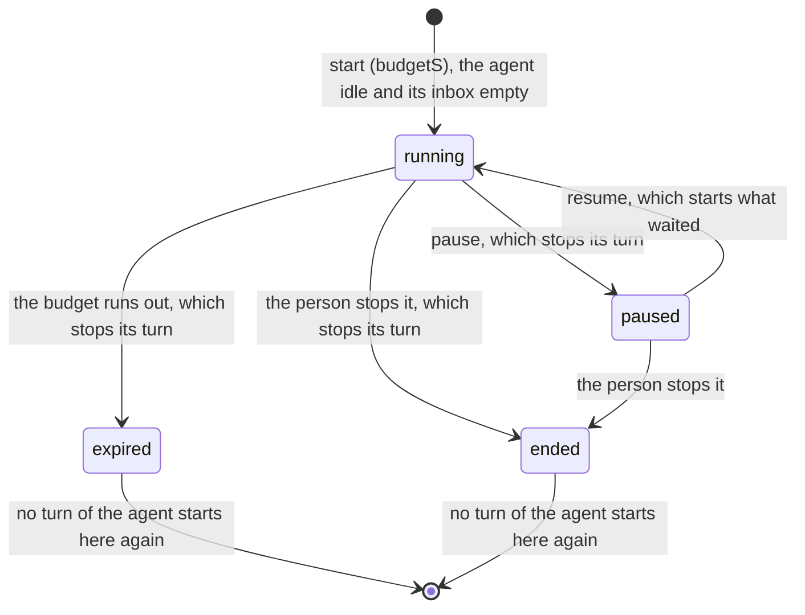

# Run clocks: a budget for an agent, set and enforced by the server

Part of [the architecture](../architecture.md).

**Decision** ([#1526](https://github.com/HJeon139/postbox/issues/1526)). For a timed trial, the person can give one agent in one conversation a budget of time, a run clock. Postbox’s server keeps the clock, tells the agent how much it has used at the start of each turn, and stops it at the budget. The agent can’t change the clock: only the page’s token can, and only the server’s timer stops the agent. It isn’t secret from the agent, though (see “What the agent sees”).

## Off unless a timed run asks for it

A run clock serves a timed UAT trial, not the person in [intent.md](../intent.md) (“Who it’s for”), so Postbox has none unless it starts with `POSTBOX_RUN_CLOCK=1`, which the UAT runner sets ([`tools/uat/run-env.mjs`](../../tools/uat/run-env.mjs)). Off, nothing of it is installed ([`server/run-clock-install.mjs`](../../server/run-clock-install.mjs)):
- **No route:** `POST /api/sessions/:id/clock` answers 404.
- **Nothing stored:** no clock event is ever written, and the state has no `clocks` key (`LAZY_STATE_KEYS` in [`shared/state.mjs`](../../shared/state.mjs)), so `/api/state`, the snapshot and the stream carry nothing for clocks.
- **The turn paths ask one thing:** Delivery’s `ready`, a turn’s start (`deliver`), Stop’s watchdog, a turn’s exit and a host’s confirmed stop each ask whether `rt.runClock` is there, and read nothing else. The adapters are handed no `unkilled`, and a turn’s message is built as it was.

`installRunClock` turns them on as Postbox starts, before any turn: Delivery holds a paused, expired or ended clock’s agent, and every clock in the state is armed again (`rearmClocks`).

## What it is

- **In the store.** Each clock is a record of the public state key `clocks`, by session: `{ sessionId, threadId, budgetMs, usedMs, since, state, startedAt, expiredAt, stopping }`, and `endedAt` once the person ends it ([`shared/run-clock.mjs`](../../shared/run-clock.mjs)). The events `clock.started`, `clock.paused`, `clock.resumed`, `clock.turn`, `clock.restored`, `clock.expired`, `clock.ended` and `clock.stopped` change it, and each carries `at`, the server’s time it happened, because the store’s events carry no time of their own ([store.md](store.md)). All eight are public, so they reach `/api/stream`. Every decision on a clock in the server (its route, its timer, a turn’s line, Delivery’s hold) reads it pending, as held writes will leave it (`store.pending.clock`, [`server/store-held.mjs`](../../server/store-held.mjs)): a clock started behind a commit still in its fsync times and holds its agent at once.
- **Used time.** It’s `usedMs`, plus the time since `since` while it counts. A pause isn’t counted once it has taken effect (see “A turn on a host”). Time while Postbox is down is: a restart reads the clock as it was, and a budget that ran out meanwhile expires as Postbox starts ([`server/run-clock.mjs`](../../server/run-clock.mjs), `rearmClocks`).
- **The person’s control.** `POST /api/sessions/:id/clock` takes `{ action: 'start', budgetS }`, `{ action: 'pause' }`, `{ action: 'resume' }` or `{ action: 'stop' }`. It needs the page’s token, like every write ([security-boundaries.md](security-boundaries.md), “Writes need the page’s token”). The budget is a whole number of seconds from 1 to 30 days. There’s no control in the page yet.
- **Starting.** A clock starts only while its agent is idle (no turn running, still exiting, or on a host waiting to be attached again after a restart, and no stop its host hasn’t confirmed) and no message waits in its inbox, and only once per agent per conversation. A second timed run in the same conversation would start with the first in its context: its backend’s session, and the room’s catch-up ([shared-memory.md](shared-memory.md)). So it goes in a new conversation.

## What the agent sees

- **One line per turn.** Each turn of a clocked agent ends with `[Postbox] Run clock: elapsed Ns / budget Ms. At the budget, Postbox stops your turn and starts no other.` (`clockLine`), the last line of the turn’s background (`message.context`), which every backend writes last (`formatMessage` in [`server/adapters/guide.mjs`](../../server/adapters/guide.mjs)). The turn records `clock.turn` with its elapsed time. A slash command’s turn, and a host turn attached again, have no line, since the command or the replay is the whole prompt.
- **No tool for it.** No MCP tool reads `clocks`, and the conversation’s clock lines (below) say no more than the turn’s line.
- **Not a secret.** `clocks` is a public state key, so a local agent with a shell can read it, as the page does: `/api/state` answers any request on this computer, and an agent can get the page’s cookie by sending a browser’s headers (`server/index.mjs`). What it can’t do without the person’s token is change the clock, and nothing it does moves the server’s timer.

## What the person sees

Each change of a clock adds a system line to the agent’s conversation ([`server/run-clock-notes.mjs`](../../server/run-clock-notes.mjs)). The expiry’s says that messages to the agent now wait and that a new timed run goes in a new conversation. If Postbox stops between a clock’s event and its line, the next start adds the line a paused or expired clock lacks (`repairClockNote`), so a held agent is never silent. It reads the newest line that holds the agent or lets it go (paused, resumed, expired, ended or voided), past any stopped turn’s end or restart line after it, so a start never repeats a line the conversation has. The page shows them as it shows every system line ([`tests/uat/conversation/transcript/run-clock.md`](../../tests/uat/conversation/transcript/run-clock.md)). An expired agent otherwise looks as if it never answers.

## How it holds the agent

- **At the budget.** A timer in the server fires at the budget. It records `clock.expired`, stops the running turn as Stop does (`by: 'clock'`, [`server/turn-stop.mjs`](../../server/turn-stop.mjs)), with its own `stopReason`, so the reply says its run clock stopped it, not the person ([`app/js/reply-stop.mjs`](../../app/js/reply-stop.mjs)), and from then on Delivery starts no turn from the agent’s inbox (`ready` in [`server/delivery.mjs`](../../server/delivery.mjs)), so what it’s sent waits there, not taken by a turn that never runs. A message that comes another way than the inbox waits in memory ([`server/run-clock-held.mjs`](../../server/run-clock-held.mjs)), and goes at the expiry, at a void and at the session’s delete, since none of it can run then. Retry and Send now, which would start a turn the clock only holds, are refused with a 409 instead, and change nothing.
- **A pause.** It stops the running turn (`by: 'pause'`, silent, so its queued wakes wait, and its reply says the pause stopped it) and holds the inbox the same way. The resume starts what waited.
- **An end.** The person’s `stop` ends a running or paused run before its budget, for good (#1749). It records `clock.ended`, with the time used, and the clock’s state is `ended`, which holds the agent as an expired one does: what waited in memory goes, a resume or a second stop is refused, and a new timed run goes in a new conversation. Its running turn stops as the person’s Stop stops it (silent, so its reply says the person stopped it), and its event lists the turns still to stop, as a pause’s does. Unlike a pause, the end stops counting at once: a turn on a host that runs on until its host confirms the stop isn’t counted, and the export’s stops (`asked_by: 'clock.ended'`, `confirmed_at`) say how long it ran on. A Retry or Send now is refused with words that say the run was stopped, not that it reached its budget.
- **A turn on a host.** Stopping it is asking its host, and the turn may run on there until the daemon confirms it’s over, as when the host can’t be reached at the budget ([remote-hosts.md](remote-hosts.md); `askStop` in [`server/remote/turns-stops.mjs`](../../server/remote/turns-stops.mjs)). So the pause or the expiry stops the turn first, and its event lists the host turns not yet confirmed stopped (`stopping`). Each confirmation records `clock.stopped`, with its time, and adds a line to the conversation. A paused clock counts on until its last such turn has stopped: a pause the agent works through on its host is no pause. A clock that counts on while paused still expires at its budget, and doesn’t resume until then, since a new turn would run beside the old one. An expiry lists again a turn its pause asked to stop. A host that says the turn’s runner outlived its kill (`unkilled`, #872), at its welcome or in its `ended`, voids the run with `forced` and why `unkilled`, as for a CLI here: the runner may still be working, uncounted. That holds whether or not Postbox asked it to stop, so a runner the daemon killed for its silence voids the run too (`server/remote/turns-end.mjs`).
- **A turn on a host from before a restart.** Until it’s attached again, Postbox can’t stop it, and it may be working. So a pause or expiry meanwhile (an expiry as Postbox starts, too) lists it in `stopping`, and when it’s attached, Postbox stops it once its remote turn names its host turn, so the stop reaches the host (`stopHeldTurn`); the host’s confirmation records `clock.stopped`. One the host no longer has is over at its welcome, which records `clock.stopped` too. One whose host was removed before the restart can never be confirmed, so it voids the run with why `restart` (`server/remote/turns-restore.mjs`).
- **A turn on this computer.** Stop sends its CLI’s group SIGINT, and SIGKILL after a grace period ([`server/adapters/process-group.mjs`](../../server/adapters/process-group.mjs)), and the turn ends once the group has exited, so the agent may work on meanwhile. A pause or expiry lists it in `stopping` too, as `turn:` and its id, and its exit records `clock.stopped`: a paused clock counts to the exit. Postbox can’t always confirm that exit: Stop’s watchdog stops waiting after 15 s, a group can outlive SIGKILL (`stopTurn` then calls `unkilled`), and a restart loses the CLI it was waiting on. Then `clock.stopped` says `forced` and why (`watchdog`, `unkilled`, `restart`), whoever stopped the turn (the clock, the person’s Stop, Send now), and since the agent may still be working, uncounted, the clock ends the run as void: it expires, with `voided`, and no turn of the agent starts again. A timed trial treats `voided` as it treats `clock.restored`.
- **A store outage.** The turn still stops at the budget, as Stop is allowed then, and the `clock.expired` record waits for writes to reopen, ahead of the turns held meanwhile. Retry re-arms every clock from the state the disk held.

## Where it doesn’t hold: an agent on a host while Postbox is down

The hard stop is this server’s timer. While Postbox is down, an agent on a remote host goes on working ([remote-hosts.md](remote-hosts.md)), past its budget if the budget runs out meanwhile. The same is true, while Postbox is up, of a turn whose host hasn’t confirmed its stop (above): `clock.stopped` says when it did, and Postbox records nothing the turn did in between. Postbox can’t stop it then, and doesn’t claim to. Instead, every running clock records `clock.restored`, with its elapsed time, when Postbox starts again or Retry reloads the store, and adds a line to the conversation. A timed trial treats a `clock.restored` inside a run as voiding it, as it treats a forced `clock.stopped`, and keeps Postbox up for the whole run. The clock itself keeps running: `voided` is set only by a forced `clock.stopped`, and a reader of the events decides what a restart means.

**Revisit** if timed runs need a hard stop through an outage: the host’s daemon would need the deadline with each turn, which changes the host protocol.

## Turning it back

Starting the same data folder without `POSTBOX_RUN_CLOCK=1` turns clocks off: the reducer still reads their events and keeps `clocks`, but nothing holds an agent or times it, so what waited in an inbox then starts turns, and no running agent is stopped. A Postbox from before run clocks reads a log with clock events as events its reducer doesn’t know, which the store holds as rejected and numbers on, without closing ([`server/store-reject.mjs`](../../server/store-reject.mjs)); a snapshot’s `clocks` key is carried unread. That’s what the code says; it hasn’t been run.
