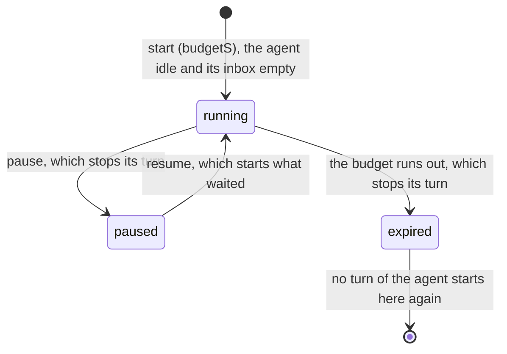

# Run clocks: a budget for an agent, set and enforced by the server

Part of [the architecture](../architecture.md).

**Decision** ([#1522](https://github.com/HJeon139/postbox/pull/1522)). The person can give one agent in one conversation a budget of time, a run clock, for a timed trial. Postbox’s server keeps the clock, tells the agent how much it has used at the start of each turn, and stops it at the budget. The agent can’t read or change the clock any other way. Postbox also exports each agent’s turns as an [ATIF v1.8](https://docs.harborframework.com/agents/atif) trajectory, timed by the same server (see “The ATIF export”).

## What it is

- **In the store.** Each clock is a record of the public state key `clocks`, by session: `{ sessionId, threadId, budgetMs, usedMs, since, state, startedAt, expiredAt }` ([`shared/run-clock.mjs`](../../shared/run-clock.mjs)). The events `clock.started`, `clock.paused`, `clock.resumed`, `clock.turn`, `clock.restored` and `clock.expired` change it, and each carries `at`, the server’s time it happened, because the store’s events carry no time of their own ([store.md](store.md)). All six are public, so they reach `/api/stream`. Every decision on a clock in the server (its route, its timer, a turn’s line, Delivery’s hold) reads it pending, as held writes will leave it (`store.pending.clock`, [`server/store-held.mjs`](../../server/store-held.mjs)): a clock started behind a commit still in its fsync times and holds its agent at once.
- **Used time.** It’s `usedMs`, plus the time since `since` while it runs. A pause isn’t counted. Time while Postbox is down is: a restart reads the clock as it was, and a budget that ran out meanwhile expires as Postbox starts ([`server/run-clock.mjs`](../../server/run-clock.mjs), `rearmClocks`).
- **The person’s control.** `POST /api/sessions/:id/clock` takes `{ action: 'start', budgetS }`, `{ action: 'pause' }` or `{ action: 'resume' }`. It needs the page’s token, like every write ([security-boundaries.md](security-boundaries.md), “Writes need the page’s token”). The budget is a whole number of seconds from 1 to 30 days. There’s no control in the page yet.
- **Starting.** A clock starts only while its agent is idle (no turn running or still exiting) and no message waits in its inbox, and only once per agent per conversation. A second timed run in the same conversation would start with the first in its context: its backend’s session, and the room’s catch-up ([shared-memory.md](shared-memory.md)). So it goes in a new conversation.

## What the agent sees

- **One line per turn.** Each turn of a clocked agent ends with `[Postbox] Run clock: elapsed Ns / budget Ms. At the budget, Postbox stops your turn and starts no other.` (`clockLine`), added to the message where every backend formats it (`formatMessage` in [`server/adapters/guide.mjs`](../../server/adapters/guide.mjs)), and the turn records `clock.turn` with its elapsed time. A slash command’s turn has no line, since the command is the whole prompt.
- **Nothing else.** No MCP tool reads `clocks`. The conversation’s clock lines (below) are in the room, so its catch-up can show them, with no more than the line says.

## What the person sees

Each change of a clock adds a system line to the agent’s conversation ([`server/run-clock-notes.mjs`](../../server/run-clock-notes.mjs)). The expiry’s says that messages to the agent now wait and that a new timed run goes in a new conversation. If Postbox stops between a clock’s event and its line, the next start adds the line a paused or expired clock lacks (`repairClockNote`), so a held agent is never silent. The page shows them as it shows every system line ([`tests/uat/conversation/transcript/run-clock.md`](../../tests/uat/conversation/transcript/run-clock.md)). An expired agent otherwise looks as if it never answers.

## How it holds the agent

- **At the budget.** A timer in the server fires at the budget. It records `clock.expired`, stops the running turn as Stop does (`by: 'clock'`, [`server/turn-stop.mjs`](../../server/turn-stop.mjs)), and from then on Delivery starts no turn from the agent’s inbox (`ready` in [`server/delivery.mjs`](../../server/delivery.mjs)), so what it’s sent waits there, not taken by a turn that never runs. A message that comes another way than the inbox waits in memory.
- **A pause.** It stops the running turn (`by: 'pause'`, silent, so its queued wakes wait) and holds the inbox the same way. The resume starts what waited.
- **A store outage.** The turn still stops at the budget, as Stop is allowed then, and the `clock.expired` record waits for writes to reopen, ahead of the turns held meanwhile. Retry re-arms every clock from the state the disk held.

## Where it doesn’t hold: an agent on a host while Postbox is down

The hard stop is this server’s timer. While Postbox is down, an agent on a remote host goes on working ([remote-hosts.md](remote-hosts.md)), past its budget if the budget runs out meanwhile. Postbox can’t stop it then, and doesn’t claim to. Instead, every running clock records `clock.restored`, with its elapsed time, when Postbox starts again or Retry reloads the store, and adds a line to the conversation. A timed trial treats a `clock.restored` inside a run as voiding it, and keeps Postbox up for the whole run.

**Revisit** if timed runs need a hard stop through an outage: the host’s daemon would need the deadline with each turn, which changes the host protocol.

## The ATIF export

[`tools/atif.mjs`](../../tools/atif.mjs) turns recorded events into one trajectory per agent session, checked against Harbor’s own models and validator ([`harbor-framework/harbor`](https://github.com/harbor-framework/harbor/tree/2ea52267e95ed7fb00bb72f0386d9c1289d331ca/src/harbor/models/trajectories)). A UAT run writes them to `atif/`, and [`tools/atif-export.mjs`](../../tools/atif-export.mjs) writes them from any recording of `/api/stream`.
- **Time.** Every timestamp is one the server set: an item’s `at`, an answer’s `at`, a clock event’s `at`. An answer goes where its patch came in the events, not beside its block.
- **What reached the agent.** Someone else’s message is a step only once one of the agent’s turns took it from its inbox. A message it only saw as background in its catch-up isn’t a step. A block’s answer is a step once it reached the agent: at once, through its question’s call, or when a turn took its entry.
- **What it isn’t.** Postbox doesn’t store a turn’s exact prompt, so a trajectory leaves out the system prompt the agent was given, the room’s catch-up each turn carried as background, and each message’s exact text; every trajectory says so in its notes and `extra.scope` (`NOT_RECORDED`).
- **Which model.** Each step names the model and effort its backend reported for it (`lastModel`, `lastEffort`), so a session whose model changed keeps each turn’s own. The trajectory names a default model only when one model ran every step.
- **Tools.** A call’s name is the tool its harness ran, which each step records (`tool`); its arguments come from the work ledger for commands, reads and other MCP servers, and are left empty, and marked so, for the rest ([work-ledger.md](work-ledger.md)).
- **Tokens and cost.** They come from the ledger’s turns. A turn’s figures go on its first step, and a figure a backend didn’t report is left out. A total only some turns reported is a partial sum in `extra.partial`.
- **A snapshot is not a recording.** A data folder’s log starts at its last snapshot, which keeps state, not the events that made it. An export from one has lost each clock’s pauses, resumes and restarts, where answers came, items’ revisions, entries taken and given back, and every live frame. So the exporter writes one only with `--partial`, and says what it lost in the trajectory’s notes and `extra.partial`. A trial’s record is a recording of `/api/stream` from its start.

## Turning it back

A Postbox without run clocks reads a log with clock events as events its reducer doesn’t know, which the store holds as rejected and numbers on, without closing ([`server/store-reject.mjs`](../../server/store-reject.mjs)); a snapshot’s `clocks` key is carried unread. That’s what the code says; it hasn’t been run. Turning it back stops no agent that’s running and drops every clock’s hold: what waited in an inbox then starts turns.
