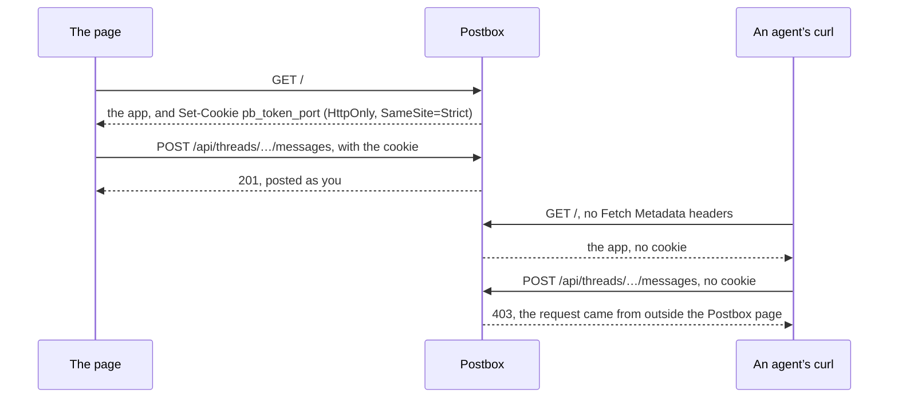
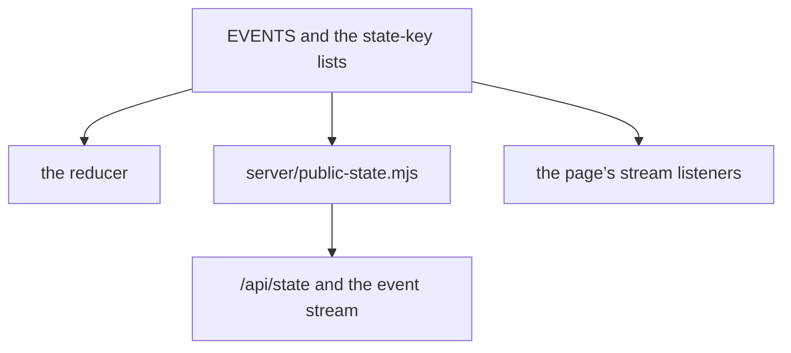

# Security boundaries: the page’s token and what reaches the browser

Part of [the architecture](../architecture.md). Who Postbox answers, and what the page may see. AGENTS.md, “Security boundaries”, lists the rules that come from these, and SECURITY.md, “What Postbox defends”, what a report may cross.

## This computer alone

**Decision.** Postbox listens on 127.0.0.1 only, and answers only requests addressed to `127.0.0.1:<port>` or `localhost:<port>`: any other `Host` gets 421, which keeps out DNS rebinding. A write whose `Origin` is another origin’s gets 403, another port on this computer included, though the browser counts that as the same site. Both checks run before any route, in `server/index.mjs`, and before the page’s token is checked.

## Writes need the page’s token

**Decision** ([#74](https://github.com/HJeon139/postbox/issues/74)). Every write to Postbox’s API (any method but GET and HEAD) needs a secret that the page you opened holds. Writes without it get 403, with a message saying why.
- **The secret:** 32 random bytes, made each time the server starts.
- **How the page gets it:** in a cookie set when a browser loads `/`, named for the port (`pb_token_<port>`), with `HttpOnly`, `SameSite=Strict` and `Path=/`. The browser sends it with the page’s own requests, so the page’s code never handles it.
- **Only a browser gets it:** the cookie comes only with a request that carries a browser’s Fetch Metadata: a navigation (`Sec-Fetch-Mode: navigate`), or `Sec-Fetch-Site` of `same-origin` (the page’s own fetch of `/`, its refresh after a restart) or `none`. A request without them, such as a plain `curl /`, gets the page and no cookie.
- **The check:** a constant-time comparison, before any route runs.
- **Agents keep their own way in:** `/mcp`, which carries the agent’s session and its turn’s token. Since #54, a tool call needs the token of the session’s running turn, which only the backend process Postbox started for that turn has; a call with only the session id is refused.

**What it protects against.** An agent that uses Postbox’s own API casually, or on generic instructions, to speak as you: one `curl` used to post a message as you, with no click, no card and no “Sent from” line, and the other agents in a room acted on it as your instruction. Now that `curl` gets 403, and so does one that loads `/` first. Another website can’t do it either: the browser doesn’t send a `SameSite=Strict` cookie with another site’s requests. A page on another port of this computer is the same site, so the browser does send the cookie with its requests; the `Origin` check is what refuses those. Apps can’t reach it: their frames have an opaque origin and no network.

**What it doesn’t.** A process running as you that sets out to get in still can: it can forge a browser’s headers when it loads `/` and keep the cookie, or read the data folder. That includes an agent whose instructions, from you or from a page it read, tell it exactly how. Postbox runs on your computer as you, so anything else running as you is out of its reach. The token makes the casual path fail; it isn’t a boundary against a determined process.

**What it costs.** A restart makes a new token, so an open page’s next write is refused once; the page then loads `/` again, gets the new cookie, and retries. Tools that write from Node (`tools/demo.mjs`, the checks) are the person’s own, so they load `/` with a navigation’s headers, as a browser does.

**`!` commands** ([#67](https://github.com/HJeon139/postbox/issues/67)) run as you, through your shell, in the conversation’s folder, so they need more than the token, which a determined process can get (above): the route also refuses unless Postbox listens on 127.0.0.1 and the request came from this computer. Each runs in its own process group, so Postbox stops them all when it shuts down (SIGINT, then SIGKILL), and keeps a bounded amount of each one’s output. Postbox listens there today; the check means a later change to the listen address can’t open it silently. Your shell is the point here: you typed a command line, as in your terminal. That’s different from the rule against spawning through a shell, which is about strings from agents and data.

**Revisit when** Postbox listens beyond localhost, or serves more than one person. Then it needs real sign-in, not a page token, and `!` stays off.

## What reaches the browser

**Decision** (1 November 2026, from the integrator’s review of #608). What the page may see is decided once, in `shared/state.mjs`: each event type’s entry in `EVENTS` says whether it is `public`, and each state key is in `PUBLIC_STATE_KEYS` or `PRIVATE_STATE_KEYS`. `server/public-state.mjs` applies that to the state and the event stream: `/api/state` (`server/page-state.mjs`), a conversation’s items by range (`server/items-routes.mjs`, through `publicItems`, #1155), and the live and backlog frames (`server/live-streams.mjs`). An event the page may not see goes out as a `cursor` that keeps only its seq, so the page stays in step. Every other route that answers with state does so with a piece of it directly: the routes that create or change an entity, `PUT /api/settings`, the permissions view (`GET /api/permissions`), and the Work view’s answers, which read the store’s items and sessions directly. Such an answer may carry only data of public keys. Review holds that rule today, while every key is public; A2, which adds the first private data, adds a check that holds it before that data exists (A1b adds none: `designs/508/a1b-asks.md`).

**What it rests on**
- **A list kept beside the reducer drifts.** #608 kept the public types in a list of their own, checked by a regular expression over the reducer’s source. The integrator added a type three ways (a `switch` in an imported helper, a lookup list in a helper, a helper two levels deep), and each passed. With one table, the reducer can’t apply a type that hasn’t said whether it is public, and the page’s listeners come from the same table (`app/js/client.mjs`).
- **It fails closed.** A type with no entry, or one that isn’t public, reaches the page only as a cursor, and a state key not listed as public isn’t sent. A spec fails when a key of `emptyState()` is in neither list, or in both.
- **The store keeps the raw history.** The log, snapshots and the remote hosts’ subscribers read the store directly.
- **Only the bulk paths are projected.** They send the whole state and every event. The other routes answer with one entity or report each, so the rule for them is about what they may carry, not a second projection.
- **The stream’s own frame names are reserved.** `STREAM` in `shared/state.mjs` holds `cursor`, `status`, `epoch`, `resync` and `header`, and none of them may be an event type.

**When to revisit**
- A remote host gets a snapshot built from the store’s state. Nothing is private yet. When A2 adds private data, its design says whether a host gets `publicState` or a projection of its own.
- A route that answers with state, today’s or a new one such as A2’s headers, carries only data of public keys. Before A2’s first private data, that rule gets a check, not only review.
