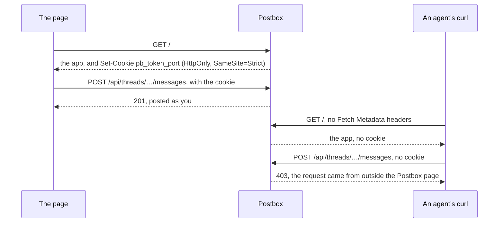
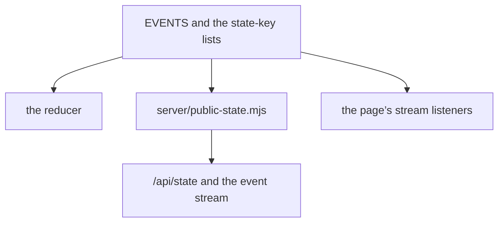

# Security boundaries: the page’s token and what reaches the browser

Part of [the architecture](../architecture.md). Who Postbox answers, what the page may see, and what an agent app reaches. Function comes first (intent.md, “Function first”): each boundary here says what it protects against, and one that costs agents or their apps function needs a real risk their harness doesn’t already carry. AGENTS.md, “Security boundaries”, lists the rules that come from these, and SECURITY.md, “What Postbox defends”, what a report may cross.

## This computer alone

**Decision.** Postbox listens on 127.0.0.1 only, and answers only requests addressed to `127.0.0.1:<port>` or `localhost:<port>`: any other `Host` gets 421, which keeps out DNS rebinding. A write whose `Origin` is another origin’s gets 403, another port on this computer included, though the browser counts that as the same site. Both checks run before any route, in `server/index.mjs`, and before the page’s token is checked.

## Writes need the page’s token

**Decision** ([#74](https://github.com/HJeon139/postbox/issues/74)). Every write to Postbox’s API (any method but GET and HEAD) needs a secret that the page you opened holds. Writes without it get 403, with a message saying why.
- **The secret:** 32 random bytes, made each time the server starts.
- **How the page gets it:** in a cookie set when a browser loads `/`, named for the port (`pb_token_<port>`), with `HttpOnly`, `SameSite=Strict` and `Path=/`. The browser sends it with the page’s own requests, so the page’s code never handles it.
- **Only a browser gets it:** the cookie comes only with a request that carries a browser’s Fetch Metadata: a navigation (`Sec-Fetch-Mode: navigate`), or `Sec-Fetch-Site` of `same-origin` (the page’s own fetch of `/`, its refresh after a restart) or `none`. A request without them, such as a plain `curl /`, gets the page and no cookie.
- **The check:** a constant-time comparison, before any route runs.
- **Agents keep their own way in:** `/mcp`, which carries the agent’s session and its turn’s token. Since #54, a tool call needs the token of the session’s running turn, which only the backend process Postbox started for that turn has; a call with only the session id is refused.

**What it protects against.** An agent that uses Postbox’s own API casually, or on generic instructions, to speak as you: one `curl` used to post a message as you, with no click, no card and no “Sent from” line, and the other agents in a room acted on it as your instruction. Now that `curl` gets 403, and so does one that loads `/` first. Another website can’t do it either: the browser doesn’t send a `SameSite=Strict` cookie with another site’s requests. A page on another port of this computer is the same site, so the browser does send the cookie with its requests; the `Origin` check is what refuses those. Apps can’t reach it: their frames have an opaque origin and no network.

**What it doesn’t.** A process running as you that sets out to get in still can: it can forge a browser’s headers when it loads `/` and keep the cookie, or read the data folder. That includes an agent whose instructions, from you or from a page it read, tell it exactly how. Postbox runs on your computer as you, so anything else running as you is out of its reach. The token makes the casual path fail; it isn’t a boundary against a determined process.

**What it costs.** A restart makes a new token, so an open page’s next write is refused once; the page then loads `/` again, gets the new cookie, and retries. Tools that write from Node (`tools/demo.mjs`, the checks) are the person’s own, so they load `/` with a navigation’s headers, as a browser does.

**`!` commands** ([#67](https://github.com/HJeon139/postbox/issues/67)) run as you, through your shell, in the conversation’s folder, so they need more than the token, which a determined process can get (above): the route also refuses unless Postbox listens on 127.0.0.1 and the request came from this computer. Each runs in its own process group, so Postbox stops them all when it shuts down (SIGINT, then SIGKILL), and keeps a bounded amount of each one’s output. Postbox listens there today; the check means a later change to the listen address can’t open it silently. Your shell is the point here: you typed a command line, as in your terminal. That’s different from the rule against spawning through a shell, which is about strings from agents and data.

**An app’s links** ([#1480](https://github.com/HJeon139/postbox/issues/1480)): `POST /api/apps/:id/open` starts your default browser (`open`, `xdg-open` or `rundll32`) on a URL an agent’s app gave, for the Claude desktop app’s pane, where the page can’t open a tab (designs/architecture/sandbox.md, “No popups; links through the bridge”). It spawns a process from agent data, so it gets the `!` route’s checks on top of the token: Postbox listens on 127.0.0.1 and the request came from this computer. Then `server/app-links.mjs` takes only an absolute http or https URL, passes it normalized as one argument with no shell, opens at most 10 a minute per app, and answers with the error when the opener fails to start. The page asks only right after a click in that app, one link per click, and never where it can’t tell which frame was clicked (`app/js/app-links.mjs`).

**Revisit when** Postbox listens beyond localhost, or serves more than one person. Then it needs real sign-in, not a page token, and `!` and an app’s links stay off.

## What leaves through net.fetch

**Decision** ([#1482](https://github.com/HJeon139/postbox/issues/1482); function first since 21 November 2026, [#1604](https://github.com/HJeon139/postbox/issues/1604)). An agent app reaches what its agent’s computer reaches: a public site, a server on the person’s network, and a service on this computer, such as the dashboard of a Ray cluster the person runs, on its private address or on `localhost` through a port forward. The app fetches the data itself, so its agent never spends turns relaying numbers into it (intent.md, “Function first”). The frame itself still loads nothing ([sandbox.md](sandbox.md)): it fetches with `postbox.query('net.fetch', { url })`, which Postbox’s server runs for an app that names `net.fetch` in its permissions (`server/net-fetch.mjs`). Every agent holds `net.fetch`, as it holds its conversation’s assets (`HELD_BY_EVERY_AGENT` in `server/host-tool.mjs`), so any agent can grant it to its apps, with no card: an agent’s shell already reaches all of the same addresses, with any method and its own credentials, so an app that reads them adds no reach.

What stays, because it costs an app nothing and keeps something real out:
- **Postbox itself.** A fetch to Postbox’s own port, in any spelling of this computer’s address, is refused. Postbox answers a read without the page’s token, so a fetch of `/api/state` would hand an app every conversation’s public state, and the frame’s opaque origin is what keeps an app out of Postbox’s API (“Writes need the page’s token”). An app gets its own conversation’s data through the bridge instead. The addresses are classified by node’s `BlockList` in `server/net-address.mjs`, which matches an IPv4-mapped IPv6 address (`::ffff:7f00:1` is 127.0.0.1) in either spelling; the literal address is checked first, then every address DNS gives, in the lookup the request’s own socket uses, so a name can’t resolve elsewhere once and to Postbox the next time.
- **No credentials of the person’s.** It sends no cookies and no `Authorization`, and refuses a URL with a user name or password. A request comes from Postbox’s server, not the person’s browser, so it carries nothing of their signed-in sessions: the measured risk of opening the frame’s own network (sandbox.md, “What it rests on”).
- **Reads.** GET over http or https: an app shows state. A write to another system, such as stopping a Ray job, goes through the agent, as a click in the app that starts its turn.
- **Limits that protect Postbox, sized for function** (`NET_FETCH` in `shared/limits.mjs`, which show_app’s description reads; counted in `server/net-fetch-limits.mjs`): a cap on the response body, a deadline for the whole fetch, and how many fetches an app and all apps may have open or make in a minute. They keep a runaway poll from filling the server’s memory or the event log, not the person from their agents, so they’re sized for a dashboard that polls several endpoints every second and reads a job’s log. Past a count limit a fetch is refused with a 429 before anything leaves.
- **What it saw, shown.** Every attempt shows in the app’s agent’s activity, refused, failed and timed out too: one line per app per turn naming each host and how often, such as “Visits fetched ray-head.internal:8265 ×120” (`server/net-fetch-line.mjs`). It’s transparency, not an alarm: no message, needs-you, notification or focus move. A polling app patches that line at most once every 5 seconds, so it can’t grow the event log with each fetch.

**Where it stands.** The code still refuses what #1482 refused, until #1604’s follow-up lands: this computer and every private, link-local, carrier-grade NAT, benchmark, multicast, reserved or unspecified address, and IPv6 ranges that carry IPv4 (NAT64, 6to4, Teredo); it follows no redirect, uses no environment proxy, and its limits are 1 MB, 10 seconds, 4 open per app and 16 in all, and 60 a minute per app and 120 across apps. The follow-up narrows the refusal to Postbox’s own port, follows a redirect when its target passes the same check, and resizes the limits for polling. The allow list `POSTBOX_FETCH_ALLOW` (host:port), which treats a host as public for tests and demos, goes with the refusal it works around. The tests: `tests/net-address.test.mjs`, `tests/net-fetch.test.mjs`, `tests/net-fetch-limits.test.mjs`, `tests/integration/net-fetch.test.mjs`, `tests/net-fetch-line.test.mjs` and `tests/browser/app-net-fetch.spec.mjs`.

**What it protects against.** An app reading Postbox’s own API around the frame’s opaque origin; an app’s requests carrying the person’s browser sessions; and a polling app wearing down Postbox’s server or log.

**What it doesn’t, by design.** An app reaches the person’s network and this computer’s services, as its agent’s shell does, and data an app puts in a URL leaves; the activity line shows where. An agent that wants to do harm already has a shell, so refusing its app the same addresses only made the agent the app’s data transport.

**Revisit when** an app needs to write to another system without a turn, or to call an authenticated API: neither should mean the person’s browser cookies. And when the app’s agent runs on a remote host, the system it watches may be reachable only from there: the fetch should run on the host, through its daemon, which today it doesn’t.

## What an app reads from disk

**Decision** (21 November 2026, [#1604](https://github.com/HJeon139/postbox/issues/1604)). An agent app reads files while it runs, as it fetches: a job’s log, a results folder, a metrics file a training run rewrites. Today an app gets a file only when its agent attaches it to a version (`postbox.file`, #54), so a file that changes needs the agent to send a new version each time. The new host tool, `fs.read`, held by every agent as `net.fetch` is, gives an app a file’s text, or a folder’s entries, read on Postbox’s server as the person, read only. A path is absolute, or relative to the agent’s working folder. What stays:
- **Postbox’s own data folder** is refused, resolved with `realpath`, so a link can’t reach it: it holds every conversation and the records the page may not see (“What reaches the browser”).
- **Reads only,** of regular files and folders, under a size limit in `shared/limits.mjs`, so a large file can’t fill the server’s memory.
- **What it read, shown,** in the agent’s activity, one line per app per turn naming each path, as `net.fetch`’s line names each host.

**What it doesn’t, by design.** An app reads what its agent’s shell reads, as the person. Refusing it the person’s files would only make the agent copy them in.

**Where it stands.** Not built: #1604’s follow-up adds it. On a remote host, the files are the host’s, so the read runs there, through its daemon.

## What reaches the browser

**Decision** (1 November 2026, from the integrator’s review of #608). What the page may see is decided once, in `shared/state.mjs`: each event type’s entry in `EVENTS` says whether it is `public`, and each state key is in `PUBLIC_STATE_KEYS` or `PRIVATE_STATE_KEYS`. `server/public-state.mjs` applies that to the state and the event stream: `/api/state` (`server/page-state.mjs`), a conversation’s items by range (`server/items-routes.mjs`, through `publicItems`, #1155), and the live and backlog frames (`server/live-streams.mjs`). An event the page may not see goes out as a `cursor` that keeps only its seq, so the page stays in step. An event a page already had on a live frame isn’t sent to that page at all: a commit point of a step it was sent live, or a running turn’s change of state that a session frame carried (`server/live-sent.mjs`). Only events `server/live-buffer.mjs` marks are skipped, only on a page’s stream, and only for a stream that was itself sent the step or the session live. A reconnect is a new stream, sent nothing live, so it’s spared nothing: it gets the backlog whole, then the running turns’ snapshots through `publicLive`, filtered by its `open`. Every other route that answers with state does so with a piece of it directly: the routes that create or change an entity, `PUT /api/settings`, the permissions view (`GET /api/permissions`), and the Work view’s answers, which read the store’s items and sessions directly. Such an answer may carry only data of public keys. Review holds that rule today; A2 adds a check that holds it (A1b adds no private data: `designs/508/a1b-asks.md`).

**The first private key** (#1478). `published`, with its event `app.publish`, is what each app published for its agent with `postbox.publish`. Only the agent’s `read_app` reads it, and no page does, so it is private: a publish sends a page only a cursor, where the whole public `app` record, with every version’s code, went to every page and the log at each one. No route answers with it: the publish route answers `{ ok }`, and a remote host gets none of it, since `read_app` waits for Postbox’s answer (`TOOL_ROUTES`) and the host’s snapshot carries a conversation’s items. `tests/app-publish.test.mjs` holds that a publish puts none of its data in a frame or in `/api/state`, and that `server/app-publish.mjs` is the one server module that reads it. That reads source text, so it misses a key built at run time or a spread of the whole state: `tests/published-kept-out.test.mjs` publishes a secret through the page’s route and finds it in none of `/api/state`, the stream’s backlog and live frames, every GET route (a route without a case there fails it) and a host’s snapshot.

**The second private key** (#1488). `appNotes`, with its events `app.note`, `app.notes.dropped` and `app.notes.read`, holds what each app sent its agent without the person’s click: a note, which starts no turn. It is private for the same reasons, and held the same ways: the note route answers `{ ok, noted: true }`, `read_app` is its one reader, and `tests/app-notes.test.mjs` holds that `server/app-notes.mjs` is the one server module that reads it. `tests/published-kept-out.test.mjs` sends a second secret as a note through the page’s route and finds it in none of the answers it checks.

**What it rests on**
- **A list kept beside the reducer drifts.** #608 kept the public types in a list of their own, checked by a regular expression over the reducer’s source. The integrator added a type three ways (a `switch` in an imported helper, a lookup list in a helper, a helper two levels deep), and each passed. With one table, the reducer can’t apply a type that hasn’t said whether it is public, and the page’s listeners come from the same table (`app/js/client.mjs`).
- **It fails closed.** A type with no entry, or one that isn’t public, reaches the page only as a cursor, and a state key not listed as public isn’t sent. A spec fails when a key of `emptyState()` is in neither list, or in both.
- **The store keeps the raw history.** The log, snapshots and the remote hosts’ subscribers read the store directly.
- **Only the bulk paths are projected.** They send the whole state and every event. The other routes answer with one entity or report each, so the rule for them is about what they may carry, not a second projection.
- **The stream’s own frame names are reserved.** `STREAM` in `shared/state.mjs` holds `cursor`, `status`, `epoch`, `resync`, `header` and `live`, and none of them may be an event type.
- **A live frame can’t drift from the events.** The `live` frame carries a running turn’s progress unstored ([live-progress.md](live-progress.md)). Each of its kinds, in `LIVE` (`shared/live-kinds.mjs`), mirrors the event types that carry the same data when it’s stored, and takes their `public` flag from `EVENTS`: there’s no second table of flags. It also names the state keys its data belongs to, which must be in `PUBLIC_STATE_KEYS`: `items` for an item’s kinds, `sessions` for a session’s. `publicLiveFrame` and `publicLive` (`server/public-state.mjs`) send nothing for a kind that isn’t listed, or whose event types or state keys aren’t all public. They keep a listed field only as a scalar, or as an object or a list whose entries are picked by their own shape, so no nested value gets past its list. They send an item’s frames only to a stream with its conversation open, and nothing to a stream whose `open` is anything but `null` or a `Set`. `tests/live-frames-public.test.mjs` holds each rule, and that removing it fails a test.

**When to revisit**
- A remote host gets a snapshot built from the store’s items, which holds none of `published`. When A2 adds private data, its design says whether a host gets `publicState` or a projection of its own.
- A route that answers with state, today’s or a new one such as A2’s headers, carries only data of public keys. Before A2’s first private data, that rule gets a check, not only review.
