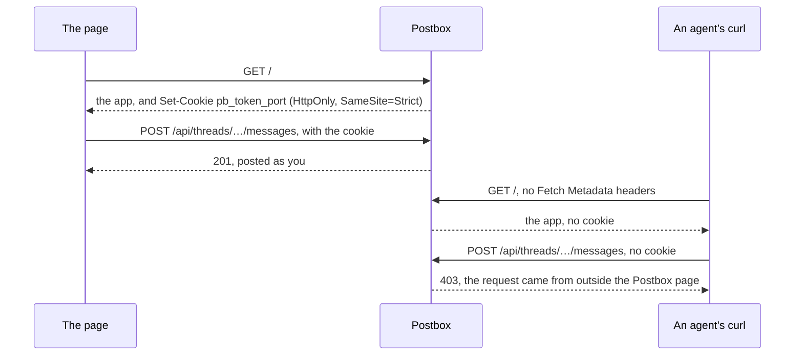
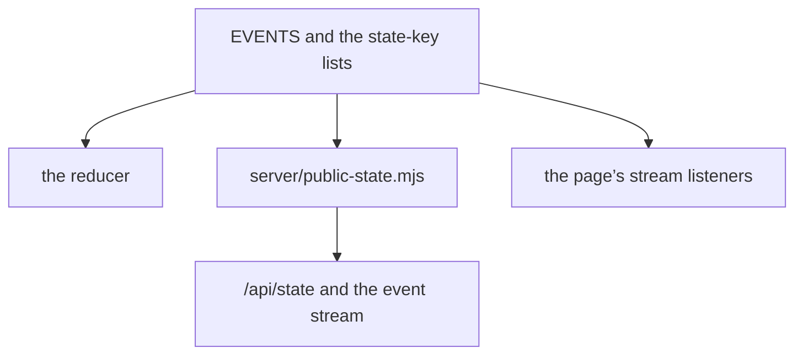

# Security boundaries: the page’s token and what reaches the browser

Part of [the architecture](../architecture.md). Who Postbox answers, what the page may see, and what an agent app reaches. Function comes first (intent.md, “Function first”): each boundary here says what it protects against, and one that costs agents or their apps function needs a real risk, and an app is held to what its agent’s own tools allow. AGENTS.md, “Security boundaries”, lists the rules that come from these, and SECURITY.md, “What Postbox defends”, what a report may cross.

## This computer alone

**Decision.** Postbox listens on 127.0.0.1 only, and answers only requests addressed to `127.0.0.1:<port>` or `localhost:<port>`: any other `Host` gets 421, which keeps out DNS rebinding. A write whose `Origin` is another origin’s gets 403, another port on this computer included, though the browser counts that as the same site. Both checks run before any route, in `server/index.mjs`, and before the page’s token is checked.

## Writes need the page’s token

**Decision** ([#74](https://github.com/HJeon139/postbox/issues/74)). Every write to Postbox’s API (any method but GET and HEAD) needs a secret that the page you opened holds. Writes without it get 403, with a message saying why.
- **The secret:** 32 random bytes, made each time the server starts.
- **How the page gets it:** in a cookie set when a browser loads `/`, named for the port (`pb_token_<port>`), with `HttpOnly`, `SameSite=Strict` and `Path=/`. The browser sends it with the page’s own requests, so the page’s code never handles it.
- **Only a browser gets it:** the cookie comes only with a request that carries a browser’s Fetch Metadata: a navigation (`Sec-Fetch-Mode: navigate`), or `Sec-Fetch-Site` of `same-origin` (the page’s own fetch of `/`, its refresh after a restart) or `none`. A request without them, such as a plain `curl /`, gets the page and no cookie.
- **The check:** a constant-time comparison, before any route runs.
- **Agents keep their own way in:** `/mcp`, which carries the agent’s session and its turn’s token. Since #54, a tool call needs the token of the session’s running turn, which only the backend process Postbox started for that turn has; a call with only the session id is refused.

**What it protects against.** An agent that uses Postbox’s own API casually, or on generic instructions, to speak as you: one `curl` used to post a message as you, with no click, no card and no “Sent from” line, and the other agents in a room acted on it as your instruction. Now that `curl` gets 403, and so does one that loads `/` first. Another website can’t do it either: the browser doesn’t send a `SameSite=Strict` cookie with another site’s requests. A page on another port of this computer is the same site, so the browser does send the cookie with its requests; the `Origin` check is what refuses those. Apps can’t reach it: their frames have an opaque origin and no network.

**What it doesn’t.** A process running as you that sets out to get in still can: it can forge a browser’s headers when it loads `/` and keep the cookie, or read the data folder. That includes an agent whose instructions, from you or from a page it read, tell it exactly how. Postbox runs on your computer as you, so anything else running as you is out of its reach. The token makes the casual path fail; it isn’t a boundary against a determined process.

**What it costs.** A restart makes a new token, so an open page’s next write is refused once; the page then loads `/` again, gets the new cookie, and retries. Tools that write from Node (`tools/demo.mjs`, the checks) are the person’s own, so they load `/` with a navigation’s headers, as a browser does.

**`!` commands** ([#67](https://github.com/HJeon139/postbox/issues/67)) run as you, through your shell, in the conversation’s folder, so they need more than the token, which a determined process can get (above): the route also refuses unless Postbox listens on 127.0.0.1 and the request came from this computer. Each runs in its own process group, so Postbox stops them all when it shuts down (SIGINT, then SIGKILL), and keeps a bounded amount of each one’s output. Postbox listens there today; the check means a later change to the listen address can’t open it silently. Your shell is the point here: you typed a command line, as in your terminal. That’s different from the rule against spawning through a shell, which is about strings from agents and data.

**An app’s links** ([#1480](https://github.com/HJeon139/postbox/issues/1480)): `POST /api/apps/:id/open` starts your default browser (`open`, `xdg-open` or `rundll32`) on a URL an agent’s app gave, for the Claude desktop app’s pane, where the page can’t open a tab (designs/architecture/sandbox.md, “No popups; links through the bridge”). It spawns a process from agent data, so it gets the `!` route’s checks on top of the token: Postbox listens on 127.0.0.1 and the request came from this computer. Then `server/app-links.mjs` takes only an absolute http or https URL, passes it normalized as one argument with no shell, opens at most 10 a minute per app, and answers with the error when the opener fails to start. The page asks only right after a click in that app, one link per click, and never where it can’t tell which frame was clicked (`app/js/app-links.mjs`).

**Reads, planned** ([#1610](https://github.com/HJeon139/postbox/issues/1610), decided in [#1604](https://github.com/HJeon139/postbox/issues/1604)). Today a read (GET or HEAD) needs no token, and every Postbox on this computer, another clone or worktree, a UAT run, a test server, answers a tokenless GET from `127.0.0.1:<its port>`: its state and stream, a conversation’s items and search (`/api/threads/:id/items`, `/search`, `server/items-routes.mjs:99`), Work’s git, diffs and command output, room and changed files, stored files (`/api/files/:id`, `server/stored-files.mjs:14`), app files and pages (`/sandbox/…`, `/sandbox/mermaid` included), review images, a project’s folder listing, its permissions, Claude sessions, a host’s install text (`/api/hosts/:id/install`), MCP servers and skills. Once an app can fetch this computer (“What leaves through net.fetch”), that would hand it all of them. So the rule is by exclusion: every GET that answers with data needs the page’s token, as writes do. Only `/` (which hands out the cookie only on a browser’s Fetch Metadata headers), the static app files Postbox ships (`/app/`, `/shared/` and `/kit/`, `STATIC` in `server/index.mjs`, and `/favicon.svg`) and `/media/` answer without it. That closes every Postbox at once, not one port, and costs the page nothing: it already holds the cookie.
- **`/media/` stays open.** A sandboxed frame’s image request comes from an opaque origin, so it never carries the `SameSite=Strict` cookie, and requiring the token would break every app image. It serves only the media bundled with Postbox and the images agents copy into the data folder for apps to show, so a fetch of another Postbox’s `/media/` reads only image files. That is accepted: those images can be screenshots an agent copied in from another conversation, and an app that knows a file’s name can read it.
- **`net.fetch` can’t get the token.** It never sends `Sec-Fetch-*` headers, so `/` hands it no cookie, and it never returns `Set-Cookie` to an app. Both hold today: it sends fixed headers (`server/net-fetch.mjs:68`) and returns only the status, type, location and text (`:86-90`); #1610 adds a test that keeps them.

**Revisit when** Postbox listens beyond localhost, or serves more than one person. Then it needs real sign-in, not a page token, and `!` and an app’s links stay off. [hosted.md](hosted.md) proposes that change, and nothing of it is built.

## What leaves through net.fetch

**Decision as built** ([#1482](https://github.com/HJeon139/postbox/issues/1482)). An agent app’s frame loads nothing itself ([sandbox.md](sandbox.md)). It gets public data through one outbound path, `postbox.query('net.fetch', { url })`, which Postbox’s server runs for an app that names `net.fetch` in its permissions (`server/net-fetch.mjs`). Every agent holds `net.fetch` (`HELD_BY_EVERY_AGENT` in `server/host-tool.mjs`). It refuses:
- **This computer and the local network:** `localhost`, and any loopback, private, link-local, carrier-grade NAT, benchmark, multicast, reserved or unspecified address, IPv4 or IPv6, and the IPv6 ranges that carry IPv4 (NAT64, 6to4, Teredo, IPv4-compatible, IPv4-translated), classified by node’s `BlockList` in `server/net-address.mjs`, which matches an IPv4-mapped address (`::ffff:7f00:1` is 127.0.0.1) in either spelling. It checks the literal address first, then every address DNS gives, in the lookup the request’s own socket uses, so a name can’t resolve to a public address once and a private one the next time.
- **Proxies:** it uses HTTP agents of its own, so `HTTP_PROXY` never applies.
- **Redirects:** it follows none; the app gets the 3xx and its `location`.
- **Credentials:** no cookies and no `Authorization`, and a URL with a user name or password is refused.
- **Anything but GET over http or https.**
- **Limits** (`NET_FETCH` in `shared/limits.mjs`, which show_app’s description reads; `server/net-fetch-limits.mjs`): 1 MB of body, 10 seconds for the whole fetch, 4 open per app and 16 in all, and 60 a minute per app and 120 across apps; past a count limit, a 429 before anything leaves.

Every attempt shows in the app’s agent’s activity, refused, failed and timed out too: one line per app per turn naming each host and how often (`server/net-fetch-line.mjs`). It’s transparency, not an alarm: no message, needs-you, notification or focus move. A polling app patches that line at most once every 5 seconds. `POSTBOX_FETCH_ALLOW` (host:port) treats a host as public, for tests and demos only. The tests: `tests/net-address.test.mjs`, `tests/net-fetch.test.mjs`, `tests/net-fetch-limits.test.mjs`, `tests/integration/net-fetch.test.mjs`, `tests/net-fetch-line.test.mjs` and `tests/browser/app-net-fetch.spec.mjs`.

**Planned: a grant its agent sets** (function first, decided 21 November 2026, [#1604](https://github.com/HJeon139/postbox/issues/1604); none of it is built, and [#1610](https://github.com/HJeon139/postbox/issues/1610) builds it). An app that shows a Ray job on the person’s cluster, or a team’s CI board, needs the person’s own network: the dashboard sits on a private address, or on `localhost` through a port forward. Today its agent has to poll it and relay the numbers into the app (intent.md, “Function first”). So:
- **The agent sets the grant, and the person never clicks.** When an agent shows or updates an app, it names the app’s sources: the endpoints it fetches (a host and port, or a URL prefix). The app may fetch those, and public URLs, with no further click: the dashboard polls on its own. The grant is recorded with the app’s version, where the person can see it, and the newest version’s grant governs every frame of the app, older versions’ included.
- **Bounded by the agent’s own tools.** An agent without Web, or without network access in its harness (`TOOL_RULES` in `server/adapters/setup.mjs`, `server/adapters/codex-network.mjs`), gets no `net.fetch` for its apps, public URLs included; today every agent holds it. An app is never given reach its agent’s persona was denied.
- **Scoped to the app and run on the agent’s machine.** The grant covers that app and its versions, nothing else. For an agent on a remote host, the fetch runs on the host, through its daemon, where the cluster usually is; until it can, a host agent’s app gets no private or loopback address on the laptop.
- **Reads only.** GET, as today. A write to another system, such as stopping a Ray job, goes through a click that starts the agent’s turn, so each write is in the agent’s record.
- **Redirects** are followed when the target passes the same checks, including the Postbox probe below for a loopback port.
- **`HTTP_PROXY` and `HTTPS_PROXY` are honored** (the first for http URLs, the second for https), and a host `NO_PROXY` names connects directly, since ignoring them breaks corporate and VPN networks. The DNS check isn’t lost: through a proxy, the proxy would resolve the name, so a name could pass Postbox’s check and reach `169.254.169.254` or loopback at the proxy. So Postbox resolves and checks the name itself, then asks the proxy for a tunnel to the checked address, `CONNECT <ip>:<port>`, and sends the name as the `Host` header and, for https, as the TLS server name. The certificate is checked against the name, never the IP. A proxy that won’t tunnel to an address gets the fetch refused, with that reason, rather than sent by name.
- **Limits sized for polling**, so a dashboard can poll several endpoints every second and read a job’s log. They protect Postbox’s server and event log, not the person from their agents.

What stays out, because a dashboard never needs it:
- **Cloud metadata.** Link-local addresses stay refused, by range, along with `169.254.169.254` and `fd00:ec2::254` by name: on a cloud VM, a remote host included, they hand out the instance’s credentials.
- **Other Postbox servers.** Reads will need the page’s token (“Writes need the page’s token”, its “Reads, planned”), which closes every Postbox that has that change. Until that lands, loopback stays refused. After it, a Postbox from before it may still be running on another port and answer a tokenless read, so a granted loopback source is refused if its port answers as a Postbox: before an app’s first fetch of a loopback port, and again after any failed connection to it (a port can change hands), Postbox asks it for `/api/state` with no token, and refuses the source if the answer is a Postbox’s state. Nothing of that answer reaches the app.
- **The person’s browser sessions.** A request comes from Postbox’s server, never the frame, so it carries no cookies of the person’s (sandbox.md, “What it rests on”), and the app sets no `Authorization`.

**When a grant stops working.** A grant is checked on every request, never cached in a frame. A dashboard still authorized keeps polling with no interruption and no click. When its agent removes a source in a new version, the app is retired, the persona loses Web (or Shell or its read tool, for `fs.read`), or the agent moves to another host, the next request from the app is refused, in every open frame, older versions’ frames included, with the reason in the app’s answer and in the activity line. Data a frame already read stays in it until it reloads. The app shows that the source is gone; nothing asks the person.

**Acceptance: the Ray dashboard** (#1610’s first case). An agent shows an app whose sources are the Ray dashboard’s address and the job’s log folder (`/tmp/ray/session_latest/logs`, “What an app reads from disk”), named once. It passes when:
- the app shows the job’s live status, progress and the log’s tail, updating on its own while no agent runs a turn;
- it shows when a source is unavailable, or its data is stale, with how old it is;
- it never asks the person for anything;
- removing a source in a new version, retiring the app, or turning off the persona’s Web stops its next request in every open frame, older versions included, while an app still authorized keeps polling.
A live sprint or CI board from the team’s own files is the second case.

**What it protects against.** An app reaching another Postbox’s conversations, a cloud VM’s credentials, or the person’s signed-in sessions; an app given reach its agent’s persona was denied; and a polling app wearing down Postbox’s server.

**What it doesn’t.** An app isn’t its agent: it runs whenever the person opens the conversation, with no turn running and no harness judging each request, as Claude Code’s auto mode or Codex’s reviewer judge an agent’s shell. So an app can send what it holds out in a GET’s URL, to its sources or a public site, and the activity line shows it only afterwards. What limits that: the grant names the sources, GET only, no credentials of the person’s, `fs.read` never reads a named credential location (“What an app reads from disk”), and every request is shown.

**Revisit when** an app needs to write to another system without a turn, or to call an authenticated API: neither should mean the person’s browser cookies.

## What an app reads from disk

**Planned** (decided 21 November 2026, [#1604](https://github.com/HJeon139/postbox/issues/1604); not built, and [#1610](https://github.com/HJeon139/postbox/issues/1610) builds it). Today an app gets a file only when its agent attaches it to a version (`postbox.file`, #54), so a file that changes, a job’s log or a metrics file a training run rewrites, needs a new version each time. A new host tool, `fs.read`, will give an app a file’s text or a folder’s entries, read on the agent’s machine, read only, under the same grant as `net.fetch`:
- **Its sources are named by its agent:** the folders the app reads, set when the agent shows the app, with no click from the person. A folder under the agent’s working folder, or one outside it, such as Ray’s log folder `/tmp/ray/session_latest/logs`, which no project holds. The refusals below apply to every source, whatever the grant names.
- **Bounded by the agent’s own tools:** an agent without Shell or its backend’s read tool gets no `fs.read` for its apps.
- **On the agent’s machine:** for a host agent, the read runs on the host, through its daemon, never on the laptop.
- **Never a Postbox’s data,** this one’s or another’s: a folder that holds a Postbox store (`holdsStore` in `server/home.mjs`), such as another clone’s `data/` or a test server’s `--data` folder, is refused, as is anything inside it. It holds every conversation and the records the page may not see (“What reaches the browser”).
- **Never a named credential location,** whatever the grant names: `~/.ssh`, `~/.gnupg`, `~/.aws`, `~/.azure`, `~/.config/gcloud`, `~/.config/gh`, `~/.docker/config.json`, `~/.kube`, `~/.netrc`, `~/.git-credentials`, `~/.npmrc`, `~/.claude*`, `~/.codex`, `~/.gemini` (Antigravity’s sign-in), `~/.kiro`, kiro-cli’s data folder (`~/Library/Application Support/kiro-cli` on macOS, where it keeps its sign-in in `data.sqlite3`; on Linux, `$XDG_DATA_HOME/kiro-cli`, by default `~/.local/share/kiro-cli`, which #1610 confirms) and any `.env` file. The list lives in one constant beside `fs.read`, with a test for each entry; the code and this list agree only as long as a change to one changes the other, which review holds.
- **Every refusal is checked on each resolved path,** not on the grant: a granted parent such as `~` still works, and a read under it that lands in a refused folder is refused. A folder’s listing leaves refused entries out, so it never names what it won’t read.
- **Contained in its source.** Each read resolves its path with the native `realpath` (`fs.realpath.native`, which returns the case on disk, since macOS paths are case-insensitive), and the result must stay inside the named source, also resolved: no `..` escape and no link out of it, since `/tmp` is writable by every user. A source that is itself a link, such as Ray’s `session_latest`, is resolved again on each read, so it follows the current session.
- **Reads only,** of regular files and folders, under a size limit in `shared/limits.mjs`, and each read shown in the agent’s activity, one line per app per turn naming each path.

“Sends no browser credentials” (`net.fetch`) and “never reads a named credential location” (`fs.read`) are two different promises, and neither keeps every secret out: a key kept outside the named locations, in a granted folder, can be read. The root rule that Postbox never reads, stores or passes an API key or token is about Postbox’s own handling of the harnesses’ sign-ins, and `fs.read` keeps it by refusing the places those keys live.

**What it doesn’t.** A secret kept somewhere else under a granted folder can be read and sent out in a GET; the grant’s folders, the activity line and the refusals above are what limit it.

## What reaches the browser

**Decision** (1 November 2026, from the integrator’s review of #608). What the page may see is decided once, in `shared/state.mjs`: each event type’s entry in `EVENTS` says whether it is `public`, and each state key is in `PUBLIC_STATE_KEYS` or `PRIVATE_STATE_KEYS`. `server/public-state.mjs` applies that to the state and the event stream: `/api/state` (`server/page-state.mjs`), a conversation’s items by range (`server/items-routes.mjs`, through `publicItems`, #1155), and the live and backlog frames (`server/live-streams.mjs`). An event the page may not see goes out as a `cursor` that keeps only its seq, so the page stays in step. An event a page already had on a live frame isn’t sent to that page at all: a commit point of a step it was sent live, or a running turn’s change of state that a session frame carried (`server/live-sent.mjs`). Only events `server/live-buffer.mjs` marks are skipped, only on a page’s stream, and only for a stream that was itself sent the step or the session live. A reconnect is a new stream, sent nothing live, so it’s spared nothing: it gets the backlog whole, then the running turns’ snapshots through `publicLive`, filtered by its `open`. Every other route that answers with state does so with a piece of it directly: the routes that create or change an entity, `PUT /api/settings`, the permissions view (`GET /api/permissions`), and the Work view’s answers, which read the store’s items and sessions directly. Such an answer may carry only data of public keys. Review holds that rule today; A2 adds a check that holds it (A1b adds no private data: `designs/508/a1b-asks.md`).

**The first private key** (#1478). `published`, with its event `app.publish`, is what each app published for its agent with `postbox.publish`. Only the agent’s `read_app` reads it, and no page does, so it is private: a publish sends a page only a cursor, where the whole public `app` record, with every version’s code, went to every page and the log at each one. No route answers with it: the publish route answers `{ ok }`, and a remote host gets none of it, since `read_app` waits for Postbox’s answer (`TOOL_ROUTES`) and the host’s snapshot carries a conversation’s items. `tests/app-publish.test.mjs` holds that a publish puts none of its data in a frame or in `/api/state`, and that `server/app-publish.mjs` is the one server module that reads it. That reads source text, so it misses a key built at run time or a spread of the whole state: `tests/published-kept-out.test.mjs` publishes a secret through the page’s route and finds it in none of `/api/state`, the stream’s backlog and live frames, every GET route (a route without a case there fails it) and a host’s snapshot.

**The second private key** (#1488). `appNotes`, with its events `app.note`, `app.notes.dropped` and `app.notes.read`, holds what each app sent its agent without the person’s click: a note, which starts no turn. It is private for the same reasons, and held the same ways: the note route answers `{ ok, noted: true }`, `read_app` is its one reader, and `tests/app-notes.test.mjs` holds that `server/app-notes.mjs` is the one server module that reads it. `tests/published-kept-out.test.mjs` sends a second secret as a note through the page’s route and finds it in none of the answers it checks.

**What it rests on**
- **A list kept beside the reducer drifts.** #608 kept the public types in a list of their own, checked by a regular expression over the reducer’s source. The integrator added a type three ways (a `switch` in an imported helper, a lookup list in a helper, a helper two levels deep), and each passed. With one table, the reducer can’t apply a type that hasn’t said whether it is public, and the page’s listeners come from the same table (`app/js/client.mjs`).
- **It fails closed.** A type with no entry, or one that isn’t public, reaches the page only as a cursor, and a state key not listed as public isn’t sent. A spec fails when a key of `emptyState()` is in neither list, or in both.
- **The store keeps the raw history.** The log, snapshots and the remote hosts’ subscribers read the store directly.
- **Only the bulk paths are projected.** They send the whole state and every event. The other routes answer with one entity or report each, so the rule for them is about what they may carry, not a second projection.
- **The stream’s own frame names are reserved.** `STREAM` in `shared/state.mjs` holds `cursor`, `status`, `epoch`, `resync`, `header` and `live`, and none of them may be an event type.
- **A live frame can’t drift from the events.** The `live` frame carries a running turn’s progress unstored ([live-progress.md](live-progress.md)). Each of its kinds, in `LIVE` (`shared/live-kinds.mjs`), mirrors the event types that carry the same data when it’s stored, and takes their `public` flag from `EVENTS`: there’s no second table of flags. It also names the state keys its data belongs to, which must be in `PUBLIC_STATE_KEYS`: `items` for an item’s kinds, `sessions` for a session’s. `publicLiveFrame` and `publicLive` (`server/public-state.mjs`) send nothing for a kind that isn’t listed, or whose event types or state keys aren’t all public. They keep a listed field only as a scalar, or as an object or a list whose entries are picked by their own shape, so no nested value gets past its list. They send an item’s frames only to a stream with its conversation open, and nothing to a stream whose `open` is anything but `null` or a `Set`. `tests/live-frames-public.test.mjs` holds each rule, and that removing it fails a test.

**When to revisit**
- A remote host gets a snapshot built from the store’s items, which holds none of `published`. When A2 adds private data, its design says whether a host gets `publicState` or a projection of its own.
- A route that answers with state, today’s or a new one such as A2’s headers, carries only data of public keys. Before A2’s first private data, that rule gets a check, not only review.
