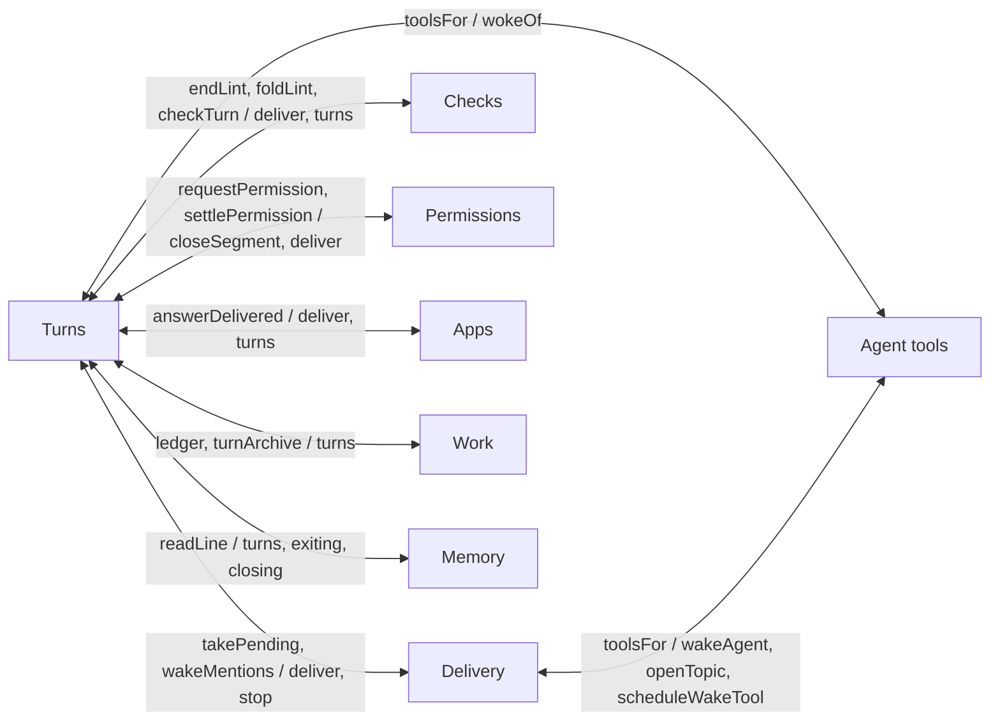
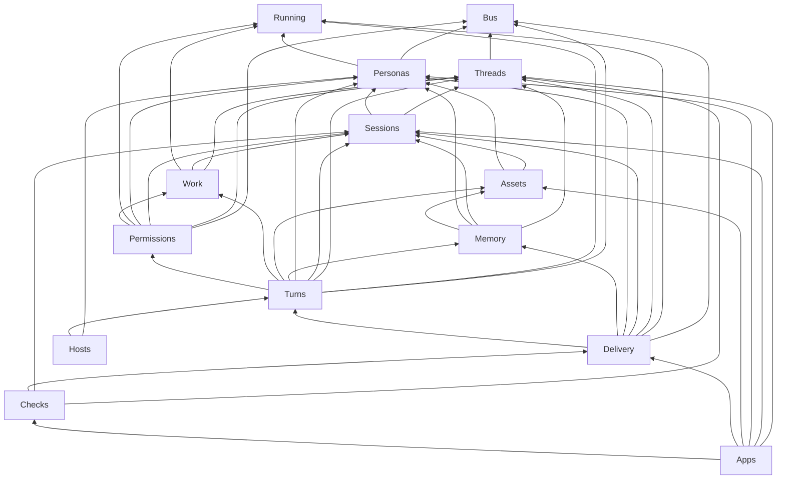
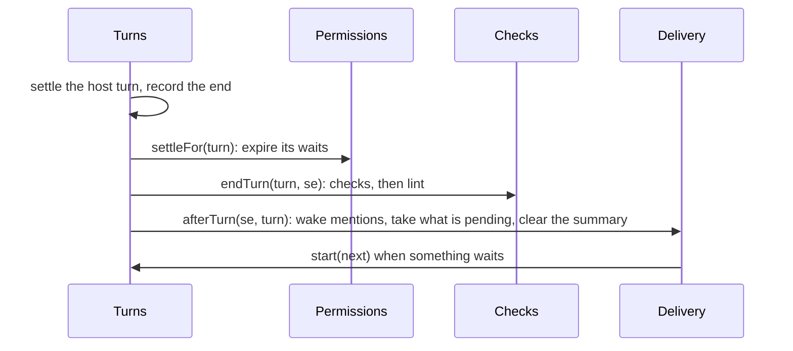

# Concerns as services

**Status:** a proposal, 12 November 2026, for the person to approve before any code moves. Nothing here is built. Numbers are from `main` at edcd2d74, and the scripts that produced them are in the pull request that added this document.

## Why

[#1236](https://github.com/HJeon139/postbox/issues/1236) split `server/runtime.mjs` from 2,823 lines to 907. It moved the code, but not its dependencies. Every moved function still takes the whole `Runtime` as `rt` and reaches into it for whatever it needs, including the other moved functions, through one-line methods that exist only so one module can call another. `Runtime` is now a service locator: any module can reach any other, so nothing says which concern depends on which, and cycles hide behind lazy `rt.x()` calls that the import-cycle lint (`tools/import-cycles.mjs`) can’t see.

The person agreed to fix the cause: each concern becomes a class that owns its state, with its dependencies injected through its constructor, instead of “different concerns wrapped in helper methods out of coding convenience”. They also ruled that “compromising the functionality of the code due to unit test complexity is a bad idea”, and that old unit tests may be deleted rather than refactored, once their behavior is covered.

## The problem, measured

The script reads every module under `server/` and lists the `rt.x` names it uses: a method, a field or the state getter `s`.

- **107 modules reach `Runtime`**: 97 take `rt` as the first parameter of a function or a constructor, and 10 reach it another way (nine `server/remote/turns-*.mjs` through `rts.rt`, and `page-state.mjs` through an options object). 24 of them use 10 or more members. Counted once per module and member, that’s 707 uses.
- **`Runtime` has 152 methods**, a getter (`s`) and 3 static constants. 133 of the methods only forward to a module function, passing `this`. Its constructor sets 26 fields, and modules read and write them directly: `rt.turns` in 36 modules, `rt.exiting` in 10, `rt.permissionWaits` in 8, and `rt.closing`, `rt.keptPoll` and `rt.timers` are written from outside the class.
- **Three test seams are undeclared members.** `rt.judge` (`write-intent.mjs`), `rt.pushes` (`write-intent.mjs`) and `rt.summarize` (`thread-summary.mjs`) aren’t set anywhere in the server. A module checks whether a test assigned one, and falls back to the real thing.

The modules that use the most, out of 107 (the full table is in “Appendix: every module’s members”, below):

| Module | Members | The ones that cross concerns |
|---|---|---|
| `index.mjs` | 50 | the routes; every one is a facade candidate |
| `turn-finish.mjs` | 22 | `takePending`, `wakeMentions`, `endLint`, `checkTurn`, `settlePermission`, `clearSummaryPending`, `permissionWaits` |
| `turn-stop.mjs` | 20 | `deliver`, `takePending`, `settlePermission`, `stopKeptJobs`, `clearSummaryPending`, `turnArchive` |
| `side-threads.mjs` | 18 | `deliver`, `toolsFor`, `turns`, `exiting`, `busyFor` |
| `permission-cards.mjs` | 17 | `deliver`, `closeSegment`, `turns` |
| `thread-summary.mjs` | 17 | `catchUp`, `describeItem`, `turns`, `exiting`, `ledger`, `summarize` |
| `turn-context.mjs` | 17 | `requestPermission`, `recordDenial`, `recordJob`, `recordCommands`, `toolsFor`, `attachmentPath` |
| `message-queue.mjs` | 15 | `deliver`, `stop`, `turns`, `exiting` |
| `remote/turns-resume.mjs` | 15 | `deliver`, `drainQueues`, `stop`, `permissionWaits` |
| `deliver.mjs` | 14 | `deliver` (itself), `foldLint`, `answerDelivered`, `ledger`, `remote` |

### The tangles

Static imports among these modules have no cycle; the lint holds that. Add the calls that go through `rt` (module A calls `rt.x`, and `x` forwards to module B), and **50 of the 106 modules (`index.mjs` left out) fall into one strongly connected component**: from any of them, a chain of calls reaches any other. 81 of the edges inside it go through `rt`. Through `rt` alone, three cycles stand out:

- `deliver`, `blocks`, `apps`, `lint-delivery`, `permission-cards`, `permission-always` and `side-threads`: each asks `rt.deliver` to start a turn, and `deliver` calls back into two of them (`foldLint`, `answerDelivered`).
- `message-queue`, `send-message` and `turn-stop`: the queue stops turns for Send now, and a stopped turn hands its held messages back to the queue.
- `job-records` and `kept-jobs`: each calls the other’s functions through `rt`.

19 modules call themselves through `rt` (`turn-stop` calls `rt.stop`, `deliver` calls `rt.deliver`), so a test that replaces the method changes the module’s own recursion.

Grouping the modules into the concerns proposed below, eight pairs of concerns depend on each other both ways today. Seven of them pass through Turns, and the eighth through the agents’ tools:

## The services

One service per concern, each a class in the folder that designs/architecture.md, “Folders by concern”, gives that concern, so a module moves once. A service owns its state; nothing else reads or writes that state except through its interface. Its constructor takes the services it needs, and nothing else from `Runtime`.

The list refines the starting point from the data:
- **Running** is new: the live-turn registry (`turns`, `exiting`, `closing`). 36 modules read `rt.turns`, most only to ask whether a session has a live turn; answering that from a small service below Turns breaks several of the cycles through it.
- **Memory** is new: what an agent reads of a conversation (catch-up, `describeItem`, `read_conversation`, the thread summaries). Its modules sit between Threads, Sessions and Assets today, and read live turns, so they cycle with Turns; with Running, they don’t.
- **Bus** carries in-process signals only. The store’s own events (`store.emit`, `store.subscribe`) stay the Store’s.
- **Blocks** fold into Apps. `act()` becomes a dispatch in the facade, so blocks no longer call into permissions, wakes and apps.
- **Placement** (where a backend runs, `remote/placement.mjs`) becomes a plain module over the adapter registry and the host manager, not a service: it has no state.

### Store

- **Owns:** the state, the event log and its snapshots, the pending view (`pending`), and the outage gate (`storeWait` and `backendWait`, on `Runtime` today). Invariant: what’s pending is applied in commit order, and nothing writes while the store can’t (designs/architecture.md, “The store: an event log with snapshots, not a database”).
- **Interface:** `state`, `pending`, `emit(type, data)`, `item(threadId, id)`, `items(threadId)`, `subscribe(fn)`, `onStatus(fn)`, `whenWritable(fn)`.
- **Depends on:** nothing (its folder and its `io`).

### Bus

- **Owns:** the listeners for in-process signals. It calls them synchronously, in the order the composition root registered them, and a listener’s throw reaches the emitter, as a direct call’s does today. Nothing is persisted.
- **Interface:** `emit(signal, data)`, `on(signal, fn)`. Signals: `persona.moved`, `card.opened`, `agent.notice`, `session.free`.
- **Depends on:** nothing.

### Running

- **Owns:** the live turn per session, the stopped turns still exiting, a host turn waiting to be attached again after a restart, and `closing`. Invariants: at most one live turn per session; a session that’s busy (running, exiting or awaiting attach) starts no new turn; once `closing` is set, nothing starts.
- **Interface:** `turnOf(sessionId)`, `busy(sessionId)`, `all()`, `closing`. Only Turns writes it: `begin(turn)`, `exit(sessionId, entry)`, `end(sessionId)`, `close()`.
- **Depends on:** nothing.

### Threads

- **Owns:** conversations, topic and side threads, their items, and presence (`viewing`). Invariants: an item has one live copy (`bringForward` leaves a stub); a topic’s reply count and a side thread’s line follow each message; a thread’s lineage ends at its conversation.
- **Interface:** `get(id)`, `create(opts)`, `patch(id, patch)`, `addItem`, `patchItem`, `bringForward`, `lineage(id)`, `conversationThreads(id)`, `glossaryFor(id)`, `notify(level, …)`, `view(id)`, `isViewing(id)`.
- **Depends on:** Store, Bus.

### Personas

- **Owns:** personas. Invariants: a handle is unique among personas not retired, ignoring case; a persona’s backend is registered and can run where it’s placed; a stored retired permission mode runs as Auto; a persona with a live turn doesn’t move hosts.
- **Interface:** `get(id)`, `forSession(se)` (today’s `personaFor`), `byHandle(handle)`, `handles()`, `create(spec)`, `update(id, patch)`, `remove(id)`, `setupFor(id, projectId)` (today’s `mcpContext`). Signal: `persona.moved`.
- **Depends on:** Store, Bus, Running. External: the adapter registry and the host manager, through Placement.

### Sessions

- **Owns:** sessions: one per agent per conversation (#228), their needs and unread counts, notices for the next turn (`tellAgent`), the commands each agent offers (`recordCommands`), and the conversation’s readable folders.
- **Interface:** `get(id)`, `in(threadId)`, `ensure(threadId, personaId, opts)`, `update(id, patch)`, `tell(id, text)`, `roomOf(threadId, se)`, `awayFrom(se, threadId)`, `recordCommands(id, list)`, `remove(id)`.
- **Depends on:** Store, Threads, Personas.

### Assets

- **Owns:** room assets and blobs, message attachments, the files an agent reads and serves (`agentFile`, `appFiles`), and review files.
- **Interface:** `attachmentPath`, `agentFolders`, `agentFile`, `appFiles`, `search`, `reviewFiles`.
- **Depends on:** Store, Sessions, Personas. External: blobs, and Placement for files on a host.

### Memory

- **Owns:** each session’s marker of what it has read, and how a conversation reads to an agent (designs/architecture.md, “A conversation is shared memory”).
- **Interface:** `catchUp(se, exclude)`, `describeItem(item, se)`, `topicRootLine(se, t)`, `readConversation(se, args)`, `readMessage(se, args)`, `summarize(threadId)`, `moveMarkers(…)`.
- **Depends on:** Store, Threads, Sessions, Personas, Assets. External: the summarizer, injected (today’s `rt.summarize` seam).

### Ledger and work

- **Owns:** the work ledger (already a class, `Ledger`, with injected store, blobs and home), its archive passes (#305), the work view’s answers, and the person’s `!` commands.
- **Interface:** `workGit`, `workDiff`, `workOutput`, `restoreWork`, `endWork(turn)`, `runShellCommand`, `stopShellCommand`, `stopAll()`, `expireStale()`.
- **Depends on:** Store, Threads, Sessions, Running. External: `Ledger`, `spawnShell`.

### Permissions

- **Owns:** waits for permission cards and AskUserQuestion, Always rules and the panel, readable folders, the write guard and the request judge.
- **Interface:** `request(sessionId, req)`, `recordDenial(turn, d)`, `settle(itemId, status)`, `settleFor(turn)`, `resolve(threadId, itemId, action, values)`, `resolveDenial`, `view(who)`, `changeRule`, `changeFolder`, `expireStale(keeps)`. Signals: `card.opened` (Turns closes the segment), `agent.notice` (Delivery sends it).
- **Depends on:** Store, Bus, Threads, Sessions, Personas, Running, Work. External: home, config folder, the judge and pushes (today’s `rt.judge` and `rt.pushes` seams).
- designs/rooms-at-scale.md, “The permission layer”, removes most of this. Its redo is that removal; see “Order of work”.

### Turns

- **Owns:** a turn’s life: starting it (`deliver`), what its adapter calls (`turnContext`), its segments and steps, background jobs and kept jobs, stopping, ending, host turns (`RemoteTurns`), attached Claude Code sessions, and settling turns when the store goes down or after a restart. Invariant: a turn ends once, and its end runs the after-end hooks in their order.
- **Interface:** `start(sessionId, message, opts)` (Delivery only), `retry(threadId, itemId)`, `stop(sessionId, opts)`, `requestStop`, `dismissStopAsk`, `stopAll(opts)`, `stopJob`, `keptJobs()`, `resumeRemote`, `restoreRemote()`, `claudeSessions()`, `attachClaudeSession(req)`, `keepsCard(item)`. Hooks, set once by the root: `beforeStart` and `afterEnd`. Signal: `session.free`.
- **Depends on:** Store, Bus, Running, Threads, Sessions, Personas, Memory, Assets, Work, Permissions. External: the adapter registry, the host manager, `signalProcess`, `listProcesses`. Late: the agent tools.

### Delivery

- **Owns:** who answers and when: the queues, mentions and wakes, side threads and wake cards, the chain limit, scheduled wakes and their timers, and opening and sharing back topic threads.
- **Interface:** `send(sessionId, message, opts)` (what every other concern uses in place of `rt.deliver`), `sendMessage(threadId, message)`, `editQueued`, `cancelQueued`, `sendQueuedNow`, `afterTurn(se, turn)`, `drain(sessionId)`, `drainAll()`, `agentWake`, `resolveHop`, `schedule`, `cancelSchedule`, `rearm()`, `startTopic`, `shareToConversation`, `summarizeBack`.
- **Depends on:** Store, Bus, Running, Threads, Sessions, Personas, Memory, Turns.
- designs/rooms-at-scale.md, “Delivery: mention, wake and queue on one inbox”, redesigns this concern. The service’s interface is that inbox’s.

### Checks

- **Owns:** lint entries per agent turn, the server’s checks on a finished turn, and diagram reports from the page.
- **Interface:** `endTurn(turn, se)`, `foldLint(sessionId, message)`, `lint(sessionId, turnId, problems)`, `diagramCheck(threadId, itemId, report)`.
- **Depends on:** Store, Threads, Sessions, Delivery.

### Apps

- **Owns:** agents’ apps and their sends, state and checks, blocks and their answers, review comments, and the view-app consent.
- **Interface:** `act(threadId, itemId, action, values, revision)` for blocks and app sends, `answerDelivered`, `appCheck`, `appEvent`, `appState`, `appQuery`, `appFile`, `register`, `show`.
- **Depends on:** Store, Threads, Sessions, Personas, Assets, Delivery, Checks.

### Hosts

- **Owns:** remote hosts: adding, updating and removing them, their status, installs and keep-updated (designs/architecture.md, “Remote hosts”).
- **Interface:** `localBackends()`, `add`, `update`, `remove`, `status`, `describeInstall`, `install`, `retry`, `setProjectFolder`, `watch()`.
- **Depends on:** Store, Personas, Turns. External: the host manager.

### The dependency graph

Constructor dependencies only. Every service also depends on Store; those arrows are left out.

Built in this order, each service’s dependencies already exist: Store, Bus, Running, Threads, Personas, Sessions, Assets, Memory, Work, Permissions, Turns, Delivery, Checks, Apps, Hosts.

| Service | Dependencies, Store included |
|---|---|
| Store | 0 |
| Bus | 0 |
| Running | 0 |
| Threads | 2 |
| Personas | 3 |
| Sessions | 3 |
| Assets | 3 |
| Memory | 5 |
| Work | 4 |
| Permissions | 7 |
| Turns | 10 |
| Delivery | 8 |
| Checks | 4 |
| Apps | 7 |
| Hosts | 3 |

### How each cycle breaks

A lower service never calls a higher one. Where it does today, the design uses one of three tools: a hook or a late callback that the composition root sets, a signal on the bus, or the small Running service.

| Today | How it breaks |
|---|---|
| Turns ends a turn by calling `takePending`, `wakeMentions`, `endLint`, `checkTurn`, `settlePermission` and `clearSummaryPending` | `afterEnd` hooks, set once in the root in today’s order (below). Turns doesn’t know who listens. |
| Turns starts a turn by calling `foldLint` and `answerDelivered` | `beforeStart` hooks: Checks folds waiting lint into the message, and Apps marks an answer read. |
| A stopped turn hands its held messages to the queue | the `afterEnd` hook of a stopped turn, and `session.free` once its process exits (#126) |
| Permissions, Apps, Checks and side threads call `rt.deliver` | they call `Delivery.send`, below Turns in the graph. Only Delivery calls `Turns.start`. |
| Permissions closes the turn’s segment when a card opens (`closeSegment`) | `card.opened` on the bus; Turns closes the segment |
| Permissions tells an agent what happened to a card after its turn ended | `agent.notice` on the bus; Delivery sends it |
| 36 modules read `rt.turns` and `rt.exiting` | they ask Running |
| Turns and Delivery build the agent’s tools (`toolsFor`), which call back into every service | the agent tools are built last, and the root hands Turns a `toolsFor` callback |
| `updatePersona` drains the queues of an agent moved off a host (`drainMovedOff`) | `persona.moved` on the bus; Delivery drains |
| A host turn attached again drains its queue (`remote/turns-resume.mjs`) | `session.free` on the bus; Delivery drains |
| The store going down settles turns (`store-outage.mjs`, from the Store’s side) | Turns subscribes to `Store.onStatus` |
| `deletePersona` deletes sessions; `deleteSession` and `deleteThread` stop turns and kept jobs | orchestration in the facade: stop, then remove, in one method each |
| `createThread` makes sessions; `resolveProposal` creates a persona and a session | orchestration in the facade |
| `act()` reaches permissions, wake cards, app sends and proposals | the facade dispatches on the item’s kind to the service that owns it |
| Startup expiry asks whether a host turn keeps a card (`rt.remote.keepsCard`) | the root passes `Turns.keepsCard` to `Permissions.expireStale` |

The end of a turn, as the root wires it. The order is today’s `endTurn` (`server/turn-finish.mjs`), and a facade test holds it:

## The composition root

`Runtime`’s constructor builds the services in the order above, then the agent tools, then wires the hooks and the bus, and keeps a thin facade. Nothing outside `server/runtime.mjs` builds a service, except a service’s own tests.

The agent tools (`ui-tools.mjs`, `mcp.mjs` and the tool modules behind them, `server/agent-tools/` in “Folders by concern”) are the agents’ facade, as the routes are the person’s. They’re built from the services after all of them, and Turns gets them as a `toolsFor` callback.

The facade keeps the methods the routes, the seed, the MCP endpoint and the startup in `server/index.mjs` call today, by today’s names, so the behavior net needs no change. Each is one line, or a few for an orchestration listed above:

- **Conversations:** `createThread`, `patchThread`, `deleteThread`, `view`, `startTopic`, `shareToConversation`, `summarizeBack`.
- **Messages:** `sendMessage`, `editQueued`, `cancelQueued`, `sendQueuedNow`, `retry`, `cancelSchedule`.
- **Blocks and apps:** `act`, `diagramCheck`, `appCheck`, `appEvent`, `appState`, `appQuery`, `appFile`.
- **Turns:** `requestStop`, `dismissStopAsk`, `stopJob`, `resumeRemote`, `dismissFailed`, `claudeSessions`, `attachClaudeSession`.
- **Personas and sessions:** `createPersona`, `updatePersona`, `deletePersona`, `mcpContext`, `deleteSession`.
- **Permissions:** `permissionsView`, `changePermissionRule`, `changePermissionFolder`.
- **Commands and work:** `runAgentCommand`, `runShellCommand`, `stopShellCommand`, `workGit`, `workDiff`, `workOutput`, `restoreWork`.
- **Hosts:** `localBackends`, `addHost`, `updateHost`, `removeHost`, `describeHostInstall`, `installHost`, `retryHost`, `setProjectHostFolder`.
- **Lifecycle:** `start()`, which replaces the ten calls `server/index.mjs` makes after building `Runtime` (`rearmSchedules`, `expireStalePermissions`, `expireStaleCommands`, `ledger.expireStale`, `expireStaleJobs`, `rearmMirrors`, `restoreRemoteTurns`, `watchHosts`, `drainAll`, and settling items left streaming), and `close()`, which replaces the shutdown calls (`stopTurns`, `stopShellCommands`, `stopMirrors`, the timers and the archive passes).
- **Reads:** `store` (the routes read state through it), `thread(id)`, `session(id)` and `persona(id)`, which answer 404 when it’s missing.
- **Agents:** `toolsFor(sessionId, turn)`, which the MCP endpoint and the in-process mock call.

That is 57 members, from 152 methods today. `deletePersona`, `dismissFailed` and `patchThread` are module functions that `server/index.mjs` and `server/session-routes.mjs` call with `rt` today; they become facade methods. The other 100 or so go, each when the step that redoes its concern lands.

## Tests

Counted from `tests/`, outside `tests/browser/` and `tests/uat/`: 668 test files. 404 never reach `Runtime` (the store, adapters, `shared/`, tools and UAT checks) and this work doesn’t touch them. 264 reach it, by importing `server/runtime.mjs` or `server/index.mjs`, directly or through a helper. Each of those 264 falls in one bucket:

| Bucket | Files | What happens |
|---|---|---|
| Start the server and test the HTTP routes | 36 | keep: the behavior net |
| Call only facade members | 59 | keep: the behavior net |
| Arrange state through internal writes only (`sessionsIn`, `addItem`, `updateSession`, `ensureSession`, `putThread`, `patchItem`), then act through the facade | 35 | keep; the arrangement moves to a fixture that writes through the Store |
| Swap a dependency field (`rt.adapters`, `rt.blobs`, `rt.listProcesses`) | 6 | keep; the fake moves to the constructor |
| Replace a `Runtime` method | 20 | replace |
| Act through internal methods or helpers that take `rt` | 108 | replace |

### Keep: the behavior net

The 95 net files, the 192 browser specs in `tests/browser/`, and the 14 tests of the MCP endpoint (`handleMcp`), which is the agents’ boundary and stays. 11 of the net files also replace or call something internal; those parts are rewritten in the step that redoes the concern, and the test stays.

### Replace

35 files replace a `Runtime` member, and one helper does (`tests/requested-setup.mjs`): 22 replace a method, 13 only a field. Of the 22, 2 start the server and stay in the net, so 20 are here. The 108 call an internal method to act (`stop` in 37 files, `deliver` in 32, `agentWake` in 30, `resolvePermission` in 17, `schedule` in 14) or an internal helper with `rt` (`settleInterrupted`, `expireWait`, `fireScheduledWake` and others). 24 of them call only `stop` or `resolvePermission`, whose facade forms are `requestStop` and `act`: those are rewritten, not deleted.

**When a test may be deleted:** only in the step that redoes the concern it pins, and only when each behavior it asserts is covered by a named test, in the net or in the new service’s interface tests, that fails when that behavior breaks. The pull request lists each deleted file with the test that covers each of its behaviors. Where nothing covers one, a facade or interface test is written first, and shown failing on a mutant.

### New: interface tests

Each service gets `tests/<folder>/<service>.test.mjs` (designs/architecture.md, “Folders by concern”, “Tests”), written first, against its interface alone. Its dependencies are small fakes built from the interfaces above: a Store over an empty state, a Running with a set of busy sessions, a Bus that records what was emitted. A service’s test never builds `Runtime`.

## Order of work

Smallest and least tangled first. Until a dependency is redone, a service takes it as a narrow function bound to `Runtime` (for example `busy: (id) => rt.busyFor(id)`), and the step that redoes that dependency swaps in the service. The table in the appendix, regenerated, shows each step’s progress: a redone concern’s modules no longer take `rt`.

1. **Personas, the pilot.** It touches 4 modules (`persona-write`, `persona-delete`, `permission-modes`, `setup-context`) that use 2 to 5 members each, depends only on Store, Bus and Running, and its facade methods are covered by route tests and the persona sheet’s specs. It brings in Bus with its first signal, `persona.moved`. Delivery is the most tangled concern, and a poor pilot: a pilot should test the approach, not the hardest case. The pilot’s pull request reports what the step cost and which tests it deleted, so the person can judge the approach before the next one.
2. **Running.** Turns still writes it through `Runtime`; every reader moves to it.
3. **Threads.**
4. **Sessions.**
5. **Assets.**
6. **Memory.**
7. **Ledger and work.**
8. **Checks**, with the `beforeStart` and `afterEnd` hooks it needs.
9. **Apps**, with `act()`’s dispatch in the facade.
10. **Hosts.**
11. **Permissions**, as designs/rooms-at-scale.md, “The permission layer”, removes it. What survives is asks, under that document’s “Asks”.
12. **Delivery**, as designs/rooms-at-scale.md’s inbox.
13. **Turns**, last, when everything it calls has an interface. Then `Runtime` holds only the root and the facade.

Each step is its own pull request, and is done when:
- the service is a class with the constructor dependencies listed here, and its modules no longer take `rt`;
- `Runtime` keeps no delegating method for it, except the facade’s;
- its interface tests were written first, and pass;
- each deleted test is listed with what covers it;
- `npm run check` exits 0, and `npx playwright test` passes, plain and with `POSTBOX_STREAM_LAG=300`;
- one or two mutants of the service (a dropped hook, a skipped invariant check) each fail a named test, listed in the pull request;
- this document’s “Where it stands” says so.

## Risks

- **The order at the end of a turn.** Today it’s the order of the lines in `endTurn`; after this, it’s the order of the hooks in the root. A facade test holds that order before the hooks come in (step 8).
- **Turns has ten dependencies,** the most of any service. If its step shows two concerns inside it (starting a turn and ending one), it splits into two services, from the regenerated table.
- **Two styles at once.** Until the last step, some modules take `rt` and some take services. The narrow functions bound to `Runtime` mark where; each step removes its own.
- **Thin net in places.** A concern whose only tests pin internals has no net to delete against. The deletion rule makes the step write that coverage first.
- **Overlap with other work.** “Folders by concern” moves the same modules, and designs/rooms-at-scale.md redesigns Delivery and removes Permissions. Services land in the target folders, and steps 11 and 12 are those redesigns rather than a pass over code they delete.

## What this does not do

- It changes no behavior: no route, event, stored format, adapter contract or page changes.
- It adds no dependency injection library or container. The root is plain constructor calls.
- It doesn’t redesign delivery or the permission layer; designs/rooms-at-scale.md does.
- It doesn’t touch `app/`, the adapters’ internals or the host daemon.

## Where it stands

- **Done:** this proposal.
- **Next:** the person’s review. Then step 1, Personas.

## Appendix: every module’s members

Each module under `server/` that reaches `Runtime`, with the `rt.x` names it uses, on `main` at edcd2d74. A `*` marks a module that reaches it another way than as a first parameter. `view-app/view-of.mjs` takes `rt` and uses no member, so it isn’t listed.

106 modules

| Module | Count | Members it uses |
|---|---|---|
| `index.mjs` | 50 | `act`, `appCheck`, `appEvent`, `appFile`, `appQuery`, `appState`, `attachClaudeSession`, `cancelQueued`, `cancelSchedule`, `changePermissionFolder`, `changePermissionRule`, `claudeSessions`, `createPersona`, `createThread`, `deleteThread`, `diagramCheck`, `drainAll`, `editQueued`, `ensureSession`, `expireStaleCommands`, `expireStaleJobs`, `expireStalePermissions`, `ledger`, `lineage`, `localBackends`, `patchItem`, `permissionsView`, `rearmMirrors`, `rearmSchedules`, `restoreWork`, `resumeRemote`, `retry`, `runAgentCommand`, `runShellCommand`, `sendMessage`, `sendQueuedNow`, `shareToConversation`, `startTopic`, `stopMirrors`, `stopShellCommand`, `stopShellCommands`, `stopTurns`, `summarizeBack`, `timers`, `turnArchive`, `updatePersona`, `view`, `workDiff`, `workGit`, `workOutput` |
| `turn-finish.mjs` | 22 | `addItem`, `awayFrom`, `checkTurn`, `clearSummaryPending`, `endLint`, `isViewing`, `mirrors`, `notify`, `patchItem`, `permissionWaits`, `quietLint`, `remote`, `s`, `settlePermission`, `settleSubagentSteps`, `stallLeftRunning`, `stallSteps`, `store`, `takePending`, `turns`, `updateSession`, `wakeMentions` |
| `turn-stop.mjs` | 20 | `addItem`, `clearSummaryPending`, `closing`, `deliver`, `exiting`, `patchItem`, `permissionWaits`, `recordStopped`, `remote`, `s`, `session`, `settlePermission`, `stallLeftRunning`, `stop`, `stopKeptJobs`, `store`, `takePending`, `turnArchive`, `turns`, `updateSession` |
| `side-threads.mjs` | 18 | `addItem`, `agentWake`, `busyFor`, `deliver`, `ensureSession`, `exiting`, `lineage`, `patchItem`, `persona`, `personaByHandle`, `recordAgentMessage`, `s`, `sessionsIn`, `store`, `tellAgent`, `toolsFor`, `turns`, `updateSession` |
| `permission-cards.mjs` | 17 | `addItem`, `allowAlways`, `alwaysFor`, `askPerson`, `awayFrom`, `closeSegment`, `deliver`, `notify`, `patchItem`, `permissionWaits`, `personaFor`, `readsRules`, `s`, `settlePermission`, `store`, `turns`, `updateSession` |
| `thread-summary.mjs` | 17 | `adapters`, `catchUp`, `closing`, `config`, `describeItem`, `exiting`, `ledger`, `lineage`, `patchItem`, `persona`, `s`, `sessionsIn`, `store`, `summarize`, `topicRootLine`, `turns`, `updateSession` |
| `turn-context.mjs` | 17 | `addItem`, `attachmentPath`, `config`, `handles`, `ledger`, `patchItem`, `personaFor`, `recordCommands`, `recordDenial`, `recordJob`, `remote`, `requestPermission`, `roomOf`, `s`, `store`, `toolsFor`, `updateSession` |
| `message-queue.mjs` | 15 | `addItem`, `closing`, `deliver`, `drainQueue`, `drainQueues`, `exiting`, `lineage`, `postAndDeliver`, `s`, `stop`, `store`, `tellAgent`, `thread`, `threadRefs`, `turns` |
| `remote/turns-resume.mjs`* | 15 | `addItem`, `closing`, `conversationThreads`, `deliver`, `drainQueues`, `exiting`, `patchItem`, `permissionWaits`, `personaFor`, `s`, `session`, `stop`, `store`, `turns`, `updateSession` |
| `blocks.mjs` | 14 | `addItem`, `bringForward`, `config`, `deliver`, `patchItem`, `resolveAppSend`, `resolveDenial`, `resolveHop`, `resolvePermission`, `resolveProposal`, `s`, `store`, `turns`, `unreadAnswer` |
| `claude-mirror.mjs` | 14 | `addItem`, `config`, `createPersona`, `createThread`, `mirror`, `mirrors`, `patchItem`, `personaByHandle`, `pollMirror`, `s`, `sessionsIn`, `store`, `turns`, `updateSession` |
| `deliver.mjs` | 14 | `answerDelivered`, `closing`, `deliver`, `exiting`, `foldLint`, `ledger`, `patchItem`, `persona`, `remote`, `s`, `session`, `store`, `turns`, `updateSession` |
| `wake-cards.mjs` | 14 | `addItem`, `agentWake`, `awayFrom`, `deliver`, `ensureSession`, `lineage`, `notify`, `patchItem`, `personaByHandle`, `s`, `sessionsIn`, `store`, `tellAgent`, `turns` |
| `apps.mjs` | 13 | `addItem`, `awayFrom`, `blobs`, `bringForward`, `deliver`, `lint`, `needAppSend`, `notify`, `patchItem`, `personaFor`, `s`, `store`, `turns` |
| `store-outage.mjs` | 13 | `backendWait`, `clearSummaryPending`, `exiting`, `patchItem`, `recordStopped`, `remote`, `s`, `stallLeftRunning`, `store`, `storeWait`, `timers`, `turns`, `updateSession` |
| `send-message.mjs` | 12 | `ensureSession`, `handles`, `lineage`, `persona`, `personaByHandle`, `postAndDeliver`, `remote`, `s`, `sessionsIn`, `sideSession`, `thread`, `turns` |
| `share-back.mjs` | 12 | `addItem`, `deliver`, `exiting`, `patchItem`, `personaByHandle`, `s`, `shareText`, `sideSession`, `store`, `summarizing`, `thread`, `turns` |
| `job-records.mjs` | 11 | `keptJobs`, `keptPoll`, `ledger`, `patchItem`, `s`, `stallSteps`, `store`, `tellAgent`, `turns`, `updateSession`, `watchKept` |
| `kept-jobs.mjs` | 11 | `endJob`, `keptJobs`, `keptPoll`, `listProcesses`, `pollKept`, `s`, `session`, `signalProcess`, `store`, `turns`, `updateSession` |
| `permissions-panel.mjs` | 11 | `configDir`, `home`, `latestProject`, `panelTarget`, `persona`, `personaFor`, `readsRules`, `s`, `session`, `turns`, `updateSession` |
| `session-lifecycle.mjs` | 11 | `addItem`, `lineage`, `patchItem`, `remote`, `s`, `session`, `sessionsIn`, `stop`, `stopKeptJobs`, `store`, `thread` |
| `topic-open.mjs` | 11 | `addItem`, `agentWake`, `lineage`, `patchItem`, `putThread`, `s`, `session`, `sessionsIn`, `store`, `thread`, `turns` |
| `write-intent.mjs` | 11 | `adapters`, `addItem`, `judge`, `ledger`, `panelTarget`, `patchItem`, `personaFor`, `pushes`, `s`, `store`, `turns` |
| `shell-runs.mjs` | 10 | `addItem`, `commandFolder`, `patchItem`, `personaFor`, `s`, `sessionsIn`, `shellRuns`, `spawnShell`, `store`, `thread` |
| `ask-question.mjs` | 9 | `addItem`, `awayFrom`, `closeSegment`, `notify`, `permissionWaits`, `requestPermission`, `s`, `settlePermission`, `turns` |
| `remote/turns-prompts.mjs`* | 9 | `awayFrom`, `conversationThreads`, `patchItem`, `permissionWaits`, `requestPermission`, `s`, `settlePermission`, `store`, `turns` |
| `tool-ask.mjs` | 9 | `addItem`, `deliver`, `patchItem`, `persona`, `s`, `session`, `store`, `turns`, `updatePersona` |
| `card-needs.mjs` | 8 | `awayFrom`, `notify`, `patchItem`, `permissionWaits`, `s`, `store`, `turns`, `updateSession` |
| `scheduled-wakes.mjs` | 8 | `addItem`, `deliver`, `ledger`, `patchItem`, `s`, `session`, `store`, `timers` |
| `agent-commands.mjs` | 7 | `addItem`, `deliver`, `s`, `sessionsIn`, `thread`, `turns`, `updateSession` |
| `hosts-routes.mjs` | 7 | `addHost`, `describeHostInstall`, `installHost`, `removeHost`, `retryHost`, `setProjectHostFolder`, `updateHost` |
| `lint-delivery.mjs` | 7 | `addItem`, `config`, `deliver`, `lints`, `s`, `store`, `turns` |
| `mcp.mjs` | 7 | `adapters`, `appFiles`, `personaFor`, `s`, `session`, `toolsFor`, `turns` |
| `permission-prompt.mjs` | 7 | `permissionWaits`, `personaFor`, `requestPermission`, `s`, `settlePermission`, `store`, `turns` |
| `remote/host-admin.mjs` | 7 | `exiting`, `hosts`, `persona`, `remote`, `s`, `stop`, `store` |
| `remote/placement.mjs` | 7 | `adapters`, `drainQueues`, `exiting`, `hosts`, `remote`, `s`, `turns` |
| `ui-tools.mjs` | 7 | `addItem`, `persona`, `readConversation`, `readMessage`, `s`, `session`, `store` |
| `view-app/consent.mjs` | 7 | `addItem`, `deliver`, `patchItem`, `s`, `session`, `store`, `turns` |
| `agent-files.mjs` | 6 | `agentFile`, `agentFolders`, `blobs`, `personaFor`, `s`, `session` |
| `catch-up.mjs` | 6 | `describeItem`, `lineage`, `s`, `store`, `topicRootLine`, `updateSession` |
| `conversations.mjs` | 6 | `ensureSession`, `persona`, `putSession`, `putThread`, `s`, `thread` |
| `remote/turns-end.mjs`* | 6 | `closing`, `notify`, `patchItem`, `s`, `store`, `tellAgent` |
| `review-comments.mjs` | 6 | `config`, `deliver`, `patchItem`, `session`, `store`, `turns` |
| `thread-erase.mjs` | 6 | `s`, `stop`, `stopKeptJobs`, `stopMirrorFor`, `store`, `turns` |
| `turn-checks.mjs` | 6 | `glossaryFor`, `lineage`, `patchItem`, `stallSteps`, `store`, `tellAgent` |
| `item-lines.mjs` | 5 | `attachmentPath`, `personaFor`, `remote`, `s`, `store` |
| `mention-wakes.mjs` | 5 | `addItem`, `agentWake`, `deliver`, `handles`, `tellAgent` |
| `permission-expiry.mjs` | 5 | `patchItem`, `remote`, `s`, `store`, `tellAgent` |
| `persona-delete.mjs` | 5 | `adapters`, `deleteSession`, `persona`, `s`, `store` |
| `read-folders.mjs` | 5 | `home`, `persona`, `s`, `store`, `updateSession` |
| `remote/turns-snapshot.mjs`* | 5 | `conversationThreads`, `lineage`, `readLine`, `s`, `store` |
| `remote/turns-start.mjs`* | 5 | `adapters`, `config`, `notify`, `s`, `updateSession` |
| `remote/turns-tools.mjs`* | 5 | `blobs`, `s`, `session`, `tellAgent`, `toolsFor` |
| `session-routes.mjs` | 5 | `deleteSession`, `dismissStopAsk`, `requestStop`, `session`, `stopJob` |
| `turn-end-work.mjs` | 5 | `ledger`, `lineage`, `patchItem`, `store`, `turnArchive` |
| `view-app/view-app.mjs` | 5 | `agentFolders`, `personaFor`, `s`, `session`, `store` |
| `app-retire.mjs` | 4 | `patchItem`, `s`, `session`, `store` |
| `asset-tools.mjs` | 4 | `agentFile`, `s`, `session`, `store` |
| `block-show.mjs` | 4 | `addItem`, `config`, `registerApp`, `store` |
| `diagram-check.mjs` | 4 | `lint`, `s`, `store`, `updateSession` |
| `persona-write.mjs` | 4 | `adapters`, `persona`, `personaByHandle`, `store` |
| `prompt-claim.mjs` | 4 | `addItem`, `patchItem`, `s`, `turns` |
| `read-message.mjs` | 4 | `conversationThreads`, `describeItem`, `readLine`, `store` |
| `reply-segment.mjs` | 4 | `addItem`, `closeSegment`, `patchItem`, `store` |
| `restart-sweep.mjs` | 4 | `remote`, `s`, `store`, `updateSession` |
| `room-chain-limit.mjs` | 4 | `lineage`, `renameThread`, `store`, `thread` |
| `schedule-tools.mjs` | 4 | `cancelSchedule`, `s`, `schedule`, `toolsFor` |
| `seed.mjs` | 4 | `createPersona`, `createThread`, `personaByHandle`, `store` |
| `subagent-end.mjs` | 4 | `session`, `store`, `turns`, `updateSession` |
| `write-guard.mjs` | 4 | `configDir`, `home`, `panelTarget`, `readsRules` |
| `archive-runtime.mjs` | 3 | `ledger`, `s`, `turns` |
| `bring.mjs` | 3 | `s`, `session`, `shareText` |
| `host-rules.mjs` | 3 | `persona`, `s`, `store` |
| `remote/host-status.mjs` | 3 | `hosts`, `s`, `store` |
| `remote/turns-origin.mjs` | 3 | `blobs`, `personaFor`, `s` |
| `remote/turns-stops.mjs`* | 3 | `patchItem`, `personaFor`, `s` |
| `remote/turns.mjs` | 3 | `personaFor`, `s`, `store` |
| `review-files.mjs` | 3 | `agentFile`, `blobs`, `store` |
| `session-write.mjs` | 3 | `s`, `store`, `updateSession` |
| `turn-marks.mjs` | 3 | `blobs`, `s`, `store` |
| `unarchive.mjs` | 3 | `s`, `store`, `updateSession` |
| `work-view.mjs` | 3 | `addItem`, `ledger`, `thread` |
| `empty-reply.mjs` | 2 | `personaFor`, `tellAgent` |
| `held-session.mjs` | 2 | `s`, `store` |
| `host-tool.mjs` | 2 | `narrator`, `s` |
| `message-attachments.mjs` | 2 | `blobs`, `s` |
| `newer-waiting.mjs` | 2 | `s`, `turns` |
| `permission-always.mjs` | 2 | `persona`, `readsRules` |
| `permission-modes.mjs` | 2 | `s`, `store` |
| `queue-batch.mjs` | 2 | `busyFor`, `store` |
| `reactions.mjs` | 2 | `conversationThreads`, `store` |
| `remote/serve.mjs` | 2 | `restoreRemoteTurns`, `watchHosts` |
| `remote/turns-restore.mjs`* | 2 | `personaFor`, `s` |
| `remote/turns-shared.mjs`* | 2 | `s`, `updateSession` |
| `setup-context.mjs` | 2 | `persona`, `s` |
| `thread-lineage.mjs` | 2 | `lineage`, `s` |
| `turn-steps.mjs` | 2 | `patchItem`, `store` |
| `adapters/adapter.mjs` | 1 | `adapters` |
| `asset-search.mjs` | 1 | `s` |
| `helpers.mjs` | 1 | `s` |
| `page-state.mjs`* | 1 | `localBackends` |
| `review-person.mjs` | 1 | `config` |
| `setup-routes.mjs` | 1 | `mcpContext` |
| `thread-write.mjs` | 1 | `store` |
| `tool-gate.mjs` | 1 | `store` |
| `turn-work.mjs` | 1 | `ledger` |

