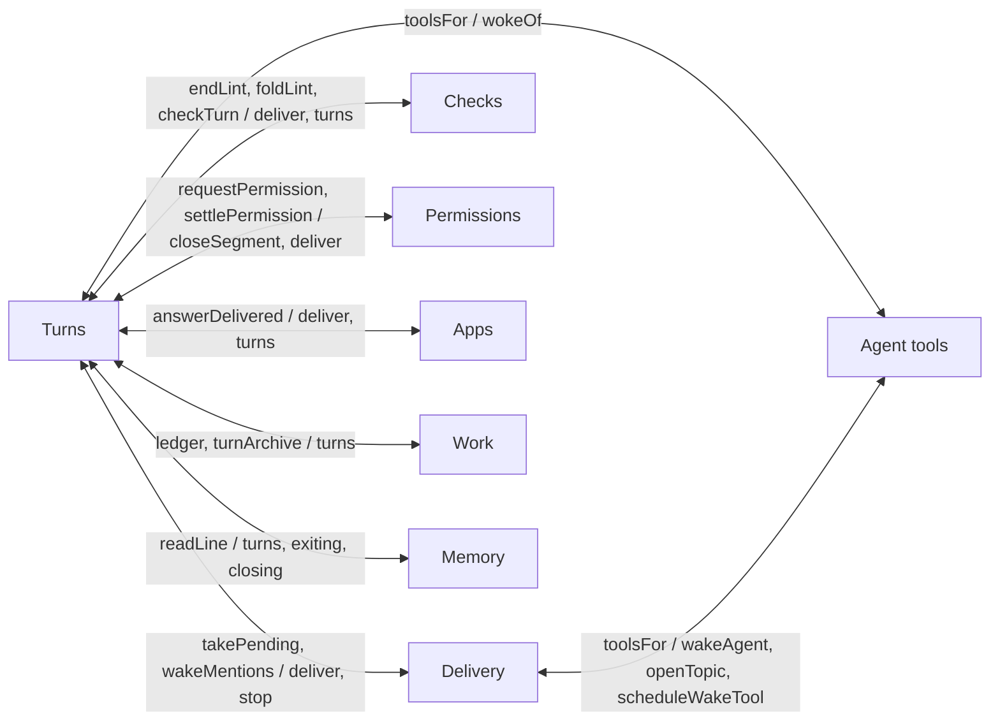
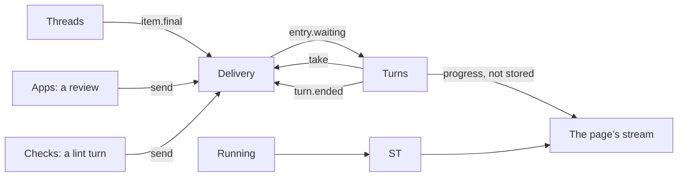
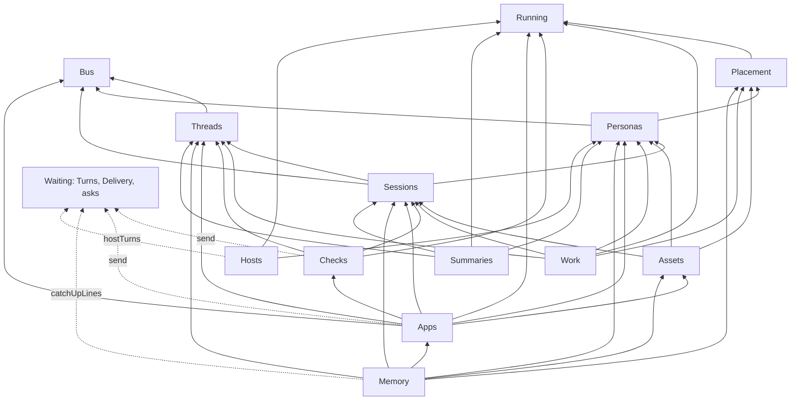
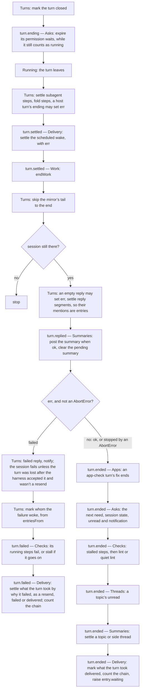
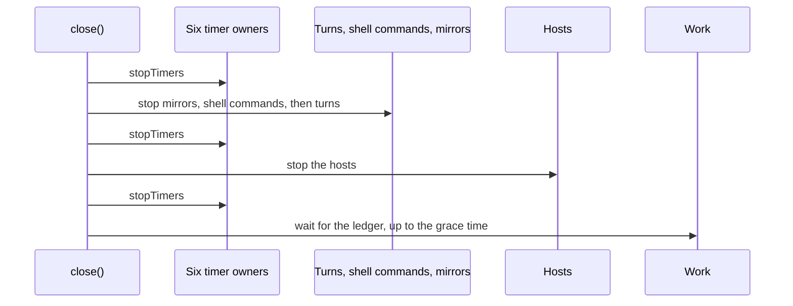

# Concerns as services

**Status:** a proposal, 12 November 2026, for the person to approve before any code moves. Steps 0 to 11 are built, from the test fixture to Hosts, with the thread summaries split off from Memory as Summaries in step 10; Asks, Delivery and Turns wait for rooms at scale; Delivery and Turns are designed as the inbox (“Delivery and Turns, built as the inbox”). Numbers are from `main` at 2259cebe. The scripts that produced them are in the pull request that added this document; the last of them, `svc-check.mjs`, checks the design against the code.

## Why

[#1236](https://github.com/HJeon139/postbox/issues/1236) split `server/runtime.mjs` from 2,823 lines to about 900. It moved the code, but not its dependencies. Every moved function still takes the whole `Runtime` as `rt` and reaches into it for whatever it needs, including the other moved functions, through one-line methods that exist only so one module can call another. `Runtime` is now a service locator: any module can reach any other, nothing says which concern depends on which, and cycles hide behind lazy `rt.x()` calls that the import-cycle lint (`tools/import-cycles.mjs`) can’t see.

The person agreed to fix the cause: each concern becomes a class that owns its state, with its dependencies injected through its constructor, instead of “different concerns wrapped in helper methods out of coding convenience”. They also ruled that “compromising the functionality of the code due to unit test complexity is a bad idea”, and that old unit tests may be deleted rather than refactored, once their behavior is covered.

## The problem, measured

The scan reads every module under `server/` and lists the `rt.x` names it uses: a method, a field or the state getter `s`.

- **108 modules reach `Runtime`**: 98 take `rt` as the first parameter of a function or a constructor, and 10 reach it another way (nine `server/remote/turns-*.mjs` through `rts.rt`, and `page-state.mjs` through an options object). 23 of them use 10 or more members. Counted once per module and member, that’s 703 uses.
- **`Runtime` has 152 methods**, a getter (`s`) and 3 static constants. 133 of the methods only forward to a module function, passing `this`. Its constructor sets 27 fields, and modules read and write them directly: `rt.turns` in 36 modules, `rt.exiting` in 10, `rt.permissionWaits` in 9; `rt.closing`, `rt.keptPoll` and `rt.timers` are assigned from outside the class.
- **Three test seams are undeclared members.** `rt.judge` and `rt.pushes` (`write-intent.mjs`) and `rt.summarize` (`thread-summary.mjs`) aren’t set anywhere in the server. A module checks whether a test assigned one, and falls back to the real thing.
- **Counting `rt.x` misses half the dependencies.** A module also imports functions that take `rt` and calls them with its own: `persona-write.mjs` calls `settleToolAsks`, which delivers to agents and adds items, and `catch-up.mjs` calls `heldFor` in `wake-cards.mjs`. `svc-check.mjs` counts both.

The modules that use the most, out of 108 (the full table is in “Appendix: every module’s members”, below):

| Module | Members | The ones that cross concerns |
|---|---|---|
| `index.mjs` | 49 | the routes; every one is a facade candidate |
| `turn-finish.mjs` | 22 | `takePending`, `wakeMentions`, `endLint`, `checkTurn`, `settlePermission`, `clearSummaryPending`, `permissionWaits` |
| `turn-stop.mjs` | 21 | `deliver`, `takePending`, `settlePermission`, `stopKeptJobs`, `clearSummaryPending`, `turnArchive` |
| `side-threads.mjs` | 18 | `deliver`, `toolsFor`, `turns`, `exiting`, `busyFor` |
| `permission-cards.mjs` | 17 | `deliver`, `closeSegment`, `turns` |
| `thread-summary.mjs` | 17 | `catchUp`, `describeItem`, `turns`, `exiting`, `ledger`, `summarize` |
| `turn-context.mjs` | 17 | `requestPermission`, `recordDenial`, `recordJob`, `recordCommands`, `toolsFor`, `attachmentPath` |
| `message-queue.mjs` | 15 | `deliver`, `stop`, `turns`, `exiting` |
| `remote/turns-resume.mjs` | 15 | `deliver`, `drainQueues`, `stop`, `permissionWaits` |
| `deliver.mjs` | 14 | `deliver` (itself), `foldLint`, `answerDelivered`, `ledger`, `remote` |

### The tangles

Static imports among these modules have no cycle; the lint holds that. Add the calls that go through `rt` (module A calls `rt.x`, and `x` forwards to module B), and **50 of the 107 modules (`index.mjs` left out) fall into one strongly connected component**: from any of them, a chain of calls reaches any other. 81 of the edges inside it go through `rt`. Through `rt` alone, three cycles stand out:

- `deliver`, `blocks`, `apps`, `lint-delivery`, `permission-cards`, `permission-always` and `side-threads`: each asks `rt.deliver` to start a turn, and `deliver` calls back into two of them (`foldLint`, `answerDelivered`).
- `message-queue`, `send-message` and `turn-stop`: the queue stops turns for Send now, and a stopped turn hands its held messages back to the queue.
- `job-records` and `kept-jobs`: each calls the other’s functions through `rt`.

19 modules call themselves through `rt` (`turn-stop` calls `rt.stop`, `deliver` calls `rt.deliver`), so a test that replaces the method changes the module’s own recursion.

Grouping the modules by concern, the calls through `rt` alone make eight pairs of concerns that depend on each other both ways. Seven pass through Turns, and the eighth through the agents’ tools:

## What waits for rooms at scale

designs/rooms-at-scale.md decides the end state of the most tangled code: the permission layer goes (“The permission layer”), mention, wake and queue move onto one inbox per agent (“Delivery: mention, wake and queue on one inbox”), and needs you becomes asks, with the wake, hop, add-agent, app-send and permission cards gone (“Asks: needs you as an interface”). The permission layer’s removal is paused (10 November) until a demo proves inferred grants hold.

So this work doesn’t build interfaces around that machinery. Three concerns **wait**, in their current shape, behind the facade, until those decisions land:
- **Asks and permissions:** `permission-*.mjs`, `permissions-panel`, `ask-question`, `tool-ask`, `prompt-claim`, `read-folders`, `write-guard`, `write-intent`, `host-rules`, `card-needs`, `blocks` (its `act()` dispatches the cards), `view-app/consent` and `view-app/view-app` (the download card). The app-send cards split from `apps.mjs` in step 9 were removed in #1488.
- **Delivery:** `message-queue`, `send-message`, `turn-batch`, `mention-wakes`, `newer-waiting`, `side-threads`, `wake-cards`, `scheduled-wakes`, `chain-stop`, `topic-open`, `share-back`, `bring` and `agent-commands`.
- **Turns:** `deliver`, `turn-context`, `turn-stop`, `turn-finish`, the turn’s steps and marks, jobs and kept jobs, `claude-mirror`, `store-outage`, `restart-sweep`, and `remote/turns*.mjs`. Starting and ending a turn interleave delivery and needs at every step (see “The end of a turn”, below), so Turns is redone with the inbox, not before it.

That is 55 modules. Waiting code keeps taking `rt`, and may call any service. The rule for everything redone before then: **a service never calls waiting code.** Where it does today, it raises a signal or calls a port, below, and the waiting code listens or answers.

## The services

One service per concern, each a class in the folder that designs/architecture/folders.md gives that concern, so a module moves once. A service owns its state; nothing else reads or writes that state except through its interface. Its constructor takes the services it needs, and nothing else from `Runtime`.

The list refines the starting point from the data:
- **Running** is new: the live-turn registry (`turns`, `exiting`, `closing`). 36 modules read `rt.turns`, most only to ask whether a session has a live turn; answering that from a small service below everything else breaks several cycles.
- **Placement** is new: where a backend runs (`remote/placement.mjs`, today in the strongly connected component). Personas, Assets, Work and Memory ask it; it reads Running.
- **Memory** is new: what an agent reads of a conversation (catch-up, `describeItem`, `read_conversation`). The thread summaries were part of it, and are a service of their own, **Summaries**, since step 10.
- **Bus** carries in-process signals only. The store’s own events (`store.emit`, `store.subscribe`) stay the Store’s.
- **Ports** are the few functions a redone service needs from waiting code, injected late by the root: `send`, `catchUpLines` and `hostTurns`. Each names what the service needs, not the machinery behind it: `send` is “a message for an agent”, which is an inbox entry in rooms-at-scale’s end state.

### Store

- **Owns:** the state, the event log and its snapshots, the pending view (`pending`), and the outage gate (`storeWait` and `backendWait` on `Runtime` today; `gated` and `saveBackendState` in `store-outage.mjs`, `whenWritable` in `store-wait.mjs`). Invariant: what’s pending is applied in commit order, and nothing writes while the store can’t (designs/architecture/store.md).
- **Interface:** `state`, `pending`, `emit(type, data)`, `item(threadId, id)`, `items(threadId)`, `subscribe(fn)`, `onStatus(fn)`, `whenWritable(fn)`, `gated(fn)`.
- **Depends on:** nothing (its folder and its `io`).

### Bus

- **Owns:** the listeners for in-process signals. It calls them synchronously, in the order the root registered them, and a listener’s throw reaches the emitter, as a direct call’s does today. Nothing is persisted.
- **Interface:** `emit(signal, data)`, `on(signal, fn)`.
- **Signals:** `persona.updated` (Personas, after a write), `session.joined` (Sessions: a declined add lifts), `session.removing` (Sessions, before a session’s remove: host turns keep its stops still waiting on a host in that host’s record, `hostStops`, #1796; `RemoteTurns` registers this one itself, since `server/runtime.mjs` is at its ceiling), `item.added` (Threads: a side thread’s line counts the message), `item.final` (Threads, once per item, when it is first final: Delivery will turn its mentions into entries; nothing listens yet but the tests), `item.moved` (Threads, from `bringForward`: Memory moves its read markers to the stub), `app.retired` (Apps: nothing listens since the app-send cards were removed in #1488), `block.withdrawn` (Apps, from `update_block`’s withdraw: the block’s need releases).
- **`persona.updated`’s listeners, in this order:** host turns set Running’s awaiting-attach entries for that persona’s sessions from where it runs now (`RemoteTurns.noteAttach`): one moved off its host is cleared, and one moved back before the attach waits again; sessions drop what their last turn reported, after a change of backend or model (`Sessions.forgetReported`, #1315); tool asks settle (`settleToolAsks`); the queue of an agent moved off a host drains (`drainMovedOff`); an agent moved to another backend or computer leaves its old quota’s mark and takes the new one’s, if it’s out (`quotaMoved`, #442). Today `busyFor` computes awaiting attach from the persona as it is after the write, so a drain right after it already sees the agent free; clearing first keeps that. If the queue drained first, a moved agent’s messages would stay held.
- **Depends on:** nothing.

### Running

- **Owns:** the live turn per session, the stopped turns still exiting, the sessions whose host turn waits to be attached again after a restart (#1135), with the host each waits on, and `closing`. Invariants: at most one live turn per session; no turn starts while the session’s stopped turn is still exiting; once `closing` is set, nothing starts. A session awaiting attach is busy, so the queue and wakes hold what’s for it, but `begin` doesn’t refuse it (below).
- **Interface:** `turnOf(sessionId)`, `exitOf(sessionId)`, `afterExit(sessionId)` (settles once a stopped turn has exited, #1797), `midTurn(sessionId)`, `awaitsAttach(sessionId)`, `busy(sessionId)`, `all()`, `closing`. `midTurn` is a turn running or one still exiting, which Placement reads; `busy` adds awaiting attach, which the queue and the side threads read; `sendMessage` reads `turnOf` and `awaitsAttach`, without exiting (#1136). Only Turns writes it: `begin(turn)`, `exit(sessionId, entry)`, `end(sessionId)`, `exited(sessionId)`, `awaitAttach(sessionId, hostId)`, `attached(sessionId)`, `close()`, and `releaseWaits()`, which a shutdown calls once it stops waiting for stopped turns, ending every `afterExit` wait then and after (#1797). `exit` records a stopped turn as exiting while it’s still live, and `end` lets it go after its abort, so what the abort runs still finds it live, as before; `exited` is its process gone. `begin` throws for a write that breaks an invariant. It doesn’t refuse a session awaiting attach: Send now, a direct delivery and a scheduled wake reach `deliver` without the queue and start a turn on the host beside the one about to be attached, as before step 2, a gap #1135 leaves open; refusing there lost the message, or stopped Postbox when a wake’s timer threw (#1303’s review). Until Turns is redone, `Runtime` keeps `turns`, `exiting` and `closing` as getters onto Running’s, so waiting code reads them unchanged.
- **Depends on:** nothing. Before step 2, `busyFor` (`runtime.mjs`) asked `RemoteTurns.awaitsAttach`, which read the session and `hostOf(personaFor(se))` (`remote/turns.mjs`): computed that way, `busy()` would need Store and Personas, a cycle with Placement. So Running keeps the awaiting sessions, with the host each waits on, instead: `RemoteTurns.noteAttach` computes what `awaitsAttach` did and writes it, wherever `restoring` is set or deleted (`turns-restore`, `turns-end`, `turns-start`, `turns-resume`), and the first `persona.updated` listener calls it for the persona’s sessions. It re-adds an entry as well as clearing one: an agent moved off a silent host and back before its welcome waits for the attach again, as it did when this was read live.

### Placement

- **Owns:** no state. The rules for where a persona’s backend runs: registered here or on a host, and whether a persona with a live turn may move.
- **Interface:** `localBackends()`, `runsHere(backend)`, `notHere(backend)`, `placement(remote, backend)`, `placedPatch(id, p, patch)`, `registeredAdapter(persona)`, `requestAdapter(handle, persona)`, `refuseHere(se, persona)`, `refuseUnregisteredSend(personas)`, `hereFolder`, `hostOf(persona)` (from `RemoteTurns`).
- **Depends on:** Store, Running. External: the adapter registry and the host manager. `drainMovedOff` leaves it for the `persona.updated` listener.
- **From Running it needs “mid-turn”, not `busy()`:** a turn running, or a stopped one still exiting. `busy()` also counts a host turn waiting to be attached again, and that would refuse moving an agent off a host that may never answer, which #1135 lets it do. Built so in step 1, the four “moved off a silent host” tests in `tests/remote-turns-restart-window.test.mjs` fail.

### Threads

- **Owns:** conversations, topic and side threads, their items, and presence (`viewing`). Invariants: an item has one live copy (`bringForward` leaves a stub); a topic’s reply count follows each message; a thread’s lineage ends at its conversation.
- **Interface:** `get(id)`, `create(opts)` (from `conversations.mjs`), `put(thread)`, `patch(id, change)`, `toWrite(id)`, `pending()`, `rename(id, title)`, `addItem`, `patchItem`, `bringForward`, `lineage(id)`, `conversationThreads(id)`, `glossaryFor(id)`, `notify(level, …)`, `view(id)`, `isViewing(id)`, `toggleReaction`. Signals: `item.added`, with the thread as written; `item.final`, with the item and its thread, once per item, when it is first final; and `item.moved`, with the stub’s id. An item is final when it’s added, unless it’s a reply still streaming, which is final when a patch moves it out of streaming (its segment closes, or its turn ends, fails or is stopped). Clearing the sessions’ unread counts when a thread is viewed is Sessions’ (`markRead`); the facade’s `view()` clears them first, then calls `Threads.view`, which marks the thread open and clears its own, the order the two writes always had.
- **Depends on:** Store, Bus.

### Personas

- **Owns:** personas. Invariants: a handle is unique among personas not retired, ignoring case; a persona’s backend is registered and can run where it’s placed; a stored retired permission mode runs as Auto.
- **Interface:** `get(id)`, `forSession(se)` (today’s `personaFor`), `byHandle(handle)`, `handles()`, `create(spec)`, `update(id, patch)`, `remove(id, after)`, `setupFor(id, projectId)` (today’s `mcpContext`). Signal: `persona.updated`, with the persona as written, as it was, and the change. `remove(id, after)` emits the removal and has each backend forget the persona once `after` settles; its sessions go first, in the facade’s `deletePersona`, which passes the exit of their stopped turns as `after`, since a CLI ending in its own time could write the memory being removed (#1797).
- **Depends on:** Store, Bus, Placement. `retireModes` stays with the permission layer and runs from `start()`.

### Sessions

- **Owns:** sessions: one per agent per conversation (#228), their unread counts, notices for the next turn (`tellAgent`), and the commands each agent offers (`recordCommands`, from `agent-commands.mjs`). Needs stay with asks.
- **Interface:** `get(id)`, `in(threadId)`, `pendingIn(threadId)`, `ensure(threadId, personaId, opts)`, `update(id, patch)`, `tell(id, text)`, `roomOf(threadId, se)`, `awayFrom(se, threadId)`, `recordCommands(id, list)`, `markRead(threadId)`, `remove(id)`, `forgetReported(was, next)`; as the store loads, `stampNeeds()` and `unarchive()`. Signals: `session.joined`, with the thread, the session and the persona, once the session is a member; `session.removing`, with its id, before `remove(id)` removes it (#1796).
- **Depends on:** Store, Bus, Threads, Personas.

### Assets

- **Owns:** room assets and blobs, message attachments, the files an agent reads and serves (`agentFile`, `appFiles`), and review files.
- **Interface:** `attachmentPath`, `sentAttachments`, `agentFolders`, `agentFile`, `appFiles`, `search` and `listText` (the room’s text assets, for an app’s host tools), `tools` (the asset tools an agent calls), `roomBlobs`, and a review’s files: `blockFiles`, `storeReviewFiles`, `servedReviewFile`.
- **Depends on:** Store, Sessions, Personas, Placement. External: blobs.

### Ledger and work

- **Owns:** the work ledger (already a class, `Ledger`, with injected store, blobs and home), its archive passes (#305), the work view’s answers, and the person’s `!` commands.
- **Interface:** `workGit`, `workDiff`, `workOutput`, `restoreWork`, `workEvents(turn, live)`, `endWork(turn, status)`, `idle()`; the archive passes’ `archiveAll()` and `stopArchive(boundMs)`; and the `!` commands’ `commandFolder`, `runShellCommand`, `stopShellCommand`, `flushShellOutput`, `stopAll()` and `expireStale()`.
- **Depends on:** Store, Threads, Sessions, Personas, Placement, Running. External: `Ledger`, `spawnShell`. `turn-work.mjs` stops calling `recordScheduledTool`; its caller in `turn-context.mjs` calls it beside `workEvents` (done in step 7).

### Checks

- **Owns:** lint entries per agent turn and their timers, the server’s checks on a finished turn, the stalled-step checks, and diagram reports from the page.
- **Interface:** `endTurn(turn, se)`, `quietLint(turn, se)`, `foldLint(sessionId, message)`, `lint(sessionId, turnId, problems)`, `stallSteps(turn, se)`, `stallLeftRunning(turn, se, how)`, `diagramCheck(threadId, itemId, report)`, `stopTimers()`.
- **Depends on:** Store, Threads, Sessions, Running, and the `send` port. External: the server’s settings (`config`), where a test shortens a lint turn’s wait or gives its own clock and timers.

### Apps

- **Owns:** agents’ apps, their state, queries and checks, the tools an app may call on this computer (`host-tool.mjs`), showing and updating blocks, review comments, and which answers an agent has read. `act()`’s dispatch of cards stays with asks.
- **Interface:** `register`, `showApp`, `updateApp`, `retire`, `appCheck`, `appEvent`, `appState`, `appQuery`, `appFile`, `appOf(item)`, `showBlock`, `updateBlock`, `answerDelivered`, `unreadAnswer`, `reviewBlock`, `personAnswer`. Signals: `app.retired`, `block.withdrawn`.
- **Depends on:** Store, Bus, Threads, Sessions, Personas, Assets, Running, Checks, Delivery, and the `send` and `turns` ports. Turns depends on Apps, so Apps reaches it through a port, for one call: `takeQueued` takes an answer’s message out of a live turn’s queue once `update_block`’s refusal gave it to the agent (#1810), since only Turns writes that queue. External: the narrator, and the server’s settings (`config`, for the catalog’s image origins).

### Memory

- **Owns:** each session’s marker of what it has read, and how a conversation reads to an agent: the catch-up a turn starts with, a topic or side thread’s, an item’s line and the read tools (designs/architecture/shared-memory.md).
- **Interface:** `catchUp(se, exclude)`, `turnContext(se, where, message, slash)`, `threadCatchUp(se, threadId, exclude)`, `moveMarkers(threadId, id, stubId)`, `describeItem(item, se, n, reader)`, `topicRootLine(se, t)`, `readConversation(se, args)`, `readMessage(se, args)`, `readLine(item, se, n)`.
- **Depends on:** Store, Threads, Sessions, Personas, Placement, Assets, Apps, and the `catchUpLines` port: the messages held for an agent on a card waiting for the person (#693).

### Summaries

Split from Memory in step 10 (“Risks”).
- **Owns:** the short summary a model writes on a topic or side thread’s line once the thread is quiet (#228), and the timers that wait for it.
- **Interface:** `settleThread(threadId)`, `summarizeThread(threadId, summarize)`, `summarizerOf(threadId)`, `stopTimers()`, and `summarize`, the model a test gives in place of Haiku.
- **Depends on:** Store, Threads, Sessions, Personas, Running, and, from the inbox step, Delivery: a summary’s request is an entry Summaries sends with the source “command”, and its `turn.replied` listener posts the summary (step H of “The end of a turn”). It knows the turn that answered the request from the turn’s record of the entries it took. External: the ledger, which Work holds too, the adapter registry, for Claude Code’s CLI, and the server’s settings (`config`), where a test shortens the wait.

### Hosts

- **Owns:** remote hosts: adding, updating and removing them, their status, installs and keep-updated (designs/architecture/remote-hosts.md).
- **Interface:** `get`, `add`, `update`, `remove`, `status`, `describeInstall`, `install`, `retry`, `setKeepUpdated`, `setProjectFolder`, `watch()`.
- **Depends on:** Store, Personas, Running, and the `hostTurns` port (`busyOn`, `sessionsOn`, `stopOn`, `cancel`, `confirmStops`, `stoppingSession`: the host turns that an update or a removal stops; `stoppingPersonas`, `onStopEnded`: whose turns are still stopping on a host, which a deleted persona’s memory removal waits for, #1680). External: the host manager. In the inbox step, Hosts takes this interface from Turns, and the port goes (“Delivery and Turns, built as the inbox”).

### Delivery and Turns, built as the inbox

[`rooms-at-scale.md`](../rooms-at-scale.md), “Delivery: mention, wake and queue on one inbox”, decides what an agent receives and what its turn is given. This section decides where that lives. Delivery is built below Turns. Today they call each other both ways (“The tangles”). The inbox removes most of those calls instead of wrapping them, because a mention becomes an entry when its message is final, not at the end of the turn that wrote it.

**Delivery**
- **Owns:**
  - each agent’s inbox in each conversation, as stored entries;
  - scheduled wakes;
  - the chain count (principle 6).

  An entry has:
  - its source: the person, a mention, a review, an answer, a scheduled wake, a command, a check, an event, or a notice;
  - the item it came from, or its own text where there is no item (a check’s findings, a scheduled wake’s note, an event, a summary’s request, a notice);
  - its thread, its sender, and when it arrived;
  - its state: waiting, taken by a turn, delivered, failed, or stopped;
  - whether it is a resend;
  - the newer posts from its sender since (“@x posted since”).
- **Invariants:**
  - **One entry per final item and recipient.** An item makes entries once, when it is first final. A block’s later revisions make none; a review makes its own. A replayed tool call or a page’s resend carries the same retry id and makes none (#1138).
  - **Nothing is held, merged or dropped.** Stop and delete are the person’s, below.
  - **A take is stored when the turn starts:** each taken entry records the turn that took it. An entry whose turn failed to start goes back to waiting. One that a harness accepted and then lost to a network failure goes back once, marked as a resend (#466).
  - **A mention wakes only where [`rooms-at-scale.md`](../rooms-at-scale.md), “Which mention wakes”, says.**
- **Interface:**
  - `send(entry)`: what the `send` port names today. Checks and Apps call it directly once Delivery exists, so the port goes.
  - **Turns calls:**
    - `waiting(sessionId)`;
    - `take(sessionId, turnId, budget)`, which returns the waiting entries of one thread, that of the oldest waiting entry, up to the budget, and leaves the rest waiting for the next turn;
    - `entriesFrom(itemId)`.
  - `stateOf(sessionId)`: each entry’s own state, for its message if delivery status is ever shown there; an entry still waiting is never an agent state of its sender’s (#1975).
  - **Scheduled wakes:**
    - `schedule` and `cancelSchedule` add and remove them.
    - A due wake is an entry with the source “scheduled”, so `noteScheduledTurn` becomes its take, `prepareScheduledRetry` becomes the failed-start rule, and the tools a wake recorded (`recordScheduledTool`, `recordedTools`) are its note.
    - A wake whose own turn is on a host stays that turn’s while it waits to be attached again, after a restart or a lost link: it stays running with no timer, and isn’t settled as done. The turn attached again keeps the wake’s id through its origin record (`se.remoteTurn.origin`, `continueAs`), notes itself as the wake’s turn, and settles it as the first turn would have: done when it ends, retried with the bounded backoff on a network failure. A host that’s only offline at a restart leaves the wake waiting with its turn until the host is back. When Postbox gives up attaching it (`restore`, when the host was removed or Postbox isn’t set up to reach hosts; `reattach`, when the agent moved; `cancel`, when the host is removed or the conversation deleted), the wake never says “done”: an agent moved off that host has the wake retried where it runs now, as from a network failure and as a recovery when a tool had started, and one still placed on a host Postbox can’t reach any more has it stopped, since a retry could only fail there (#466; `tests/scheduled-wake-host-restart.test.mjs`).
  - **The person’s own actions:**
    - `edit(entryId)`, `cancel(entryId)` and `stopped(sessionId)`;
    - `retry(sessionId)`: the facade’s Retry on a failed turn. The entries that turn took go back to waiting, marked as a resend, and the session is no longer failed, so `entry.waiting` starts the turn. As built (#1429) it takes the failed turn’s id and whom its failed reply already woke (`woken`, #485), which rides on each reopened entry, so whichever turn takes them, Send now’s included, is the retry and no other turn is. What an app event’s entry carries in memory stays while a Retry can reopen it. A failed turn that took no entries, such as a host turn’s replay, sends its request again instead.

    The person’s message is an entry when it’s sent (#1404), so `edit` and `cancel` act on it. A queue a store holds from before that is turned into entries once, on start (step 3).
  - **Signals:** `entry.waiting`. It is raised for an agent that has a waiting entry that isn’t a notice, and that:
    - isn’t `busy()` in Running (no live turn, none exiting, no host turn awaiting attach);
    - has a session that hasn’t failed.

    It is raised when such an entry arrives, and from the listeners below.
- **Listens to:**
  - `item.final`: the item’s mentions become entries;
  - `turn.settled`: it settles the turn’s scheduled wake, before Work’s `endWork`, as step E does now;
  - `turn.failed`: it settles what the turn took by why the turn failed, and counts the chain:
    - **Lost after the harness accepted it, and not a resend** (#466): the entries go back to waiting, marked as a resend. This loss doesn’t fail the session, so `entry.waiting` starts the one resend on its own. As built (#1429), one classifier (`server/harness-failure.mjs`) reads network loss and quota from marks each adapter puts on the error it throws, and `turn.failed` passes `lost` from it. The failed reply shows as retried, with a note, and the notification is info, since the person has nothing to act on (#1218’s rule). A scheduled wake’s turn isn’t lost this way: its schedule recovers it, with backoff, and with a recovery turn after a tool started. Delivery settles what the lost turn took before anything wakes the agent, so the resend goes ahead of a message that came after it. A turn that failed for quota leaves the session failed with `quota: { until }`, with no needs-you, since the person can’t act on it before the reset, and raises one info notice per quota (`server/turn-quota.mjs`); with no reset time, the notice says Postbox doesn’t know when. A quota is a backend’s on the computer that runs it, keyed `backend@host` for a host, since a host’s harness signs in to its own account. Every agent on that quota is marked out of it, and only the person’s own message starts one before the reset. Its ring says “Out of quota” in the idle color, and isn’t a button to what it needs; a ring is that button only while the agent needs the person, and never at rest beside an earlier reply. The page repaints the ring and the row when the reset passes (`app/js/quota-reset.mjs`). A timer wakes the quota’s agents at the reset, armed again from the sessions after a restart. Only a turn on that quota that ends well clears the mark, on all of its agents; a turn that only starts clears nothing (#442).
    - **Lost again on its resend:** the entries are failed, and the session fails.
    - **Any other failure:** the entries are delivered, since the agent was given them, and the session fails. No turn follows until the person acts.

    Turns fails the session (step K), by the same rule; Delivery settles only the entries.
  - `turn.ended`: it marks what the turn took as delivered, counts the chain, and raises `entry.waiting` if entries are left (step R). It is the last listener on `turn.ended`;
  - `turn.exited`: a stopped turn is gone, so `entry.waiting` is raised if the agent has entries;
  - `turn.attached`: a host turn awaiting attach attached, or the wait for it was given up, so `entry.waiting` is raised likewise;
  - `persona.updated`: it drains an agent moved off a host, as `drainMovedOff` does now.
- **Stop and delete:**
  - The person’s Stop marks the agent’s waiting entries stopped, as `dropWakes` drops them today. A stopped entry starts no turn, its sender sees it was stopped, and the agent’s next turn lists the stopped entries’ ids in one line, so nothing is lost from the record.
  - Send now is facade orchestration: `Turns.stop`, then `send`. Today’s `stopForSendNow` goes.
  - Deleting a session deletes its entries, as delete is plain. The messages they came from stay in the conversation.
- **On start (`start()`):**
  1. An entry taken by a turn here that has no record of ending reopens once, as a resend.
  2. An entry taken by a host turn that is awaiting attach stays with that turn until it attaches or is given up.
  3. Then `entry.waiting` is raised for every idle agent with entries, which is today’s `drainAll`.
- **Depends on:** Store, Bus, Threads, Sessions, Personas, Running. Not on Turns.
- **What goes:**
  - `wake_agent`, and `open_topic`’s `mentions`;
  - wake cards and their held lines (the `catchUpLines` port);
  - `newer-waiting`’s replacement of a waiting message (“posted since” takes its place);
  - `queue-batch`, and the wakes at the end of a turn (step L). Gone since step 3’s cleanup: what’s left of `queue-batch` is a turn’s batch of entries and their arrival order, `turn-batch.mjs`.

  A reply’s mentions are entries as soon as it is final, a failed reply’s included.

**Turns**
- **Owns:**
  - starting a turn from the entries it takes;
  - the turn’s input: its entries, all from one thread and each whole up to its ceiling, then a bounded tail of the rest of the room and a pointer to `search_conversation` and `read_conversation`. A side thread’s entry carries its offer to bring the thread forward (`offersBring`), as today;
  - the harness-event contract (`server/harness-events.mjs`, #1239);
  - host turns (`remote/turns*.mjs`);
  - stopping a turn;
  - one record of the turn when it ends: the entries it took, its steps, its jobs still running, and why it ended. A turn that dies says what it held from this record, not with an empty message.

  The live-state step, which follows this one, adds the live progress of a running turn: a small buffer for a page that reconnects, each step with its start time, and Postbox’s own tool calls as steps like any other.
- **Invariants:**
  - A turn starts only through Running’s `begin`.
  - A reply’s segment becomes final through Threads, which raises `item.final`.
- **Interface:**
  - `start(sessionId)`, `stop(sessionId, reason)`;
  - the host-turn interface Hosts used through the `hostTurns` port: `busyOn`, `sessionsOn`, `stopOn`, `cancel`, `confirmStops` and `stoppingSession`. Hosts takes it from Turns, and the port goes;
  - **signals,** raised on the Bus, each with the turn, its outcome and `err`. They are the end steps below:
    - starting: `turn.started`;
    - ending: `turn.ending`, `turn.settled`, `turn.replied`, then `turn.failed` or `turn.ended`;
    - stopping: `turn.stopping` and `turn.exited`;
    - host turns: `turn.attached`, with `given: true` when the wait is given up.

    The Bus calls a signal’s listeners in the order the root adds them, as it does for `persona.updated`.
- **No one else starts a turn.** `rt.deliver` has 15 calling modules today (#1236, the inventory of 15 November). Twelve of them hand an agent a message, and they call Delivery’s `send` instead: the queue, mention wakes, side threads, scheduled wakes, share-back, agent commands, blocks, and the permission, wake, tool-ask, app-send and download cards. The other three aren’t messages, and they become Turns’ own steps:
  - `retryHeld`: a start that waited, behind a held commit, with writes closed, or for a session joined behind one. As built (#1429) it isn’t a step of its own: it’s `run`’s held re-entry, which calls `run` again when the start can go;
  - `release`: what waited on a turn, given when a stopped turn has exited, and when a turn ends normally with messages held on it (`takePending`); Turns raises `turn.exited`, and Delivery raises `entry.waiting` if the agent has entries;
  - `resume`: a host turn resumed after a restart (`remote/turns-resume.mjs`).
- **Calls into waiting code:** until the permission layer is removed and Asks is built, Turns reaches them through one port, `asks`. It covers `requestPermission`, `recordDenial`, `settlePermission`, the needs (`keptTurns`, `offerNeed`, `releaseNeed`) and `card.opened`. Nothing else in Turns calls waiting code. As built (#1429), `server/asks-port.mjs` is the port the root hands Turns as `asks`. `settlePermission` is `expirePermissions(sessionId)`, the one settle Turns makes, at a turn’s end and at Stop. The needs add what the turn’s end reads (`nextNeed`, `stateFor`) and whether a need is tied to a turn (`turnTied`). `offerNeed` stays with the cards, since Turns never calls it. Cards raise `card.opened`, and Turns’ listener closes the reply segment. This holds for the laptop’s Turns modules (`turns.mjs` and `turn-*.mjs`). Host turns (`remote/turns-prompts.mjs`, `remote/turns-start.mjs`, `remote/turns-resume.mjs`) and `restart-sweep.mjs` still import waiting code or call `requestPermission`, `settlePermission` and `permissionWaits` on the Runtime; routing them through `asks` is pending. `tests/turn-service.test.mjs` holds that the laptop’s modules call no waiting code, and that host turns and the sweep call only what they call today, so a new import fails it.
- **Listens to:** `entry.waiting`.
- **Depends on:** Store, Bus, Running, Threads, Sessions, Personas, Placement, Memory, Summaries, Assets, Work, Checks, Apps, Delivery, and the `asks` port.
- **The end of a turn** keeps its order, as Bus signals (“The end of a turn”, below). Three steps change:
  - **Step H** (posting a thread’s summary, clearing the pending one) is Summaries’ listener on `turn.replied`, since `shareText` and `clearSummaryPending` are Summaries’ (#1236).
  - **Steps L and L3** (wake mentions with the failure, take pending) go: the failed reply is final, so its mentions are entries.
  - **Step L2** (marking whom the failure woke) reads them with `entriesFrom`.

  Step E is Delivery’s `turn.settled` listener, and step R its `turn.ended` listener.

**Agent state** is read, never stored, and is built in the live-state step from what this step records. It comes from Running (a live turn, exiting, awaiting attach), Turns’ current step and its last turn’s end, Work’s jobs, and asks once they exist. A post still waiting in another agent’s inbox isn’t one of them: a hand-off never shows its sender as waiting (#1975). Each agent shows one of:
- running, with its current step;
- waiting on a job;
- waiting on you;
- failed;
- idle.

The facade gives it to `server/public-state.mjs`. With the state always in view, the person has no reason to ask an agent for status. Postbox doesn’t try to tell a status question from work, so a question still wakes the agent it mentions.

**What this does to `runtime.mjs`.** Most of its remaining facade forwards to the modules above: `deliver`, the queue, mention wakes, the turn’s start and end, and the cards. Those methods move to Delivery and Turns or are deleted with what they served. So the rest of the split of `runtime.mjs` (#1236, wave 3) happens in these steps and in Asks. #1236’s inventory counts the remaining lines:
- **806 lines today:** 51 facade methods stay.
- **About 680 after this step:** 39 forwarding methods go.
- **About 650 after Asks.**
- **About 590 after the permission layer goes:** its 15 methods go.
- **About 490 after a final pass:** it removes what forwarding is left, and the 28 modules that read `rt.turns` ask Running directly.

**Order inside this step.** Each item is a pull request of its own, from interface tests to moves to the service, as in steps 0 to 11:
1. Threads raises `item.final`.
2. Delivery with stored entries, behind today’s queue. Mentions become entries, and a call to `wake_agent` is refused with what to do instead ([`rooms-at-scale.md`](../rooms-at-scale.md), “After `wake_agent` goes”). Step 1 found three final items whose entries this step decides, since `item.final` raises them like any other: a reply a restart or a store outage stopped mid-stream; a host turn’s reply replaced by its replay after a restart, which is final again as the replay’s new reply (#1138’s class); and a reply mirrored from an attached Claude Code terminal, which is final when it’s added and grows after, and whose mentions wake no one today.
3. Turns takes entries, builds its input from them, and keeps the turn’s record.

Live-only progress and agent state follow, as the next step ([`rooms-at-scale.md`](../rooms-at-scale.md), “Order of work”). Asks follow the permission layer.

### Asks, after the inbox

- **Asks:** an ask is a record its agents write together, and needs you is the queue of open ones. Depends on Store, Bus, Threads, Sessions, Personas, Running and Delivery. A harness’s own question (AskUserQuestion, a permission prompt while the layer stays) comes in through Turns’ adapter contract and becomes an ask. Whether the stop ask survives as the harness’s own question is Asks’ call (#1236).

### The dependency graph

Constructor dependencies of the services redone first. Every service also depends on Store; those arrows are left out. Dotted arrows are ports into waiting code.

Built in this order, each service’s dependencies already exist: Store, Bus, Running, Placement, Threads, Personas, Sessions, Assets, Work, Checks, Apps, Memory, Summaries, Hosts. The waiting code is built after them, and the root binds the ports to it.

| Service | Dependencies, Store and ports included |
|---|---|
| Store | 0 |
| Bus | 0 |
| Running | 0 |
| Placement | 2 |
| Threads | 2 |
| Personas | 3 |
| Sessions | 4 |
| Assets | 4 |
| Hosts | 4 |
| Checks | 5 |
| Summaries | 5 |
| Work | 6 |
| Memory | 8 |
| Apps | 9 |

### How each dependency on waiting code breaks

`svc-check.mjs` lists every dependency each of these services has today, through `rt.x`, an imported function that takes `rt`, or the body of a `Runtime` method the service takes over (62 of them, such as `busyFor` and `addItem`), and checks it against the graph above or a break below. On 2259cebe it finds none unaccounted for.

| Where, today | How it breaks |
|---|---|
| `persona-write.mjs` calls `settleToolAsks` (`tool-ask.mjs`, which delivers and adds items) and `drainMovedOff` | `persona.updated`; tool asks and the queue listen (done in step 4) |
| `persona-write.mjs` calls `rt.updateSession` to drop what sessions last reported after a change of backend or model (#1315) | `persona.updated`; Sessions listens with `forgetReported` (done in step 4) |
| `remote/placement.mjs`’s `drainMovedOff` calls `rt.drainQueues` and reads `rt.remote` | it leaves Placement for the `persona.updated` listener |
| `conversations.mjs`’s `ensureSession` calls `liftDecline` (`wake-cards.mjs`) | `session.joined`; wake cards listen (done in step 5) |
| `Runtime.addItem` calls `bumpSideLink` (`side-threads.mjs`) | `item.added`; side threads listen (done in step 3) |
| `Runtime.busyFor` calls `remote.awaitsAttach`, which reads the session and its persona’s host | Running keeps the awaiting sessions; `RemoteTurns` writes them, and the first `persona.updated` listener sets them from where the agent runs now (done in step 2: `busyFor` is gone) |
| `Runtime.bringForward` calls `moveMarkers` (`catch-up.mjs`) | `item.moved`; Memory moves its markers (done in step 3: the root listens with `moveMarkers`, Memory’s since step 10) |
| `Runtime.view` clears the sessions’ unread counts | the facade’s `view()`: `Sessions.markRead`, then `Threads.view` (done in step 3; `Sessions.markRead` since step 5) |
| `app-retire.mjs` calls `releaseNeed` (`card-needs.mjs`) | `app.retired`; asks listen (done in step 9) |
| `apps.mjs`’s app-send card offer and answer (removed in #1488) call `offerNeed` and `releaseNeed` | they stay with asks; `apps.mjs` splits (done in step 9: `app-send-cards.mjs`) |
| `blocks.mjs`’s `updateBlock` withdraws a block with `releaseNeed` | `block.withdrawn`; asks listen (done in step 9) |
| `lint-delivery.mjs`, `apps.mjs` and `review-comments.mjs` call `rt.deliver` | the `send` port (`lint-delivery.mjs` done in step 8, the others in step 9) |
| `catch-up.mjs` calls `heldFor` (`wake-cards.mjs`) | the `catchUpLines` port: waiting code contributes lines (done in step 10) |
| `item-lines.mjs` calls `rt.remote.hostOf` | it moves to `Placement.hostOf` |
| `read-message.mjs` calls `appOf` (`apps.mjs`) | Memory depends on Apps (done in step 10) |
| `thread-summary.mjs` reads `rt.turns`, `rt.exiting`, `rt.closing` and `rt.ledger` | Summaries depends on Running, and takes the ledger Work holds (done in step 10) |
| `turn-work.mjs` calls `recordScheduledTool` (`scheduled-wakes.mjs`) | the call moves to its caller, `turn-context.mjs` (done in step 7) |
| `shell-runs.mjs` calls `whenWritable` (`store-wait.mjs`) | `Store.whenWritable` (step 7: Work takes a `whenWritable` bound to the runtime until the Store is a service) |
| `remote/host-admin.mjs` calls `rt.stop` and `rt.remote` | the `hostTurns` port (done in step 11) |
| `lint-delivery.mjs`, `apps.mjs`, `review-comments.mjs`, `host-admin.mjs` and `placement.mjs` read `rt.turns` or `rt.exiting` | Running (`placement.mjs` done in step 1, `lint-delivery.mjs` in step 8, `apps.mjs` and `review-comments.mjs` in step 9, `host-admin.mjs` in step 11) |
| `persona-delete.mjs` deletes sessions; `session-lifecycle.mjs` and `thread-erase.mjs` stop turns and kept jobs | orchestration in the facade: stop, then remove, in one method each (`deletePersona` done in step 4) |
| `createThread` makes sessions; `resolveProposal` creates a persona and a session | orchestration in the facade |

Waiting code also depends on itself both ways, and the steps that redo it settle those: `permission-prompt.mjs` calls `claimPrompt` (`prompt-claim.mjs`), which reads the turn’s stream, so prompt claims go with asks and read Turns’ steps; and Turns calls into Delivery in the middle of a turn, not only at its end: scheduled wakes (`prepareScheduledRetry`, `noteScheduledTurn`, `recordScheduledTool`, `recordedTools`), the chain (`endChain`, `dropWakes`), needs (`keptTurns`, `releaseNeed`, `offerNeed`), `offersBring` and `newerFromSender`. Each has a named home in “Delivery and Turns, built as the inbox”: the scheduled wakes and the chain are Delivery’s, `dropWakes` becomes Stop’s stopped entries, `newerFromSender` becomes “posted since”, `offersBring` is part of Turns’ input, and the needs go through Turns’ `asks` port.

### The end of a turn

`endTurn` (`server/turn-finish.mjs`), in order, as the inbox step builds it, with the concern each step belongs to. Each group of steps is a Bus signal Turns raises, and the root adds each signal’s listeners in this order. Turns knows only the signals. The steps get `err`, which changes along the way (a host turn’s ending can set it, and so can an empty reply), and a shared record of what earlier steps found (`open`, `viewing`, `topic`).

So the signals are:
- `turn.ending`, before Running lets the turn go (B);
- `turn.settled`, with the final host `err` (E, F);
- `turn.replied` (H);
- `turn.failed`, after Turns’ own K and L2 (J, L4);
- `turn.ended` (M to R).

Their listeners run in that order and share `open`, `viewing` and `topic`. Stopping a turn (`turn-stop.mjs`) raises `turn.stopping` and `turn.exited` in the same way. Apps’ step M also listens to `turn.stopping`, and to `turn.failed` unless the turn goes again as a resend, so an app-check turn that is stopped or fails lets go of its app’s “fixing” too; a shutdown’s stop raises nothing, and the restart leaves the app fixing only while its app-check entry is still to run (#1664). As built (#1429), `server/turn-end-listeners.mjs` adds each concern’s listener, and the inbox’s (`server/inbox-listeners.mjs`) come last. `turn.ended` carries `open`, `viewing` and `topic`, which Asks’ listener (N, `server/turn-needs.mjs`) fills for the ones after it. Turns posts the failed reply (K) and marks whom it woke (L2) before it raises `turn.failed`, so Checks’ failed or stalled steps (J) run after them: failed when the turn really failed, stalled when it goes on as a resend or on its host (#664). The inbox’s `turn.ended` listener keeps #733’s order: the agent’s held messages go before or after what the turn took settles, by which arrived first. `turn.exited` starts the agent’s next waiting entries.

**`card.opened` must be synchronous.** When a card opens, the turn’s reply segment must be closed before `offerNeed`, so the reply goes on below the card and the need points at a settled segment. As built (#1429), `permission-cards.mjs` and `ask-question.mjs` raise `card.opened` and Turns closes the segment in a listener, so the bus must call it synchronously, before `offerNeed`; the bus above does.

## The composition root

`Runtime`’s constructor builds the services in the order above, then the waiting code and the agent tools, then binds the ports, wires the signals, and keeps a thin facade. Nothing outside `server/runtime.mjs` builds a service, except a service’s own tests and the test fixture below.

The agent tools (`ui-tools.mjs`, `mcp.mjs` and the tool modules behind them, `server/agent-tools/` in designs/architecture/folders.md) are the agents’ facade, as the routes are the person’s. `mcp.mjs` checks a request’s turn token against the live turn (Running), finds the persona (Personas) and the app files (Assets), and calls the tool modules; it gets those services, not `rt`.

The facade keeps the methods the routes, the seed, the MCP endpoint and the startup in `server/index.mjs` call today, by today’s names. Each is one line, or a few for an orchestration listed above:

- **Conversations:** `createThread`, `patchThread`, `deleteThread`, `ensureSession` (adding an agent, `index.mjs`), `view`, `startTopic`, `shareToConversation`, `summarizeBack`.
- **Messages:** `sendMessage`, `editQueued`, `cancelQueued`, `sendQueuedNow`, `retry`, `cancelSchedule`.
- **Blocks and apps:** `act`, `diagramCheck`, `appCheck`, `appEvent`, `appState`, `appQuery`, `appFile`.
- **Turns:** `requestStop`, `dismissStopAsk`, `stopJob`, `resumeRemote`, `dismissFailed`, `claudeSessions`, `attachClaudeSession`.
- **Personas and sessions:** `createPersona`, `updatePersona`, `deletePersona`, `mcpContext`, `deleteSession`.
- **Permissions:** `permissionsView`, `changePermissionRule`, `changePermissionFolder`.
- **Commands and work:** `runAgentCommand`, `runShellCommand`, `stopShellCommand`, `workGit`, `workDiff`, `workOutput`, `restoreWork`.
- **Hosts:** `localBackends`, `addHost`, `updateHost`, `removeHost`, `describeHostInstall`, `installHost`, `retryHost`, `setHostKeepUpdated`, `setProjectHostFolder`.
- **Lifecycle:** `start()` and `close()`, below.
- **Reads:** `store` (the routes read state through it), `thread(id)`, `session(id)` and `persona(id)`, which answer 404 when it’s missing.
- **Agents:** `toolsFor(sessionId, turn)`, which the MCP endpoint and the in-process mock call.

That is 58 members, from 152 methods today. `deletePersona`, `dismissFailed` and `patchThread` are module functions that `server/index.mjs` and `server/session-routes.mjs` call with `rt` today; they become facade methods. The rest go, each when the step that redoes its concern lands.

**`start()`** replaces the calls `server/index.mjs` makes after building `Runtime`, in their order: settling turns left interrupted, marking items left streaming as stopped, `rearmSchedules`, `expireStalePermissions`, `expireStaleCommands`, `ledger.expireStale`, `expireStaleJobs`, `rearmMirrors`, `restoreRemoteTurns`, `watchHosts`, and `drainAll` once Postbox listens.

**`close()`** replaces `server/index.mjs`’s `close()` and `server/runtime-close.mjs`, in their order. `stopTimers` clears the timers of six owners: scheduled wakes (`rt.timers`, Delivery), lint entries (Checks), stopped turns’ watchdogs and the kept jobs’ poll (Turns), permission cards’ waits (asks) and summaries (Summaries). It runs three times, because a turn that ends as it stops, or as its host’s link closes, can start one: before the turns stop, after them, and after the hosts stop. Then the ledger settles (Work’s `idle()`, with a grace time). Each owner gets a `stopTimers()`, and the facade calls all six at each of the three points, so the order stays in one place:

## Tests

Counted from `tests/`, outside `tests/browser/` and `tests/uat/`: 678 test files. 411 never reach `Runtime` (the store, adapters, `shared/`, tools and UAT checks) and this work doesn’t touch them. 267 reach it, by importing `server/runtime.mjs` or `server/index.mjs`, directly or through a helper. Each of those 267 falls in one bucket:

| Bucket | Files | What happens |
|---|---|---|
| Start the server and test the HTTP routes, reading no internal field | 28 | keep: the behavior net |
| Call only facade members, reading no internal field | 49 | keep: the behavior net |
| Use the routes or the facade, but read an internal field (`turns`, `exiting`, `timers`, `permissionWaits`, `mirrors`, `hosts`, `ledger`) | 21 | keep; the reads move to the fixture |
| Arrange state through internal writes only (`sessionsIn`, `addItem`, `updateSession`, `putThread`, `patchItem`), then act through the facade | 34 | keep; the arrangement moves to the fixture |
| Swap a dependency field (`rt.adapters`, `rt.blobs`, `rt.listProcesses`) | 6 | keep; the fake moves to the constructor |
| Replace a `Runtime` method | 21 | replace |
| Act through internal methods or helpers that take `rt` | 108 | replace |

### Keep: the behavior net

The 77 net files, the 193 browser specs in `tests/browser/`, and the 14 tests of the MCP endpoint (`handleMcp`), which is the agents’ boundary and stays. 5 of the net files also replace or call something internal; those parts are rewritten in the step that redoes the concern, and the test stays.

### The fixture: arranging without the facade

The net doesn’t stay unchanged by itself. Of the 193 browser specs, 155 use `Runtime` members beyond the facade, mostly to arrange a room: `sessionsIn` (112 specs), `addItem` (75), `s` (66), `personaByHandle` (47), `adapters` (45), `updateSession` (29) and `turns` (20). 22 act through something else: `bringForward` (8), `agentWake` (4), `recordCommands`, `deliver`, `timers`, `signalProcess` and `listProcesses`, `judge` and `pushes`, and others. The 34 arrange tests and the 21 that read internal fields do the same.

So the root returns the services beside the facade, and a test-only fixture, `tests/arrange.mjs`, is the one place specs and unit tests reach them: `agentIn(threadId, handle)`, `post(threadId, item)`, `setSession(id, patch)`, `persona(handle)`, `liveTurn(sessionId)`, `withAdapter(name, fake)`, `withProcesses(fakes)`, and, for the 22, named helpers for what they do (`wake(from, to, text)`, `moveToEnd(threadId, itemId)`). Routes and the agent tools never see it, and it’s kept out of the facade. Each helper takes the runtime first (`arrange.agentIn(rt, threadId, handle)`), so it works wherever a spec has one, and is built on today’s members until its concern is redone. A step that redoes a concern updates the fixture’s helpers for that concern, and no spec. The fixture comes first, as its own pull request, before step 1.

### Replace

38 files replace a `Runtime` member, and one helper does (`tests/requested-setup.mjs`): 25 replace a method, 13 only a field. 21 are in the replace bucket; the rest start the server or read internal fields, and stay. The 108 call an internal method to act (`stop` in 37 files, `deliver` in 32, `agentWake` in 30, `resolvePermission` in 17, `schedule` in 14) or an internal helper with `rt` (`settleInterrupted`, `expireWait`, `fireScheduledWake` and others). 24 of them call only `stop` or `resolvePermission`, whose facade forms are `requestStop` and `act`: those are rewritten, not deleted.

**When a test may be deleted:** only in the step that redoes the concern it pins, and only when each behavior it asserts is covered by a named test, in the net or in the new service’s interface tests, that fails when that behavior breaks. The pull request lists each deleted file with the test that covers each of its behaviors. Where nothing covers one, a facade or interface test is written first, and shown failing on a mutant.

### New: interface tests

Each service gets `tests/<folder>/<service>.test.mjs` (designs/architecture/folders.md, “Tests”), written first, against its interface alone. Its dependencies are small fakes built from the interfaces above: a Store over an empty state, a Running with a set of busy sessions, a Bus that records what was emitted, a `send` port that records what it was given. A service’s test never builds `Runtime`.

## Order of work

Smallest and least tangled first. Until a dependency is redone, a service takes it as a narrow function bound to `Runtime` (for example Placement’s `midTurn: (id) => rt.turns.has(id) || rt.exiting.has(id)`), and the step that redoes that dependency swaps in the service. `svc-check.mjs`, rerun, shows each step’s progress and any new dependency on waiting code.

0. **The fixture** (`tests/arrange.mjs`), and the browser specs and arrange tests moved onto it. No server change.
1. **Placement, the pilot.** One module that uses 5 members once `drainMovedOff` leaves, no state, two dependencies (Store, and Running through a `midTurn` function bound to `rt.turns` and `rt.exiting` until step 2), and stateless queries that fakes test easily. 12 modules call it. Personas was the first choice, but after counting imports it needs Placement and Bus first. Delivery, the most tangled, waits for rooms at scale. The pilot’s pull request reports what the step cost and which tests it deleted, so the person can judge the approach before the next one.
2. **Running.** Its maps move in, with the awaiting-attach set that `RemoteTurns` writes and the first `persona.updated` listener sets (until step 4 adds that signal, `updatePersona` sets it directly, before `settleToolAsks`); `Runtime` keeps getters for waiting code.
3. **Threads**, with Bus and `item.added`.
4. **Personas**, with `persona.updated`.
5. **Sessions**, with `session.joined`.
6. **Assets.**
7. **Ledger and work.**
8. **Checks**, with the `send` port.
9. **Apps**, with `app.retired`; the app-send cards split off to asks.
10. **Memory**, with the `catchUpLines` port; the thread summaries split off as Summaries.
11. **Hosts**, with the `hostTurns` port.

Asks, Delivery and Turns then wait for rooms-at-scale’s decisions on the permission layer and the inbox, behind the facade in their current shape. When those land, their pull requests redo them as services, with the end steps above, and `Runtime` becomes only the root and the facade.

Each step is its own pull request, and is done when:
- the service is a class with the constructor dependencies listed here, and its modules no longer take `rt`;
- `svc-check.mjs` finds nothing unaccounted for;
- `Runtime` keeps no delegating method for it, except the facade’s and the getters waiting code reads;
- its interface tests were written first, and pass;
- each deleted test is listed with what covers it;
- `npm run check` exits 0, and `npx playwright test` passes, plain and with `POSTBOX_STREAM_LAG=300`;
- one or two mutants of the service (a dropped signal, a skipped invariant check) each fail a named test, listed in the pull request;
- this document’s “Where it stands” says so.

## Risks

- **The order at the end of a turn.** Today it’s the order of the lines in `endTurn`; later it’s the order of the end steps in the root. A facade test holds today’s order before Turns is redone.
- **Signals change who calls whom, not when.** Each listener runs synchronously where the call ran, in the order the root registers them; a step that adds a signal shows a test that would fail if the listener ran late.
- **Memory has ten dependencies,** the most of the services redone first. If its step shows two concerns inside it (what an agent reads, and the thread summaries), it splits. Step 10 did: Memory and Summaries.
- **Two styles at once, for a while.** Until rooms at scale lands, 55 modules take `rt`. The ports and the getters on `Runtime` mark the seam; `svc-check.mjs` keeps services from reaching across it.
- **Thin net in places.** A concern whose only tests pin internals has no net to delete against. The deletion rule makes the step write that coverage first.
- **Overlap with other work.** designs/architecture/folders.md moves the same modules; services land in the target folders, so a module moves once.

## What this does not do

- It changes no behavior: no route, event, stored format, adapter contract or page changes.
- It adds no dependency injection library or container. The root is plain constructor calls.
- It doesn’t redesign delivery, asks or the permission layer, and builds no interface around their cards; designs/rooms-at-scale.md does that.
- It doesn’t touch `app/`, the adapters’ internals or the host daemon.

## Where it stands

- **Done:** this proposal, approved. Step 0: `tests/arrange.mjs`, with the browser specs and the 55 arrange and read tests moved onto it. No spec or one of those tests uses a `Runtime` member beyond the facade; what remains in those tests calls the function under test with `rt`, or acts through an internal method in a net test, and is rewritten in the step that redoes its concern.
- **Done:** step 1, Placement. `server/remote/placement.mjs` is a class that `Runtime`’s constructor builds with the store, `midTurn`, the adapter registry and the host manager; its interface tests are `tests/placement.test.mjs`. `drainMovedOff` runs in `updatePersona` until step 4, and `hostOf` moved from `RemoteTurns`. Code that still takes `rt` reaches it as `rt.placement`; `Runtime` keeps only the facade’s `localBackends`. What step 1 found:
  - Placement needs “mid-turn” from Running, not `busy()` (“Placement”, above).
  - Runtime and Placement share one adapter registry, so a test can no longer stand for a Postbox without a backend by replacing `rt.adapters`: five tests did, and now call the fixture’s `withoutAdapters`, which empties the registry in place.
  - `svc-check.mjs` reads only modules that reach `rt`, so it lost sight of Placement once it stopped taking `rt`. It now also scans each service module that doesn’t, for `rt.` and for imports of functions that take `rt`.
- **Done:** step 2, Running. `server/running.mjs` is a class with no dependencies, which `Runtime`’s constructor builds; its interface tests are `tests/running.test.mjs`. Every write to the live turns, the exiting ones and `closing` goes through it (`deliver`, `turn-stop`, `turn-finish`, `store-outage`); `Runtime` keeps `turns`, `exiting` and `closing` as getters for waiting code, and `busyFor` is gone. Placement’s `midTurn` reads Running’s. The fixture’s turn helpers read Running, and `shuttingDown` replaces assigning `rt.closing`. What step 2 found:
  - Running needs two more queries than the interface listed: `midTurn`, the narrow check Placement needs (step 1), and `awaitsAttach`, which `sendMessage` reads without exiting (#1136). It also needs `exitOf` and a writer for a stopped turn’s exit, `exited`.
  - Stop sets the exiting entry before the turn’s abort, and lets the live turn go after it, so a permission card the abort expires still counts the turn as running. So `exit` doesn’t remove the live turn; `end` does.
  - A cleared awaiting-attach entry has to come back: on `main`, an agent moved off its silent host and back before the welcome waits for the attach again, and the attach goes (`tests/remote-turns-restart-window.test.mjs`). So the listener recomputes what `awaitsAttach` did, from the persona as written, instead of only clearing.
  - `deliver` never checked awaiting attach; only the queue and wakes hold a message for such a session. A first cut had `begin` refuse any turn but the attach for one: the review found Send now, a direct delivery and a scheduled wake still reach it, so it lost their messages, and a wake’s throw from its timer stopped Postbox. `begin` keeps today’s behavior, and `tests/remote-turns-restart-window.test.mjs` pins each of the three being delivered. Gating `deliver` on awaiting attach is a fix of its own.
  - `noteAttach` reads the session and the persona from the store’s pending view, so a move held behind a commit counts the moment `updatePersona` makes it, whichever call notes it.
  - A stored answer goes stale where a live one didn’t: Retry installs the disk’s state, which may undo a held move. The store’s reload listener (`store-outage.mjs`) notes every awaiting session again before writes reopen (`RemoteTurns.noteAllAttach`), and `tests/remote-turns-restart-retry.test.mjs` holds both directions. A service that keeps what main computed must be told when the state is replaced wholesale.
- **Done:** step 3, Threads, with the Bus. `server/bus.mjs` is a class with no dependencies, and `server/threads.mjs` a class that `Runtime`’s constructor builds with the store and the bus; their interface tests are `tests/bus.test.mjs` and `tests/threads.test.mjs`, and `tests/threads-signals.test.mjs` holds that each listener runs where its call ran. `thread-write.mjs`, `thread-lineage.mjs`, and `createThread` and `renameThread` from `conversations.mjs` moved into it; `reactions.mjs` and `refuseRetired` (`helpers.mjs`) no longer take `rt`. The root listens to `item.added` with the side threads’ `bumpSideLink` and to `item.moved` with `moveMarkers`. `Runtime` keeps the facade’s `createThread`, `view` and `thread(id)`; code that still takes `rt` reaches Threads as `rt.threads`, and the fixture’s thread helpers call it. What step 3 found:
  - Threads needs four members the interface didn’t list: `put(thread)`, for a topic or side thread made whole (`topic-open.mjs`, the side threads, the fixture); `toWrite(id)` and `pending()`, the 404 and the sweep `thread-write.mjs` had; and `rename(id, title)`.
  - The facade’s `view()` can’t call `Threads.view` first: today the sessions’ unread counts clear before the thread’s, so it clears them, then calls `Threads.view`. Presence is no write, so marking the thread open after the sessions’ writes changes nothing a listener sees.
  - `item.added` carries the thread as written, so the listener, not `addItem`, decides that a message in a side thread counts on its line.
  - The guards read names: `tests/thread-write-guard.test.mjs` now finds `threads.patch(` (and `this.patch(` in Threads) with the change after one argument, and counts `threads.get(` as a published read; `tests/store-held-guard.test.mjs` places Threads’ pending reads in `threads.mjs`, and `createThread`’s in `runtime.mjs`.
  - Tests that replaced `rt.notify` or `rt.patchItem` to listen call the fixture’s `onNotify` and `onItemPatch`, and three fakes of a runtime give a `threads` object (`shell-runs-output`, `remote-broker-snapshot`, `codex-always`). No test was deleted, and no spec changed.
  - `svc-check.mjs` finds one dependency unaccounted for, as it does on `main`: `persona-write.mjs` calls `rt.updateSession` ([#1315](https://github.com/HJeon139/postbox/issues/1315): a backend switch drops the model the old backend reported), so Personas depends on Sessions, which the graph doesn’t have. Step 4 decides its break.
- **Done:** step 4, Personas, with `persona.updated`. `server/personas.mjs` (renamed from `persona-write.mjs`) is a class that `Runtime`’s constructor builds with the store, the bus, Placement and the adapter registry; its interface tests are `tests/personas.test.mjs`, and `tests/personas-signals.test.mjs` holds the listeners’ order. `setup-context.mjs` takes the state and a persona lookup, `persona-delete.mjs` is gone (its `forget` is `Personas.remove`’s, its orchestration the facade’s `deletePersona`), `drainMovedOff` moved to `message-queue.mjs`, and #1315’s clear to `session-write.mjs` as `forgetReported`. `Runtime` keeps the facade’s `persona`, `createPersona`, `updatePersona`, `deletePersona` and `mcpContext`; code that still takes `rt` reaches the rest as `rt.personas`. What step 4 found:
  - #1315’s call into Sessions breaks by the signal, not a port: `forgetReported` is the second listener, after `noteAttach` and before `settleToolAsks`, where `updatePersona` made the call. Sessions depends on Personas, so a port into Sessions would be the cycle a signal avoids; and the clear is what a change means for sessions, which Sessions decides once it’s a service. `svc-check.mjs` finds nothing unaccounted for.
  - The listener for tool asks needs the change, not only the persona: it settles only when the change named `tools`. So the signal carries the change, and the persona as it was for #1315’s comparison.
  - `deletePersona` was a module function the route and two tests called with `rt`; it’s a facade method now, as the design said. Its pending reads moved with it, and `tests/store-held-guard.test.mjs` places them in `runtime.mjs`.
  - Step 0 left one spec on `rt.personaByHandle` (`gemini-boilerplate.spec.mjs`); it calls the fixture’s `persona` now. A test that replaced `rt.personaFor` (`view-app.test.mjs`) replaces `rt.personas.forSession`.
- **Done:** step 5, Sessions, with `session.joined`. `server/sessions.mjs` (renamed from `session-write.mjs`) is a class that `Runtime`’s constructor builds with the store, the bus, Threads and Personas; its interface tests are `tests/sessions.test.mjs`, and `tests/sessions-signals.test.mjs` holds that the root’s `session.joined` listener lifts a decline before the person’s add returns (#789). `ensureSession` (`conversations.mjs`), `unarchive.mjs` and `recordCommands` (`agent-commands.mjs`) moved into it; `conversations.mjs` and `unarchive.mjs` are gone. `Runtime` keeps the facade’s `session(id)`, `ensureSession` and `view`; code that still takes `rt` reaches the rest as `rt.sessions`. What step 5 found:
  - Sessions needs four members the interface didn’t list: `pendingIn(threadId)`, the pending read a join and a delete decide on (#796); `forgetReported`, #1315’s clear, which step 4 left in `session-write.mjs`; and `stampNeeds()` and `unarchive()`, which run as the store loads. `forgetReported` is Sessions’ method, and the root still registers it second on `persona.updated`, so the four listeners’ order stays in one place.
  - A delete and an erase emitted a session’s removal themselves (`session-lifecycle.mjs`, `thread-erase.mjs`); they call `Sessions.remove` now, so every write of a session is in `sessions.mjs`, and `tests/session-write-guard.test.mjs` places them there.
  - The session-write guard reads names, as the thread one did in step 3: it finds `sessions.update(` (and `this.update(` in Sessions) with the change after one argument, counts `sessions.get(` and `sessions.in(` as published reads, and a raw write is a store emit of `session` or `session.patch`, so the bus’s `session.joined` isn’t taken for one.
  - Tests that replaced `rt.updateSession` or `rt.tellAgent` to listen call the fixture’s `onSessionUpdate` and `onTell`. They now hear every write, since every module writes through `rt.sessions`, not some through `updateSession(rt, …)`; each still passes. No test was deleted, and no spec changed.
- **Done:** step 6, Assets. `server/asset-service.mjs` is a class that `Runtime`’s constructor builds with the store, Sessions, Personas, Placement and the blobs; its interface tests are `tests/assets.test.mjs`. Its modules (`agent-files.mjs`, `asset-tools.mjs`, `asset-search.mjs`, `message-attachments.mjs`, `review-files.mjs`) take the service, not the runtime, and nothing moved between them. `Runtime` keeps no method of Assets; code that still takes `rt` reaches it as `rt.assets`, and the asset tools reach an agent the same way on this computer (`mcp.mjs`) and through a host’s shim (`remote/turns-tools.mjs`). What step 6 found:
  - Assets is too large for one module: about 800 lines across five, each a concern of its own. The class is the interface, a method each, and the five modules stay as they were, each taking the service instead of the runtime. That is the shape for a service whose code is larger than a file: the class names what it offers, and its modules what each part does.
  - “`reviewFiles`” and “`search`” were each a name for several calls: a review’s files are read and stored (`blockFiles`, `storeReviewFiles`) and served back (`servedReviewFile`), and a search has a listing beside it (`listText`) for an app’s host tools. The asset tools (`tools`) and the asset folder (`roomBlobs`, which the seed writes to) weren’t listed.
  - The blobs are an external dependency both `Runtime` and Assets hold, as the adapter registry is both Runtime’s and Placement’s (step 1): five tests assigned `rt.blobs` to stand for a Postbox with another store or none, and call the fixture’s `withBlobs` now, which sets both. Waiting code (apps, turn marks, the host turns) reads `rt.blobs`, the same store.
  - `tests/arrange.mjs` was past Biome’s length with this step’s helpers, so its fakes and listeners moved to `tests/arrange-fakes.mjs` first, as a move of its own.
- **Done:** step 7, Ledger and work. `server/work-service.mjs` is a class that `Runtime`’s constructor builds with the store, Threads, Sessions, Personas, Placement and Running, the ledger, `spawnShell` and a `whenWritable`; its interface tests are `tests/work-service.test.mjs`, and `tests/work-end-order.test.mjs` holds where a turn’s end records its work. Its modules (`work-view.mjs`, `turn-work.mjs`, `turn-end-work.mjs`, `archive-runtime.mjs`, `shell-runs.mjs`) take the service, not the runtime, as Assets’ do (step 6), and nothing moved between them. `Runtime` keeps the facade’s `runShellCommand`, `stopShellCommand`, `workGit`, `workDiff`, `workOutput` and `restoreWork`; the turn’s end and Stop call `rt.work.endWork`, and start-up, listening and `close()` call `rt.work`’s `expireStale`, `archiveAll`, `stopAll`, `stopArchive` and `idle`. What step 7 found:
  - Work needs four members the interface didn’t list: `commandFolder` and `flushShellOutput`, which tests read and call; and `archiveAll` and `stopArchive`, the archive passes that start-up and shutdown ran through `rt.turnArchive`. `workEvents` takes the turn’s `live` check, and `expireStale()` ends the commands left running, then the ledger’s records, the two start-up calls it replaces, in their order.
  - The ledger is an external dependency both `Runtime` and Work hold, as the blobs are (step 6): tests pass one to `Runtime`’s constructor, and waiting code (`deliver`, `turn-context`, `job-records`, `scheduled-wakes`, `write-intent`) and `thread-summary` read `rt.ledger`, the same ledger (Summaries takes it since step 10).
  - `recordScheduledTool` recorded a tool’s start in the ledger, then counted it toward a scheduled wake. Work’s `toolUse` records it now, and `turn-context.mjs` counts it right after, with the ledger flag off, so the order stays: the call is seen, the ledger has it, the wake counts it.
  - The Store isn’t a service yet, so Work takes `whenWritable` as a function bound to the runtime, as Placement took `midTurn` before Running (step 1).
  - No test held where a turn’s end records its work (“Risks”, “The order at the end of a turn”). `tests/work-end-order.test.mjs` does: after the turn leaves Running, before its reply settles and before a failed turn fails its session. Neither did any test hold that the archive passes keep a live turn hot; the interface test does.
  - No test was deleted, and no spec changed.
- **Done:** step 8, Checks, with the `send` port. `server/check-service.mjs` is a class that `Runtime`’s constructor builds with the store, Threads, Sessions and Running, the server’s settings, and `send`; its interface tests are `tests/check-service.test.mjs`, and `tests/check-send.test.mjs` holds that a lint turn goes through the `deliver` in place when it’s sent. Its modules (`turn-checks.mjs`, `lint-delivery.mjs`, `diagram-check.mjs`) take the service, not the runtime, and nothing moved between them; the three lines that end a turn’s checks moved from `turn-finish.mjs` into `turn-checks.mjs` first, and the loop that clears the lint turns’ waits from `runtime-close.mjs` into `lint-delivery.mjs`, each as a move of its own. `Runtime` keeps the facade’s `diagramCheck`; code that still takes `rt` reaches the rest as `rt.checks`. What step 8 found:
  - The interface was as listed. Checks also needs the server’s settings, an external dependency like the adapter registry (step 1): the lint turn’s settle wait, its limit while an app is checked, and a test’s own clock and timers are read there, as before.
  - The root binds `send` as a function that looks up the runtime’s `deliver` each time, not `deliver` itself. Tests put a spy on `rt.deliver` after the runtime is built (`tests/close-timers.test.mjs`), and a port bound once would go past it; `tests/check-send.test.mjs` fails on that mutant.
  - No test held that a problem the browser reports while the turn still runs joins its lint turn (`lint` reading Running’s live turns); the interface tests do.
  - The app check stays as it was: `apps.mjs`, waiting code until step 9, calls `rt.checks.lint` for its notes and `rt.deliver` for its fix turn. One test that replaced `rt.lint` to listen replaces `rt.checks.lint`, and `tests/lint-delivery.test.mjs`’s fake is shaped as Checks. No test was deleted, and no spec changed.
- **Done:** step 9, Apps, with `app.retired`; the app-send cards split off to asks. `server/app-service.mjs` is a class that `Runtime`’s constructor builds with the store, the bus, Threads, Sessions, Personas, Assets, Running and Checks, `send`, the narrator and the server’s settings; its interface tests are `tests/app-service.test.mjs`. Its modules (`apps.mjs`, `app-retire.mjs`, `block-show.mjs`, `block-update.mjs`, `review-comments.mjs`, `review-person.mjs`, `host-tool.mjs`) take the service, not the runtime. Two moves came first, each with no change to the code moved: `update_block`, `answerDelivered` and `unreadAnswer` from `blocks.mjs`, which keeps the person’s answer (`act`) with asks, to `block-update.mjs`; and the app-send cards (their offer, their answer, the hold of an event past the limit, all removed in #1488, and the sweep when an app is retired) from `apps.mjs` and `app-retire.mjs` to `app-send-cards.mjs`, a module of asks. `Runtime` keeps the facade’s `appCheck`, `appEvent`, `appState`, `appQuery` and `appFile`, and asks’ app-send card offer and answer (removed in #1488); code that still takes `rt` reaches the rest as `rt.apps`. What step 9 found:
  - Apps signals, so it depends on the Bus, which the design left out. It needs a second signal: `update_block`’s withdraw released the block’s need (`releaseNeed`, asks) where it ran, so it signals `block.withdrawn`, and the root’s listener releases it, as `app.retired`’s drops the card’s sends.
  - Holding an app’s event on its card is asks’, and neither a signal nor a port fits it: the event’s answer to the page is the card’s. So `appEvent` decides (the app, its limit, a card already open) and answers `{ hold }`, and the facade’s `appEvent` has asks hold it, an orchestration in the facade as `createThread`’s is. `svc-check.mjs` names that break.
  - “`show`” and “`update`” were each two tools: `showBlock` and `showApp`, `updateBlock` and `updateApp`. The person’s answer to a review writes through Apps too (`personAnswer`), since `act` stays with asks.
  - An app’s data file is read from the blobs Assets holds, the same store as `rt.blobs`, so the fixture’s `withBlobs` (step 6) still sets it.
  - `view-app/view-of.mjs` keys view_app’s state by the runtime object and reads none of it; it stays as it was, with `view-app.mjs` and `consent.mjs`, which wait with asks.
  - The signals’ timing is held by tests that read right after the call: “#193: retiring drops the sends waiting for the person, clears needs-you, and later sends are refused” fails when `app.retired`’s listener runs late. No test was deleted, and no spec changed.
- **Done:** step 10, Memory, with the `catchUpLines` port, and the thread summaries split off as Summaries. `server/memory-service.mjs` is a class that `Runtime`’s constructor builds with the store, Threads, Sessions, Personas, Placement, Assets and Apps, and `catchUpLines`, which the root binds to the wake cards’ `heldFor`; `server/summary-service.mjs` is a class it builds with the store, Threads, Sessions, Personas and Running, the ledger, the adapter registry and the server’s settings. Their interface tests are `tests/memory-service.test.mjs` and `tests/summary-service.test.mjs`, and `tests/memory-golden.test.mjs` holds what an agent reads, byte for byte, as `main` gave it. Memory’s modules (`catch-up.mjs`, `item-lines.mjs`, `read-message.mjs`, `thread-catch-up.mjs`) take Memory, and `thread-summary.mjs` takes Summaries, never the runtime. One move came first, with no change to the code moved: what an agent reads of a topic or side thread, from `thread-summary.mjs` to `thread-catch-up.mjs`. `Runtime` keeps no method of either; the agent tools, `deliver`, a host’s snapshot, the turn’s end and `close()` reach them as `rt.memory` and `rt.summaries`, and the root’s `item.moved` listener calls `Memory.moveMarkers`. What step 10 found:
  - Memory held two concerns, as “Risks” foresaw, so it split. What an agent reads needs Placement, Assets and Apps; the summaries need Running, the ledger and the adapters; and neither calls the other: an agent reads a summary from the store, on the thread’s line. `thread-summary.mjs` held both, so its reading half moved out first. The thread’s line (`lineOf`) and what counts as said (`SAID`) stay in `thread-summary.mjs`, and `lineOf` takes the store.
  - Memory needs three members the interface didn’t list: `pointerIfSeen`, which `deliver` calls for a mention a catch-up already gave (#484; gone since step 3’s cleanup); and `turnContext` and `threadCatchUp`, which build a turn’s context in a topic or side thread. Neither Running nor Work is a dependency of Memory any more; Summaries takes the ledger, an external dependency Work holds too, as the blobs are Assets’ and `Runtime`’s (step 6).
  - The summarizer seam was an undeclared member of `Runtime` (`rt.summarize`, “The problem, measured”). It is Summaries’ declared `summarize` field now, which the fixture’s `withSummarizer` sets; two tests that assigned `rt.summarize` call the fixture. The summary timers were a `WeakMap` keyed by the runtime, and are Summaries’ own.
  - The root binds `catchUpLines` once: it calls `heldFor`, a module function no test replaces, so it needs no late lookup as `send` does (step 8).
  - No test held the whole text an agent reads; `tests/memory-golden.test.mjs` does, built through the facade and the fixture, and fails when the port’s lines are dropped. `tests/remote-broker-snapshot.test.mjs` compares a host’s reading tools with Memory’s methods, as it did with `Runtime`’s. No test was deleted, and no spec changed.
- **Done:** step 11, Hosts, with the `hostTurns` port. `server/remote/host-service.mjs` is a class that `Runtime`’s constructor builds with the store, Personas and Running, the host manager (its `manager`), and `hostTurns`, whose parts look the runtime’s `RemoteTurns` and `stop` up as they’re called; its interface tests are `tests/host-service.test.mjs`. Its modules (`host-admin.mjs`, `host-status.mjs`) take the service, not the runtime, and nothing moved between them. `Runtime` keeps the facade’s `addHost`, `updateHost`, `removeHost`, `describeHostInstall`, `installHost`, `retryHost` and `setProjectHostFolder`; start-up calls `rt.hostService.watch()`, and the fixture reads a host and its status through the service. What step 11 found:
  - `hostTurns` needs a sixth part, `stoppingSession`: a removal refused because the host’s token is gone names whose turns are still running, which it read from `RemoteTurns`’ stopping map. `stopOn` is Stop with `silent`, and whether a stopped turn still exits, which the removal waits for, is Running’s `exitOf`, a dependency already listed.
  - The interface needs two more members: `get`, the 404 a lookup gives, which `Runtime` had as `host(id)`; and `setKeepUpdated` (#464-b2a), which the keep-updated route called as a module function with the runtime. It’s a facade method now, `setHostKeepUpdated`, as `deletePersona` became one in step 4.
  - The runtime’s `hosts` field is the host manager, which Placement and the host turns read too, so the service is `rt.hostService`, and holds the manager as `manager`.
  - The design’s `start()` isn’t built yet: start-up (`remote/serve.mjs`) calls the service’s `watch()` where it called `rt.watchHosts()`.
  - No test replaces `rt.stop` around a removal, so the port’s late lookup isn’t pinned: a mutant that binds `stopOn` once passes the suite. It looks up late as `send` does (step 8), for the same reason.
  - No test was deleted, and no spec changed.
- **Complete:** steps 0 to 11, the order of work above. Asks, Delivery and Turns wait on rooms at scale’s decisions on the permission layer and the inbox, behind the facade in their current shape, and take `rt` until then.
- **Done:** the inbox’s step 1, `item.final`. Threads raises it once per item, when it is first final: as it’s added, unless it’s a reply still streaming, and for a streaming reply when `patchItem` moves it out of streaming. One rule in Threads covers every path that settles a reply: a segment closed mid-turn (`closeSegment`, a new segment after a post below it), the end of a turn (`settleReplies`), a failed turn’s reply (`endFailed`), Stop (`turn-stop.mjs`), a store outage (`store-outage.mjs`), start-up (`index.mjs`) and a host turn’s replay (`remote/turns-resume.mjs`). Its interface tests are `tests/threads-final.test.mjs`, and `tests/threads-final-turns.test.mjs` holds each turn path through a runtime; the fixture’s `onItemFinal` listens. Nothing listens in the root yet. What it found:
  - A patch reads the item first only when it sets a status, so a reply’s words and steps, the patches that come per chunk, cost no read.
  - The three final items “Order inside this step” lists for step 2 to decide.
- **In progress:** the inbox’s step 2, Delivery with stored entries.
  - **Built so far:**
    - `server/delivery.mjs` is a class that `Runtime`’s constructor builds with the store, the bus, Running and a chain-cap predicate. Its interface tests are `tests/delivery.test.mjs`.
    - Entries are stored as `entry.add` and `entry.patch` events in a public `inbox` key, per session, with a pending read like the items’, so an entry written behind a held commit is read back before its release. Deleting a session deletes its entries in the reducer.
    - `start()` runs after the queue’s drain on start-up.
  - **What it found:** a review’s entry keeps the event today’s `deliver` takes, in `message`, until Turns builds a turn’s input from entries. Delivery keeps nothing in memory, so a store Retry that installs the disk’s state needs no listener of its own.
  - **The switch:**
    - The root listens to `item.final` with `mention-entries.mjs`, so a reply’s mentions become entries once it’s final, and steps L and L3’s wakes (`mention-wakes.mjs`) are gone.
    - It listens to `entry.waiting` with `turns.mjs`, which takes one thread’s entries and starts the turn through today’s `deliver`.
    - `endTurn` raises `turn.ended` and `turn.failed`, with Delivery’s listeners last.
    - A review reaches its author as a “review” entry. App events and checks stay on the `send` port, so no app’s own text is stored in the public key.
    - A turn the queue starts in a thread takes that thread’s waiting entries with it, as the queue’s wakes joined the person’s message (#733). Send now, and a group that can’t join, keep them for the next turn.
  - **What the switch found:**
    - A reply’s part that settles during the end of its turn is final before that turn has written its error. Its entries are stored with `wake: false`, and `turn.ended` or `turn.failed` wakes their agents, so a failed reply’s entry reads its error.
    - Delivery needs the turn an item came from after Running has let it go: Running keeps each session’s last turn to leave (`turnFor`).
    - The add-agent card stands in front of Delivery until Asks replaces it, so `chainHeld` stays unbound. Nothing is held at the chain cap since #1623: the wake past it is refused.
    - A host turn’s replay keys its mentions by the host turn and their order, as the retry id (#1138’s class).
    - Entries carry an arrival number, so they sort with the queue’s messages in the same millisecond (#733).
    - Stop closes a turn without `endTurn`, so it raises `turn.stopping` with `{ turn, by }`, and Delivery marks what the turn took as delivered. A stop with the Stop button or Send now (`by: 'you'`) drops the need the turn’s own card made and marks the session’s `stoppedTurnId`, so that turn’s cards stay quiet after other answers and restarts. A run clock’s pause or budget (`'pause'`, `'clock'`) or a hung host turn (`'hung'`) leaves the card’s need, so it counts throughout instead of going quiet and ringing again (#1928). A shutdown’s stop doesn’t: the restart reopens those entries once, as a resend. A reply the person stopped hands its mentions to no one, as before.
  - **`wake_agent` is gone** (#481):
    - It left the tool list. A call to it by name gets `GONE_TOOLS`’ answer, “wake_agent is gone. Post a message that @-mentions the agent; that wakes it.”, from Postbox’s MCP server and from a host’s calls, whose route table keeps the name for that.
    - `open_topic` lost `mentions`: its first message’s own @-mentions wake, as prose, as a reply’s do.
    - The chain-limit sentence moved to the guide’s room paragraph.
  - **What the removal found:** the measurement’s resumed session is still to show whether a harness passes a call to an unlisted tool through to Postbox (rooms-at-scale.md, “After `wake_agent` goes”).
- **Done:** the inbox’s step 3, Turns takes entries, but for routing host turns and the restart sweep through `asks` (below).
  - **The person’s message is an entry when it’s sent** (#1404). It’s posted at once, with a `person` entry per agent it goes to; the thread’s `queue` stops growing. Send now stops the turn, then a turn takes that entry alone.
  - **What it found:**
    - Before entries, a Stop kept the person’s queued messages and dropped what waited on the turn. So a Stop stops agents’ entries and answers, and keeps the person’s messages waiting.
    - A failed turn’s end drained only agents’ wakes, so the person’s queued messages waited for them (#1146). Delivery holds the person’s entries that waited through a failure until the person acts. It keeps that in memory, as the queue’s rule was: a restart, or a host turn’s attach given up, sends them, as the queue’s drain did (#1135).
    - A message posted at send would be in the catch-up of the turn before its own, so the agent read it twice. The catch-up leaves out the person’s messages still waiting for the agent.
    - #694’s note names a waiting message of the person’s without pointing at its item, so Remove still retracts one it named.
    - A send the page tries again carries its client id, which its entries keep as their retry id, so it’s stored once (#1138).
  - **A stored queue becomes entries once, on start** (#1423), before Delivery’s own start (`queue-convert.mjs`). The person’s message is posted with a `person` entry per agent still here, and an agent’s wake becomes a `mention` entry for its item. Each entry carries its queue row’s id as its retry id, so a conversion a crash cut short posts nothing twice. The queue’s code is gone: its drain, its batching, and its Edit, Remove and Send now.
  - **The last sources are entries** (#1425):
    - an app’s event is an `event` entry for the voice line it posted, and what the app sent rides in memory with it (Delivery’s `carry`), so it never enters the public `inbox`; after a restart its turn reads the voice line;
    - an app check needing a fix is a `check` entry;
    - a thread’s summary request is a `command` entry, whose reply the turn posts in the thread’s parent;
    - a scheduled wake is a `scheduled` entry carrying the wake its turn keeps, so #466’s lifecycle is unchanged. A Stop that stops it, or canceling its schedule, settles it, and a restart’s rearm stops what an earlier fire left.
  - The start of a turn from entries lives in `turns.mjs`. The `Turns` class comes with `deliver`’s removal (4c), whose remaining callers become its steps.
  - **A turn of plain entries is given `turnInput`’s text** (#1427): the person’s messages and agents’ mentions, with notices riding, as an `input` message that every backend formats as its text after the room’s fixed facts (#515). It’s built as the turn starts: its entries, each whole up to `READING.mention`; the room’s items since the agent’s last turn that aren’t its entries nor the person’s waiting messages (Memory’s `turnTail`, which moves its marker as the catch-up did); a topic thread’s own talk; and the files and thread links its messages carry. The take’s budget is `TURN_INPUT.entries`, and `sizeOf` counts each entry’s line as the turn gives it.
  - An entry with a message kind of its own keeps it until 4c: an answer, a review, an app event, a scheduled wake, a command, a check, and a host turn’s attach. The input keeps its batch’s plain parts on what the turn was asked, with their kind and sender (`as`), for what reads them there until Turns owns it.
  - **Turns owns the start** (#1429, 4c-a): `server/turn-service.mjs` is a class the root builds as `rt.turnService`, since `rt.turns` is Running’s map. Every start is one of its steps:
    - `start`: an agent’s waiting entries (`entry.waiting`);
    - `takeAlone`: the person’s Send now on one entry;
    - `release`: what waited on a turn, once it ended or its process exited;
    - `resume`: a host turn resumed or attached again;
    - `retry`: the person’s Retry.

    Each goes through `run`, which builds and runs the turn (`turn-run.mjs`, moved from `deliver.mjs`), and holds a start until it can go: behind a held commit, with writes closed, or behind a stopped turn still exiting. The runtime’s `deliver` is gone, and no server module calls one.
  - **Retry runs on entries** (4c-b): a failed turn’s entries reopen as a resend, and nothing sends the asked message again. **The `asks` port** (4c-c) covers the laptop’s Turns modules (“Turns”, above).
  - **The end of a turn is Bus signals** (#1435), and **a failed turn settles by its class** (#1436): network loss resends once on its own, and quota marks the agents of its backend on that computer, with one notice (“The end of a turn”, K and L4).
  - **The cleanup** (#1429’s last part):
    - A summary leaves out every message still waiting for the agent as an entry, so a mention reaches it once, whole, and `givenMentions` and `pointerIfSeen` are gone (#484).
    - The queue’s batching is gone (`batchPending`, `latestMessage`); a turn’s batch of entries and their arrival order are `turn-batch.mjs`.
    - #694’s note reads the agent’s entries only, in every thread: one waiting in another thread is named with its thread, on a tool result and in the prompt of a turn that starts while it waits (#734).
    - `runtime.mjs` lost the forwards only Delivery’s and Turns’ own modules called (`takePending`, `settleSubagentSteps`, `sideSession`, `recordAgentMessage`, `threadRefs`); it’s 799 lines. What the routes and the tests act through stays, and `recordStopped` stayed, since its store-outage caller would close an import cycle with `turn-stop.mjs`, until #1442 moved it into `stop-record.mjs` and dropped the forward.
    - A turn left on a host when its agent moves to this computer is stopped there, as one left when it moves to another host is (#1214).
  - **Still to do:** host turns (`remote/turns-prompts.mjs`, `turns-start.mjs`, `turns-resume.mjs`) and `restart-sweep.mjs` reach waiting code directly, not through `asks`; that goes with Asks.

## Appendix: every module’s members

Each module under `server/` that reaches `Runtime`, with the `rt.x` names it uses, on `main` at 2259cebe. A `*` marks a module that reaches it another way than as a first parameter. `view-app/view-of.mjs` takes `rt` and uses no member, so it isn’t listed. Imports of functions that take `rt` aren’t in this table; `svc-check.mjs` counts them.

107 modules

| Module | Count | Members it uses |
|---|---|---|
| `index.mjs` | 49 | `act`, `appCheck`, `appEvent`, `appFile`, `appQuery`, `appState`, `attachClaudeSession`, `cancelQueued`, `cancelSchedule`, `changePermissionFolder`, `changePermissionRule`, `claudeSessions`, `createPersona`, `createThread`, `deleteThread`, `diagramCheck`, `drainAll`, `editQueued`, `ensureSession`, `expireStaleCommands`, `expireStaleJobs`, `expireStalePermissions`, `ledger`, `lineage`, `localBackends`, `patchItem`, `permissionsView`, `rearmMirrors`, `rearmSchedules`, `restoreWork`, `resumeRemote`, `retry`, `runAgentCommand`, `runShellCommand`, `sendMessage`, `sendQueuedNow`, `shareToConversation`, `startTopic`, `stopMirrors`, `stopShellCommand`, `stopShellCommands`, `stopTurns`, `summarizeBack`, `turnArchive`, `updatePersona`, `view`, `workDiff`, `workGit`, `workOutput` |
| `turn-finish.mjs` | 22 | `addItem`, `awayFrom`, `checkTurn`, `clearSummaryPending`, `endLint`, `isViewing`, `mirrors`, `notify`, `patchItem`, `permissionWaits`, `quietLint`, `remote`, `s`, `settlePermission`, `settleSubagentSteps`, `stallLeftRunning`, `stallSteps`, `store`, `takePending`, `turns`, `updateSession`, `wakeMentions` |
| `turn-stop.mjs` | 21 | `addItem`, `clearSummaryPending`, `closing`, `deliver`, `exiting`, `patchItem`, `permissionWaits`, `recordStopped`, `remote`, `s`, `session`, `settlePermission`, `stallLeftRunning`, `stop`, `stopKeptJobs`, `store`, `takePending`, `turnArchive`, `turns`, `updateSession`, `watchdogs` |
| `side-threads.mjs` | 18 | `addItem`, `agentWake`, `busyFor`, `deliver`, `ensureSession`, `exiting`, `lineage`, `patchItem`, `persona`, `personaByHandle`, `recordAgentMessage`, `s`, `sessionsIn`, `store`, `tellAgent`, `toolsFor`, `turns`, `updateSession` |
| `permission-cards.mjs` | 17 | `addItem`, `allowAlways`, `alwaysFor`, `askPerson`, `awayFrom`, `closeSegment`, `deliver`, `notify`, `patchItem`, `permissionWaits`, `personaFor`, `readsRules`, `s`, `settlePermission`, `store`, `turns`, `updateSession` |
| `thread-summary.mjs` | 17 | `adapters`, `catchUp`, `closing`, `config`, `describeItem`, `exiting`, `ledger`, `lineage`, `patchItem`, `persona`, `s`, `sessionsIn`, `store`, `summarize`, `topicRootLine`, `turns`, `updateSession` |
| `turn-context.mjs` | 17 | `addItem`, `attachmentPath`, `config`, `handles`, `ledger`, `patchItem`, `personaFor`, `recordCommands`, `recordDenial`, `recordJob`, `remote`, `requestPermission`, `roomOf`, `s`, `store`, `toolsFor`, `updateSession` |
| `message-queue.mjs` | 15 | `addItem`, `closing`, `deliver`, `drainQueue`, `drainQueues`, `exiting`, `lineage`, `postAndDeliver`, `s`, `stop`, `store`, `tellAgent`, `thread`, `threadRefs`, `turns` |
| `remote/turns-resume.mjs`* | 15 | `addItem`, `closing`, `conversationThreads`, `deliver`, `drainQueues`, `exiting`, `patchItem`, `permissionWaits`, `personaFor`, `s`, `session`, `stop`, `store`, `turns`, `updateSession` |
| `blocks.mjs` | 14 | `addItem`, `bringForward`, `config`, `deliver`, `patchItem`, the app-send card’s answer (removed in #1488), `resolveDenial`, `resolveHop`, `resolvePermission`, `resolveProposal`, `s`, `store`, `turns`, `unreadAnswer` |
| `deliver.mjs` | 14 | `answerDelivered`, `closing`, `deliver`, `exiting`, `foldLint`, `ledger`, `patchItem`, `persona`, `remote`, `s`, `session`, `store`, `turns`, `updateSession` |
| `wake-cards.mjs` | 14 | `addItem`, `agentWake`, `awayFrom`, `deliver`, `ensureSession`, `lineage`, `notify`, `patchItem`, `personaByHandle`, `s`, `sessionsIn`, `store`, `tellAgent`, `turns` |
| `apps.mjs` | 13 | `addItem`, `awayFrom`, `blobs`, `bringForward`, `deliver`, `lint`, the app-send card’s offer (removed in #1488), `notify`, `patchItem`, `personaFor`, `s`, `store`, `turns` |
| `claude-mirror.mjs` | 13 | `addItem`, `config`, `createPersona`, `createThread`, `mirror`, `mirrors`, `patchItem`, `personaByHandle`, `pollMirror`, `s`, `store`, `turns`, `updateSession` |
| `store-outage.mjs` | 13 | `backendWait`, `clearSummaryPending`, `exiting`, `patchItem`, `recordStopped`, `remote`, `s`, `stallLeftRunning`, `store`, `storeWait`, `timers`, `turns`, `updateSession` |
| `send-message.mjs` | 12 | `ensureSession`, `handles`, `lineage`, `persona`, `personaByHandle`, `postAndDeliver`, `remote`, `s`, `sessionsIn`, `sideSession`, `thread`, `turns` |
| `share-back.mjs` | 12 | `addItem`, `deliver`, `exiting`, `patchItem`, `personaByHandle`, `s`, `shareText`, `sideSession`, `store`, `summarizing`, `thread`, `turns` |
| `job-records.mjs` | 11 | `keptJobs`, `keptPoll`, `ledger`, `patchItem`, `s`, `stallSteps`, `store`, `tellAgent`, `turns`, `updateSession`, `watchKept` |
| `kept-jobs.mjs` | 11 | `endJob`, `keptJobs`, `keptPoll`, `listProcesses`, `pollKept`, `s`, `session`, `signalProcess`, `store`, `turns`, `updateSession` |
| `permissions-panel.mjs` | 11 | `configDir`, `home`, `latestProject`, `panelTarget`, `persona`, `personaFor`, `readsRules`, `s`, `session`, `turns`, `updateSession` |
| `topic-open.mjs` | 11 | `addItem`, `agentWake`, `lineage`, `patchItem`, `putThread`, `s`, `session`, `sessionsIn`, `store`, `thread`, `turns` |
| `write-intent.mjs` | 11 | `adapters`, `addItem`, `judge`, `ledger`, `panelTarget`, `patchItem`, `personaFor`, `pushes`, `s`, `store`, `turns` |
| `shell-runs.mjs` | 10 | `addItem`, `commandFolder`, `patchItem`, `personaFor`, `s`, `sessionsIn`, `shellRuns`, `spawnShell`, `store`, `thread` |
| `ask-question.mjs` | 9 | `addItem`, `awayFrom`, `closeSegment`, `notify`, `permissionWaits`, `requestPermission`, `s`, `settlePermission`, `turns` |
| `remote/turns-prompts.mjs`* | 9 | `awayFrom`, `conversationThreads`, `patchItem`, `permissionWaits`, `requestPermission`, `s`, `settlePermission`, `store`, `turns` |
| `tool-ask.mjs` | 9 | `addItem`, `deliver`, `patchItem`, `persona`, `s`, `session`, `store`, `turns`, `updatePersona` |
| `card-needs.mjs` | 8 | `awayFrom`, `notify`, `patchItem`, `permissionWaits`, `s`, `store`, `turns`, `updateSession` |
| `scheduled-wakes.mjs` | 8 | `addItem`, `deliver`, `ledger`, `patchItem`, `s`, `session`, `store`, `timers` |
| `agent-commands.mjs` | 7 | `addItem`, `deliver`, `s`, `sessionsIn`, `thread`, `turns`, `updateSession` |
| `hosts-routes.mjs` | 7 | `addHost`, `describeHostInstall`, `installHost`, `removeHost`, `retryHost`, `setProjectHostFolder`, `updateHost` |
| `lint-delivery.mjs` | 7 | `addItem`, `config`, `deliver`, `lints`, `s`, `store`, `turns` |
| `mcp.mjs` | 7 | `adapters`, `appFiles`, `personaFor`, `s`, `session`, `toolsFor`, `turns` |
| `permission-prompt.mjs` | 7 | `permissionWaits`, `personaFor`, `requestPermission`, `s`, `settlePermission`, `store`, `turns` |
| `remote/host-admin.mjs` | 7 | `exiting`, `hosts`, `persona`, `remote`, `s`, `stop`, `store` |
| `remote/placement.mjs` | 7 | `adapters`, `drainQueues`, `exiting`, `hosts`, `remote`, `s`, `turns` |
| `runtime-close.mjs` | 7 | `config`, `keptPoll`, `ledger`, `lints`, `permissionWaits`, `timers`, `watchdogs` |
| `session-lifecycle.mjs` | 7 | `addItem`, `lineage`, `patchItem`, `remote`, `stop`, `stopKeptJobs`, `store` |
| `ui-tools.mjs` | 7 | `addItem`, `persona`, `readConversation`, `readMessage`, `s`, `session`, `store` |
| `view-app/consent.mjs` | 7 | `addItem`, `deliver`, `patchItem`, `s`, `session`, `store`, `turns` |
| `agent-files.mjs` | 6 | `agentFile`, `agentFolders`, `blobs`, `personaFor`, `s`, `session` |
| `catch-up.mjs` | 6 | `describeItem`, `lineage`, `s`, `store`, `topicRootLine`, `updateSession` |
| `remote/turns-end.mjs`* | 6 | `closing`, `notify`, `patchItem`, `s`, `store`, `tellAgent` |
| `review-comments.mjs` | 6 | `config`, `deliver`, `patchItem`, `session`, `store`, `turns` |
| `turn-checks.mjs` | 6 | `glossaryFor`, `lineage`, `patchItem`, `stallSteps`, `store`, `tellAgent` |
| `conversations.mjs` | 5 | `ensureSession`, `putSession`, `putThread`, `s`, `store` |
| `item-lines.mjs` | 5 | `attachmentPath`, `personaFor`, `remote`, `s`, `store` |
| `mention-wakes.mjs` | 5 | `addItem`, `agentWake`, `deliver`, `handles`, `tellAgent` |
| `permission-expiry.mjs` | 5 | `patchItem`, `remote`, `s`, `store`, `tellAgent` |
| `read-folders.mjs` | 5 | `home`, `persona`, `s`, `store`, `updateSession` |
| `remote/turns-snapshot.mjs`* | 5 | `conversationThreads`, `lineage`, `readLine`, `s`, `store` |
| `remote/turns-start.mjs`* | 5 | `adapters`, `config`, `notify`, `s`, `updateSession` |
| `remote/turns-tools.mjs`* | 5 | `blobs`, `s`, `session`, `tellAgent`, `toolsFor` |
| `session-routes.mjs` | 5 | `deleteSession`, `dismissStopAsk`, `requestStop`, `session`, `stopJob` |
| `thread-erase.mjs` | 5 | `stop`, `stopKeptJobs`, `stopMirrorFor`, `store`, `turns` |
| `turn-end-work.mjs` | 5 | `ledger`, `lineage`, `patchItem`, `store`, `turnArchive` |
| `view-app/view-app.mjs` | 5 | `agentFolders`, `personaFor`, `s`, `session`, `store` |
| `app-retire.mjs` | 4 | `patchItem`, `s`, `session`, `store` |
| `asset-tools.mjs` | 4 | `agentFile`, `s`, `session`, `store` |
| `block-show.mjs` | 4 | `addItem`, `config`, `registerApp`, `store` |
| `diagram-check.mjs` | 4 | `lint`, `s`, `store`, `updateSession` |
| `prompt-claim.mjs` | 4 | `addItem`, `patchItem`, `s`, `turns` |
| `read-message.mjs` | 4 | `conversationThreads`, `describeItem`, `readLine`, `store` |
| `reply-segment.mjs` | 4 | `addItem`, `closeSegment`, `patchItem`, `store` |
| `restart-sweep.mjs` | 4 | `remote`, `s`, `store`, `updateSession` |
| `schedule-tools.mjs` | 4 | `cancelSchedule`, `s`, `schedule`, `toolsFor` |
| `seed.mjs` | 4 | `createPersona`, `createThread`, `personaByHandle`, `store` |
| `subagent-end.mjs` | 4 | `session`, `store`, `turns`, `updateSession` |
| `write-guard.mjs` | 4 | `configDir`, `home`, `panelTarget`, `readsRules` |
| `archive-runtime.mjs` | 3 | `ledger`, `s`, `turns` |
| `bring.mjs` | 3 | `s`, `session`, `shareText` |
| `host-rules.mjs` | 3 | `persona`, `s`, `store` |
| `persona-delete.mjs` | 3 | `adapters`, `deleteSession`, `store` |
| `persona-write.mjs` | 3 | `adapters`, `personaByHandle`, `store` |
| `remote/host-status.mjs` | 3 | `hosts`, `s`, `store` |
| `remote/turns-origin.mjs` | 3 | `blobs`, `personaFor`, `s` |
| `remote/turns-stops.mjs`* | 3 | `patchItem`, `personaFor`, `s` |
| `remote/turns.mjs` | 3 | `personaFor`, `s`, `store` |
| `review-files.mjs` | 3 | `agentFile`, `blobs`, `store` |
| `session-write.mjs` | 3 | `s`, `store`, `updateSession` |
| `turn-marks.mjs` | 3 | `blobs`, `s`, `store` |
| `unarchive.mjs` | 3 | `s`, `store`, `updateSession` |
| `work-view.mjs` | 3 | `addItem`, `ledger`, `thread` |
| `empty-reply.mjs` | 2 | `personaFor`, `tellAgent` |
| `held-session.mjs` | 2 | `s`, `store` |
| `host-tool.mjs` | 2 | `narrator`, `s` |
| `message-attachments.mjs` | 2 | `blobs`, `s` |
| `newer-waiting.mjs` | 2 | `s`, `turns` |
| `permission-always.mjs` | 2 | `persona`, `readsRules` |
| `permission-modes.mjs` | 2 | `s`, `store` |
| `queue-batch.mjs` (now `turn-batch.mjs`, which reaches no member) | 2 | `busyFor`, `store` |
| `reactions.mjs` | 2 | `conversationThreads`, `store` |
| `remote/serve.mjs` | 2 | `restoreRemoteTurns`, `watchHosts` |
| `remote/turns-restore.mjs`* | 2 | `personaFor`, `s` |
| `remote/turns-shared.mjs`* | 2 | `s`, `updateSession` |
| `setup-context.mjs` | 2 | `persona`, `s` |
| `thread-lineage.mjs` | 2 | `lineage`, `s` |
| `turn-steps.mjs` | 2 | `patchItem`, `store` |
| `adapters/adapter.mjs` | 1 | `adapters` |
| `asset-search.mjs` | 1 | `s` |
| `helpers.mjs` | 1 | `s` |
| `page-state.mjs`* | 1 | `localBackends` |
| `review-person.mjs` | 1 | `config` |
| `setup-routes.mjs` | 1 | `mcpContext` |
| `thread-write.mjs` | 1 | `store` |
| `tool-gate.mjs` | 1 | `store` |
| `turn-work.mjs` | 1 | `ledger` |

