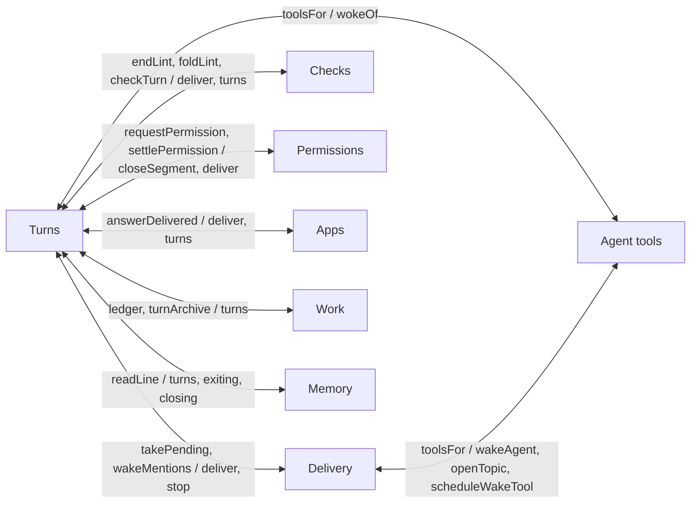
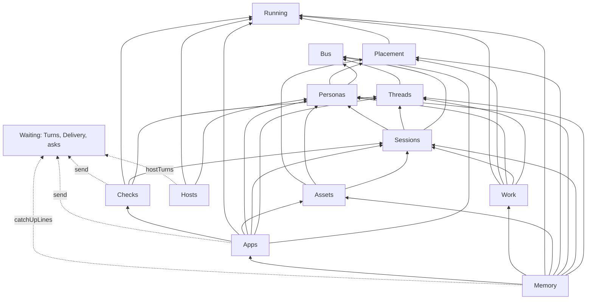
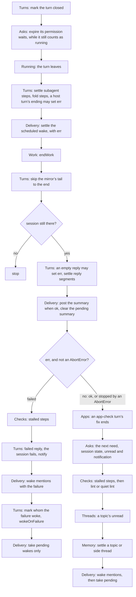
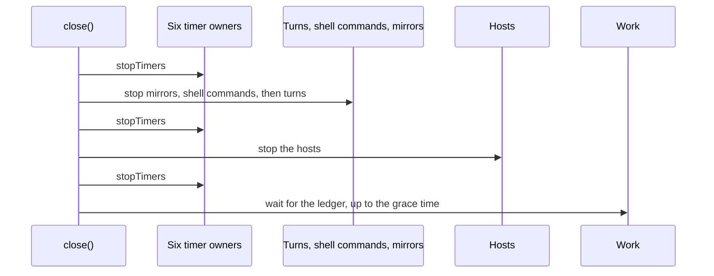

# Concerns as services

**Status:** a proposal, 12 November 2026, for the person to approve before any code moves. Step 0, the test fixture, step 1, Placement, step 2, Running, step 3, Threads with the Bus, step 4, Personas, step 5, Sessions, step 6, Assets, step 7, Ledger and work, step 8, Checks, and step 9, Apps, are built (“Where it stands”). Numbers are from `main` at 2259cebe. The scripts that produced them are in the pull request that added this document; the last of them, `svc-check.mjs`, checks the design against the code.

## Why

[#1236](https://github.com/HJeon139/postbox/issues/1236) split `server/runtime.mjs` from 2,823 lines to about 900. It moved the code, but not its dependencies. Every moved function still takes the whole `Runtime` as `rt` and reaches into it for whatever it needs, including the other moved functions, through one-line methods that exist only so one module can call another. `Runtime` is now a service locator: any module can reach any other, nothing says which concern depends on which, and cycles hide behind lazy `rt.x()` calls that the import-cycle lint (`tools/import-cycles.mjs`) can’t see.

The person agreed to fix the cause: each concern becomes a class that owns its state, with its dependencies injected through its constructor, instead of “different concerns wrapped in helper methods out of coding convenience”. They also ruled that “compromising the functionality of the code due to unit test complexity is a bad idea”, and that old unit tests may be deleted rather than refactored, once their behavior is covered.

## The problem, measured

The scan reads every module under `server/` and lists the `rt.x` names it uses: a method, a field or the state getter `s`.

- **108 modules reach `Runtime`**: 98 take `rt` as the first parameter of a function or a constructor, and 10 reach it another way (nine `server/remote/turns-*.mjs` through `rts.rt`, and `page-state.mjs` through an options object). 23 of them use 10 or more members. Counted once per module and member, that’s 703 uses.
- **`Runtime` has 152 methods**, a getter (`s`) and 3 static constants. 133 of the methods only forward to a module function, passing `this`. Its constructor sets 27 fields, and modules read and write them directly: `rt.turns` in 36 modules, `rt.exiting` in 10, `rt.permissionWaits` in 9; `rt.closing`, `rt.keptPoll` and `rt.timers` are assigned from outside the class.
- **Three test seams are undeclared members.** `rt.judge` and `rt.pushes` (`write-intent.mjs`) and `rt.summarize` (`thread-summary.mjs`) aren’t set anywhere in the server. A module checks whether a test assigned one, and falls back to the real thing.
- **Counting `rt.x` misses half the dependencies.** A module also imports functions that take `rt` and calls them with its own: `persona-write.mjs` calls `settleToolAsks`, which delivers to agents and adds items, and `catch-up.mjs` calls `heldFor` in `wake-cards.mjs`. `svc-check.mjs` counts both.

The modules that use the most, out of 108 (the full table is in “Appendix: every module’s members”, below):

| Module | Members | The ones that cross concerns |
|---|---|---|
| `index.mjs` | 49 | the routes; every one is a facade candidate |
| `turn-finish.mjs` | 22 | `takePending`, `wakeMentions`, `endLint`, `checkTurn`, `settlePermission`, `clearSummaryPending`, `permissionWaits` |
| `turn-stop.mjs` | 21 | `deliver`, `takePending`, `settlePermission`, `stopKeptJobs`, `clearSummaryPending`, `turnArchive` |
| `side-threads.mjs` | 18 | `deliver`, `toolsFor`, `turns`, `exiting`, `busyFor` |
| `permission-cards.mjs` | 17 | `deliver`, `closeSegment`, `turns` |
| `thread-summary.mjs` | 17 | `catchUp`, `describeItem`, `turns`, `exiting`, `ledger`, `summarize` |
| `turn-context.mjs` | 17 | `requestPermission`, `recordDenial`, `recordJob`, `recordCommands`, `toolsFor`, `attachmentPath` |
| `message-queue.mjs` | 15 | `deliver`, `stop`, `turns`, `exiting` |
| `remote/turns-resume.mjs` | 15 | `deliver`, `drainQueues`, `stop`, `permissionWaits` |
| `deliver.mjs` | 14 | `deliver` (itself), `foldLint`, `answerDelivered`, `ledger`, `remote` |

### The tangles

Static imports among these modules have no cycle; the lint holds that. Add the calls that go through `rt` (module A calls `rt.x`, and `x` forwards to module B), and **50 of the 107 modules (`index.mjs` left out) fall into one strongly connected component**: from any of them, a chain of calls reaches any other. 81 of the edges inside it go through `rt`. Through `rt` alone, three cycles stand out:

- `deliver`, `blocks`, `apps`, `lint-delivery`, `permission-cards`, `permission-always` and `side-threads`: each asks `rt.deliver` to start a turn, and `deliver` calls back into two of them (`foldLint`, `answerDelivered`).
- `message-queue`, `send-message` and `turn-stop`: the queue stops turns for Send now, and a stopped turn hands its held messages back to the queue.
- `job-records` and `kept-jobs`: each calls the other’s functions through `rt`.

19 modules call themselves through `rt` (`turn-stop` calls `rt.stop`, `deliver` calls `rt.deliver`), so a test that replaces the method changes the module’s own recursion.

Grouping the modules by concern, the calls through `rt` alone make eight pairs of concerns that depend on each other both ways. Seven pass through Turns, and the eighth through the agents’ tools:

## What waits for rooms at scale

designs/rooms-at-scale.md decides the end state of the most tangled code: the permission layer goes (“The permission layer”), mention, wake and queue move onto one inbox per agent (“Delivery: mention, wake and queue on one inbox”), and needs you becomes asks, with the wake, hop, add-agent, app-send and permission cards gone (“Asks: needs you as an interface”). The permission layer’s removal is paused (10 November) until a demo proves inferred grants hold.

So this work doesn’t build interfaces around that machinery. Three concerns **wait**, in their current shape, behind the facade, until those decisions land:
- **Asks and permissions:** `permission-*.mjs`, `permissions-panel`, `ask-question`, `tool-ask`, `prompt-claim`, `read-folders`, `write-guard`, `write-intent`, `host-rules`, `card-needs`, `blocks` (its `act()` dispatches the cards), `view-app/consent` and `view-app/view-app` (the download card), and the app-send cards (`app-send-cards.mjs`, split from `apps.mjs` in step 9).
- **Delivery:** `message-queue`, `send-message`, `queue-batch`, `mention-wakes`, `newer-waiting`, `side-threads`, `wake-cards`, `scheduled-wakes`, `room-chain-limit`, `topic-open`, `share-back`, `bring` and `agent-commands`.
- **Turns:** `deliver`, `turn-context`, `turn-stop`, `turn-finish`, the turn’s steps and marks, jobs and kept jobs, `claude-mirror`, `store-outage`, `restart-sweep`, and `remote/turns*.mjs`. Starting and ending a turn interleave delivery and needs at every step (see “The end of a turn”, below), so Turns is redone with the inbox, not before it.

That is 55 modules. Waiting code keeps taking `rt`, and may call any service. The rule for everything redone before then: **a service never calls waiting code.** Where it does today, it raises a signal or calls a port, below, and the waiting code listens or answers.

## The services

One service per concern, each a class in the folder that designs/architecture/folders.md gives that concern, so a module moves once. A service owns its state; nothing else reads or writes that state except through its interface. Its constructor takes the services it needs, and nothing else from `Runtime`.

The list refines the starting point from the data:
- **Running** is new: the live-turn registry (`turns`, `exiting`, `closing`). 36 modules read `rt.turns`, most only to ask whether a session has a live turn; answering that from a small service below everything else breaks several cycles.
- **Placement** is new: where a backend runs (`remote/placement.mjs`, today in the strongly connected component). Personas, Assets, Work and Memory ask it; it reads Running.
- **Memory** is new: what an agent reads of a conversation (catch-up, `describeItem`, `read_conversation`, the thread summaries).
- **Bus** carries in-process signals only. The store’s own events (`store.emit`, `store.subscribe`) stay the Store’s.
- **Ports** are the few functions a redone service needs from waiting code, injected late by the root: `send`, `catchUpLines` and `hostTurns`. Each names what the service needs, not the machinery behind it: `send` is “a message for an agent”, which is an inbox entry in rooms-at-scale’s end state.

### Store

- **Owns:** the state, the event log and its snapshots, the pending view (`pending`), and the outage gate (`storeWait` and `backendWait` on `Runtime` today; `gated`, `whenWritable` and `saveBackendState` in `store-outage.mjs`). Invariant: what’s pending is applied in commit order, and nothing writes while the store can’t (designs/architecture/store.md).
- **Interface:** `state`, `pending`, `emit(type, data)`, `item(threadId, id)`, `items(threadId)`, `subscribe(fn)`, `onStatus(fn)`, `whenWritable(fn)`, `gated(fn)`.
- **Depends on:** nothing (its folder and its `io`).

### Bus

- **Owns:** the listeners for in-process signals. It calls them synchronously, in the order the root registered them, and a listener’s throw reaches the emitter, as a direct call’s does today. Nothing is persisted.
- **Interface:** `emit(signal, data)`, `on(signal, fn)`.
- **Signals:** `persona.updated` (Personas, after a write), `session.joined` (Sessions: a declined add lifts), `item.added` (Threads: a side thread’s line counts the message), `item.moved` (Threads, from `bringForward`: Memory moves its read markers to the stub), `app.retired` (Apps: its send card’s need releases), `block.withdrawn` (Apps, from `update_block`’s withdraw: the block’s need releases).
- **`persona.updated`’s listeners, in this order:** host turns set Running’s awaiting-attach entries for that persona’s sessions from where it runs now (`RemoteTurns.noteAttach`): one moved off its host is cleared, and one moved back before the attach waits again; sessions drop what their last turn reported, after a change of backend or model (`Sessions.forgetReported`, #1315); tool asks settle (`settleToolAsks`); the queue of an agent moved off a host drains (`drainMovedOff`). Today `busyFor` computes awaiting attach from the persona as it is after the write, so a drain right after it already sees the agent free; clearing first keeps that. If the queue drained first, a moved agent’s messages would stay held.
- **Depends on:** nothing.

### Running

- **Owns:** the live turn per session, the stopped turns still exiting, the sessions whose host turn waits to be attached again after a restart (#1135), with the host each waits on, and `closing`. Invariants: at most one live turn per session; no turn starts while the session’s stopped turn is still exiting; once `closing` is set, nothing starts. A session awaiting attach is busy, so the queue and wakes hold what’s for it, but `begin` doesn’t refuse it (below).
- **Interface:** `turnOf(sessionId)`, `exitOf(sessionId)`, `midTurn(sessionId)`, `awaitsAttach(sessionId)`, `busy(sessionId)`, `all()`, `closing`. `midTurn` is a turn running or one still exiting, which Placement reads; `busy` adds awaiting attach, which the queue and the side threads read; `sendMessage` reads `turnOf` and `awaitsAttach`, without exiting (#1136). Only Turns writes it: `begin(turn)`, `exit(sessionId, entry)`, `end(sessionId)`, `exited(sessionId)`, `awaitAttach(sessionId, hostId)`, `attached(sessionId)`, `close()`. `exit` records a stopped turn as exiting while it’s still live, and `end` lets it go after its abort, so what the abort runs still finds it live, as before; `exited` is its process gone. `begin` throws for a write that breaks an invariant. It doesn’t refuse a session awaiting attach: Send now, a direct delivery and a scheduled wake reach `deliver` without the queue and start a turn on the host beside the one about to be attached, as before step 2, a gap #1135 leaves open; refusing there lost the message, or stopped Postbox when a wake’s timer threw (#1303’s review). Until Turns is redone, `Runtime` keeps `turns`, `exiting` and `closing` as getters onto Running’s, so waiting code reads them unchanged.
- **Depends on:** nothing. Before step 2, `busyFor` (`runtime.mjs`) asked `RemoteTurns.awaitsAttach`, which read the session and `hostOf(personaFor(se))` (`remote/turns.mjs`): computed that way, `busy()` would need Store and Personas, a cycle with Placement. So Running keeps the awaiting sessions, with the host each waits on, instead: `RemoteTurns.noteAttach` computes what `awaitsAttach` did and writes it, wherever `restoring` is set or deleted (`turns-restore`, `turns-end`, `turns-start`, `turns-resume`), and the first `persona.updated` listener calls it for the persona’s sessions. It re-adds an entry as well as clearing one: an agent moved off a silent host and back before its welcome waits for the attach again, as it did when this was read live.

### Placement

- **Owns:** no state. The rules for where a persona’s backend runs: registered here or on a host, and whether a persona with a live turn may move.
- **Interface:** `localBackends()`, `runsHere(backend)`, `notHere(backend)`, `placement(remote, backend)`, `placedPatch(id, p, patch)`, `registeredAdapter(persona)`, `requestAdapter(handle, persona)`, `refuseHere(se, persona)`, `refuseUnregisteredSend(personas)`, `hereFolder`, `hostOf(persona)` (from `RemoteTurns`).
- **Depends on:** Store, Running. External: the adapter registry and the host manager. `drainMovedOff` leaves it for the `persona.updated` listener.
- **From Running it needs “mid-turn”, not `busy()`:** a turn running, or a stopped one still exiting. `busy()` also counts a host turn waiting to be attached again, and that would refuse moving an agent off a host that may never answer, which #1135 lets it do. Built so in step 1, the four “moved off a silent host” tests in `tests/remote-turns-restart-window.test.mjs` fail.

### Threads

- **Owns:** conversations, topic and side threads, their items, and presence (`viewing`). Invariants: an item has one live copy (`bringForward` leaves a stub); a topic’s reply count follows each message; a thread’s lineage ends at its conversation.
- **Interface:** `get(id)`, `create(opts)` (from `conversations.mjs`), `put(thread)`, `patch(id, change)`, `toWrite(id)`, `pending()`, `rename(id, title)`, `addItem`, `patchItem`, `bringForward`, `lineage(id)`, `conversationThreads(id)`, `glossaryFor(id)`, `notify(level, …)`, `view(id)`, `isViewing(id)`, `toggleReaction`. Signals: `item.added`, with the thread as written, and `item.moved`, with the stub’s id. Clearing the sessions’ unread counts when a thread is viewed is Sessions’ (`markRead`); the facade’s `view()` clears them first, then calls `Threads.view`, which marks the thread open and clears its own, the order the two writes always had.
- **Depends on:** Store, Bus.

### Personas

- **Owns:** personas. Invariants: a handle is unique among personas not retired, ignoring case; a persona’s backend is registered and can run where it’s placed; a stored retired permission mode runs as Auto.
- **Interface:** `get(id)`, `forSession(se)` (today’s `personaFor`), `byHandle(handle)`, `handles()`, `create(spec)`, `update(id, patch)`, `remove(id)`, `setupFor(id, projectId)` (today’s `mcpContext`). Signal: `persona.updated`, with the persona as written, as it was, and the change. `remove` emits the removal and has each backend forget the persona; its sessions go first, in the facade’s `deletePersona`.
- **Depends on:** Store, Bus, Placement. `retireModes` stays with the permission layer and runs from `start()`.

### Sessions

- **Owns:** sessions: one per agent per conversation (#228), their unread counts, notices for the next turn (`tellAgent`), and the commands each agent offers (`recordCommands`, from `agent-commands.mjs`). Needs stay with asks.
- **Interface:** `get(id)`, `in(threadId)`, `pendingIn(threadId)`, `ensure(threadId, personaId, opts)`, `update(id, patch)`, `tell(id, text)`, `roomOf(threadId, se)`, `awayFrom(se, threadId)`, `recordCommands(id, list)`, `markRead(threadId)`, `remove(id)`, `forgetReported(was, next)`; as the store loads, `stampNeeds()` and `unarchive()`. Signal: `session.joined`, with the thread, the session and the persona, once the session is a member.
- **Depends on:** Store, Bus, Threads, Personas.

### Assets

- **Owns:** room assets and blobs, message attachments, the files an agent reads and serves (`agentFile`, `appFiles`), and review files.
- **Interface:** `attachmentPath`, `sentAttachments`, `agentFolders`, `agentFile`, `appFiles`, `search` and `listText` (the room’s text assets, for an app’s host tools), `tools` (the asset tools an agent calls), `roomBlobs`, and a review’s files: `blockFiles`, `storeReviewFiles`, `servedReviewFile`.
- **Depends on:** Store, Sessions, Personas, Placement. External: blobs.

### Ledger and work

- **Owns:** the work ledger (already a class, `Ledger`, with injected store, blobs and home), its archive passes (#305), the work view’s answers, and the person’s `!` commands.
- **Interface:** `workGit`, `workDiff`, `workOutput`, `restoreWork`, `workEvents(turn, live)`, `endWork(turn, status)`, `idle()`; the archive passes’ `archiveAll()` and `stopArchive(boundMs)`; and the `!` commands’ `commandFolder`, `runShellCommand`, `stopShellCommand`, `flushShellOutput`, `stopAll()` and `expireStale()`.
- **Depends on:** Store, Threads, Sessions, Personas, Placement, Running. External: `Ledger`, `spawnShell`. `turn-work.mjs` stops calling `recordScheduledTool`; its caller in `turn-context.mjs` calls it beside `workEvents` (done in step 7).

### Checks

- **Owns:** lint entries per agent turn and their timers, the server’s checks on a finished turn, the stalled-step checks, and diagram reports from the page.
- **Interface:** `endTurn(turn, se)`, `quietLint(turn, se)`, `foldLint(sessionId, message)`, `lint(sessionId, turnId, problems)`, `stallSteps(turn, se)`, `stallLeftRunning(turn, se, how)`, `diagramCheck(threadId, itemId, report)`, `stopTimers()`.
- **Depends on:** Store, Threads, Sessions, Running, and the `send` port. External: the server’s settings (`config`), where a test shortens a lint turn’s wait or gives its own clock and timers.

### Apps

- **Owns:** agents’ apps, their state, queries and checks, the tools an app may call on this computer (`host-tool.mjs`), showing and updating blocks, review comments, and which answers an agent has read. The app-send cards and `act()`’s dispatch of cards stay with asks.
- **Interface:** `register`, `showApp`, `updateApp`, `retire`, `appCheck`, `appEvent`, `appState`, `appQuery`, `appFile`, `appOf(item)`, `showBlock`, `updateBlock`, `answerDelivered`, `unreadAnswer`, `reviewBlock`, `personAnswer`. Signals: `app.retired`, `block.withdrawn`. Past an app’s limit, `appEvent` answers `{ hold }`, and the facade’s `appEvent` has asks hold the event on the app’s card.
- **Depends on:** Store, Bus, Threads, Sessions, Personas, Assets, Running, Checks, and the `send` port. External: the narrator, and the server’s settings (`config`, for the catalog’s image origins).

### Memory

- **Owns:** each session’s marker of what it has read, how a conversation reads to an agent, and the thread summaries and their timers (designs/architecture/shared-memory.md).
- **Interface:** `catchUp(se, exclude)`, `describeItem(item, se)`, `topicRootLine(se, t)`, `readConversation(se, args)`, `readMessage(se, args)`, `readLine`, `settleThread(threadId)`, `summarize(threadId)`, `moveMarkers(…)`, `stopTimers()`.
- **Depends on:** Store, Threads, Sessions, Personas, Placement, Assets, Running, Work, Apps, and the `catchUpLines` port. External: the summarizer (today’s `rt.summarize` seam).

### Hosts

- **Owns:** remote hosts: adding, updating and removing them, their status, installs and keep-updated (designs/architecture/remote-hosts.md).
- **Interface:** `add`, `update`, `remove`, `status`, `describeInstall`, `install`, `retry`, `setProjectFolder`, `watch()`.
- **Depends on:** Store, Personas, Running, and the `hostTurns` port (`busyOn`, `sessionsOn`, `stopOn`, `cancel`, `confirmStops`: the host turns that an update or a removal stops). External: the host manager.

### The waiting concerns, once rooms at scale lands

Their target shape, for the step that redoes each; its details belong to that design.
- **Asks:** an ask is a record its agents write together, and needs you is the queue of open ones. Depends on Store, Bus, Threads, Sessions, Personas, Running and `send`. A harness’s own question (AskUserQuestion, a permission prompt while the layer stays) comes in through Turns’ adapter contract and becomes an ask.
- **Delivery (the inbox):** one stored inbox per agent per conversation; `send` adds an entry. Depends on Store, Bus, Running, Threads, Sessions, Personas, Memory and Turns.
- **Turns:** starts a turn from inbox entries, runs it through the adapter contract, and ends it through the end steps below. Depends on Store, Bus, Running, Threads, Sessions, Personas, Placement, Memory, Assets, Work, Checks and Apps. Delivery and asks attach to its start and end steps; they don’t sit below it.

### The dependency graph

Constructor dependencies of the services redone first. Every service also depends on Store; those arrows are left out. Dotted arrows are ports into waiting code.

Built in this order, each service’s dependencies already exist: Store, Bus, Running, Placement, Threads, Personas, Sessions, Assets, Work, Checks, Apps, Memory, Hosts. The waiting code is built after them, and the root binds the ports to it.

| Service | Dependencies, Store and ports included |
|---|---|
| Store | 0 |
| Bus | 0 |
| Running | 0 |
| Placement | 2 |
| Threads | 2 |
| Personas | 3 |
| Sessions | 4 |
| Assets | 4 |
| Hosts | 4 |
| Checks | 5 |
| Work | 6 |
| Apps | 9 |
| Memory | 10 |

### How each dependency on waiting code breaks

`svc-check.mjs` lists every dependency each of these services has today, through `rt.x`, an imported function that takes `rt`, or the body of a `Runtime` method the service takes over (62 of them, such as `busyFor` and `addItem`), and checks it against the graph above or a break below. On 2259cebe it finds none unaccounted for.

| Where, today | How it breaks |
|---|---|
| `persona-write.mjs` calls `settleToolAsks` (`tool-ask.mjs`, which delivers and adds items) and `drainMovedOff` | `persona.updated`; tool asks and the queue listen (done in step 4) |
| `persona-write.mjs` calls `rt.updateSession` to drop what sessions last reported after a change of backend or model (#1315) | `persona.updated`; Sessions listens with `forgetReported` (done in step 4) |
| `remote/placement.mjs`’s `drainMovedOff` calls `rt.drainQueues` and reads `rt.remote` | it leaves Placement for the `persona.updated` listener |
| `conversations.mjs`’s `ensureSession` calls `liftDecline` (`wake-cards.mjs`) | `session.joined`; wake cards listen (done in step 5) |
| `Runtime.addItem` calls `bumpSideLink` (`side-threads.mjs`) | `item.added`; side threads listen (done in step 3) |
| `Runtime.busyFor` calls `remote.awaitsAttach`, which reads the session and its persona’s host | Running keeps the awaiting sessions; `RemoteTurns` writes them, and the first `persona.updated` listener sets them from where the agent runs now (done in step 2: `busyFor` is gone) |
| `Runtime.bringForward` calls `moveMarkers` (`catch-up.mjs`) | `item.moved`; Memory moves its markers (done in step 3: the root listens with `moveMarkers` until Memory is a service) |
| `Runtime.view` clears the sessions’ unread counts | the facade’s `view()`: `Sessions.markRead`, then `Threads.view` (done in step 3; `Sessions.markRead` since step 5) |
| `app-retire.mjs` calls `releaseNeed` (`card-needs.mjs`) | `app.retired`; asks listen (done in step 9) |
| `apps.mjs`’s `needAppSend` and `resolveAppSend` call `offerNeed` and `releaseNeed` | they stay with asks; `apps.mjs` splits (done in step 9: `app-send-cards.mjs`) |
| `blocks.mjs`’s `updateBlock` withdraws a block with `releaseNeed` | `block.withdrawn`; asks listen (done in step 9) |
| `lint-delivery.mjs`, `apps.mjs` and `review-comments.mjs` call `rt.deliver` | the `send` port (`lint-delivery.mjs` done in step 8, the others in step 9) |
| `catch-up.mjs` calls `heldFor` (`wake-cards.mjs`) | the `catchUpLines` port: waiting code contributes lines |
| `item-lines.mjs` calls `rt.remote.hostOf` | it moves to `Placement.hostOf` |
| `read-message.mjs` calls `appOf` (`apps.mjs`) | Memory depends on Apps |
| `thread-summary.mjs` reads `rt.turns`, `rt.exiting`, `rt.closing` and `rt.ledger` | Memory depends on Running and Work |
| `turn-work.mjs` calls `recordScheduledTool` (`scheduled-wakes.mjs`) | the call moves to its caller, `turn-context.mjs` (done in step 7) |
| `shell-runs.mjs` calls `whenWritable` (`store-outage.mjs`) | `Store.whenWritable` (step 7: Work takes a `whenWritable` bound to the runtime until the Store is a service) |
| `remote/host-admin.mjs` calls `rt.stop` and `rt.remote` | the `hostTurns` port |
| `lint-delivery.mjs`, `apps.mjs`, `review-comments.mjs`, `host-admin.mjs` and `placement.mjs` read `rt.turns` or `rt.exiting` | Running (`placement.mjs` done in step 1, `lint-delivery.mjs` in step 8, `apps.mjs` and `review-comments.mjs` in step 9) |
| `persona-delete.mjs` deletes sessions; `session-lifecycle.mjs` and `thread-erase.mjs` stop turns and kept jobs | orchestration in the facade: stop, then remove, in one method each (`deletePersona` done in step 4) |
| `createThread` makes sessions; `resolveProposal` creates a persona and a session | orchestration in the facade |

Waiting code also depends on itself both ways, and the steps that redo it settle those: `permission-prompt.mjs` calls `claimPrompt` (`prompt-claim.mjs`), which reads the turn’s stream, so prompt claims go with asks and read Turns’ steps; and Turns calls into Delivery in the middle of a turn, not only at its end: scheduled wakes (`prepareScheduledRetry`, `noteScheduledTurn`, `recordScheduledTool`, `recordedTools`), the chain (`endChain`, `dropWakes`), needs (`keptTurns`, `releaseNeed`, `offerNeed`), `offersBring` and `newerFromSender`. Those become the inbox’s own steps, which is why Turns waits with it.

### The end of a turn

`endTurn` (`server/turn-finish.mjs`) on 2259cebe, in order, with the concern each step belongs to. The step that redoes Turns keeps this order, with each group of steps a named end step that the root fills, and Turns knows only the step names. The steps get `err`, which changes along the way (a host turn’s ending can set it, and so can an empty reply), and a shared record of what earlier steps found (`open`, `viewing`, `topic`).

So the steps are: `ending` before Running lets the turn go (B), `settled` with the final host `err` (E, F), `replied` (H), `failed` (J to L3, with Turns’ `wokeOnFailure` patch between the wakes and the take), and `ended` (M to R), whose listeners run in that order and share `open`, `viewing` and `topic`. Stopping a turn (`turn-stop.mjs`) gets its own steps, `stopping` and `exited`, in the same way.

**`card.opened` must be synchronous.** When a card opens, `permission-cards.mjs` (line 96) closes the turn’s reply segment before `offerNeed`, so the reply goes on below the card and the need points at a settled segment. When asks raise `card.opened` and Turns closes the segment in a listener, the bus must call it synchronously, before `offerNeed`; the bus above does.

## The composition root

`Runtime`’s constructor builds the services in the order above, then the waiting code and the agent tools, then binds the ports, wires the signals, and keeps a thin facade. Nothing outside `server/runtime.mjs` builds a service, except a service’s own tests and the test fixture below.

The agent tools (`ui-tools.mjs`, `mcp.mjs` and the tool modules behind them, `server/agent-tools/` in designs/architecture/folders.md) are the agents’ facade, as the routes are the person’s. `mcp.mjs` checks a request’s turn token against the live turn (Running), finds the persona (Personas) and the app files (Assets), and calls the tool modules; it gets those services, not `rt`.

The facade keeps the methods the routes, the seed, the MCP endpoint and the startup in `server/index.mjs` call today, by today’s names. Each is one line, or a few for an orchestration listed above:

- **Conversations:** `createThread`, `patchThread`, `deleteThread`, `ensureSession` (adding an agent, `index.mjs`), `view`, `startTopic`, `shareToConversation`, `summarizeBack`.
- **Messages:** `sendMessage`, `editQueued`, `cancelQueued`, `sendQueuedNow`, `retry`, `cancelSchedule`.
- **Blocks and apps:** `act`, `diagramCheck`, `appCheck`, `appEvent`, `appState`, `appQuery`, `appFile`.
- **Turns:** `requestStop`, `dismissStopAsk`, `stopJob`, `resumeRemote`, `dismissFailed`, `claudeSessions`, `attachClaudeSession`.
- **Personas and sessions:** `createPersona`, `updatePersona`, `deletePersona`, `mcpContext`, `deleteSession`.
- **Permissions:** `permissionsView`, `changePermissionRule`, `changePermissionFolder`.
- **Commands and work:** `runAgentCommand`, `runShellCommand`, `stopShellCommand`, `workGit`, `workDiff`, `workOutput`, `restoreWork`.
- **Hosts:** `localBackends`, `addHost`, `updateHost`, `removeHost`, `describeHostInstall`, `installHost`, `retryHost`, `setProjectHostFolder`.
- **Lifecycle:** `start()` and `close()`, below.
- **Reads:** `store` (the routes read state through it), `thread(id)`, `session(id)` and `persona(id)`, which answer 404 when it’s missing.
- **Agents:** `toolsFor(sessionId, turn)`, which the MCP endpoint and the in-process mock call.

That is 58 members, from 152 methods today. `deletePersona`, `dismissFailed` and `patchThread` are module functions that `server/index.mjs` and `server/session-routes.mjs` call with `rt` today; they become facade methods. The rest go, each when the step that redoes its concern lands.

**`start()`** replaces the calls `server/index.mjs` makes after building `Runtime`, in their order: settling turns left interrupted, marking items left streaming as stopped, `rearmSchedules`, `expireStalePermissions`, `expireStaleCommands`, `ledger.expireStale`, `expireStaleJobs`, `rearmMirrors`, `restoreRemoteTurns`, `watchHosts`, and `drainAll` once Postbox listens.

**`close()`** replaces `server/index.mjs`’s `close()` and `server/runtime-close.mjs`, in their order. `stopTimers` clears the timers of six owners: scheduled wakes (`rt.timers`, Delivery), lint entries (Checks), stopped turns’ watchdogs and the kept jobs’ poll (Turns), permission cards’ waits (asks) and summaries (Memory). It runs three times, because a turn that ends as it stops, or as its host’s link closes, can start one: before the turns stop, after them, and after the hosts stop. Then the ledger settles (Work’s `idle()`, with a grace time). Each owner gets a `stopTimers()`, and the facade calls all six at each of the three points, so the order stays in one place:

## Tests

Counted from `tests/`, outside `tests/browser/` and `tests/uat/`: 678 test files. 411 never reach `Runtime` (the store, adapters, `shared/`, tools and UAT checks) and this work doesn’t touch them. 267 reach it, by importing `server/runtime.mjs` or `server/index.mjs`, directly or through a helper. Each of those 267 falls in one bucket:

| Bucket | Files | What happens |
|---|---|---|
| Start the server and test the HTTP routes, reading no internal field | 28 | keep: the behavior net |
| Call only facade members, reading no internal field | 49 | keep: the behavior net |
| Use the routes or the facade, but read an internal field (`turns`, `exiting`, `timers`, `permissionWaits`, `mirrors`, `hosts`, `ledger`) | 21 | keep; the reads move to the fixture |
| Arrange state through internal writes only (`sessionsIn`, `addItem`, `updateSession`, `putThread`, `patchItem`), then act through the facade | 34 | keep; the arrangement moves to the fixture |
| Swap a dependency field (`rt.adapters`, `rt.blobs`, `rt.listProcesses`) | 6 | keep; the fake moves to the constructor |
| Replace a `Runtime` method | 21 | replace |
| Act through internal methods or helpers that take `rt` | 108 | replace |

### Keep: the behavior net

The 77 net files, the 193 browser specs in `tests/browser/`, and the 14 tests of the MCP endpoint (`handleMcp`), which is the agents’ boundary and stays. 5 of the net files also replace or call something internal; those parts are rewritten in the step that redoes the concern, and the test stays.

### The fixture: arranging without the facade

The net doesn’t stay unchanged by itself. Of the 193 browser specs, 155 use `Runtime` members beyond the facade, mostly to arrange a room: `sessionsIn` (112 specs), `addItem` (75), `s` (66), `personaByHandle` (47), `adapters` (45), `updateSession` (29) and `turns` (20). 22 act through something else: `bringForward` (8), `agentWake` (4), `recordCommands`, `deliver`, `timers`, `signalProcess` and `listProcesses`, `judge` and `pushes`, and others. The 34 arrange tests and the 21 that read internal fields do the same.

So the root returns the services beside the facade, and a test-only fixture, `tests/arrange.mjs`, is the one place specs and unit tests reach them: `agentIn(threadId, handle)`, `post(threadId, item)`, `setSession(id, patch)`, `persona(handle)`, `liveTurn(sessionId)`, `withAdapter(name, fake)`, `withProcesses(fakes)`, and, for the 22, named helpers for what they do (`wake(from, to, text)`, `moveToEnd(threadId, itemId)`). Routes and the agent tools never see it, and it’s kept out of the facade. Each helper takes the runtime first (`arrange.agentIn(rt, threadId, handle)`), so it works wherever a spec has one, and is built on today’s members until its concern is redone. A step that redoes a concern updates the fixture’s helpers for that concern, and no spec. The fixture comes first, as its own pull request, before step 1.

### Replace

38 files replace a `Runtime` member, and one helper does (`tests/requested-setup.mjs`): 25 replace a method, 13 only a field. 21 are in the replace bucket; the rest start the server or read internal fields, and stay. The 108 call an internal method to act (`stop` in 37 files, `deliver` in 32, `agentWake` in 30, `resolvePermission` in 17, `schedule` in 14) or an internal helper with `rt` (`settleInterrupted`, `expireWait`, `fireScheduledWake` and others). 24 of them call only `stop` or `resolvePermission`, whose facade forms are `requestStop` and `act`: those are rewritten, not deleted.

**When a test may be deleted:** only in the step that redoes the concern it pins, and only when each behavior it asserts is covered by a named test, in the net or in the new service’s interface tests, that fails when that behavior breaks. The pull request lists each deleted file with the test that covers each of its behaviors. Where nothing covers one, a facade or interface test is written first, and shown failing on a mutant.

### New: interface tests

Each service gets `tests/<folder>/<service>.test.mjs` (designs/architecture/folders.md, “Tests”), written first, against its interface alone. Its dependencies are small fakes built from the interfaces above: a Store over an empty state, a Running with a set of busy sessions, a Bus that records what was emitted, a `send` port that records what it was given. A service’s test never builds `Runtime`.

## Order of work

Smallest and least tangled first. Until a dependency is redone, a service takes it as a narrow function bound to `Runtime` (for example Placement’s `midTurn: (id) => rt.turns.has(id) || rt.exiting.has(id)`), and the step that redoes that dependency swaps in the service. `svc-check.mjs`, rerun, shows each step’s progress and any new dependency on waiting code.

0. **The fixture** (`tests/arrange.mjs`), and the browser specs and arrange tests moved onto it. No server change.
1. **Placement, the pilot.** One module that uses 5 members once `drainMovedOff` leaves, no state, two dependencies (Store, and Running through a `midTurn` function bound to `rt.turns` and `rt.exiting` until step 2), and stateless queries that fakes test easily. 12 modules call it. Personas was the first choice, but after counting imports it needs Placement and Bus first. Delivery, the most tangled, waits for rooms at scale. The pilot’s pull request reports what the step cost and which tests it deleted, so the person can judge the approach before the next one.
2. **Running.** Its maps move in, with the awaiting-attach set that `RemoteTurns` writes and the first `persona.updated` listener sets (until step 4 adds that signal, `updatePersona` sets it directly, before `settleToolAsks`); `Runtime` keeps getters for waiting code.
3. **Threads**, with Bus and `item.added`.
4. **Personas**, with `persona.updated`.
5. **Sessions**, with `session.joined`.
6. **Assets.**
7. **Ledger and work.**
8. **Checks**, with the `send` port.
9. **Apps**, with `app.retired`; the app-send cards split off to asks.
10. **Memory**, with the `catchUpLines` port.
11. **Hosts**, with the `hostTurns` port.

Asks, Delivery and Turns then wait for rooms-at-scale’s decisions on the permission layer and the inbox, behind the facade in their current shape. When those land, their pull requests redo them as services, with the end steps above, and `Runtime` becomes only the root and the facade.

Each step is its own pull request, and is done when:
- the service is a class with the constructor dependencies listed here, and its modules no longer take `rt`;
- `svc-check.mjs` finds nothing unaccounted for;
- `Runtime` keeps no delegating method for it, except the facade’s and the getters waiting code reads;
- its interface tests were written first, and pass;
- each deleted test is listed with what covers it;
- `npm run check` exits 0, and `npx playwright test` passes, plain and with `POSTBOX_STREAM_LAG=300`;
- one or two mutants of the service (a dropped signal, a skipped invariant check) each fail a named test, listed in the pull request;
- this document’s “Where it stands” says so.

## Risks

- **The order at the end of a turn.** Today it’s the order of the lines in `endTurn`; later it’s the order of the end steps in the root. A facade test holds today’s order before Turns is redone.
- **Signals change who calls whom, not when.** Each listener runs synchronously where the call ran, in the order the root registers them; a step that adds a signal shows a test that would fail if the listener ran late.
- **Memory has ten dependencies,** the most of the services redone first. If its step shows two concerns inside it (what an agent reads, and the thread summaries), it splits.
- **Two styles at once, for a while.** Until rooms at scale lands, 55 modules take `rt`. The ports and the getters on `Runtime` mark the seam; `svc-check.mjs` keeps services from reaching across it.
- **Thin net in places.** A concern whose only tests pin internals has no net to delete against. The deletion rule makes the step write that coverage first.
- **Overlap with other work.** designs/architecture/folders.md moves the same modules; services land in the target folders, so a module moves once.

## What this does not do

- It changes no behavior: no route, event, stored format, adapter contract or page changes.
- It adds no dependency injection library or container. The root is plain constructor calls.
- It doesn’t redesign delivery, asks or the permission layer, and builds no interface around their cards; designs/rooms-at-scale.md does that.
- It doesn’t touch `app/`, the adapters’ internals or the host daemon.

## Where it stands

- **Done:** this proposal, approved. Step 0: `tests/arrange.mjs`, with the browser specs and the 55 arrange and read tests moved onto it. No spec or one of those tests uses a `Runtime` member beyond the facade; what remains in those tests calls the function under test with `rt`, or acts through an internal method in a net test, and is rewritten in the step that redoes its concern.
- **Done:** step 1, Placement. `server/remote/placement.mjs` is a class that `Runtime`’s constructor builds with the store, `midTurn`, the adapter registry and the host manager; its interface tests are `tests/placement.test.mjs`. `drainMovedOff` runs in `updatePersona` until step 4, and `hostOf` moved from `RemoteTurns`. Code that still takes `rt` reaches it as `rt.placement`; `Runtime` keeps only the facade’s `localBackends`. What step 1 found:
  - Placement needs “mid-turn” from Running, not `busy()` (“Placement”, above).
  - Runtime and Placement share one adapter registry, so a test can no longer stand for a Postbox without a backend by replacing `rt.adapters`: five tests did, and now call the fixture’s `withoutAdapters`, which empties the registry in place.
  - `svc-check.mjs` reads only modules that reach `rt`, so it lost sight of Placement once it stopped taking `rt`. It now also scans each service module that doesn’t, for `rt.` and for imports of functions that take `rt`.
- **Done:** step 2, Running. `server/running.mjs` is a class with no dependencies, which `Runtime`’s constructor builds; its interface tests are `tests/running.test.mjs`. Every write to the live turns, the exiting ones and `closing` goes through it (`deliver`, `turn-stop`, `turn-finish`, `store-outage`); `Runtime` keeps `turns`, `exiting` and `closing` as getters for waiting code, and `busyFor` is gone. Placement’s `midTurn` reads Running’s. The fixture’s turn helpers read Running, and `shuttingDown` replaces assigning `rt.closing`. What step 2 found:
  - Running needs two more queries than the interface listed: `midTurn`, the narrow check Placement needs (step 1), and `awaitsAttach`, which `sendMessage` reads without exiting (#1136). It also needs `exitOf` and a writer for a stopped turn’s exit, `exited`.
  - Stop sets the exiting entry before the turn’s abort, and lets the live turn go after it, so a permission card the abort expires still counts the turn as running. So `exit` doesn’t remove the live turn; `end` does.
  - A cleared awaiting-attach entry has to come back: on `main`, an agent moved off its silent host and back before the welcome waits for the attach again, and the attach goes (`tests/remote-turns-restart-window.test.mjs`). So the listener recomputes what `awaitsAttach` did, from the persona as written, instead of only clearing.
  - `deliver` never checked awaiting attach; only the queue and wakes hold a message for such a session. A first cut had `begin` refuse any turn but the attach for one: the review found Send now, a direct delivery and a scheduled wake still reach it, so it lost their messages, and a wake’s throw from its timer stopped Postbox. `begin` keeps today’s behavior, and `tests/remote-turns-restart-window.test.mjs` pins each of the three being delivered. Gating `deliver` on awaiting attach is a fix of its own.
  - `noteAttach` reads the session and the persona from the store’s pending view, so a move held behind a commit counts the moment `updatePersona` makes it, whichever call notes it.
  - A stored answer goes stale where a live one didn’t: Retry installs the disk’s state, which may undo a held move. The store’s reload listener (`store-outage.mjs`) notes every awaiting session again before writes reopen (`RemoteTurns.noteAllAttach`), and `tests/remote-turns-restart-retry.test.mjs` holds both directions. A service that keeps what main computed must be told when the state is replaced wholesale.
- **Done:** step 3, Threads, with the Bus. `server/bus.mjs` is a class with no dependencies, and `server/threads.mjs` a class that `Runtime`’s constructor builds with the store and the bus; their interface tests are `tests/bus.test.mjs` and `tests/threads.test.mjs`, and `tests/threads-signals.test.mjs` holds that each listener runs where its call ran. `thread-write.mjs`, `thread-lineage.mjs`, and `createThread` and `renameThread` from `conversations.mjs` moved into it; `reactions.mjs` and `refuseRetired` (`helpers.mjs`) no longer take `rt`. The root listens to `item.added` with the side threads’ `bumpSideLink` and to `item.moved` with `moveMarkers`. `Runtime` keeps the facade’s `createThread`, `view` and `thread(id)`; code that still takes `rt` reaches Threads as `rt.threads`, and the fixture’s thread helpers call it. What step 3 found:
  - Threads needs four members the interface didn’t list: `put(thread)`, for a topic or side thread made whole (`topic-open.mjs`, the side threads, the fixture); `toWrite(id)` and `pending()`, the 404 and the sweep `thread-write.mjs` had; and `rename(id, title)`.
  - The facade’s `view()` can’t call `Threads.view` first: today the sessions’ unread counts clear before the thread’s, so it clears them, then calls `Threads.view`. Presence is no write, so marking the thread open after the sessions’ writes changes nothing a listener sees.
  - `item.added` carries the thread as written, so the listener, not `addItem`, decides that a message in a side thread counts on its line.
  - The guards read names: `tests/thread-write-guard.test.mjs` now finds `threads.patch(` (and `this.patch(` in Threads) with the change after one argument, and counts `threads.get(` as a published read; `tests/store-held-guard.test.mjs` places Threads’ pending reads in `threads.mjs`, and `createThread`’s in `runtime.mjs`.
  - Tests that replaced `rt.notify` or `rt.patchItem` to listen call the fixture’s `onNotify` and `onItemPatch`, and three fakes of a runtime give a `threads` object (`shell-runs-output`, `remote-broker-snapshot`, `codex-always`). No test was deleted, and no spec changed.
  - `svc-check.mjs` finds one dependency unaccounted for, as it does on `main`: `persona-write.mjs` calls `rt.updateSession` ([#1315](https://github.com/HJeon139/postbox/issues/1315): a backend switch drops the model the old backend reported), so Personas depends on Sessions, which the graph doesn’t have. Step 4 decides its break.
- **Done:** step 4, Personas, with `persona.updated`. `server/personas.mjs` (renamed from `persona-write.mjs`) is a class that `Runtime`’s constructor builds with the store, the bus, Placement and the adapter registry; its interface tests are `tests/personas.test.mjs`, and `tests/personas-signals.test.mjs` holds the listeners’ order. `setup-context.mjs` takes the state and a persona lookup, `persona-delete.mjs` is gone (its `forget` is `Personas.remove`’s, its orchestration the facade’s `deletePersona`), `drainMovedOff` moved to `message-queue.mjs`, and #1315’s clear to `session-write.mjs` as `forgetReported`. `Runtime` keeps the facade’s `persona`, `createPersona`, `updatePersona`, `deletePersona` and `mcpContext`; code that still takes `rt` reaches the rest as `rt.personas`. What step 4 found:
  - #1315’s call into Sessions breaks by the signal, not a port: `forgetReported` is the second listener, after `noteAttach` and before `settleToolAsks`, where `updatePersona` made the call. Sessions depends on Personas, so a port into Sessions would be the cycle a signal avoids; and the clear is what a change means for sessions, which Sessions decides once it’s a service. `svc-check.mjs` finds nothing unaccounted for.
  - The listener for tool asks needs the change, not only the persona: it settles only when the change named `tools`. So the signal carries the change, and the persona as it was for #1315’s comparison.
  - `deletePersona` was a module function the route and two tests called with `rt`; it’s a facade method now, as the design said. Its pending reads moved with it, and `tests/store-held-guard.test.mjs` places them in `runtime.mjs`.
  - Step 0 left one spec on `rt.personaByHandle` (`gemini-boilerplate.spec.mjs`); it calls the fixture’s `persona` now. A test that replaced `rt.personaFor` (`view-app.test.mjs`) replaces `rt.personas.forSession`.
- **Done:** step 5, Sessions, with `session.joined`. `server/sessions.mjs` (renamed from `session-write.mjs`) is a class that `Runtime`’s constructor builds with the store, the bus, Threads and Personas; its interface tests are `tests/sessions.test.mjs`, and `tests/sessions-signals.test.mjs` holds that the root’s `session.joined` listener lifts a decline before the person’s add returns (#789). `ensureSession` (`conversations.mjs`), `unarchive.mjs` and `recordCommands` (`agent-commands.mjs`) moved into it; `conversations.mjs` and `unarchive.mjs` are gone. `Runtime` keeps the facade’s `session(id)`, `ensureSession` and `view`; code that still takes `rt` reaches the rest as `rt.sessions`. What step 5 found:
  - Sessions needs four members the interface didn’t list: `pendingIn(threadId)`, the pending read a join and a delete decide on (#796); `forgetReported`, #1315’s clear, which step 4 left in `session-write.mjs`; and `stampNeeds()` and `unarchive()`, which run as the store loads. `forgetReported` is Sessions’ method, and the root still registers it second on `persona.updated`, so the four listeners’ order stays in one place.
  - A delete and an erase emitted a session’s removal themselves (`session-lifecycle.mjs`, `thread-erase.mjs`); they call `Sessions.remove` now, so every write of a session is in `sessions.mjs`, and `tests/session-write-guard.test.mjs` places them there.
  - The session-write guard reads names, as the thread one did in step 3: it finds `sessions.update(` (and `this.update(` in Sessions) with the change after one argument, counts `sessions.get(` and `sessions.in(` as published reads, and a raw write is a store emit of `session` or `session.patch`, so the bus’s `session.joined` isn’t taken for one.
  - Tests that replaced `rt.updateSession` or `rt.tellAgent` to listen call the fixture’s `onSessionUpdate` and `onTell`. They now hear every write, since every module writes through `rt.sessions`, not some through `updateSession(rt, …)`; each still passes. No test was deleted, and no spec changed.
- **Done:** step 6, Assets. `server/asset-service.mjs` is a class that `Runtime`’s constructor builds with the store, Sessions, Personas, Placement and the blobs; its interface tests are `tests/assets.test.mjs`. Its modules (`agent-files.mjs`, `asset-tools.mjs`, `asset-search.mjs`, `message-attachments.mjs`, `review-files.mjs`) take the service, not the runtime, and nothing moved between them. `Runtime` keeps no method of Assets; code that still takes `rt` reaches it as `rt.assets`, and the asset tools reach an agent the same way on this computer (`mcp.mjs`) and through a host’s shim (`remote/turns-tools.mjs`). What step 6 found:
  - Assets is too large for one module: about 800 lines across five, each a concern of its own. The class is the interface, a method each, and the five modules stay as they were, each taking the service instead of the runtime. That is the shape for a service whose code is larger than a file: the class names what it offers, and its modules what each part does.
  - “`reviewFiles`” and “`search`” were each a name for several calls: a review’s files are read and stored (`blockFiles`, `storeReviewFiles`) and served back (`servedReviewFile`), and a search has a listing beside it (`listText`) for an app’s host tools. The asset tools (`tools`) and the asset folder (`roomBlobs`, which the seed writes to) weren’t listed.
  - The blobs are an external dependency both `Runtime` and Assets hold, as the adapter registry is both Runtime’s and Placement’s (step 1): five tests assigned `rt.blobs` to stand for a Postbox with another store or none, and call the fixture’s `withBlobs` now, which sets both. Waiting code (apps, turn marks, the host turns) reads `rt.blobs`, the same store.
  - `tests/arrange.mjs` was past Biome’s length with this step’s helpers, so its fakes and listeners moved to `tests/arrange-fakes.mjs` first, as a move of its own.
- **Done:** step 7, Ledger and work. `server/work-service.mjs` is a class that `Runtime`’s constructor builds with the store, Threads, Sessions, Personas, Placement and Running, the ledger, `spawnShell` and a `whenWritable`; its interface tests are `tests/work-service.test.mjs`, and `tests/work-end-order.test.mjs` holds where a turn’s end records its work. Its modules (`work-view.mjs`, `turn-work.mjs`, `turn-end-work.mjs`, `archive-runtime.mjs`, `shell-runs.mjs`) take the service, not the runtime, as Assets’ do (step 6), and nothing moved between them. `Runtime` keeps the facade’s `runShellCommand`, `stopShellCommand`, `workGit`, `workDiff`, `workOutput` and `restoreWork`; the turn’s end and Stop call `rt.work.endWork`, and start-up, listening and `close()` call `rt.work`’s `expireStale`, `archiveAll`, `stopAll`, `stopArchive` and `idle`. What step 7 found:
  - Work needs four members the interface didn’t list: `commandFolder` and `flushShellOutput`, which tests read and call; and `archiveAll` and `stopArchive`, the archive passes that start-up and shutdown ran through `rt.turnArchive`. `workEvents` takes the turn’s `live` check, and `expireStale()` ends the commands left running, then the ledger’s records, the two start-up calls it replaces, in their order.
  - The ledger is an external dependency both `Runtime` and Work hold, as the blobs are (step 6): tests pass one to `Runtime`’s constructor, and waiting code (`deliver`, `turn-context`, `job-records`, `scheduled-wakes`, `write-intent`) and Memory’s `thread-summary` read `rt.ledger`, the same ledger.
  - `recordScheduledTool` recorded a tool’s start in the ledger, then counted it toward a scheduled wake. Work’s `toolUse` records it now, and `turn-context.mjs` counts it right after, with the ledger flag off, so the order stays: the call is seen, the ledger has it, the wake counts it.
  - The Store isn’t a service yet, so Work takes `whenWritable` as a function bound to the runtime, as Placement took `midTurn` before Running (step 1).
  - No test held where a turn’s end records its work (“Risks”, “The order at the end of a turn”). `tests/work-end-order.test.mjs` does: after the turn leaves Running, before its reply settles and before a failed turn fails its session. Neither did any test hold that the archive passes keep a live turn hot; the interface test does.
  - No test was deleted, and no spec changed.
- **Done:** step 8, Checks, with the `send` port. `server/check-service.mjs` is a class that `Runtime`’s constructor builds with the store, Threads, Sessions and Running, the server’s settings, and `send`; its interface tests are `tests/check-service.test.mjs`, and `tests/check-send.test.mjs` holds that a lint turn goes through the `deliver` in place when it’s sent. Its modules (`turn-checks.mjs`, `lint-delivery.mjs`, `diagram-check.mjs`) take the service, not the runtime, and nothing moved between them; the three lines that end a turn’s checks moved from `turn-finish.mjs` into `turn-checks.mjs` first, and the loop that clears the lint turns’ waits from `runtime-close.mjs` into `lint-delivery.mjs`, each as a move of its own. `Runtime` keeps the facade’s `diagramCheck`; code that still takes `rt` reaches the rest as `rt.checks`. What step 8 found:
  - The interface was as listed. Checks also needs the server’s settings, an external dependency like the adapter registry (step 1): the lint turn’s settle wait, its limit while an app is checked, and a test’s own clock and timers are read there, as before.
  - The root binds `send` as a function that looks up the runtime’s `deliver` each time, not `deliver` itself. Tests put a spy on `rt.deliver` after the runtime is built (`tests/close-timers.test.mjs`), and a port bound once would go past it; `tests/check-send.test.mjs` fails on that mutant.
  - No test held that a problem the browser reports while the turn still runs joins its lint turn (`lint` reading Running’s live turns); the interface tests do.
  - The app check stays as it was: `apps.mjs`, waiting code until step 9, calls `rt.checks.lint` for its notes and `rt.deliver` for its fix turn. One test that replaced `rt.lint` to listen replaces `rt.checks.lint`, and `tests/lint-delivery.test.mjs`’s fake is shaped as Checks. No test was deleted, and no spec changed.
- **Done:** step 9, Apps, with `app.retired`; the app-send cards split off to asks. `server/app-service.mjs` is a class that `Runtime`’s constructor builds with the store, the bus, Threads, Sessions, Personas, Assets, Running and Checks, `send`, the narrator and the server’s settings; its interface tests are `tests/app-service.test.mjs`. Its modules (`apps.mjs`, `app-retire.mjs`, `block-show.mjs`, `block-update.mjs`, `review-comments.mjs`, `review-person.mjs`, `host-tool.mjs`) take the service, not the runtime. Two moves came first, each with no change to the code moved: `update_block`, `answerDelivered` and `unreadAnswer` from `blocks.mjs`, which keeps the person’s answer (`act`) with asks, to `block-update.mjs`; and the app-send cards (`needAppSend`, `resolveAppSend`, the hold of an event past the limit, and the sweep when an app is retired) from `apps.mjs` and `app-retire.mjs` to `app-send-cards.mjs`, a module of asks. `Runtime` keeps the facade’s `appCheck`, `appEvent`, `appState`, `appQuery` and `appFile`, and asks’ `needAppSend` and `resolveAppSend`; code that still takes `rt` reaches the rest as `rt.apps`. What step 9 found:
  - Apps signals, so it depends on the Bus, which the design left out. It needs a second signal: `update_block`’s withdraw released the block’s need (`releaseNeed`, asks) where it ran, so it signals `block.withdrawn`, and the root’s listener releases it, as `app.retired`’s drops the card’s sends.
  - Holding an app’s event on its card is asks’, and neither a signal nor a port fits it: the event’s answer to the page is the card’s. So `appEvent` decides (the app, its limit, a card already open) and answers `{ hold }`, and the facade’s `appEvent` has asks hold it, an orchestration in the facade as `createThread`’s is. `svc-check.mjs` names that break.
  - “`show`” and “`update`” were each two tools: `showBlock` and `showApp`, `updateBlock` and `updateApp`. The person’s answer to a review writes through Apps too (`personAnswer`), since `act` stays with asks.
  - An app’s data file is read from the blobs Assets holds, the same store as `rt.blobs`, so the fixture’s `withBlobs` (step 6) still sets it.
  - `view-app/view-of.mjs` keys view_app’s state by the runtime object and reads none of it; it stays as it was, with `view-app.mjs` and `consent.mjs`, which wait with asks.
  - The signals’ timing is held by tests that read right after the call: “#193: retiring drops the sends waiting for the person, clears needs-you, and later sends are refused” fails when `app.retired`’s listener runs late. No test was deleted, and no spec changed.
- **Next:** step 10, Memory, with the `catchUpLines` port.

## Appendix: every module’s members

Each module under `server/` that reaches `Runtime`, with the `rt.x` names it uses, on `main` at 2259cebe. A `*` marks a module that reaches it another way than as a first parameter. `view-app/view-of.mjs` takes `rt` and uses no member, so it isn’t listed. Imports of functions that take `rt` aren’t in this table; `svc-check.mjs` counts them.

107 modules

| Module | Count | Members it uses |
|---|---|---|
| `index.mjs` | 49 | `act`, `appCheck`, `appEvent`, `appFile`, `appQuery`, `appState`, `attachClaudeSession`, `cancelQueued`, `cancelSchedule`, `changePermissionFolder`, `changePermissionRule`, `claudeSessions`, `createPersona`, `createThread`, `deleteThread`, `diagramCheck`, `drainAll`, `editQueued`, `ensureSession`, `expireStaleCommands`, `expireStaleJobs`, `expireStalePermissions`, `ledger`, `lineage`, `localBackends`, `patchItem`, `permissionsView`, `rearmMirrors`, `rearmSchedules`, `restoreWork`, `resumeRemote`, `retry`, `runAgentCommand`, `runShellCommand`, `sendMessage`, `sendQueuedNow`, `shareToConversation`, `startTopic`, `stopMirrors`, `stopShellCommand`, `stopShellCommands`, `stopTurns`, `summarizeBack`, `turnArchive`, `updatePersona`, `view`, `workDiff`, `workGit`, `workOutput` |
| `turn-finish.mjs` | 22 | `addItem`, `awayFrom`, `checkTurn`, `clearSummaryPending`, `endLint`, `isViewing`, `mirrors`, `notify`, `patchItem`, `permissionWaits`, `quietLint`, `remote`, `s`, `settlePermission`, `settleSubagentSteps`, `stallLeftRunning`, `stallSteps`, `store`, `takePending`, `turns`, `updateSession`, `wakeMentions` |
| `turn-stop.mjs` | 21 | `addItem`, `clearSummaryPending`, `closing`, `deliver`, `exiting`, `patchItem`, `permissionWaits`, `recordStopped`, `remote`, `s`, `session`, `settlePermission`, `stallLeftRunning`, `stop`, `stopKeptJobs`, `store`, `takePending`, `turnArchive`, `turns`, `updateSession`, `watchdogs` |
| `side-threads.mjs` | 18 | `addItem`, `agentWake`, `busyFor`, `deliver`, `ensureSession`, `exiting`, `lineage`, `patchItem`, `persona`, `personaByHandle`, `recordAgentMessage`, `s`, `sessionsIn`, `store`, `tellAgent`, `toolsFor`, `turns`, `updateSession` |
| `permission-cards.mjs` | 17 | `addItem`, `allowAlways`, `alwaysFor`, `askPerson`, `awayFrom`, `closeSegment`, `deliver`, `notify`, `patchItem`, `permissionWaits`, `personaFor`, `readsRules`, `s`, `settlePermission`, `store`, `turns`, `updateSession` |
| `thread-summary.mjs` | 17 | `adapters`, `catchUp`, `closing`, `config`, `describeItem`, `exiting`, `ledger`, `lineage`, `patchItem`, `persona`, `s`, `sessionsIn`, `store`, `summarize`, `topicRootLine`, `turns`, `updateSession` |
| `turn-context.mjs` | 17 | `addItem`, `attachmentPath`, `config`, `handles`, `ledger`, `patchItem`, `personaFor`, `recordCommands`, `recordDenial`, `recordJob`, `remote`, `requestPermission`, `roomOf`, `s`, `store`, `toolsFor`, `updateSession` |
| `message-queue.mjs` | 15 | `addItem`, `closing`, `deliver`, `drainQueue`, `drainQueues`, `exiting`, `lineage`, `postAndDeliver`, `s`, `stop`, `store`, `tellAgent`, `thread`, `threadRefs`, `turns` |
| `remote/turns-resume.mjs`* | 15 | `addItem`, `closing`, `conversationThreads`, `deliver`, `drainQueues`, `exiting`, `patchItem`, `permissionWaits`, `personaFor`, `s`, `session`, `stop`, `store`, `turns`, `updateSession` |
| `blocks.mjs` | 14 | `addItem`, `bringForward`, `config`, `deliver`, `patchItem`, `resolveAppSend`, `resolveDenial`, `resolveHop`, `resolvePermission`, `resolveProposal`, `s`, `store`, `turns`, `unreadAnswer` |
| `deliver.mjs` | 14 | `answerDelivered`, `closing`, `deliver`, `exiting`, `foldLint`, `ledger`, `patchItem`, `persona`, `remote`, `s`, `session`, `store`, `turns`, `updateSession` |
| `wake-cards.mjs` | 14 | `addItem`, `agentWake`, `awayFrom`, `deliver`, `ensureSession`, `lineage`, `notify`, `patchItem`, `personaByHandle`, `s`, `sessionsIn`, `store`, `tellAgent`, `turns` |
| `apps.mjs` | 13 | `addItem`, `awayFrom`, `blobs`, `bringForward`, `deliver`, `lint`, `needAppSend`, `notify`, `patchItem`, `personaFor`, `s`, `store`, `turns` |
| `claude-mirror.mjs` | 13 | `addItem`, `config`, `createPersona`, `createThread`, `mirror`, `mirrors`, `patchItem`, `personaByHandle`, `pollMirror`, `s`, `store`, `turns`, `updateSession` |
| `store-outage.mjs` | 13 | `backendWait`, `clearSummaryPending`, `exiting`, `patchItem`, `recordStopped`, `remote`, `s`, `stallLeftRunning`, `store`, `storeWait`, `timers`, `turns`, `updateSession` |
| `send-message.mjs` | 12 | `ensureSession`, `handles`, `lineage`, `persona`, `personaByHandle`, `postAndDeliver`, `remote`, `s`, `sessionsIn`, `sideSession`, `thread`, `turns` |
| `share-back.mjs` | 12 | `addItem`, `deliver`, `exiting`, `patchItem`, `personaByHandle`, `s`, `shareText`, `sideSession`, `store`, `summarizing`, `thread`, `turns` |
| `job-records.mjs` | 11 | `keptJobs`, `keptPoll`, `ledger`, `patchItem`, `s`, `stallSteps`, `store`, `tellAgent`, `turns`, `updateSession`, `watchKept` |
| `kept-jobs.mjs` | 11 | `endJob`, `keptJobs`, `keptPoll`, `listProcesses`, `pollKept`, `s`, `session`, `signalProcess`, `store`, `turns`, `updateSession` |
| `permissions-panel.mjs` | 11 | `configDir`, `home`, `latestProject`, `panelTarget`, `persona`, `personaFor`, `readsRules`, `s`, `session`, `turns`, `updateSession` |
| `topic-open.mjs` | 11 | `addItem`, `agentWake`, `lineage`, `patchItem`, `putThread`, `s`, `session`, `sessionsIn`, `store`, `thread`, `turns` |
| `write-intent.mjs` | 11 | `adapters`, `addItem`, `judge`, `ledger`, `panelTarget`, `patchItem`, `personaFor`, `pushes`, `s`, `store`, `turns` |
| `shell-runs.mjs` | 10 | `addItem`, `commandFolder`, `patchItem`, `personaFor`, `s`, `sessionsIn`, `shellRuns`, `spawnShell`, `store`, `thread` |
| `ask-question.mjs` | 9 | `addItem`, `awayFrom`, `closeSegment`, `notify`, `permissionWaits`, `requestPermission`, `s`, `settlePermission`, `turns` |
| `remote/turns-prompts.mjs`* | 9 | `awayFrom`, `conversationThreads`, `patchItem`, `permissionWaits`, `requestPermission`, `s`, `settlePermission`, `store`, `turns` |
| `tool-ask.mjs` | 9 | `addItem`, `deliver`, `patchItem`, `persona`, `s`, `session`, `store`, `turns`, `updatePersona` |
| `card-needs.mjs` | 8 | `awayFrom`, `notify`, `patchItem`, `permissionWaits`, `s`, `store`, `turns`, `updateSession` |
| `scheduled-wakes.mjs` | 8 | `addItem`, `deliver`, `ledger`, `patchItem`, `s`, `session`, `store`, `timers` |
| `agent-commands.mjs` | 7 | `addItem`, `deliver`, `s`, `sessionsIn`, `thread`, `turns`, `updateSession` |
| `hosts-routes.mjs` | 7 | `addHost`, `describeHostInstall`, `installHost`, `removeHost`, `retryHost`, `setProjectHostFolder`, `updateHost` |
| `lint-delivery.mjs` | 7 | `addItem`, `config`, `deliver`, `lints`, `s`, `store`, `turns` |
| `mcp.mjs` | 7 | `adapters`, `appFiles`, `personaFor`, `s`, `session`, `toolsFor`, `turns` |
| `permission-prompt.mjs` | 7 | `permissionWaits`, `personaFor`, `requestPermission`, `s`, `settlePermission`, `store`, `turns` |
| `remote/host-admin.mjs` | 7 | `exiting`, `hosts`, `persona`, `remote`, `s`, `stop`, `store` |
| `remote/placement.mjs` | 7 | `adapters`, `drainQueues`, `exiting`, `hosts`, `remote`, `s`, `turns` |
| `runtime-close.mjs` | 7 | `config`, `keptPoll`, `ledger`, `lints`, `permissionWaits`, `timers`, `watchdogs` |
| `session-lifecycle.mjs` | 7 | `addItem`, `lineage`, `patchItem`, `remote`, `stop`, `stopKeptJobs`, `store` |
| `ui-tools.mjs` | 7 | `addItem`, `persona`, `readConversation`, `readMessage`, `s`, `session`, `store` |
| `view-app/consent.mjs` | 7 | `addItem`, `deliver`, `patchItem`, `s`, `session`, `store`, `turns` |
| `agent-files.mjs` | 6 | `agentFile`, `agentFolders`, `blobs`, `personaFor`, `s`, `session` |
| `catch-up.mjs` | 6 | `describeItem`, `lineage`, `s`, `store`, `topicRootLine`, `updateSession` |
| `remote/turns-end.mjs`* | 6 | `closing`, `notify`, `patchItem`, `s`, `store`, `tellAgent` |
| `review-comments.mjs` | 6 | `config`, `deliver`, `patchItem`, `session`, `store`, `turns` |
| `turn-checks.mjs` | 6 | `glossaryFor`, `lineage`, `patchItem`, `stallSteps`, `store`, `tellAgent` |
| `conversations.mjs` | 5 | `ensureSession`, `putSession`, `putThread`, `s`, `store` |
| `item-lines.mjs` | 5 | `attachmentPath`, `personaFor`, `remote`, `s`, `store` |
| `mention-wakes.mjs` | 5 | `addItem`, `agentWake`, `deliver`, `handles`, `tellAgent` |
| `permission-expiry.mjs` | 5 | `patchItem`, `remote`, `s`, `store`, `tellAgent` |
| `read-folders.mjs` | 5 | `home`, `persona`, `s`, `store`, `updateSession` |
| `remote/turns-snapshot.mjs`* | 5 | `conversationThreads`, `lineage`, `readLine`, `s`, `store` |
| `remote/turns-start.mjs`* | 5 | `adapters`, `config`, `notify`, `s`, `updateSession` |
| `remote/turns-tools.mjs`* | 5 | `blobs`, `s`, `session`, `tellAgent`, `toolsFor` |
| `session-routes.mjs` | 5 | `deleteSession`, `dismissStopAsk`, `requestStop`, `session`, `stopJob` |
| `thread-erase.mjs` | 5 | `stop`, `stopKeptJobs`, `stopMirrorFor`, `store`, `turns` |
| `turn-end-work.mjs` | 5 | `ledger`, `lineage`, `patchItem`, `store`, `turnArchive` |
| `view-app/view-app.mjs` | 5 | `agentFolders`, `personaFor`, `s`, `session`, `store` |
| `app-retire.mjs` | 4 | `patchItem`, `s`, `session`, `store` |
| `asset-tools.mjs` | 4 | `agentFile`, `s`, `session`, `store` |
| `block-show.mjs` | 4 | `addItem`, `config`, `registerApp`, `store` |
| `diagram-check.mjs` | 4 | `lint`, `s`, `store`, `updateSession` |
| `prompt-claim.mjs` | 4 | `addItem`, `patchItem`, `s`, `turns` |
| `read-message.mjs` | 4 | `conversationThreads`, `describeItem`, `readLine`, `store` |
| `reply-segment.mjs` | 4 | `addItem`, `closeSegment`, `patchItem`, `store` |
| `restart-sweep.mjs` | 4 | `remote`, `s`, `store`, `updateSession` |
| `schedule-tools.mjs` | 4 | `cancelSchedule`, `s`, `schedule`, `toolsFor` |
| `seed.mjs` | 4 | `createPersona`, `createThread`, `personaByHandle`, `store` |
| `subagent-end.mjs` | 4 | `session`, `store`, `turns`, `updateSession` |
| `write-guard.mjs` | 4 | `configDir`, `home`, `panelTarget`, `readsRules` |
| `archive-runtime.mjs` | 3 | `ledger`, `s`, `turns` |
| `bring.mjs` | 3 | `s`, `session`, `shareText` |
| `host-rules.mjs` | 3 | `persona`, `s`, `store` |
| `persona-delete.mjs` | 3 | `adapters`, `deleteSession`, `store` |
| `persona-write.mjs` | 3 | `adapters`, `personaByHandle`, `store` |
| `remote/host-status.mjs` | 3 | `hosts`, `s`, `store` |
| `remote/turns-origin.mjs` | 3 | `blobs`, `personaFor`, `s` |
| `remote/turns-stops.mjs`* | 3 | `patchItem`, `personaFor`, `s` |
| `remote/turns.mjs` | 3 | `personaFor`, `s`, `store` |
| `review-files.mjs` | 3 | `agentFile`, `blobs`, `store` |
| `room-chain-limit.mjs` | 3 | `lineage`, `renameThread`, `store` |
| `session-write.mjs` | 3 | `s`, `store`, `updateSession` |
| `turn-marks.mjs` | 3 | `blobs`, `s`, `store` |
| `unarchive.mjs` | 3 | `s`, `store`, `updateSession` |
| `work-view.mjs` | 3 | `addItem`, `ledger`, `thread` |
| `empty-reply.mjs` | 2 | `personaFor`, `tellAgent` |
| `held-session.mjs` | 2 | `s`, `store` |
| `host-tool.mjs` | 2 | `narrator`, `s` |
| `message-attachments.mjs` | 2 | `blobs`, `s` |
| `newer-waiting.mjs` | 2 | `s`, `turns` |
| `permission-always.mjs` | 2 | `persona`, `readsRules` |
| `permission-modes.mjs` | 2 | `s`, `store` |
| `queue-batch.mjs` | 2 | `busyFor`, `store` |
| `reactions.mjs` | 2 | `conversationThreads`, `store` |
| `remote/serve.mjs` | 2 | `restoreRemoteTurns`, `watchHosts` |
| `remote/turns-restore.mjs`* | 2 | `personaFor`, `s` |
| `remote/turns-shared.mjs`* | 2 | `s`, `updateSession` |
| `setup-context.mjs` | 2 | `persona`, `s` |
| `thread-lineage.mjs` | 2 | `lineage`, `s` |
| `turn-steps.mjs` | 2 | `patchItem`, `store` |
| `adapters/adapter.mjs` | 1 | `adapters` |
| `asset-search.mjs` | 1 | `s` |
| `helpers.mjs` | 1 | `s` |
| `page-state.mjs`* | 1 | `localBackends` |
| `review-person.mjs` | 1 | `config` |
| `setup-routes.mjs` | 1 | `mcpContext` |
| `thread-write.mjs` | 1 | `store` |
| `tool-gate.mjs` | 1 | `store` |
| `turn-work.mjs` | 1 | `ledger` |

