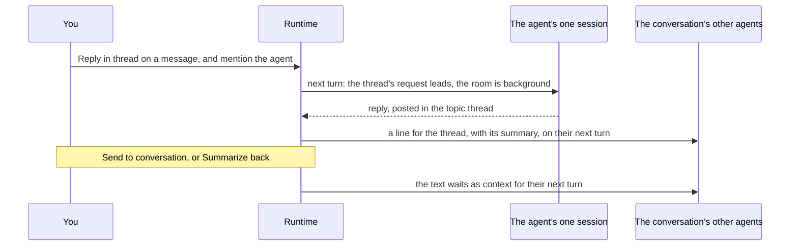

# A conversation is shared memory

Part of [the architecture](../architecture.md). What each agent in a conversation reads of it, and how a topic thread’s agent answers.

**Decision.** Every agent in a conversation can read all of it.
- **A marker per session:** each session records the last item it was given (`seenItem`).
- **Catch-up:** each delivery starts with the items after that marker, written as plain lines (“You: …”, “@indexer: …”, “@critic showed a review block …”), leaving out the agent’s own messages and the message being delivered.
- **Caps:** at most 40 items or about 16,000 characters. Messages that @-mention the agent come first, within a cap of their own of about 32,000 characters (`MENTION_CHARS`), so the rest’s caps can’t push one out ([#484](https://github.com/HJeon139/postbox/issues/484)). When items are left out, the catch-up says how many, of what kinds (“10 messages from other agents”, “2 mentions of you”), and which `read_conversation` `skip` reaches them.
- **A mention it already gave:** the catch-up records the mentions it gave in full (`givenMentions`). When one of them is then delivered as its own queued wake, the agent gets a pointer to it that quotes its first 200 characters, not the whole message again as if it were new ([#484](https://github.com/HJeon139/postbox/issues/484)).
- **Joining:** a new session starts with no marker, so an agent that joins a room gets its recent history.
- **Further back:** `read_conversation` returns older history on request.
- **Long items** ([#109](https://github.com/HJeon139/postbox/issues/109)): the catch-up and `read_conversation` cut each item at 2,000 characters (`READING.item`), and the catch-up cuts a message that @-mentions its agent at 15,000 (`READING.mention`), under half of `MENTION_CHARS` so two fit whole, since agents asked for one cut at 2,000 to be sent again rather than read the rest ([#499](https://github.com/HJeon139/postbox/issues/499)); and a cut says how much it kept and gives the item’s id, such as “… (2,000 of 5,412 characters; read_message { id: "it_4kQ2xY9a" } has the rest)”. `read_message` returns that one item in full, 40,000 characters at a time, so a history stays small and a reviewer can still read every word.
- **Blocks** ([#153](https://github.com/HJeon139/postbox/issues/153)): a block’s line carries what it holds, so an agent asked to review another’s draft can read it. A review, card or code block gives its content, with a review’s comment threads; a choice or form its prompt and its options or fields; a table, progress or image block its fallback; and an answered block your answer. An app is its title alone. The line is cut like any other item, and `read_message` takes the item’s id or the block’s.
- **Commands you ran** with `!` ([#67](https://github.com/HJeon139/postbox/issues/67)) are items like any other: each agent reads the command, where it ran, how it ended and the last 4,000 characters of its output, on its next turn. Running one wakes nobody, as Claude Code’s bash mode only adds to the context.
- **A skill or command** an agent runs from the / menu is the whole prompt, since Claude Code runs `/name args` only at the start of one. Its catch-up waits for the agent’s next turn.

**What it rests on.** Issue #1: in a room, an agent woken by an @-mention saw only that message, and answered confidently about a discussion it had never seen. The catch-up costs nothing when nothing was missed, as in a direct message where the agent is woken by every message; it replaces the separate path shares from topic threads used to take.

**Revisit when** rooms get long enough that 40 items is too little. #508 decided how: a count and a `read_conversation` cursor for what was left out, not summaries.

## Delivering a turn

From [#508](https://github.com/HJeon139/postbox/issues/508) (`designs/508/design.md`, “Delivering a turn”).
- **The turn envelope,** built ([#524](https://github.com/HJeon139/postbox/issues/524), `tests/guide-envelope.test.mjs`): each turn opens with the request it answers and where the reply goes, then what has changed in the room, then the deliveries addressed to the agent, then background, labeled as such. The system prompt holds only what is fixed for a persona, so a resumed session never runs on an old guide (#515).
- **Deliveries as records,** not built yet (#508’s A2, [#527](https://github.com/HJeon139/postbox/issues/527)): what was addressed to an agent becomes a record per recipient, not inferred from a marker. A delivery counts only once the turn carrying it produced output; a turn that fails first sends it again, labeled as a resend, at most three times, after which it waits on the person as an ask. The marker moves only with output.

## Topic threads: one session per agent

**Decision** ([#228](https://github.com/HJeon139/postbox/issues/228)). A topic thread is a thread of kind `topic` whose `parentId` is its conversation and whose `rootItemId` is the message it started from (`server/topic-open.mjs`). The person opens one with Reply in thread, and an agent with `open_topic` (#637). An agent never forks itself (intent.md, principle 7): an agent mentioned there answers from its one session in the conversation, so it remembers both. Its turn leads with the thread’s request as its task, with what happened in the room as background (`server/deliver.mjs`). The conversation’s other agents see each thread with something new as a line, with a summary of about 20 tokens one cheap model call writes once the thread settles, and read it only if they choose (`server/thread-summary.mjs`).

**What it rests on**
- **Forks multiplied agents.** Each agent in a topic thread used to run a new session forked from the conversation’s at that message, so a thread grew its own pool of agents, and forks of forks, instead of using the project’s (#228). The person decided on 23 October 2026 that each agent has one session per conversation, and you choose its memory by where you talk to it (intent.md, principle 7).
- **Nothing from a thread enters another agent’s context unless it reads it or you send it.** The line and its summary are what the others get; `read_message` and `read_conversation` take the thread’s id.
- **Bringing things back costs no turn.** Shared text is queued as context on each of the conversation’s sessions and prepended to the next message they get, so the main agent reads it when it next works rather than being woken by it (`server/share-back.mjs`).
- **No nesting.** A topic thread can’t start another one, as in Slack; a reply that deserves its own branch can be sent to the conversation and branched from there.
- **Forks from before #228 are retired.** Each keeps only `retiredFork`, which keeps it out of the rail; no message reaches it, and nothing wakes it (`server/unarchive.mjs`, `server/side-threads.mjs`).

**What’s left of forking.** The adapters still record where each turn ended in their own transcript (`ctx.checkpoint`: Claude Code and the Agent SDK give the last assistant message’s uuid, Codex its turn, the mock its session), and the runtime stamps the turn’s messages with it (`server/turn-finish.mjs`). The Claude Code, Agent SDK and Codex adapters can still start a session from a fork point (`--fork-session --resume-session-at`, `resumeSessionAt` with `forkSession`, `thread/fork`), and fall back once to the latest point when the branch point is gone (#61), but nothing in the runtime sets one now.
