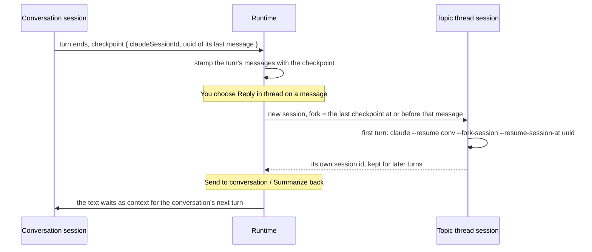

# A conversation is shared memory

Part of [the architecture](../architecture.md).

**Decided next** (28 October 2026, [#508](https://github.com/HJeon139/postbox/issues/508); built in Now, [#524](https://github.com/HJeon139/postbox/issues/524), and A2, [#527](https://github.com/HJeon139/postbox/issues/527)).
- **The turn envelope:** each turn opens with the request it answers and where the reply goes, then what has changed in the room, then the deliveries addressed to the agent, then background, labeled as such. The system prompt holds only what is fixed for a persona, so a resumed session never runs on an old guide (#515).
- **Deliveries are records:** what was addressed to an agent is a record per recipient, not inferred from a marker. A delivery counts only once the turn carrying it produced output; a turn that fails first sends it again, labeled as a resend, at most three times, after which it waits on the person as an ask. The marker moves only with output.
- **This section’s revisit line changes:** rooms longer than the caps are handled by a count and a `read_conversation` cursor for what was left out, not by summaries.

**Decision.** Every agent in a conversation can read all of it.
- **A marker per session:** each session records the last item it was given (`seenItem`).
- **Catch-up:** each delivery starts with the items after that marker, written as plain lines (“You: …”, “@indexer: …”, “@critic showed a review block …”), leaving out the agent’s own messages and the message being delivered.
- **Caps:** at most 40 items or about 16,000 characters. Messages that @-mention the agent come first, within a cap of their own of about 32,000 characters (`MENTION_CHARS`), so the rest’s caps can’t push one out ([#484](https://github.com/HJeon139/postbox/issues/484)). When items are left out, the catch-up says how many, of what kinds (“10 messages from other agents”, “2 mentions of you”), and which `read_conversation` `skip` reaches them.
- **A mention it already gave:** the catch-up records the mentions it gave in full (`givenMentions`). When one of them is then delivered as its own queued wake, the agent gets a pointer to it that quotes its first 200 characters, not the whole message again as if it were new ([#484](https://github.com/HJeon139/postbox/issues/484)).
- **Joining:** a new session starts with no marker, so an agent that joins a room gets its recent history.
- **Further back:** `read_conversation` returns older history on request.
- **Long items** ([#109](https://github.com/HJeon139/postbox/issues/109)): the catch-up and `read_conversation` cut each item at 2,000 characters (`READING.item`), and the catch-up cuts a message that @-mentions its agent at 15,000 (`READING.mention`), under half of `MENTION_CHARS` so two fit whole, since agents asked for one cut at 2,000 to be sent again rather than read the rest ([#499](https://github.com/HJeon139/postbox/issues/499)); and a cut says how much it kept and gives the item’s id, such as “… (2,000 of 5,412 characters; read_message { id: "it_4kQ2xY9a" } has the rest)”. `read_message` returns that one item in full, 40,000 characters at a time, so a history stays small and a reviewer can still read every word.
- **Blocks** ([#153](https://github.com/HJeon139/postbox/issues/153)): a block’s line carries what it holds, so an agent asked to review another’s draft can read it. A review, card or code block gives its content, with a review’s comment threads; a choice or form its prompt and its options or fields; a table, progress or image block its fallback; and an answered block your answer. An app is its title alone. The line is cut like any other item, and `read_message` takes the item’s id or the block’s.
- **Commands you ran** with `!` ([#67](https://github.com/HJeon139/postbox/issues/67)) are items like any other: each agent reads the command, where it ran, how it ended and the last 4,000 characters of its output, on its next turn. Running one wakes nobody, as Claude Code’s bash mode only adds to the context.
- **A skill or command** an agent runs from the / menu is the whole prompt, since Claude Code runs `/name args` only at the start of one. Its catch-up waits for the agent’s next turn.

**What it rests on.** Issue #1: in a room, an agent woken by an @-mention saw only that message, and answered confidently about a discussion it had never seen. The catch-up costs nothing when nothing was missed, as in a direct message where the agent is woken by every message; it replaces the separate path shares from topic threads used to take.

**Revisit when** rooms get long enough that 40 items is too little. Then summarize older stretches instead of dropping them.

## Topic threads: forked sessions at checkpoints

**Decision.** A topic thread is a thread of kind `topic` whose `parentId` is its conversation and whose `rootItemId` is the message it started from. Each agent in it runs a new session that forks the conversation’s session at that message.

**What it rests on**
- **Checkpoints, not copies.** Every adapter reports where its turn ended in its own transcript (`ctx.checkpoint`): Claude Code and the Agent SDK give the last assistant message’s uuid, and the mock gives its session. The runtime stamps each message of the turn with it, so any message knows its fork point. Postbox never copies or edits a transcript.
- **Verified live.** A session told “apple”, then “banana”, then forked at the first reply, remembered only “apple”, under a new session id. The original still remembered both. The CLI’s `--resume-session-at` is undocumented in `--help`; the Agent SDK documents it as `resumeSessionAt` with `forkSession`.
- **Your message as the root.** For a message you wrote, the fork point is the agent’s last finished turn before it, and the message itself opens the thread as context. An agent that joined the conversation after the root starts fresh; replies from before checkpoints were kept fall back to the session’s latest point.
- **A branch point that’s gone falls back to the latest point, once** ([#61](https://github.com/HJeon139/postbox/issues/61)). When the checkpoint’s message is no longer on the conversation’s chain, Claude Code fails the fork with `No message found with message.uuid of: …` (in `result.errors`). Both adapters then save the fork without its uuid, so no later turn goes back to it. They run the turn again from the conversation’s latest message, with a note to the agent that it couldn’t start where it branched. Nothing from the failed run is kept: no session id, no checkpoint. Every failed turn shows Claude Code’s own reasons, bounded, rather than only “hit an error”.
- **Bringing things back costs no turn.** Shared text is queued as context on each of the conversation’s sessions and prepended to the next message they get, so the main agent reads it when it next works rather than being woken by it.
- **No nesting.** A topic thread can’t start another one, as in Slack; a reply that deserves its own branch can be sent to the conversation and branched from there.

**Revisit when** the Claude Code CLI documents or drops `--resume-session-at`. The Agent SDK path documents it and could take over the Claude Code backend’s forks.
