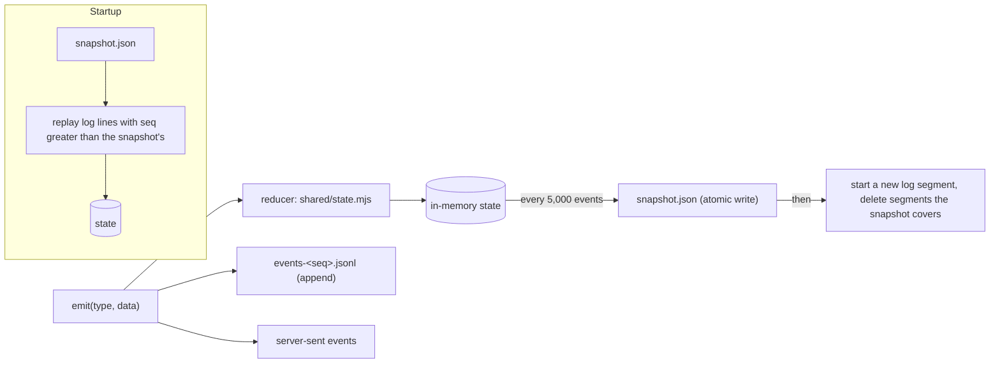
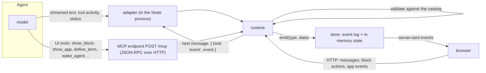

# The store: an event log with snapshots, not a database

Part of [the architecture](../architecture.md).

**Decided next** (31 October 2026, [#508](https://github.com/HJeon139/postbox/issues/508)). The Redis decision of 28 October was recalled: #565 and v1.3.0 fixed the slow room, which Redis was never chosen for, and the second writer it was chosen for has no user yet. The event log below stays, with these changes, built in steps 1a and 1b (and S2 when its budget triggers). Until they merge, the log below is what runs.
- **A commit is written whole and fsynced.** `commit(events)` writes its events together (one event as a plain event line, several as a JSON array) and `fsync`s it, so a turn’s records and marker commit together or not at all. Streamed text keeps the fast path (`emit`), unsynced. Measured on the developer’s Mac: 4.2 to 4.6 ms per `fsync`.
- **Nothing leaves the process before the sync:** a commit is applied to the public state, and so reaches the broadcast, `since()`, `/api/state`, the read tools and an adapter start, only after its line is fsynced. Emits made meanwhile are held and released in order. Server code whose read decides a write reads them before their release through `store.pending` (#601, `designs/508/601-held-view.md`); every outward reader sees them only once released.
- **Recovery:** an unterminated tail is cut; a bad line in the middle of a segment refuses to start and names the file, instead of silently dropping everything after it. A gap in the sequence starts, logs the range lost and shows it once.
- **When a write fails** (a full disk, a read-only folder, EIO), queued commits are rejected and writes close with the cause and Retry. Retry is a reload, the same recovery a restart runs: the old writer is quiesced first, and a durability barrier on a fresh descriptor comes after.
- **Receipts** are derived from the record events and checkpointed with the snapshot, so they outlive it.
- **Snapshots** are written in pieces now (the block falls from about 37 ms to about 21 ms on a 13.85 MB copy). Old turns’ work entries and activity steps are about 73% of the file and move out of state before anything is sharded (#305). A snapshot sharded by conversation waits for a stall that still passes 50 ms.
- **One writer.** A lock file in the data folder refuses a second Postbox. Revisit when a second process is designed.
- **A history epoch** made at each load tells a tab on a lost timeline to resync.
- **Data model unchanged:** key/value and documents, never a relational schema; older shapes lifted on read, never rewritten.
- **Detail:** `designs/508/storage-design.md`, and requirements ST-1 to ST-4 and PF-9 in `designs/508/requirements.md`.

**Decision.** Postbox keeps its data as an append-only event log in JSON Lines, plus periodic snapshots of the state, in its data folder. Every read comes from an in-memory projection of that log. Binary files go to a separate content-addressed blob store. All of this sits behind one small storage interface (`server/store.mjs`).

**What the design needs from a store**

| Need | Where it comes from |
|---|---|
| A numbered, append-only sequence of changes | Live updates over server-sent events must resume after a dropped connection with nothing lost or duplicated, so every change has a sequence number and clients ask for “everything after N”. |
| The current state, rebuilt from those changes | The browser and the server apply the same events with the same reducer (`shared/state.mjs`). The state is a projection, not a source of truth. |
| Durable across restarts | “The conversation survives a page reload: keep it in the app’s own store.” |
| Cheap writes during streaming | A reply streams as many small text events per second. |
| Binary attachments | Pasted images, uploads, and the files agents publish as assets. |
| No schema to maintain, no relational queries | One person, one machine, one process. Every read is “all of it” at startup, then live events. |

**Options considered**

| Option | Fit | Why not now |
|---|---|---|
| One JSON file, rewritten whole (Stage 2) | Simple | Each write serializes the entire state. That’s fine at tens of kilobytes; after months of use it blocks the event loop on every streaming reply. |
| **Event log (JSONL) + snapshots** | Matches the event model exactly. Appends are cheap and crash-tolerant. No schema beyond the event types. No dependencies. | **Chosen.** |
| Redis (Streams + AOF) | Streams are a good log, and AOF is itself an append-only file | Adds a server to install and run, a network hop and a runtime dependency, for one user in one process. Chosen on 28 October and recalled on 31 October; it earns its place only with several server processes or users. |
| SQLite (`node:sqlite`, built into Node 22) | Transactions and durability in one file, still schema-light: one events table and one snapshot table holding JSON | Still marked experimental in Node 22, and it prints a warning. It’s the first candidate if we need transactions across files or queries. |
| A document or relational database (Postgres and so on) | — | Schema and operations work with no payoff for this use case. |

**How it works**

- **Writes** are batched and appended in order. A crash can lose at most the last few milliseconds of events. A truncated last line is detected on startup and dropped.
- **Snapshots** are written to a temporary file and renamed, so a crash mid-write leaves the old snapshot intact. A new log segment starts after each snapshot, and segments the snapshot fully covers are deleted. A snapshot is lines, one small JSON value each, so no string holds the whole state ([#1180](https://github.com/HJeon139/postbox/issues/1180)). The write yields between pieces, so emits are held until it ends, as they are behind a commit: the snapshot is one view of the state, and nothing in it is in the next segment too.
- **Schema.** Events carry plain JSON. If an event’s shape ever changes, the reducer upgrades old events as it reads them (an “upcaster”), so there are no migrations to run.
- **Stage 2 data** in `store.json` is read once as the first snapshot, then renamed `store.json.migrated`.

**Revisit when** Postbox runs as more than one server process, serves more than one person, or needs queries across history (for example, search). Then move the same interface onto SQLite, Redis Streams or Postgres, and choose by the need then. Redis Streams was chosen on 28 October 2026 and recalled on 31 October (see “Decided next”).

## How agent data reaches the store

**Decision.** Everything an agent does arrives through the runtime, which validates it and emits events. Nothing writes to the store directly.

- **Text and activity** stream through the adapter, which runs inside the Node process. For the Agent SDK it’s a library call; for Claude Code it’s the CLI’s streaming JSON output.
- **UI tools** go over MCP, whether the agent is in-process or a separate Claude Code process. They’re validated and return at once.
- **Your actions** come back as HTTP requests and reach the agent as its next message.
