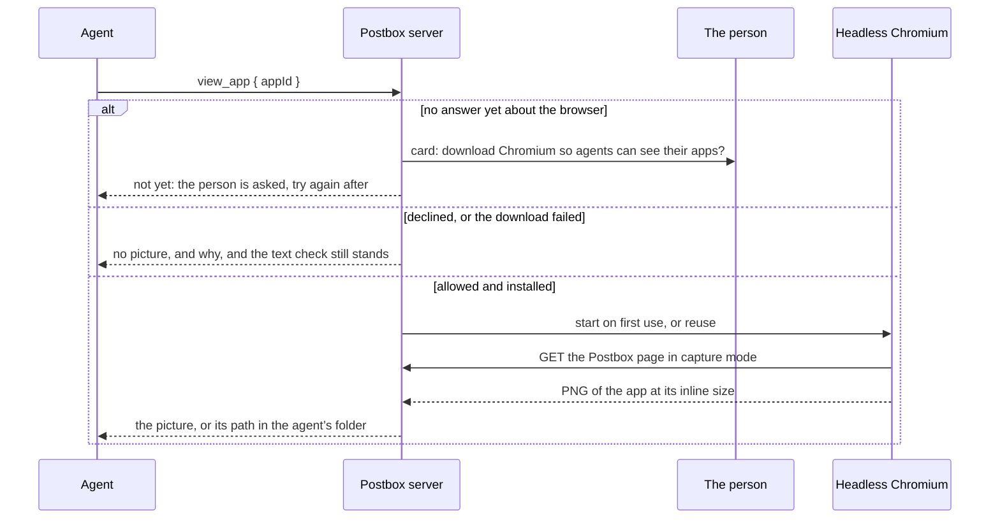

# Agents see their app: a pinned headless browser, on request

Part of [the architecture](../architecture.md).

**Decision** (7 November 2026, #473, from the person’s ruling on #95 of 25 October). A `view_app` tool returns a picture of an agent’s app, as the person first sees it, rendered by a pinned headless Chromium that Postbox downloads only after the person agrees. It doesn’t replace the pre-display check, which still runs in the person’s browser; it’s for the agent to look before calling an app done.

- **The package:** `playwright-core` in `optionalDependencies`, at the exact version of the `@playwright/test` dev dependency (1.64.1 today), so the specs and `view_app` drive the same Chromium build. It’s loaded with a dynamic `import()` inside `try`, as `kokoro-js` is ([narration.md](narration.md)). This isn’t Postbox’s first runtime dependency: the Agent SDK and `kokoro-js` are optional ones already.
- **The browser:** Chromium’s headless shell, the build `tools/browser.mjs` drives, not full headless Chrome. Playwright drives it over a pipe, and it exits when the pipe closes, so a server that’s killed leaves no browser behind ([browser-checks.md](browser-checks.md), “The tools run the headless shell”). It runs with `--site-per-process`, so the sandboxed app frame gets a process of its own.
- **The download, asked before it happens:** the first time an agent calls `view_app`, Postbox shows the person a card: “Download Chromium (about 200 MB on disk) so agents can see their apps?” Until they answer, `view_app` says the person has been asked. The answer is kept in Postbox’s data folder, so it survives a restart. “Not now” lasts a week, and the next call after that shows the card again, so the person can change their answer.
  - **On yes,** Postbox runs Playwright’s own installer as a child process (`playwright-core`’s CLI, `install chromium-headless-shell`, as an argument array) with `PLAYWRIGHT_BROWSERS_PATH` set to a `browsers` folder in Postbox’s data folder. That keeps it out of the shared Playwright cache, which other tools update on their own schedule. Playwright verifies what it downloads.
  - **On no, or a failed download,** `view_app` returns no picture and says why. The pre-display check is unchanged.
- **The process:** one browser, started on first use and closed after five idle minutes, as Kokoro is. Each capture gets a new browser context and a temporary profile, and times out after 20 seconds. A capture that times out closes the browser, since a hung one would hang every later call, and the next call starts a new one. The browser stops with the server, and so does a download that’s running: its card says Postbox stopped, and one a killed Postbox left downloading says so on the next start.
- **What it renders:** the real Postbox page, not the app page alone. An app gets D3, KaTeX and Mermaid from the host page over the postMessage bridge ([sandbox.md](sandbox.md)), so the page alone would draw without them. The capture tab opens the app’s conversation with `?nocheck`, scrolls the app into view, and takes the app’s frame. While the app’s check is pending, or its agent is fixing what the check found, the capture shows the app itself, where the person would see a placeholder. Any other result shows as the person sees it, with its note.
  - **Size:** the person’s window size and the width of their conversation beside the rail and any open pane, reported by the open Postbox tab. When no tab is open, 1000 × 680 (a 14-inch laptop’s browser), with the conversation beside the rail as the page lays it out.
  - **Theme:** the person’s.
  - **First:** the app at its inline size. **Full screen** comes second, in a later change.
- **The capture tab can’t act.** Its browser context aborts every request that isn’t a `GET` to Postbox’s own address, and every request to any other host. This is enforced by the driver, so it doesn’t depend on the page’s code. That means it can’t report that a thread was viewed (which clears unread counts), can’t write, and can’t reach the network. Apps load nothing from a URL anyway ([sandbox.md](sandbox.md)).
- **What the agent gets:** the picture as an image in the tool result, for a backend whose adapter declares that it accepts images. Otherwise it’s saved in the agent’s folder, at `.postbox/view/<app id>-v<version>.png`, in a folder whose own `.gitignore` keeps the pictures out of the project’s commits, and the result gives that path, which every backend can read with its file tool.

**What it rests on**
- **Agents ship apps they’ve never seen** (#95). Three “I haven’t seen it render” disclaimers came in one room, and a 4 px clipped control (#89) reached the person. In the #206 stage 1 experiment, every hand-drawn app spent thinking turns placing labels by coordinates that it couldn’t check.
- **The person decided the browser** (25 October 2026): pinned, optional, downloaded with consent, on request only. Narrow widths stay with the text check.
- **Isolation, as for Kokoro ([narration.md](narration.md)).** The browser’s native code runs in its own process, never inside the server that holds the conversations. The agent’s app runs in its sandbox ([sandbox.md](sandbox.md)), in a context that can only read Postbox.
- **The same build everywhere.** Pinning to the dev dependency’s version means the capture and the browser specs see the same rendering.

**Supply chain**
- The dependency review in CI covers `playwright-core`, as it does the other optional packages.
- An update moves `@playwright/test` and `playwright-core` together, in one change, and the browser specs pass on the new Chromium before it merges. A person’s installed browser is replaced on their next `view_app`, after the same consent, when the pinned build changes.

**Revisit when**
- A usable Chromium or Chrome is already on most people’s computers, and pointing Playwright at it avoids the download.
- The download proves too large, or too slow, for people to accept.
- The person’s own browser can render the check frames to an image, which would need no second browser.
- Agents need the narrow widths, or interaction states such as a middle step (#95’s render-and-critique comment).
