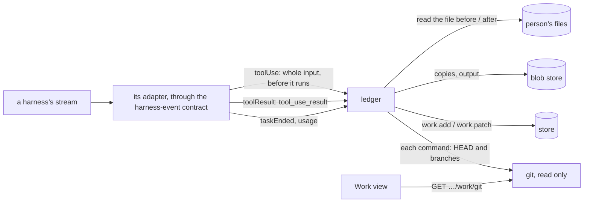

# The work ledger: built from tool calls, counted from diffs

Part of [the architecture](../architecture.md).

**Decision** ([#132](https://github.com/HJeon139/postbox/issues/132)). Each conversation keeps a ledger of what its agents’ turns changed, ran and published, and what they cost ([`server/ledger.mjs`](../../server/ledger.mjs), with the shared counting and totals in [`shared/work.mjs`](../../shared/work.mjs)). It lives in the store as `state.work[conversationId]`, a list of entries (`turn`, `file`, `change`, `command`, `commit`, `push`, `branch`, `external`, `publish`, `read`, `restore`) added and patched by `work.add` and `work.patch` events, so the Work view and the list under each turn’s last reply update live like everything else. A `publish` is an app the turn showed or updated, at its version, or a block it showed, read from the store when the turn ends; a `read` is a Read, Grep, Glob, WebFetch or WebSearch call’s path, pattern, URL or query (#195). The list’s rows come from the same entries (`turnRows` in [`shared/work-list.mjs`](../../shared/work-list.mjs)), so the list and Work can’t disagree. File copies and command output go to the blob store, never into the log.

**What it rests on**
- **Recorded, not guessed.** Two real turns are fixtures ([`ledger-edits.jsonl`](../../tests/fixtures/claude-code/ledger-edits.jsonl), [`ledger-push.jsonl`](../../tests/fixtures/claude-code/ledger-push.jsonl)). They show what the stream gives on the event that carries a tool’s result (`tool_use_result`):
  - Edit and Write give the file’s contents before the change (`originalFile`, null for a file Write created), and git’s line counts.
  - Bash gives its `stdout`, `stderr` and `interrupted`, a `backgroundTaskId` for a background command, and `gitOperation` with `commit: { sha, branch }` and `push: { branch }`. A `vcs_state_changed` system event names the repository’s folder.
  - A failed command’s result starts “Exit code N”.
  - A background command ends with `task_notification` (its tool call’s id, a summary with its exit code, and its output file), and that can come after the turn’s first `result`.
  - `total_cost_usd` and `modelUsage` are running totals for the process, so a turn’s spend is its last result’s, summed over the processes a turn ran (a fork retried).
  - A subagent’s results carry no `tool_use_result`.
- **The file before.** It’s read synchronously the moment the call’s whole input is known, which can lose the race with the tool. The tool’s own `originalFile` replaces that read whenever the result has one, so only a subagent’s edits rely on the race.
- **Counted from the diff.** Lines are counted with Myers’ algorithm the way `git diff --numstat` counts them: a missing final newline changes the last line. A file’s count is against the copy from before the agents’ first change in the conversation, so edits that are put back count as nothing. Each turn’s own change is kept too, so the lines written along the way show beside the lines kept. Kept lines count toward the agent that changed a file last, so the agents’ rows add up to the conversation’s.
- **Git is only read.** Where each file stands comes from `git status --porcelain`, `git log -1 -- <file>` and `git branch -r --contains`, run with an argument array and `GIT_OPTIONAL_LOCKS=0`, so an agent committing at the same moment never meets Postbox’s lock. A commit’s files and lines come from `git show --numstat`, so they match git.
- **Restore never overwrites newer work.** It writes the copy from before atomically beside the file, or removes a file an agent created, and only when the file on disk still matches the agents’ last change. The conversation gets a line in the person’s voice, which is how the agents learn of it.

**What a command committed.** In a git folder, the ledger reads HEAD and the branches, local and remote, as each command starts and again when it ends ([`server/ledger-commands.mjs`](../../server/ledger-commands.mjs)), read-only, without git’s optional locks. Reading them is quick, and a commit takes longer to make.
- **What's recorded:** a commit HEAD or a moved branch gained since the command’s own start, with a committer date from after it started, is recorded on the branch that gained it. That covers a commit inside `… && git commit -q` that the tool call didn’t report (#156).
- **What isn't:**
  - A commit the command’s start already had.
  - One a remote branch has, as after a pull or a rebase onto it, unless the command pushed.
- **Commits that left:** a commit HEAD no longer has, nor any branch (amended, reset or rebased away), is marked as left.
- **A new repository:** in a folder that became one during the command (`git init`), its commits are recorded.
- **Overlaps:** a commit made while commands overlapped in one repository is recorded under each of them, each in its own conversation, marked as overlapping.
- **Where it compares:** always in the repository the command’s start was read in. Claude Code’s own folder for git (`vcsCwd`) can be left over from an earlier command, so it doesn’t count here.
- **Tests:** `tests/work-git.test.mjs` uses a repository in memory, and `tests/process/ledger-git.test.mjs` runs the same cases against real git in temp folders.

**What it doesn’t see yet.** A file a command changes (a formatter, a script, `sed -i`) isn’t listed: only the file tools name files. Comparing `git status` and `git diff --numstat` as a command starts and ends was tried in #226 and set aside. Git answers for the start about 10–30 ms after Postbox hears of the command, and a quick `sed` can finish sooner. #240 takes the snapshot before the command runs, through Claude Code’s PreToolUse hook. A background command still running when its process ends is shown as having said nothing about how it ended (#129). Artifacts (recordings, reports, screenshots) and servers or ports a command started aren’t picked out yet.

## Where it shows

Work is one of the conversation’s side views in the right pane ([front-end.md](front-end.md), “The right pane”): a compact form beside the conversation (`mountWorkPane`) and a full form over the window (`mountWork`). Both forms read the same ledger through `summarize()` and ask git through the same endpoint; the compact form adds nothing to the store.

**Revisit when** the CLI reports files a command changed (then use that, in place of #240’s snapshot), or when the Agent SDK’s results stop carrying `tool_use_result`.
