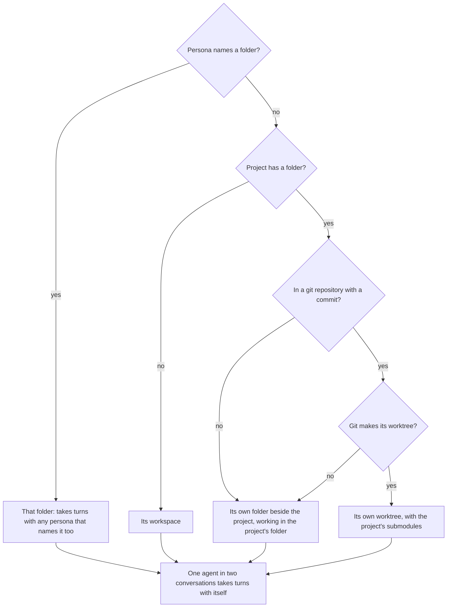

# Real agents and their backends

The five backends an agent can run on, what each needs, its permission modes and what differs between them, and how to bring your own.

## Run real agents

A persona runs on one of five backends. Pick one in the new-agent sheet, under **Backend**. Three of them can also run on another computer: see [remote-hosts.md](remote-hosts.md).

| Backend | What it runs | Needs |
|---|---|---|
| Claude Code | The `claude` CLI you’re signed in to, in print mode. Each thread is one Claude Code session, resumed every turn. | Claude Code installed (`claude --version` works), or `POSTBOX_CLAUDE_BIN` pointing at it |
| Agent SDK | `query()` from `@anthropic-ai/claude-agent-sdk`, inside Postbox’s server | `npm install` |
| Kiro CLI | The `kiro-cli` you’re signed in to, headless (`kiro-cli chat --agent-engine v3 --output-format stream-json`). Each thread is one Kiro session, resumed every turn. | Kiro CLI installed (`kiro-cli --version` works), or `POSTBOX_KIRO_BIN` pointing at it |
| Antigravity CLI | The `agy` CLI you’re signed in to, headless (`agy --output-format stream-json --print`), with Gemini models. Each thread is one conversation, resumed every turn. | Antigravity CLI installed (`agy --version` works), or `POSTBOX_AGY_BIN` pointing at it |
| Codex | The `codex app-server` you’re signed in to. Postbox starts and resumes an app-server thread for each conversation. | Codex CLI installed (`codex --version` works) and signed in, or `POSTBOX_CODEX_BIN` pointing at it |
| Mock agent | The scripted agent the demo uses | Nothing |

Postbox never reads, stores or asks for an API key. The Claude backends use Claude Code’s own sign-in, or `ANTHROPIC_API_KEY` if your environment already sets it; the Kiro CLI uses its own sign-in, or `KIRO_API_KEY`; the Antigravity CLI uses its own sign-in. Postbox starts each backend only if it can run here; the server’s first lines list the ones it found. `POSTBOX_BACKENDS=mock` turns the real ones off.

**Model.** Postbox keeps no list of models of its own. When a sheet with a **Model** field opens, Postbox asks that backend’s own harness which models it offers, and the field suggests them ([`server/model-lists.mjs`](../server/model-lists.mjs)): Claude Code answers an `initialize` request, the Agent SDK its `supportedModels()`, and the others their own list commands below. None of these runs a model. A list is used for a minute, and the last one each backend gave is kept in the data folder, so after a restart, or when the harness can’t list just then, the field suggests that one and says so. For an agent that runs on a host, the harness asked is the host’s own CLI, through its daemon, and that list is kept per host: see [remote-hosts.md](remote-hosts.md). New agents start on `claude-opus-5-5` while the backend lists it, or hasn’t listed yet, and otherwise on the first model it lists. The field takes any model you type, listed or not, and passes it to the harness as `--model`. Only switching backend changes it: to the new backend’s default, when that backend doesn’t offer it. Change it per persona under **Personas**.

**Permissions.** Each persona has one of four modes:

| Mode | The agent… |
|---|---|
| Auto (the default) | runs routine actions without asking: Claude Code’s safety classifier approves them. When it can’t decide, the agent asks you, the same way as Ask me. |
| Ask me | asks before it runs a command or changes a file. Postbox shows the exact command in a card in the thread, the agent needs you, and the tool call waits for **Allow** or **Don’t allow**. Stop answers no. |
| Accept edits | edits files in its folders freely, and asks before it runs commands |
| Run everything | never asks. Use it only in a folder you can lose. |

Postbox always passes the mode explicitly, so a default from your own Claude Code settings never changes it. A change to a persona’s mode, or to where it runs, reaches its conversations from their next turn.

**Hooks.** In Ask me and Accept edits, a Claude Code or Agent SDK agent’s turns run without the hooks in your settings files and plugins, and without your custom status line, since a hook that approves a tool call would skip Postbox’s ask rules for writes outside it and its permission cards ([#817](https://github.com/HJeon139/postbox/issues/817)). In Auto and Run everything your hooks run, as in your terminal: in Auto Postbox adds no write ask rules of its own. It still shows a card when Claude Code itself asks, and for your ask rules and the conversation’s, and one of your hooks that approves a call skips those cards there, as it would skip your ask rules in your terminal ([#806](https://github.com/HJeon139/postbox/issues/806)). A turn that started with your hooks on keeps its mode until it ends rather than switch into Ask me or Accept edits. Your terminal’s Claude Code is unchanged. The permissions panel lists each `PreToolUse` and `PermissionRequest` hook it finds in `~/.claude/settings.json` (or `$CLAUDE_CONFIG_DIR/settings.json`), only when the agent uses your setup, and in the agent folder’s `.claude/settings.json` and `.claude/settings.local.json`. When a persona names its own folder, that’s the folder it reads, not the project’s. For an agent on a host, those are this computer’s files, not the host’s. Hooks your organization manages always run, and one of those can still approve a call without a card.

**Folders.** An agent works in its project’s root folder, or in the folder its persona names, or, if neither is set, in `workspaces/<name>` in the data folder. When that data folder is a clone’s `data/`, a Claude Code or Agent SDK agent working in it is kept from the checkout’s own `AGENTS.md` and `CLAUDE.md` files (`claudeMdExcludes`), the rules for developing Postbox; a project whose folder is the checkout still loads them. Codex and Antigravity don’t yet (#319). An Antigravity agent with no folder of its own never starts in its project’s folder: it works in a git worktree of its own, or, where there’s nothing to make one from, starts in a folder of its own beside the project and works in the project’s folder from there (below). If its persona names a folder, it can also read the project’s. Its permission mode decides what it may change. Postbox’s own tools (show_block and the rest) never ask; they only show things in the thread.

**The Kiro CLI.** Each turn, Postbox writes a Kiro custom agent with the guide as its prompt, Postbox’s MCP server and the persona’s rules, and removes it when the turn ends ([`server/adapters/kiro-cli.mjs`](../server/adapters/kiro-cli.mjs)). What differs from Claude Code:
- **It can’t ask you.** A headless Kiro run treats every ask as a refusal, so there’s no permission card: a call that would need asking shows as a denied step. Ask me means Kiro’s defaults plus reads in the agent’s folders; Accept edits adds writes there; Auto, since Kiro has no Auto of its own, runs what the agent’s Tools allow, with Shell any command, with Web any search or fetch, any MCP tool that doesn’t publish, and writes in its folders, with nothing judging those calls (#136); in both, writes to the folders’ `.kiro` and `.git` stay refused. In Auto with Shell, reads and writes follow the shell’s rule anywhere, since a command could already reach them (#1723, as #1710 for Antigravity), except a write in `.git`, which Kiro itself asks about and so refuses headless; Postbox also keeps Kiro’s own config from file-tool edits, each folder’s `.kiro` and the Kiro home the turn runs with, whose settings start MCP servers; Run everything is `--trust-all-tools`, and unticked Tools stay denied. Claude Code rules (the permissions panel, Allow once) don’t apply.
- **Your setup.** With **Uses your Kiro setup**, it runs with your Kiro home (`KIRO_HOME`, else `~/.kiro`): your steering, skills, settings and MCP servers load, and the turn’s agent file is written to its `agents` folder for the turn. Off, it runs with `kiro-home` in the data folder, and a deny rule turns off every MCP server but Postbox’s, including one a managed install adds to Kiro’s agent files by itself. A `.kiro` folder in the agent’s working folder loads either way.
- **Models** are Kiro’s (`kiro-cli chat --list-models`), and the model field suggests the ones your sign-in offers, Claude’s and others such as GPT and DeepSeek. Postbox’s names become Kiro’s: `claude-opus-5-5` runs as `claude-opus-5.5`.

**The Antigravity CLI.** agy has no flag for an MCP server or a system prompt, so each turn writes a plugin into the agent’s folder, `.agents/plugins/postbox/`, with Postbox’s MCP server and the guide as its rules, and removes it when the turn ends ([`server/adapters/antigravity-cli.mjs`](../server/adapters/antigravity-cli.mjs)). In a git repository, that path goes in `.git/info/exclude`. Two turns can’t start in one folder, since each turn’s plugin holds its own conversation, so an Antigravity agent with no folder of its own, in a project whose folder is in a git repository with a commit, gets a git worktree of its own ([#1709](https://github.com/HJeon139/postbox/issues/1709), decided by you on 23 November 2026, and again on 26 November: Antigravity agents “must not share resources with other agents and wait for no reason”, [#1856](https://github.com/HJeon139/postbox/issues/1856)). This is the default, with no setting: a persona with a folder of its own keeps that folder. For Antigravity agents it replaces the opt-in worktree per conversation decided on 25 October 2026 ([#9](https://github.com/HJeon139/postbox/issues/9)). It’s made at the agent’s first turn, in `worktrees/<project>/<persona>-<repository>` in the data folder, on a branch named `postbox/<project>-<name>-<persona id>` from the project’s current commit, and kept across turns. Its file tools and its read-only commands (such as `cat`, `ls` and `grep`) may read the project’s folder with no card; a write there asks, git keeps to its own folders, and it doesn’t work in the project’s folder. At the end of each turn Postbox commits what the turn left in the worktree, on its branch, with the agent as its author and the repository’s hooks off, so an agent without Shell hands its work over with no card. A turn that was stopped or failed commits what it left too. The commit runs only in the worktree Postbox made, on the agent’s own branch; one on another branch, half done, in conflict, or with a repository of its own inside that isn’t one of the project’s submodules is left uncommitted, and the server log says why, as it does for a commit git doesn’t finish in time. The commit takes every file the turn left that the repository doesn’t ignore, a secret the agent wrote included; it stays on the agent’s branch in your repository, and Postbox never pushes it. The person merges its branch: its rules name the branch and the project’s folder, say that Postbox commits what it leaves, and ask it to name its branch when it changes files (the person’s decisions of 26 November 2026). A turn without agy’s hook, unless it runs everything, isn’t told, in a worktree or in a folder of its own (below): agy would refuse the reads the note promises, and its rules file has no room. The worktree doesn’t follow the project’s later commits or changes the person hasn’t committed. Making one never runs `git worktree prune`, which would forget the person’s own worktrees whose folders are away; a deleted worktree’s own record is removed instead. The agent works there, without the project’s folder added, so its changes land on its branch until they’re merged. Files the repository doesn’t track, such as uncommitted work, `node_modules`, `.env` and build output, aren’t in it, and Git LFS files arrive as pointers, since the repository’s filters don’t run. **Submodules** ([#1856](https://github.com/HJeon139/postbox/issues/1856)). A project whose repository has submodules gets worktrees like any other, with the submodules in them. Git leaves a submodule’s folder empty in a new worktree, so for each submodule the project’s current commit names in `.gitmodules`, Postbox makes a worktree of your own submodule repository (the one checked out in the project’s folder) at that path in the agent’s worktree, at the commit the project names, on a branch of the same name as the agent’s, `postbox/<project>-<name>-<persona id>`, in the submodule’s repository. Nothing is cloned or fetched, so nothing reaches the network or needs `protocol.file.allow`, and git’s submodule commands, which run the repository’s own ssh command, never run. Your submodule checkout is only read: its repository gains the branch and git’s record of the worktree, as the project’s does. A submodule your checkout doesn’t hold (never initialized, or without the commit the project names) stays empty in the agent’s worktree, as it is in yours, and the server log says why; so do submodules inside a submodule, and any past the first 100. At the end of a turn, what the agent left in a submodule is committed first, the same way and under the same checks, in the record your submodule repository keeps, on the agent’s branch there; the project’s commit then names that commit, so merging the agent’s branch in the project and running `git submodule update` gives you its submodule work, which is already in your submodule repository. A submodule left uncommitted (on another branch, or half done) says why in the server log, and the project’s commit goes on without it. A submodule that stands behind or beside the commit the agent’s branch names, as after the agent merged a branch that moved it on, isn’t recorded: naming where it stands would take the project’s back. Every repository inside the worktree is kept out of the commit’s `git add` by name, since adding one starts git inside it; one the agent added itself, which is neither of these, still leaves the turn uncommitted. A worktree is kept by the agent’s id, and a new agent given a deleted one’s handle gets a branch of its own. Nothing removes a worktree or its branch yet, a submodule’s included, nor an agent’s own folder: deleting the agent or the project leaves them in the data folder and the repositories ([#1761](https://github.com/HJeon139/postbox/issues/1761)). **Where there’s no worktree** ([#1856](https://github.com/HJeon139/postbox/issues/1856)). With nothing to make a worktree from (the project’s folder isn’t in a git repository, or its repository has no commit yet), the agent starts in a folder Postbox makes for it alone, `agent-folders/<project>/<persona>` in the data folder, and the project’s folder is added to the turn (`--add-dir`) as one it works in, as for an agent whose persona names a folder. Its work lands in the project’s folder itself, where every other backend’s agents work and where you already look: nothing is copied, nothing is committed, and nothing waits on you. A copy or a private repository per agent was the other choice, and it would keep each agent’s work from you and from the agents reviewing it, with no git to merge it back. Its rules say where the project’s folder is and that other agents work there at the same time. Once the repository has a commit, the agent’s next turn gets a worktree. When git refuses a worktree (the agent’s branch is checked out elsewhere, a folder that isn’t a worktree stands in its place, the checkout ran out of time, or the worktree’s record is gone, as after the repository is cloned again), the turn runs the same way rather than wait behind the others or fail: the agent’s rules say git refused, why, and that its changes aren’t on a branch of its own; the turn shows a failed step in the room, “Postbox couldn’t make this agent’s worktree”, with git’s reason and what to do; the server log says it once; and Postbox tries again at the agent’s next turn. The step asks nothing of you and doesn’t raise “needs you”. The risk a refusal carries is that the agent’s changes land in your checkout rather than on a branch, which is where every other backend’s agents work. In Auto, routine git runs with no card in a worktree’s top folder, as in a checkout, since its config is the main repository’s; in a project folder below the repository’s top it asks, as it does in a checkout. An agent that ran in the project’s folder before starts its agy conversation over once, since agy keeps a conversation per folder. **What still takes turns.** A turn waits only for another turn that starts in the same folder, since one would overwrite the other’s plugin, and no two agents start in one folder unless you set it up so. Two cases remain: one agent’s turns in two conversations, since they start in its one folder (its worktree, its own folder, or its workspace), and two personas that name the same folder of their own, which is your choice of folder and is kept (decided 26 November 2026, [#9](https://github.com/HJeon139/postbox/issues/9)): their turns take turns there, and the waiting one says “Waiting for another Antigravity turn in this folder”. Give each persona its own folder, or none, to run them together. What differs from Claude Code:
- **One line in your agy settings.** Headless, agy refuses every tool call it would ask about, Postbox’s own included. So the first turn adds `mcp(postbox_postbox/*)` to `permissions.allow` in `~/.gemini/antigravity-cli/settings.json`, and keeps the rest of the file. Only Postbox’s plugin names that server, and it exists only while a turn runs.
- **How it asks.** With agy 1.4.7 or newer, Postbox’s PreToolUse hook decides each call, and a call that needs asking comes to you as a card. agy’s own Auto isn’t offered on every account, so **Auto** works like Run everything for the tools you give the agent: with Shell, any command; with Web, any search or fetch; and any MCP tool that doesn’t publish, with nothing judging them (#416). With Shell, its read and edit tools follow the same rule, since a command reaches any file with no card: a read or an edit anywhere runs, `.git` included, except Antigravity’s own plugin, hook and settings, where a read asks and an edit is refused (#1710). Without those tools, Auto runs everyday reads and asks about the rest. A tool on Postbox’s publishing list is refused unless the agent can publish: a `gh` command through Shell isn’t on it. Before agy 1.4.7, a call that would need asking shows as a denied step, and Postbox resumes the conversation once for the agent to say what was refused. Claude Code rules don’t apply.
- **A read outside its folders** asks on a card, unless the agent is in Auto with Shell (#1710). Always allow makes that file’s folder readable for that agent in this conversation, listed in the permissions panel as “Read only, in this conversation”: the agent may read there, never edit there with no card. It’s never offered for `/`, your home folder or a dot-folder in it such as `~/.ssh`, nor for an agent on a host (#338).
- **Tools in Run everything.** With Web off, Postbox requires its PreToolUse hook, and the turn stops before it starts if the hook isn’t available. The hook refuses every Antigravity tool, and every MCP server’s tool, whose name or server’s name says web, url, browser, search, fetch or chunk, except agy’s own searches of the folder and the conversation; a tool that runs a command or code, such as a notebook or a workflow, unless the agent has Shell; a tool on Postbox’s publishing list, unless the agent can publish; and any tool Postbox doesn’t know, including a subagent, since whether agy’s hook runs inside one is unproved. With Web on, no hook runs, so Antigravity can’t enforce Shell off or publishing off: the agent is told not to use them.
- **Always your setup.** agy reads its config from `~/.gemini` and has no setting to move it, so there’s no Isolated mode: your rules, skills, plugins and MCP servers load, as in your terminal.
- **Models** are agy’s (`agy models`): Gemini’s, and others such as Claude and GPT-OSS. A persona that names no model runs `gemini-3.8-flash-high`. Effort is part of some model ids (`gemini-3.8-flash-low`), so it’s passed only to a model that takes it, such as `gemini-3.8-flash` (up to High).

Where an Antigravity turn starts, as [`server/adapters/agent-worktree.mjs`](../server/adapters/agent-worktree.mjs) decides it. Only the two ends marked “takes turns” can hold two turns at once:



**Codex.** Postbox uses the local `codex app-server` JSON-RPC protocol, with Codex’s own sign-in and configuration; it does not ask for an API key. It adds Postbox’s session-specific MCP endpoint to the Codex server, streams Codex text and tool activity, and resumes each saved thread on the next turn. Stop sends `turn/interrupt` and then stops the child process if needed. Model suggestions come from app-server’s `model/list` catalog. `/compact` runs Codex’s own compaction of the agent’s thread (`thread/compact/start`), not a prompt, and any words after it are left out, since Codex’s takes none; an agent with no thread yet has nothing to compact, and the command is refused with that reason before anything is posted. Codex reports no summary and no token counts for a compaction, so its divider shows none (#425).

Codex permission modes map to its sandbox and approval policy: **Ask me** uses read-only; **Auto** uses workspace-write, with network access on for an agent that may fetch the web, and Codex’s own reviewer judges what the sandbox stops; **Accept edits** uses workspace-write with network access off and approvals on request; and **Run everything** uses full access with approvals disabled. Its approval requests appear as Postbox permission cards. Codex doesn’t read Claude Code permission rules. Of the per-agent Tools, only Web affects Codex. In Auto it turns network access on for sandboxed commands. With Web off, Postbox disables Codex’s built-in web search when launching local and remote turns in every mode and tells the agent which tool is off. Web-enabled agents use Codex’s own web search setting. External MCP servers use their own tool policy. Always allow on a Codex card saves exactly the command prefix or host Codex proposed as a Codex rule, in `rules/default.rules` in your Codex home. A command that matches it runs outside Codex’s sandbox, with no card, in every Codex session on the computer, so the card offers one only for a few programs that read and print (such as `ls`, `cat`, `grep`, `gh pr view` and `gh issue list`), only to an agent with Web, and none on a host’s card. A host is offered only in Auto, for an agent with Web. Codex reads its usual local configuration, including any MCP servers already configured there.

**Attach a Claude Code session.** Choose **+**, then **Attach a Claude Code session**, to bring in one you started in a terminal. It joins as an agent working in that session’s folder, with its recent history. When you write to it, Postbox resumes that same session. When you type in the terminal, your turn and the agent’s reply appear in the thread, marked “from terminal”. Let a terminal turn finish before you write to it from Postbox.

**Your own adapter.** All model access goes through one interface, in [`server/adapters/adapter.mjs`](../server/adapters/adapter.mjs):

```js
import { HarnessEvents } from '../harness-events.mjs';

export class MyAdapter {
  name = 'my-backend';                      // a persona’s `backend` picks its adapter
  capabilities = { permissions: 'none' };   // optional: it doesn’t read Claude Code’s rules
  async deliver(session, message, ctx) {    // one turn; resolve when it ends, throw to fail it
    // Your harness’s stream, reported as the contract’s events; Postbox builds the reply, steps and Work from them.
    const { event } = new HarnessEvents(ctx);
    event({ kind: 'text', text: 'Reading the schema first.' });
    event({ kind: 'tool_call', id: 't1', name: 'Read', input: { file_path: 'schema.md' }, final: true });
    event({ kind: 'tool_result', id: 't1', text: '…the file…' });
    event({ kind: 'context', percent: 12 });     // the ring’s share of the context window used
    const ok = await ctx.askPermission({ tool: 'Bash', summary: 'run a command', detail: 'npm test' });
    // Blocks, apps, glossary terms and wakes go through the UI tools:
    //   in-process: ctx.tools.show_block({ block }), or over MCP at ctx.mcpUrl
    if (ctx.signal.aborted) return;          // Stop aborts the signal
  }
}
```

Every real adapter shares a system prompt that teaches the catalog, the kit and the [recipes](recipes.md) ([`server/adapters/guide.mjs`](../server/adapters/guide.mjs)), and reports its stream through the harness-event contract ([`server/harness-events.mjs`](../server/harness-events.mjs), [architecture/adapters.md](architecture/adapters.md)): name a call as Claude Code names its tools (Bash, Read, Edit, Write), and the steps, Work and the live view follow.

**MCP.** The UI tools are served over JSON-RPC 2.0 at `POST /mcp?session=<session id>&turn=<token>` ([`server/mcp.mjs`](../server/mcp.mjs)). Postbox gives each turn it starts its own token, and a tool call without the running turn’s token is refused (#54), so only an agent turn Postbox started can call them, not a script that knows a session id. A large app goes by `codePath`, a file in the agent’s folder, and an app’s data files by `files`, which the app reads with `postbox.file(name)`. The tools:
- `show_block`, `update_block`, and `review_block`, which comments on another agent’s review block, line by line or on a selection, with a verdict; each comment becomes a thread on the draft and its agent hears them: a waiting block still waits on you (#133), an answered review takes comments without reopening it, and a closed one refuses (#716)
- `show_app`, `update_app`, and `retire_app`, which leaves an app that’s no longer needed as one line in its place, with a link to what replaced it and its versions (#193)
- `define_term`
- `propose_agent`
- `schedule_wake`, and `cancel_wake`, which cancels a wake the agent scheduled, once its work is done (#458)
- `open_topic`, which opens the topic thread of a message in the agent’s conversation, or finds the one it has, and can post a first message there that wakes each agent it @-mentions; its answer says whether that message was posted, by its id (#637)
- `bring_to_conversation`, which posts in the main conversation from a topic or side thread, only when you ask for it there (#128)
- `ask_for_tool`, which asks you on a card to turn on a tool that’s turned off for the agent
- `read_conversation`, the conversation’s history (each turn already starts with what happened since the agent’s last one). A block comes with what it holds: a review, card or code block’s content, a choice or form’s prompt, options or fields and your answer, an app’s title. Both cut an item at 2,000 characters, saying how much they kept and giving its id.
- `read_message`, one item in full by that id or a block’s id, 40,000 characters at a time
- `search_conversation`, which finds items of the conversation and its topic and side threads by their words, best first, each with its id and the words around the match ([`server/search-conversation.mjs`](../server/search-conversation.mjs), #1340)
- `react`, a reaction on a message, block or app by its id, as you react (#270): the agent whose message it is hears it at its next turn, and calling it again takes it back
- `list_assets`, `read_asset`, `write_asset`, `rename_asset`, `delete_asset` and `restore_asset`, the files a conversation keeps, where each write is a new version and the earlier ones stay ([`server/asset-tools.mjs`](../server/asset-tools.mjs), #516); data an agent brings in goes there too
- `search_assets`, which searches the conversation’s text assets with BM25 and a stub meaning score, a passage at a time ([`server/asset-search.mjs`](../server/asset-search.mjs), #516)
- `permission_prompt`, which Claude Code calls before a tool that needs your OK

Every tool except `permission_prompt` returns at once. When you answer a block, your answer arrives later as an `event` message.
