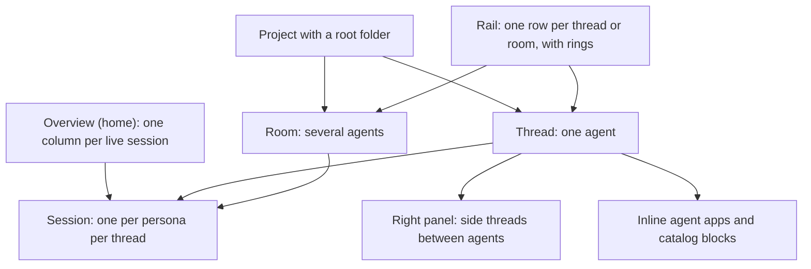
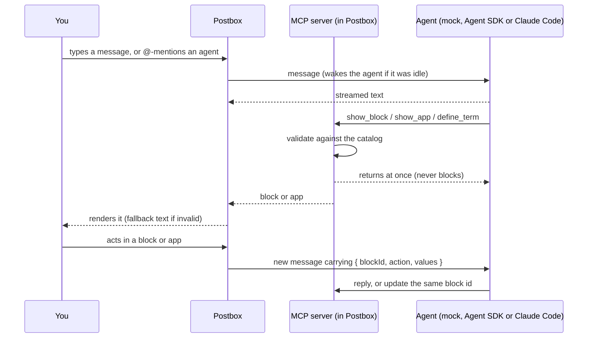

# Design intent

This document records why Postbox looks and behaves the way it does. It’s the reasoning behind the mockups in [`mockups/`](../mockups/), worked out in design reviews before any app code was written. When a later change conflicts with something here, update this document in the same change, so the reasoning stays current.

## Purpose

Postbox is one place to direct several AI agents at once. You message them, wake them when needed, and each can reply with software it writes on the spot: explainers, data explorers, review surfaces. That software runs live in the conversation, and it’s unloaded when you no longer need it.

Three situations shaped the design:

- **Exploring your own data.** You’re indexing a collection of books for lexical and semantic search, but you can’t yet say which sources and passages you want. An agent writes a corpus explorer mid-conversation. It runs inline, queries your corpus through Postbox, and sends back the passages you pick.
- **Learning a hard topic.** You want to understand how agents reason and act. An agent pulls papers from arXiv and builds a step-by-step explainer with citations, diagrams and an exercise you can practice on.
- **Giving feedback.** Agents need more than multiple choice. They also need free-form answers, and they need to show you a design, a document or code that you can comment on line by line.

None of these interfaces are built into Postbox. Agents generate them, and Postbox runs them safely.

## Who it’s for

One technical person running two to four agents on their own projects. They switch between two modes:

- **Dispatch:** several agents work in the background on long tasks. You check progress and answer when one is blocked.
- **Deep focus:** a long session with one agent, working through its apps.

Density and speed matter more than onboarding. There is no sign-in and there are no other people in rooms.

## Principles

1. **Agents author the software; Postbox owns the frame.** Feedback that must be consistent and accessible (choices, forms, confirms, reviews) comes from a fixed catalog that Postbox renders with its own code. Everything else an agent writes runs in a sandbox, behind a narrow bridge.
2. **Get the loop right before the looks.** Streaming that never loses a message, statuses that are correct, notifications that fire. If “needs you” can’t be trusted, nothing else matters.
3. **Calm by default; draw the eye only when it matters.** Only blocking events pulse and notify. Every animation eases in, eases out, then rests.
4. **Make good UI the easy path.** Agents do what is easiest, so the kit’s defaults (chart marks, tokens, controls) matter more than any written guidance.
5. **Never rely on color, hover or motion alone.** Every value is also available as text, a label or a table view, and reduced motion is respected everywhere.
6. **You stay in charge of your agents.** New personas need your approval, wake chains are capped, and tools are granted explicitly.

## How the app is organized

## The loop

## Decisions and why

### Layout

| Decision | Why |
|---|---|
| The overview is home, with one tall column per live session | With 2–4 agents, each column can show everything at once: current step, last message, a quick answer, subagents, tool calls, messages between agents, compactions. |
| The rail lists threads and rooms, with the agent’s ring and a plain-text state | You switch threads often, and you need to spot a blocked agent from anywhere. The text is the non-color cue when motion is reduced. |
| Apps and large blocks sit inline at full thread width, capped at about 80% of the viewport, with Expand | Agent software is part of the conversation, not a detour. Text stays at a readable width of about 760px. |
| The right panel is only for side threads between agents | Apps never compete with it, so the panel has one meaning. |
| On a phone, each view is a stacked full screen | The overview cards stack, rings sit in a strip under the top bar, and side threads open as full-screen sheets. |

### Agents and sessions

| Decision | Why |
|---|---|
| An agent is a persona; each thread it joins runs its own session | Context use, compactions and subagents belong to a model session, so each thread’s ring is honest. |
| Personas live in Postbox’s own store; `agents.json` only seeds it | You create and edit agents in the UI, never in a terminal. |
| The `+` menu adds files and agents | Files: upload, pick from the project folder, paste, or add to the corpus. Agents: from a boilerplate, or recommended by an agent. |
| Any agent may propose a teammate, but only your click creates one | This prevents privilege escalation: the proposal highlights any tools beyond what the proposing agent has. |
| Each project has one root folder | It bounds the file picker and is where Claude Code sessions start. |
| Archive puts a session to sleep; Delete erases it after a confirm, with 10 seconds of Undo | Archive is the safe default. Delete says exactly what goes and what stays. The persona always stays. |

### Attention and wakes

| Decision | Why |
|---|---|
| `@name` wakes an agent; agents can wake each other | It uses one familiar gesture for people and agents alike. |
| After 3 agent-to-agent wakes in a row, the next waits for your confirm | This stops two agents from looping on each other. |
| Two tiers of “needs you”: blocking (waiting on a block, failed, stuck) pulses and notifies; informational (`@me`, finished) shows a still badge | If everything pulses, the pulse means nothing. |
| Notifications are an in-app toast plus a count in the tab title and favicon | No OS notifications and no sound, by choice. |
| In a room, the last agent to speak answers unaddressed messages | It reads like a natural conversation, and the composer always shows who will reply. |
| A side thread holds each exchange between agents, and you can join it | Your thread stays readable, and you can still step in. |

### Conversation

| Decision | Why |
|---|---|
| All text is Markdown; raw HTML is never rendered | Text is consistent everywhere, and agents can’t inject markup. Short labels stay plain text. |
| Mermaid and KaTeX render; the libraries are bundled locally | Agents explain with diagrams and math. Nothing loads from the network. |
| A message sent mid-reply is queued, with Send now and Edit | You can keep thinking without derailing the agent. |
| Stop ends this agent’s turn and its subagents | Agents it woke keep running, each with its own Stop. |
| Each compaction gets a divider that expands to the summary the agent kept | You can see what it might have forgotten. |
| Turns typed in an attached Claude Code session’s terminal are mirrored, marked “from terminal” | The thread stays the complete record. |
| Citations are inline markers plus a sources list; hover cards fill a loading bar, then become sticky | Hover cards don’t flicker, and their links can be clicked. The same cards explain glossary terms. |
| A pluggable linter flags coined terms that have no definition, and tells the agent | Session-coined terms like “Step 7” stay understandable. |

### Dynamic UI

| Decision | Why |
|---|---|
| Two tiers: catalog blocks and agent-written apps | Feedback needs consistency; explainers and explorers need freedom. |
| Catalog: `choice`, `form` (with a long-text field), `table`, `progress`, `card`, `confirm`, `image`, `code`, `review`, `app` | Each block is validated against its schema. An invalid block shows its plain-text fallback and the raw JSON, and never breaks the transcript. |
| Apps run in a sandboxed iframe with no network; data comes only through the host bridge, using tools the agent already holds | Apps run automatically without risk to your files or accounts. |
| Bridge: `getTheme`, `resize`, `sendEvent`, `query`, `saveState`/`restoreState`, `registerAnchors` | A small surface is easy to secure and to explain to agents. |
| Apps unload when far off screen and reload from saved state as you approach | Memory stays bounded and you don’t lose your place. A same-size placeholder prevents layout jumps. |
| The agent learns only what an app explicitly sends | Using an app is private until you choose to send something. Apps stay live afterward; catalog blocks become read-only. |
| An app revision replaces it in place, with a version menu | The thread doesn’t fill up with old copies. |
| Reviews batch your comments with a verdict, then the revision shows as a diff | It works like a pull-request review. Comments on apps attach to anchors the app registers, so they survive re-layout. |

### Visual language

| Decision | Why |
|---|---|
| “Workbench”: warm, dense, calm; flat bordered controls; no shadows or gradients | It suits long working sessions. |
| Amber is the only interaction color, including inside apps | One meaning everywhere: you can act on this. |
| Agent apps sit on a cool slate “stage” with a slate frame and an “Agent-written app” label | Changing the surface temperature shows whose interface you’re in without adding a second accent. |
| Light mode is warm paper; the mode follows the system unless you pick Light or Dark | The design stays the same app in daylight. Apps swap tokens live. |
| Rings: a small center ring for the agent, one thinner ring outside for each subagent | Each ring shows that agent’s context use and activity, so subagents are visible without a list. |
| State is shown by motion, not icons | Generating: the arc turns once and rests. Thinking: a short bulge of thickness runs along a still arc. Calling tools: a dot crosses the free part of the ring and back. Needs you: an amber pulse. Every motion eases in and out, then rests. |
| Charts follow fixed mark specs, with a table view on every chart | The kit makes correct charts the default for agents. |

All colors are defined as tokens on `:root` in [`mockups/workbench.css`](../mockups/workbench.css), with their contrast ratios on the [palette page](../mockups/00-palette.html). Every text pair passes WCAG 2.1 AA in both modes, and the chart series pass a color-vision-deficiency check.

### Integration

| Decision | Why |
|---|---|
| UI tools are exposed once, through an MCP server inside Postbox | Claude Code sessions can only gain tools through MCP, and the Agent SDK accepts MCP natively, so both share one definition and one validator. |
| UI tools never block; your answer arrives as a new message | MCP calls time out, and a reply may come hours later. The event shape is the same for every backend. |
| The adapter starts and stops agents and reads their status | Tool calls, subagents, compactions and context use come from the backend. Nothing else touches the model. |
| Stage 2 ships a mock agent, the adapter interface and the MCP server; real adapters come in Stage 3 | The app runs offline with no dependencies beyond Node. |

## Not in scope, for now

- Several people, sign-in or presence.
- Search across threads.
- OS notifications and sound.
- Narrated slideshows as a built-in format. They may come later as recipes: a narrated walkthrough app, and a Slidev export for sharing.
- New catalog components without an explicit decision.

## Open questions

- **Control borders.** `--line` is below the 3:1 contrast recommended for borders that identify a control. Strengthen it, or accept it?
- **Checking apps before you see them.** Postbox could load each agent app headlessly at phone and desktop widths and send problems back to the agent: contrast, overflow, missing labels, focus traps, state that fails to restore.
- **Narration.** Should a speech tool (for example Kokoro) run on the host, so apps can offer narration with a synced transcript?
- **Screenshot storage.** Full retakes add about 28 MB to the history each time. Keep them in git, keep only the review sheets, or move them to Git LFS?
- **App title bar.** Keep it on the cool stage, or make it warm Postbox chrome?

## Quality bar

What’s checked today:

- `node tools/contrast.mjs` checks every text, border and status token pair in both modes, including on the app stage.
- The chart series were validated for color-vision deficiency.
- Every page is screenshotted at 375 and 1280 px in both modes (`node tools/shoot.mjs`) and reviewed.

What isn’t yet, and should be in Stage 2:

- Keyboard order, focus returning to the composer, and screen-reader announcements.
- Streaming timing, and long sessions with hundreds of messages and several apps.
- 200% text zoom, forced-colors mode, and performance with many app frames.
- Task-based testing: timed tasks done in the demo, such as answering a blocked agent from the overview, or finding why a reply failed and retrying it.
- A review by someone other than the author.
