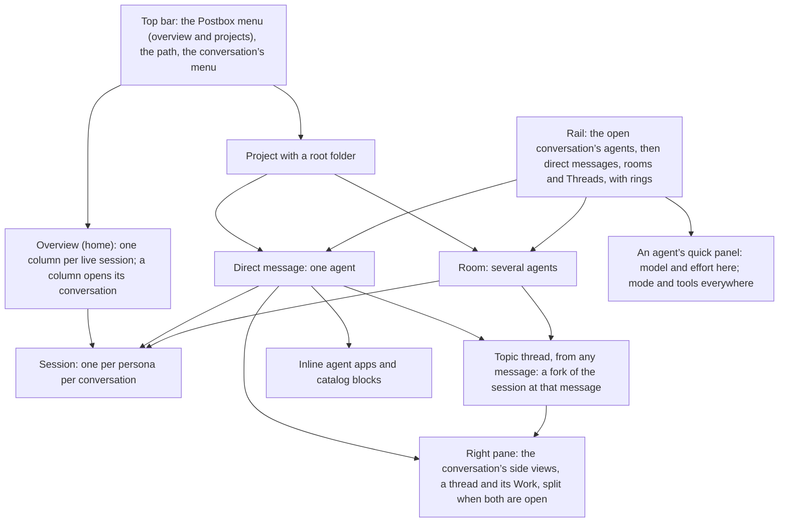
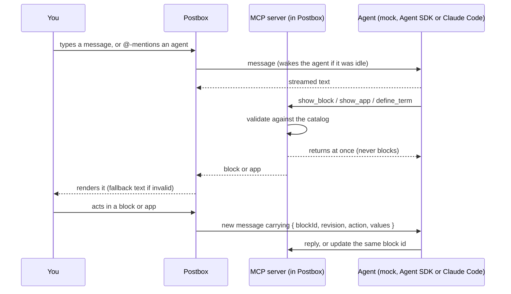

# Design intent

This document records why Postbox looks and behaves the way it does. It’s the reasoning behind the mockups in [`mockups/`](../mockups/), worked out in design reviews before any app code was written. When a later change conflicts with something here, update this document in the same change, so the reasoning stays current.

## Purpose

Postbox is one place to direct several AI agents at once. You message them, wake them when needed, and each can reply with software it writes on the spot: explainers, data explorers, review surfaces. That software runs live in the conversation, and it’s unloaded when you no longer need it.

Three situations shaped the design:

- **Exploring your own data.** You’re indexing a collection of books for lexical and semantic search, but you can’t yet say which sources and passages you want. An agent writes a corpus explorer mid-conversation. It runs inline, queries your corpus through Postbox, and sends back the passages you pick.
- **Learning a hard topic.** You want to understand how agents reason and act. An agent pulls papers from arXiv and builds a step-by-step explainer with citations, diagrams and an exercise you can practice on.
- **Giving feedback.** Agents need more than multiple choice. They also need free-form answers, and they need to show you a design, a document or code that you can comment on line by line.

None of these interfaces are built into Postbox. Agents generate them, and Postbox runs them safely.

At its core, Postbox’s conversations are a way to manage what each agent remembers. A conversation is one agent session. A topic thread that starts from a message is a fork of that session at that message, so you can follow a side question without filling the main session’s context, and bring back only what you choose.

## Who it’s for

One technical person running two to four agents on their own projects. They switch between two modes:

- **Dispatch:** several agents work in the background on long tasks. You check progress and answer when one is blocked.
- **Deep focus:** a long session with one agent, working through its apps.

Density and speed matter more than onboarding. There is no sign-in and there are no other people in rooms.

## Principles

1. **Agents author the software; Postbox owns the frame.** Feedback that must be consistent and accessible (choices, forms, confirms, reviews) comes from a fixed catalog that Postbox renders with its own code. Everything else an agent writes runs in a sandbox, behind a narrow bridge.
2. **Get the loop right before the looks.** Streaming that never loses a message, statuses that are correct, notifications that fire. If “needs you” can’t be trusted, nothing else matters.
3. **Calm by default; draw the eye only when it matters.** Only blocking events pulse and notify. Every animation eases in, eases out, then rests.
4. **Make good UI the easy path.** Agents do what is easiest, so the kit’s defaults (chart marks, tokens, controls) matter more than any written guidance.
5. **Never rely on color, hover or motion alone.** Every value is also available as text, a label or a table view, and reduced motion is respected everywhere. Every action is visible without hovering; hover only opens previews, such as glossary and citation cards.
6. **You stay in charge of your agents.** New personas need your approval, wake chains are capped, and tools are granted explicitly.
7. **You decide what an agent remembers.** Side topics branch into threads with their own forked sessions, and nothing flows back into a conversation unless you send it.

## How the app is organized

Postbox calls the main pane’s threads of messages **conversations**: a direct message with one agent, or a room with several. A **thread** is what starts from a message, as in Slack.

## The loop

## Decisions and why

### Layout

| Decision | Why |
|---|---|
| The overview is home, with one tall column per live session | With 2–4 agents, each column can show everything at once: current step, last message, a quick answer, subagents, tool calls, messages between agents, compactions. |
| Clicking anywhere on a column opens that agent’s conversation; the agent’s name is the link, and each message between agents opens its side thread | Changed after Stage 3: a column showed the work but didn’t lead to it. |
| The Postbox mark in the top bar opens a menu of places: the overview and every project, with what needs you in each. Beside it, the path (Project › Conversation) links back. A project opens the conversation you were last in there | Changed after Stage 3. Getting from the overview to a project took the palette or an agent’s menu; a tab per project was tried and dropped, since projects are switched rarely and tabs don’t scale. |
| A conversation’s menu (⋯ in the top bar) renames it, adds an agent, or deletes it with 10 seconds of Undo; the rail’s Rooms section always offers New room, which asks for two or more agents | Added after Stage 3: rooms could only appear by @-mentioning a second agent, and nothing deleted a whole conversation. |
| The rail lists the project’s conversations, as direct messages and rooms, each with the agent’s ring, name and what it’s doing in words (“thinking”, “calling tools”), plus a Threads entry for its topic threads. Projects are switched from the Postbox menu, not the rail. The rail can be hidden (⌘\\), and stays as you left it | Changed after Stage 3: the words used to show only with reduced motion; the rail’s own project switcher duplicated the Postbox menu. |
| The rail’s Agents section lists the open conversation’s agents, above Direct messages, and a topic thread’s panel lists its own: ring, name, state, model and effort, and open asks. A row opens the agent’s quick panel: model and effort for this conversation, permission mode and tools for the persona everywhere, links to its permissions and persona, and Stop, Compact and Archive. Each control says its scope. The top bar keeps only a ring per agent, which opens the same panel, and folds the rings into one stack where even they don’t fit | Decided 22 October 2026 (#105). The agent chips crowded the top bar until the title read “UseCase - E…”, and one agent’s settings were in four places; in #104 the person couldn’t tell that @critic’s shell was off. Tools apply to every conversation and the model only to this one, so the panel says which is which. A topic thread’s composer has no `/`, so its panel is where its agents change |
| Under each agent in the Agents section is the room’s agent tree: where its turn is when it’s in a side thread, and each fork of it there, with who woke it, its state and a Stop. A side-thread line in the conversation carries the ring and state of the agent at work in it, the conversation’s row counts it, and one waiting for you counts in “needs you”, ⌃J and the tab title. `/stop` in a conversation reaches its side threads, not its topic threads. Every side and topic thread has Copy link, and `#` in the composer links one; an agent that gets the link is told the thread’s id and title and can read it with `read_conversation` | Decided 22 October 2026 (#121). A woken agent built the same adapter as the person’s session of it, unseen: nothing showed it running, nothing stopped it, and a permission prompt in a side thread was a toast that closed after 12 seconds. The tree lives in #105’s section rather than a panel of its own. Topic threads keep running on `/stop` because the person forked them and each has its own Stop |
| Apps and large blocks sit inline at full thread width, capped at about 80% of the viewport, with Expand | Agent software is part of the conversation, not a detour. Text stays at a readable width of about 760px. |
| The right pane holds the conversation’s side views: a thread (a topic thread you start from a message, or a side thread between agents) and the conversation’s Work. Either opens alone, and when both are open they split it, Work above and the thread below, with a divider you can move by mouse or keyboard. Each view has a close button, and the app frames’ full-screen icon: each has a compact form in the pane and a full form over the window. A thread full screen is the same transcript and composer at the message column’s width, in place, so its draft, where you were and a reply that’s streaming carry on; Work full screen is its whole view. Escape or the icon brings it back. What’s open is in the address, so a reload restores it, and a conversation keeps Work open until you close it, wherever the window is wide enough for the pane to sit beside it | Changed after Stage 3 to follow Slack, so the conversation stays in view while you follow a thread. Changed again on 22 October 2026, when Work (#132) arrived as a Conversation/Work tab pair and a page of its own: the tabs overflowed the top bar at 375 px, and the page took the conversation away, which is the opposite of one place to direct the agents. Like the Claude app, the conversation stays in the middle and everything about the agents’ work opens beside it, so seeing what they did never means leaving what they’re saying. The thread goes below, so its composer stays at the foot of the window beside the conversation’s. Threads go full screen because #86, from wave 1’s manual UAT, found the 440 px panel too narrow for long agent summaries with tables: deep focus needs the room, and full screen gives it without the thread leaving its place, for as long as you want it. Apps still never compete with the pane: they stay inline, with their own Expand |
| On a phone, each view is a stacked full screen | The overview cards stack, rings sit in a strip under the top bar, and side threads open as full-screen sheets. |

### Agents and sessions

| Decision | Why |
|---|---|
| An agent is a persona; each conversation it joins runs its own session | Context use, compactions and subagents belong to a model session, so each conversation’s ring is honest. |
| Any message in a conversation can start a topic thread, which opens in the right pane. Its agent is a fork of the agent’s session at that message: it remembers everything up to there and nothing after | Decided after Stage 3. Conversations are how you manage agent memory: a side topic gets its own branch instead of filling the main session’s context. An agent you @-mention in the thread joins as a fork of its own session at the same point, or fresh if it joined the conversation later. |
| Nothing from a topic thread reaches the conversation unless you send it: “Send to conversation” on any reply, or “Summarize back”, which asks the thread’s agent for a short summary and posts it | Decided after Stage 3. The conversation’s agents read what you send at the start of their next turn; sending never wakes them or costs a turn. |
| A message with a thread shows “3 replies · last reply 5 min ago”; the rail’s Threads entry lists a project’s topic threads, newest reply first | Threads stay findable after you close the panel. |
| A topic thread’s agent gets an overview column only while it’s working or waiting for you | Branches are many and mostly idle; the overview stays about what needs attention. |
| Personas live in Postbox’s own store; `agents.json` only seeds it | You create and edit agents in the UI, never in a terminal. |
| The `+` menu adds files and agents | Files: upload, pick from the project folder, paste, or add to the corpus. Agents: from a boilerplate, or recommended by an agent. |
| Any agent may propose a teammate, but only your click creates one | This prevents privilege escalation: the proposal highlights any tools beyond what the proposing agent has. |
| When you create an agent, you choose where it works: join this conversation (the default, which makes a direct message a room) or start a new conversation | Joining gives it the recent messages and a short brief; a new conversation starts clean. |
| Everything said in a conversation is shared memory for every agent in it. Each turn starts with what happened since the agent’s last one, from you and the other agents; an agent that joins later gets the recent history; read_conversation reads further back | Fixed after Stage 3 (issue #1): agents in a room saw only messages addressed to them, and answered from partial information. |
| A Personas page in settings lets you edit, duplicate, retire and save boilerplates | Edits apply to new sessions only. Running sessions keep the version they started with, so behavior doesn’t change underneath you. |
| Subagents an agent creates inside its own session need no approval | They aren’t personas, and they run with their parent’s tools. |
| Each project has one root folder | It bounds the file picker and is where Claude Code sessions start. |
| A persona runs on Claude Code, the Agent SDK or the mock, and real agents default to Claude Opus 5.5 (`claude-opus-5-5`) | Decided in Stage 3. Both real backends use Claude Code’s own sign-in, so Postbox never holds a key. The model is a per-persona setting. |
| Each persona has a permission mode: auto (the default), ask, accept edits, or run everything. In auto mode, Claude Code’s safety classifier approves routine actions; anything it can’t decide, and everything in ask mode, becomes a card in the thread that shows the exact command, with Allow, Always allow, Edit and Don’t allow (with a reason), and the agent needs you until you answer. A permissions panel shows its rules with where each comes from, and changes them without a terminal. Stop answers no. A change to the mode reaches running conversations from their next turn | Decided in Stage 3 with ask as the default; changed to auto after Stage 3, because asking every time got in the way. Edit, Always allow and the panel came with #66, so an agent blocked by a rule never sends you to a terminal. |
| You can attach a Claude Code session you started in a terminal | It joins as an agent in that session’s folder, with its recent history; Postbox resumes the same session when you write to it. |
| Archive puts a session to sleep; Delete erases it after a confirm, with 10 seconds of Undo | Archive is the safe default. Delete says exactly what goes and what stays. The persona always stays. |
| Deleting an agent’s session in a room removes the agent from the room, but its past messages stay, marked “(deleted)” | The conversation still makes sense. To erase everything, delete the room. |

### Attention and wakes

| Decision | Why |
|---|---|
| `@name` wakes an agent; agents can wake each other | It uses one familiar gesture for people and agents alike. |
| An agent can schedule its own wake-up (“check back when the index finishes”) | The schedule shows as a line in the thread, with Cancel. |
| Each wake shows as a line in the thread, such as “@indexer woke @researcher” | You can always see who started what. |
| After 3 agent-to-agent wakes in a row, the next waits for your confirm | This stops two agents from looping on each other. |
| An agent replying to another agent doesn’t wake it again by mentioning it; mentioning the agent that just wrote to it wakes it only if the reply asks it to check again. Only one wake waits for your confirm at a time | Found while building Stage 2: a polite “Thanks @researcher” was enough to start a loop. |
| Two tiers of “needs you”: blocking (waiting on a block, failed, stuck) pulses and notifies; informational (`@me`, finished) shows a still badge | If everything pulses, the pulse means nothing. |
| Notifications are an in-app toast plus a count in the tab title and favicon | No OS notifications and no sound, by choice. |
| In a room, the last agent to speak answers unaddressed messages | It reads like a natural conversation, and the composer always shows who will reply. |
| A side thread holds each exchange between agents, and you can join it | Your thread stays readable, and you can still step in. |
| One session per persona per conversation. An agent woken into a side thread, or @-mentioned there, answers from its session in the conversation, which it joins if it isn’t there yet, with a note on why (“Joined when @researcher woke it” under its row and on its ring, and “joined the conversation” on the wake’s line); the exchange shows in the side thread. Only while that session is mid-turn somewhere else does a fork of it, from its latest point, answer instead, nested under it with its own Stop; a message for it in the side thread it’s already at work in waits for that turn. A fork that can’t start from the session’s memory starts fresh, and its note says so. When the fork is done, the session’s next turn says where to read it (its last reply, or all of it, with `read_conversation`), and Postbox sends neither | Decided 22 October 2026 (#110, #128): each wake started another session of the agent, with a memory of its own, so two of one persona edited the same files and neither knew what the other had said. Reading the fork stays the agent’s choice, so side work doesn’t fill its context unasked. Joining was the person’s choice on 23 October 2026 (#128 had left it open): it’s the only way to keep one session per persona, and the note explains the agent they never added. |

### Conversation

| Decision | Why |
|---|---|
| All text is Markdown; raw HTML is never rendered | Text is consistent everywhere, and agents can’t inject markup. Short labels stay plain text. |
| Mermaid and KaTeX render; the libraries are bundled locally, and each diagram has “Show source” | Agents explain with diagrams and math. Nothing loads from the network. |
| A message sent mid-reply is queued, with Send now and Edit | You can keep thinking without derailing the agent. |
| The composer: Enter sends, Shift+Enter adds a line, Stop replaces Send while an agent replies, and a short hint line says who will reply | These are standard chat conventions, plus the one thing a room needs: knowing who answers. |
| Turns are grouped by speaker; each speaker line shows the time, and while an agent works, what it’s doing (“· thinking”) beside its name. Messages sit at most a line apart | Changed after Stage 3: nothing waits for a hover, and the transcript stays dense. |
| “Jump to latest” appears when you’ve scrolled up and something new arrives | Reading history never means missing a new message. |
| Text streams as it arrives; a block appears once its JSON is complete, with a quiet placeholder line until then | Half a form is never shown. |
| Tool use shows as one collapsed activity line per turn (“Searched 3 files · 2 s”) that expands to the steps and their durations | The work is visible without flooding the transcript. |
| Stop ends the reply cleanly and marks it “stopped” | A stopped reply is clearly different from a failed one. |
| The connection uses server-sent events, shows a visible “Reconnecting…” line, and loses or duplicates nothing | Everything is kept in Postbox’s own store, so it survives a reload. |
| Stop ends this agent’s turn and its subagents | Agents it woke keep running, each with its own Stop. |
| Stop reaches every process of the turn, and the agent reads “stopping” until they’ve exited; its next turn waits for that. With background jobs running, Stop asks whether to stop them too; Send now keeps them running. A job that runs on is listed under its reply with its own Stop | Decided in #126 and #129: a turn that only looked stopped ran on beside the next one, and a background job’s step read “done” while it ran for half an hour. Send now is a change of course, not a reason to lose a job’s work. |
| Each compaction gets a divider that expands to the summary the agent kept | You can see what it might have forgotten. |
| Turns typed in an attached Claude Code session’s terminal are mirrored, marked “from terminal” | The thread stays the complete record. |
| Citations are inline markers plus a sources list. A hover card fills a loading bar under its header, then becomes sticky; when the pointer leaves, the same bar counts down before it closes. Keyboard focus works the same way, Enter pins at once and Esc closes | Hover cards don’t flicker, and their links can be clicked. The same cards explain glossary terms. |
| Agents define terms in a per-thread glossary, which links every later mention automatically, or with an explicit `term:` link for one-off or ambiguous mentions | Session-coined terms like “Step 7” or “Requirement F3” stay understandable. |
| A pluggable linter flags coined terms that have no definition, and tells the agent | It is pattern-based offline and can be model-backed later. Until the agent defines the term, you see only a faint dotted underline. |
| A diagram linter flags Mermaid diagrams people can’t read (a long chain side by side, one wide row, long labels, too many parts) and tells the agent what to change; the browser also measures each rendered diagram and reports any whose text ends up under 10 px | Added after Stage 3. Diagrams are scaled to fit the column, so the usual failure is quiet: the text shrinks until it can’t be read. The agent hears once per diagram, and its redraw isn’t linted again. |

### Work

| Decision | Why |
|---|---|
| Each conversation has a Work view listing every file its agents changed, every commit, push, branch and write outside Postbox, every command, and the effort that went into them, by agent. It opens in the right pane from a Work button in the top bar, the conversation’s ⋯ menu, or the line under each reply, which opens it at that turn | Decided 22 October 2026 (#132). The person learned the state of the work only by asking an agent to recount it, and then had to trust the recounting; in one session a wrong diagnosis came out only after asking for “a transcript of all commands”. First shipped as a tab and a page of its own; moved into the right pane on 22 October 2026 (see Layout) |
| In the pane, Work is compact: what needs review, files by where they stand in git with their counts, commands and how many failed, what was written outside Postbox, spend, and each turn’s line. Each is a short list whose items open Work full screen, at that item, with everything: each file’s diff with Restore, version control, every command’s output, and effort by agent | The pane is a third of the window, too narrow for diffs and tables, but enough to answer “where does the work stand?” at a glance. Full screen, rather than a separate page, keeps the conversation one Escape away. The compact form only lists and counts: nothing in it moves or pulses, since none of it blocks an agent |
| It’s built from the turn’s tool calls: the files an Edit, Write or NotebookEdit names, read before the tool runs (the tool’s own record of the file wins when it has one) and after the turn ends. Changes a command makes aren’t seen, and the view says so | Chosen over snapshotting the whole folder: Postbox never writes into the person’s repository or keeps a second one, and every change is attributed to the agent and turn that made it, even when two agents work at once |
| Lines are counted from the diff, as git counts them, against the file before the agents’ first change; lines written along the way are shown beside the lines kept. Where a file stands (uncommitted, committed, pushed) is asked of git, read-only, when the view opens | The counts add up by agent, by commit, by state and in all, and match `git diff --stat`. Five edits that end where they began count as nothing |
| A change outside the project, or to a file that existed before and git doesn’t track, is flagged. Every file’s copy from before is kept, and Restore puts it back behind a confirm, refusing if the file changed since; the conversation gets a line in your voice so the agents know | Git can give back a tracked file; nothing else could give back the untracked one a formatter rewrote. Restore never overwrites newer work |
| Effort (turns, wall time, tool calls, tokens and spend) shows per agent and per file, and turns that tried something and left nothing lasting are listed apart | Spend that produced nothing is effort too, and hiding it hides rework. Spend comes from the backend’s own totals; session cards, daily totals and budgets are #13 |

### Dynamic UI

| Decision | Why |
|---|---|
| Two tiers: catalog blocks and agent-written apps | Feedback needs consistency; explainers and explorers need freedom. |
| Catalog: `choice`, `form` (with a long-text field), `table`, `progress`, `card`, `confirm`, `image`, `code`, `review`, `app` | Each block is validated against its schema. An invalid block shows its plain-text fallback and the raw JSON, and never breaks the transcript. |
| Every block has an `id`, `type`, `version`, an optional `title` and a plain-text `fallback`. An unknown type, a bad field or a newer version shows the fallback plus a collapsed “Show the raw block” | Nothing fails silently. |
| Blocks are append-only, except that `update_block` with the same `id` updates the block. An update that asks again (a choice, form, confirm or review left waiting on you) brings the block to the newest point, with one line where it was, by the same rule as an app’s new version; any other update, and an outcome, stays in place. Showing an id the agent already showed in the conversation is refused | A progress list can move on without new copies. Refused, not updated, because an answer must belong to one block, and an update can reopen one the person answered (#125). A reopened block stayed where it was first shown, several messages up, while the agent said at the bottom that it was waiting (#92, 22 October 2026): what needs you must be in sight. A progress block moving on every step would be noise. |
| Apps can read aloud with a local voice (Kokoro), with a transcript that follows along and is always on screen | Decided in Stage 3, for narrated walkthroughs. No audio leaves the computer, and the walkthrough still works without sound. Recipes for it and for Slidev export are in [recipes.md](recipes.md). |
| When you act in a block, the agent gets one event, `{ blockId, revision, action, values }`; your action shows as a short line in your voice (“Chose: weekly · Monday 9:00”); the block turns read-only and shows your answer. Postbox writes every line in your voice: an app’s says what the app sent (its action, how many items each list holds, the size), and the app’s own summary shows beside it as the app’s words, which agents read as a separate field | Only a new block, or an update to the same id, can ask again. Apps’ lines changed on 21 October 2026 (#51): an app wrote “Sending 1,258 pairs” in your voice when it sent 200, and the agent read it as your words. |
| An answer is for the revision you saw. If the agent changed the block while you were answering, the answer is refused, your draft stays, and you see what changed, with focus on that notice rather than the button you pressed; an update over an answer the agent hasn’t read yet, asking again or reporting an outcome, is refused | Decided after an agent published a draft on an approval of an earlier one (#123). An approval never lands on text you didn’t see, and your answer never disappears unread. Focus leaves the button so a second press by reflex can’t answer the new text unread. |
| Links open in a new tab with `rel="noopener"`, URLs are checked, images load only from allowed origins and need alt text, and nothing an agent sends is used as a style or an attribute name | Agent content can’t restyle or script the page. |
| Adding a catalog component needs an explicit decision | The catalog stays small enough to render consistently and to explain to agents. |
| Apps run in a sandboxed iframe with no network; data comes only through the host bridge, using tools the agent already holds, or data files the agent attached to the version from its own folder. A large app’s code can come from a file in that folder too (`codePath`), under the same limits | Apps run automatically without risk to your files or accounts. Files added 23 October 2026 (#54): an app near the code limit couldn’t be sent in a tool call, so an agent posted it to Postbox from a script, where you never saw it. |
| The sandbox preloads the Workbench stylesheet, a small helper library, D3, a chart library, Mermaid and KaTeX; agents may add their own CSS for visualizations | Apps look native with little effort, and good charts and diagrams are the default. |
| When the mode changes, apps get the new tokens live, plus a `themeChange` event to redraw canvas or D3 output | Apps follow light and dark without reloading. |
| Bridge: `getTheme`, `resize`, `sendEvent`, `query`, `file`, `saveState`/`restoreState`, `registerAnchors` | A small surface is easy to secure and to explain to agents. |
| Apps unload when far off screen and reload from saved state as you approach | Memory stays bounded and you don’t lose your place. A same-size placeholder prevents layout jumps. |
| The agent learns only what an app explicitly sends | Using an app is private until you choose to send something. Apps stay live afterward; catalog blocks become read-only. |
| A new version of an app brings it to the newest point in the conversation, with a version menu; its old place becomes one line that leads to it. One copy runs, and its saved state carries over. There’s no agent opt-out | The thread doesn’t fill up with old copies. Changed from “in place” on 21 October 2026 (#49): the agent explains a change in its newest message, so the person scrolled back several screens to try it, and agents began posting new apps instead, leaving three running copies of one explainer with none of its state. |
| Before an app is shown, Postbox checks it in your browser: it loads the app in a hidden frame at 375 and 1280 px and checks contrast, overflow, missing labels, keyboard traps and state restore. Problems go to the agent as an event; if the app still fails after one fix, it’s shown with a note | Agent-written UI meets the same bar as Postbox’s own, with no headless browser on the server. |
| Reviews batch your comments with a verdict, then the revision shows as a diff | It works like a pull-request review. Comments on apps attach to anchors the app registers, so they survive re-layout. |

### Visual language

| Decision | Why |
|---|---|
| “Workbench”: warm, dense, calm; flat bordered controls; no shadows or gradients | It suits long working sessions. |
| Amber is the only interaction color, including inside apps | One meaning everywhere: you can act on this. |
| Controls (inputs, buttons, chips, toggles, the composer) use `--line-strong`, which is at least 3:1 against every surface; dividers and card edges keep the quieter `--line` | You can always see where a control is, and the screens stay calm. |
| Agent apps sit on a cool slate “stage” with a slate frame and an “Agent-written app” label; the title bar, with Postbox’s version menu, Review and Expand, is on the stage too | Changing the surface temperature shows whose interface you’re in without adding a second accent, and the whole frame reads as one object. |
| Light mode is bright warm paper (background #fcfaf6, panels near white), and the app stage is a light cool gray; the mode follows the system unless you pick Light or Dark, and the choice is saved in Postbox’s store | The design stays the same app in daylight. Apps swap tokens live. Brightened after Stage 3, when the first light palette read too dark. |
| The dark mode is a step darker than the original brief (page `#15110e`, cards `#1f1a15`, text `#e6ddcf`), and checked boxes are an amber outline and check rather than a solid fill | This reduces glare in long sessions; the brightest elements were filled amber boxes. |
| Extended color sets: agent status, 8 chart series in a fixed order, a sequential blue scale, a blue and red diverging pair, review diffs, and syntax highlighting | Each set is used only in its own context, so amber stays the only interaction color. |
| Rings: a small center ring for the agent, one thinner ring outside for each subagent | Each ring shows that agent’s context use and activity, so subagents are visible without a list. |
| State is shown by motion, not icons | Generating: the arc turns once and rests. Thinking: a short bulge of thickness runs along a still arc. Calling tools: a dot crosses the free part of the ring and back. Needs you: an amber pulse. Every motion eases in and out, then rests. |
| Charts follow fixed mark specs, with a table view on every chart | The kit makes correct charts the default for agents. |

All colors are defined as tokens on `:root` in [`mockups/workbench.css`](../mockups/workbench.css), with their contrast ratios on the [palette page](../mockups/00-palette.html). Every text pair passes WCAG 2.1 AA in both modes, and the chart series pass a color-vision-deficiency check.

### Accessibility and keyboard

| Decision | Why |
|---|---|
| Streaming text goes through an `aria-live="polite"` region that announces finished sentences, not every token | Screen readers stay usable while text streams. |
| When a block appears, focus doesn’t jump to it; after you act in it, focus returns to the composer | You stay where you are. |
| Every block and app is fully usable by keyboard; focus rings are 2px amber | It works without a mouse. |
| One key goes to the next thing that needs you (⌃J), ⌘K opens a palette for threads, projects, agents and actions, and keys move through turns and blocks | Faster than clicking for a power user. |
| Reduced motion stops every animation; rings hold still, and the rail’s text says the state | State never depends on motion alone. |

### Writing

Plain English and sentence case, with curly quotes and American spelling everywhere: the UI, the docs and code comments. Buttons say what they do (“Send”, “Stop”, “Open conversation”). Error messages say what happened and what to do next.

### Integration

| Decision | Why |
|---|---|
| UI tools are exposed once, through an MCP server inside Postbox. A tool call needs the token of the agent’s running turn, which Postbox gives only the backend process it started | Claude Code sessions can only gain tools through MCP, and the Agent SDK accepts MCP natively, so both share one definition and one validator. The token is required since 23 October 2026 (#54): with the session id alone, any process on the computer could act as an agent. Not a breaking change: `/mcp` without a turn token was never a supported interface, as the person decided on 23 October 2026. |
| UI tools never block; your answer arrives as a new message | MCP calls time out, and a reply may come hours later. The event shape is the same for every backend. |
| The adapter starts and stops agents and reads their status | Tool calls, subagents, compactions and context use come from the backend. Nothing else touches the model. |
| Stage 2 ships a mock agent, the adapter interface, the MCP server and the app check; real adapters and narration come in Stage 3 | The app runs offline with no dependencies beyond Node. |

### Scope and order

| Decision | Why |
|---|---|
| The first flow to polish is the corpus explorer: an agent writes an app, it runs inline, queries your corpus through the bridge, and sends picks back | It proves the core idea end to end. |
| The demo corpus is a few bundled public-domain books, with real BM25 search in plain Node and a stub semantic search that your own index replaces later | The demo runs offline and still searches for real. |
| Agents add their own data to the corpus while Postbox runs, with `add_dataset`: a JSON Lines file in the project’s `.postbox/datasets/`, Postbox’s own folder in the project. A dataset is searched only when a search names it, and it’s loaded again after a restart | Decided 21 and 23 October 2026 (#47). The corpus loaded only at startup, so an agent’s data-backed app stayed broken until the person restarted Postbox, which ends every agent’s session. Named-only search keeps one agent’s data out of the others’ results. Postbox’s per-project files go under `.postbox/` in the project, and the person’s own Postbox settings under their home folder. |
| A demo script plays every block type and every error state | It’s the source of the screenshots once the app is real. |

## Not in scope, for now

- Several people, sign-in or presence.
- Using Postbox on a phone. It’s a local web app on your own computer, so effort on phone-only behavior (touch, phone sheets, phone screenshots) is declined. The phone layout row above stays as a note for later. Narrow-width checks at 375 px stay, because a narrow window or an open thread panel squeezes the column the same way. Decided 21 October 2026.
- Search across threads.
- OS notifications and sound.
- Narrated slideshows as a built-in format. Narration arrives in Stage 3 instead, with the real adapters: a speech tool on the host (for example Kokoro) and two recipes, a narrated walkthrough app with a synced transcript and a Slidev export for sharing.
- New catalog components without an explicit decision.

## Open questions

None right now. Resolved on 21 October 2026: control borders (a stronger border for controls only), checking apps before you see them (Stage 2, in the browser), narration (Stage 3), screenshot storage (approved baselines only), the app title bar (stays on the stage), and state text in the rail (only with reduced motion).

## Quality bar

What’s checked today:

- `node tools/contrast.mjs` checks every text, border and status token pair in both modes, including on the app stage.
- The chart series were validated for color-vision deficiency.
- Every page is screenshotted at 375 and 1280 px in both modes and reviewed. The approved set lives in `screenshots/`; working retakes go to `screenshots/latest/`, which git ignores, and Stage 2 is compared against the approved set.

What isn’t yet, and should be in Stage 2:

- Keyboard order, focus returning to the composer, and screen-reader announcements.
- Streaming timing, and long sessions with hundreds of messages and several apps.
- 200% text zoom, forced-colors mode, and performance with many app frames.
- Task-based testing: timed tasks done in the demo, such as answering a blocked agent from the overview, or finding why a reply failed and retrying it.
- A review by someone other than the author.
