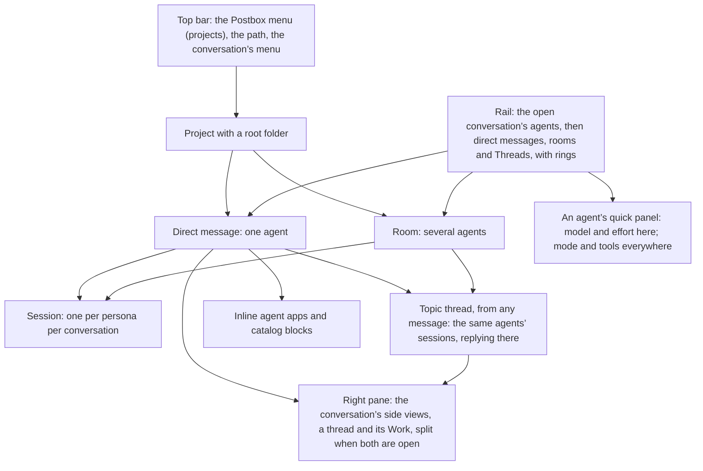
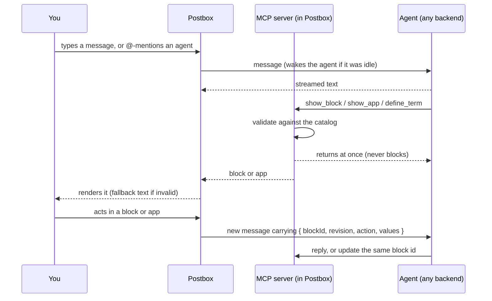

# Design intent

This document records why Postbox looks and behaves the way it does. It’s the reasoning behind the mockups in [`mockups/`](../mockups/), worked out in design reviews before any app code was written. When a later change conflicts with something here, update this document in the same change, so the reasoning stays current.

## Purpose

Postbox is one place to direct several AI agents at once. You message them, wake them when needed, and each can reply with software it writes on the spot: explainers, data explorers, review surfaces. That software runs live in the conversation, and it’s unloaded when you no longer need it.

Three situations shaped the design:

- **Exploring your own data.** You’re indexing a collection of books for lexical and semantic search, but you can’t yet say which sources and passages you want. An agent writes a corpus explorer mid-conversation. It runs inline, queries your corpus through Postbox, and sends back the passages you pick.
- **Learning a hard topic.** You want to understand how agents reason and act. An agent pulls papers from arXiv and builds a step-by-step explainer with citations, diagrams and an exercise you can practice on.
- **Giving feedback.** Agents need more than multiple choice. They also need free-form answers, and they need to show you a design, a document or code that you can comment on line by line.

None of these interfaces are built into Postbox. Agents generate them, and Postbox runs them safely.

At its core, Postbox’s conversations are a way to manage what each agent remembers. A conversation holds one session per agent, and everything in it, topic and side threads included, is that one session’s work: an agent never has a second copy of itself in a conversation (decided 23 October 2026, #228). To keep a side question out of an agent’s memory, start a new conversation; Compact and Delete are the other controls.

## Who it’s for

One technical person running two to four agents on their own projects. They switch between two modes:

- **Dispatch:** several agents work in the background on long tasks. You check progress and answer when one is blocked.
- **Deep focus:** a long session with one agent, working through its apps.

Density and speed matter more than onboarding. There is no sign-in and there are no other people in rooms.

People who run Postbox may also volunteer telemetry reports to help improve it (decided 23 October 2026, [`telemetry-persona.md`](telemetry-persona.md)). A report leaves only after its owner reviews it, and it holds only Postbox’s own values, so its gate and consent step must hold for anyone’s data, not only the author’s.

## Principles

1. **Agents author the software; Postbox owns the frame.** Feedback that must be consistent and accessible (choices, forms, confirms, reviews) comes from a fixed catalog that Postbox renders with its own code. Everything else an agent writes runs in a sandbox, behind a narrow bridge.
2. **Get the loop right before the looks.** Streaming that never loses a message, statuses that are correct, notifications that fire. If “needs you” can’t be trusted, nothing else matters.
3. **Calm by default; draw the eye only when it matters.** Only blocking events pulse and notify. Every animation eases in, eases out, then rests.
4. **Make good UI the easy path.** Agents do what is easiest, so the kit’s defaults (chart marks, tokens, controls) matter more than any written guidance.
5. **Never rely on color, hover or motion alone.** Every value is also available as text, a label or a table view, and reduced motion is respected everywhere. Every action is visible without hovering; hover only opens previews, such as glossary and citation cards.
6. **You stay in charge of your agents.** New personas need your approval, wake chains are capped, and tools are granted explicitly.
7. **You decide what an agent remembers.** Each agent has one session per conversation, and you choose its memory by where you talk to it: a new conversation starts clean, Compact shortens it, and deleting the conversation ends it. Agents never fork themselves, and nothing from a thread is put in another agent’s context unless that agent chooses to read it or you send it (decided 23 October 2026, #228).

## How the app is organized

Postbox calls the main pane’s threads of messages **conversations**: a direct message with one agent, or a room with several. A **thread** is what starts from a message, as in Slack.

## The loop

## Decisions and why

### Layout

| Decision | Why |
|---|---|
| There’s no overview: Postbox opens the conversation you were last in, else a project’s latest. A fresh install says to create a project | Changed on 24 October 2026 (#320, from a manual UAT). It began as home, one tall column per live session, so 2–4 agents showed at once. The sidebar’s Agents section (#105) and its rings came to show the same, and the Personas page edits the agents, so the overview only repeated them. |
| The Postbox mark in the top bar opens a menu of places: every project, with what needs you in each. Beside it, the path (Project › Conversation) links back. A project opens the conversation you were last in there | Changed after Stage 3. Getting from the overview to a project took the palette or an agent’s menu; a tab per project was tried and dropped, since projects are switched rarely and tabs don’t scale. The overview left the menu on 24 October 2026 (#320). |
| A conversation’s menu (⋯ in the top bar) renames it, adds an agent, or deletes it with 10 seconds of Undo; the rail’s Rooms section always offers New room, which asks for two or more agents | Added after Stage 3: rooms could only appear by @-mentioning a second agent, and nothing deleted a whole conversation. |
| The rail lists the project’s conversations, as direct messages and rooms, each with the agent’s ring, name and what it’s doing in words (“thinking”, “calling tools”), plus a Threads entry for its topic threads. Projects are switched from the Postbox menu, not the rail. The rail can be hidden (⌘\\), and stays as you left it | Changed after Stage 3: the words used to show only with reduced motion; the rail’s own project switcher duplicated the Postbox menu. |
| The rail’s Agents section lists the open conversation’s agents, above Direct messages, and a topic thread’s panel names those in it in one line (#228): ring, name, state, model and effort, and open asks. An agent’s name opens its quick panel: model and effort for this conversation, permission mode and tools for the persona everywhere, links to its permissions and persona, and Stop, Compact and Delete session. Each control says its scope. The top bar has no agent rings; the conversation’s ⋯ menu names each agent, with what it runs with | Decided 22 October 2026 (#105). The agent chips crowded the top bar until the title read “UseCase - E…”, and one agent’s settings were in four places; in #104 the person couldn’t tell that @critic’s shell was off. Tools apply to every conversation and the model only to this one, so the panel says which is which. A topic thread’s composer has no `/`, so its panel is where its agents change. Changed on 24 October 2026 (#320, from a manual UAT): the top bar kept a ring per agent, folded into a stack where they didn’t fit, which only repeated the sidebar’s. |
| Under each agent in the Agents section is its agent tree: where its turn is when it’s in a side or topic thread, and its subagents. They’re collapsed into the agent’s ring by default, a ring each; a toggle on the agent’s row (a chevron and their count, named “Show @x’s 3 subagents”) lists them instead, each with what it was asked, its state, a plain step line, never its narration or thoughts, and End, which tells the agent to stop that subagent and not use its result (#229; decided 23 October 2026). While they’re listed, the agent’s ring draws none, so each subagent shows once (#476, #477). A side-thread line in the conversation carries the ring and state of the agent at work in it, the conversation’s row counts it, and one waiting for you counts in “needs you”, ⌃J and the tab title. `/stop` in a conversation reaches its side threads, not its topic threads. Every side and topic thread has Copy link, and `#` in the composer links one; an agent that gets the link is told the thread’s id and title and can read it with `read_conversation` | Decided 22 October 2026 (#121). A woken agent built the same adapter as the person’s session of it, unseen: nothing showed it running, nothing stopped it, and a permission prompt in a side thread was a toast that closed after 12 seconds. The tree lives in #105’s section rather than a panel of its own. A turn in a topic thread keeps running on the conversation’s `/stop`: the person started it there, and the thread has its own Stop. On 23 October 2026 the person decided the tree shows subagents only, since forks go (#228). On 27 October 2026 the person decided both views, one at a time (#477): each subagent showed twice, as a ring and as a row, and three of them filled the section with their commentary (#476). The toggle shows a chevron and the count rather than its words, which squeezed the agent’s name in the sidebar. |
| Apps and large blocks sit inline at full thread width, capped at about 80% of the viewport, with Expand | Agent software is part of the conversation, not a detour. Conversation text stays at a readable width of about 760px; a review’s Preview uses the block’s full content width for detailed feedback (#486). |
| The right pane holds the conversation’s side views: a thread (a topic thread you start from a message, or a side thread from before #372, read-only), and the conversation’s Work or its Telemetry view (a recorded room’s reports, opened from Telemetry report… in the ⋯ menu). Telemetry swaps in for Work: opening it puts it in Work’s place, and closing it brings Work back if Work was open. Either a thread or Work (or Telemetry) opens alone, and when both are open they split it, Work or Telemetry above and the thread below, with a divider you can move by mouse or keyboard. Each view has a close button, and the app frames’ full-screen icon: each has a compact form in the pane and a full form over the window. A thread full screen is the same transcript and composer at the message column’s width, in place, so its draft, where you were and a reply that’s streaming carry on; Work full screen is its whole view, and so is Telemetry’s, with its summary beside the report’s bytes. Escape or the icon brings it back. What’s open is in the address, so a reload restores it, and a conversation keeps Work open until you close it, wherever the window is wide enough for the pane to sit beside it | Changed after Stage 3 to follow Slack, so the conversation stays in view while you follow a thread. Changed again on 22 October 2026, when Work (#132) arrived as a Conversation/Work tab pair and a page of its own: the tabs overflowed the top bar at 375 px, and the page took the conversation away, which is the opposite of one place to direct the agents. Like the Claude app, the conversation stays in the middle and everything about the agents’ work opens beside it, so seeing what they did never means leaving what they’re saying. The thread goes below, so its composer stays at the foot of the window beside the conversation’s. Threads go full screen because #86, from wave 1’s manual UAT, found the 440 px panel too narrow for long agent summaries with tables: deep focus needs the room, and full screen gives it without the thread leaving its place, for as long as you want it. Apps still never compete with the pane: they stay inline, with their own Expand. Telemetry joined the pane on 23 October 2026 (#230), so a report stays beside the conversation, can be reopened to file or delete, and is never in the transcript or “needs you” |
| On a phone, each view is a stacked full screen | Rings sit in a strip under the top bar, and side threads open as full-screen sheets. |

### Agents and sessions

| Decision | Why |
|---|---|
| An agent is a persona; each conversation it joins runs its own session | Context use, compactions and subagents belong to a model session, so each conversation’s ring is honest. |
| Any message in a conversation can start a topic thread, which opens in the right pane. An agent you @-mention there answers from its one session in the conversation, so it remembers the thread. Its prompt leads with the thread’s request as its task, then gives room catch-up as background whose work belongs in the room (#504). The conversation’s other agents see that the thread exists, with a summary of up to about 20 tokens that Postbox writes with a separate cheap model call after its last reply, and read it only if they choose | Decided after Stage 3 as a fork of the session at that message, so a side topic didn’t fill the main session’s context. Changed on 23 October 2026 (#228): forks became a second pool of agents the person couldn’t see or direct, and a wake from a thread made forks of forks. The person chose one session per agent per conversation, with new conversations, Compact and Archive for controlling memory. Archive went on 24 October 2026 (#320), so deleting the conversation is the third. The task-first order was added after a long room hand-off buried a short grammar request, and the agent posted its room work in that thread (#504). |
| Nothing from a topic or side thread reaches the conversation unless you send it: “Send to conversation” on any reply, or “Summarize back”, which asks the thread’s agent for a short summary and posts it. In a side thread you pick which of its two agents writes it, the one that started it first | Decided after Stage 3. The conversation’s agents read what you send at the start of their next turn; sending never wakes them or costs a turn, and a summary’s @-mentions wake no one. Side threads got Summarize back on 24 October 2026 (#225, from #128’s decision): one held 21 messages, too many to send back one at a time. |
| A message with a thread shows “3 replies · last reply 5 min ago”; the rail’s Threads entry lists a project’s topic threads, newest reply first | Threads stay findable after you close the panel. |
| Personas live in Postbox’s own store; `agents.json` only seeds it | You create and edit agents in the UI, never in a terminal. |
| The `+` menu adds files and agents | Files: upload, pick from the project folder, paste, or add to the corpus. Agents: from a boilerplate, or recommended by an agent. |
| Any agent may propose a teammate, but only your click creates one | This prevents privilege escalation: the proposal highlights any tools beyond what the proposing agent has. |
| When you create an agent, you choose where it works: join this conversation (the default, which makes a direct message a room) or start a new conversation | Joining gives it the recent messages and a short brief; a new conversation starts clean. |
| Everything said in a conversation is shared memory for every agent in it. Each turn starts with what happened since the agent’s last one, from you and the other agents, within a cap; messages @-mentioning it come first and whole, up to 15,000 characters each, within a larger cap of their own, while other items are cut at 2,000 with a pointer to the rest; and the summary says what kinds it left out and where read_conversation finds them; a queued mention the last summary gave comes as a pointer that quotes its start; an agent that joins later gets the recent history; read_conversation reads further back | Fixed after Stage 3 (issue #1): agents in a room saw only messages addressed to them, and answered from partial information. Since 28 October 2026 (#484): the cap kept only the newest, so a mention could be left out unseen, and a queued mention came twice. Since 28 October 2026 (#499): when a mention was cut at 2,000 characters, agents asked its sender to send it again rather than read the rest. |
| Telemetry is unlisted: no agent, session, thread or roster row. **Record this room** in a conversation’s ⋯ menu has Postbox record how its agents performed, with no model, into your Postbox folder (owner-only, never the project, deleted with the room, 30 days at most, and Delete recordings). The header says it’s recording; nothing in the transcript or any agent’s input changes. A 🚩 reaction (#251) flags a moment. **Telemetry report…** makes one Haiku call with no tools, like a thread summary’s, that only picks labels for what the checks and your 🚩 point at, from fixed lists; a gate with no model checks it, and the Telemetry view in the right pane shows the exact bytes, with Leave out on each line, and keeps saved reports to file or delete. Only Postbox’s own values, counts and labels are in it, never the project’s content or any model’s words. File issue sends exactly the saved bytes, rendered with no model and hash-checked, through your own `gh` or by copying and opening GitHub’s new-issue page | Decided 23 October 2026 ([`telemetry-persona.md`](telemetry-persona.md)). Most defects were found in real use, which the UAT can’t replay, and a pasted conversation carries the project with it. It was first a hidden persona in its own thread; the person made it unlisted after review, because a hidden agent needed an exception to shared memory and guards that a UAT run broke. Since telemetry says nothing to the agents and adds no session, it needs no exception to principle 7, to the topic-thread row or to the one-session row (#228, #236), or to the shared-memory row above. |
| A Personas page in settings lets you edit, duplicate, retire, delete and save boilerplates. Each persona keeps a memory of its own, per project: Claude Code’s and the Agent SDK’s auto memory, in Postbox’s data folder on this computer (#491 for hosts), which no other persona and none of your own sessions read. Delete asks first, says what goes, and gives 10 seconds of Undo; then the persona goes, with its sessions, as deleting each would, and its memory | Edits apply to new sessions only. Running sessions keep the version they started with, so behavior doesn’t change underneath you. Memory per persona decided 25 October 2026 (#208, option A): every persona in a project shared Claude Code’s memory for the project folder, and the person’s own sessions there, so one agent’s notes reached another’s context unseen; shared knowledge belongs in room notes (#14). Delete decided 27 October 2026, with the memory going after the Undo window; a new persona with the same name starts with no memory, since memory is kept by id. A persona’s memory on a host stays until #491. On upgrading to this, every persona starts with no memory: none reads the project’s shared folder any more, so one that uses your setup no longer reads your own sessions’ memory there either. That folder stays as it was, for your own sessions. |
| Subagents an agent creates inside its own session need no approval | They aren’t personas, and they run with their parent’s tools. |
| Each project has one root folder | It bounds the file picker and is where Claude Code sessions start. |
| A persona runs on Claude Code, the Agent SDK, the Kiro CLI, the Antigravity CLI, Codex, or the mock; Claude Code, the Agent SDK and the Kiro CLI default to Claude Opus 5.5 (`claude-opus-5-5`), the Antigravity CLI defaults to `gemini-3.8-flash-high`, and Codex uses its own default | Decided in Stage 3; Kiro CLI (#117), Antigravity CLI (#143) and Codex joined later. Real backends use each tool’s own sign-in, so Postbox never holds a key. The model is a per-persona setting. |
| Each persona has a permission mode: auto (the default), ask, accept edits, or run everything. In auto mode, Claude Code’s safety classifier approves routine actions (a Codex agent’s, Codex’s own reviewer, auto_review; an Antigravity agent’s, Postbox’s hook, which approves routine commands and public fetches with no query; web searches, other fetches and writes outside Postbox through MCP tools and gh keep their card); anything it can’t decide, and everything in ask mode, becomes a card in the thread that shows the exact command, with Allow, Always allow, Edit and Don’t allow (with a reason), and the agent needs you until you answer. A permissions panel shows its rules with where each comes from, and changes them without a terminal. Stop answers no. A change to the mode reaches running conversations from their next turn. Where a running turn keeps the mode it started with, the quick panel says so, and that Stop applies the new one now | Decided in Stage 3 with ask as the default; changed to auto after Stage 3, because asking every time got in the way. Edit, Always allow and the panel came with #66, so an agent blocked by a rule never sends you to a terminal. The note came on 25 October 2026 (#371, #381): a Codex agent switched to Run everything kept asking for every command in its running turn, which read as Postbox ignoring the switch. Answering those asks for it mid-turn kept finding ways around ask rules and write cards, so the turn keeps its mode, and you can see that it does. Codex’s reviewer came on 26 October 2026: a Codex agent in auto asked the person about every command its sandbox stopped, where a Claude Code agent asks about few. Codex keeps a reviewer for later turns, so every other mode names the person. Antigravity’s came on 26 October 2026: in auto, the hook asked about every command, search and fetch, which the person found asked constantly. agy’s own auto mode would be its mechanism, but it isn’t available on this account: every `--mode auto` run from agy 1.4.5 to 1.4.7 logged “rollout flag off” and ran agy’s default mode, which refuses every command headless. A hook’s allow also only hands a call on to agy’s policy. So the person chose to have Postbox’s hook approve routine actions itself, though it replaces agy’s own check. It first approved writes outside Postbox through MCP tools and gh too, as Codex’s reviewer may; on review the person narrowed it, so those writes, MCP tools, web searches and fetches with a query or fragment go on to the card, where a reviewer (#416) can judge what isn’t a write. Its review found commands that passed as routine and ran anything: an option that runs a program (`git grep -O`, `sort --compress-program`), and `npm run` or `git commit` running a script or hook the agent had just written. So a routine command takes only the options listed for it, nothing routine runs the folder’s own code, git runs only where `.git` is a real folder, and an edit in `.git` asks. A search or a fetch can carry data out, and the persona sheet says so. |
| You can attach a Claude Code session you started in a terminal | It joins as an agent in that session’s folder, with its recent history; Postbox resumes the same session when you write to it. |
| A conversation owns its agents’ sessions: they’re archived only with it, restored with it, and deleted with it. Nothing archives a conversation by itself. Delete erases a session or a conversation after a confirm, with 10 seconds of Undo | Delete says exactly what goes and what stays. The persona always stays: it’s deleted only from the Personas page (#208). Changed on 24 October 2026 (#320): conversations archived themselves after a week idle (#101), and one agent could be archived alone, but nothing showed them once the Archived page went, so idle archiving is off, one agent can’t be archived on its own, and what either had hidden came back. |
| Deleting an agent’s session in a room removes the agent from the room, but its past messages stay, marked “(deleted)” | The conversation still makes sense. To erase everything, delete the room. |

### Attention and wakes

| Decision | Why |
|---|---|
| `@name` wakes an agent; agents can wake each other | It uses one familiar gesture for people and agents alike. |
| An agent can schedule its own wake-up (“check back when the index finishes”), and the guide tells Codex agents it’s the way back to work that outlives a turn. `schedule_wake` gives the wake’s id, and the agent cancels it with `cancel_wake` once its work is done; it can cancel only its own (#458) | The schedule shows as a line in the thread, with Cancel. Agents that finished early used to be woken anyway: one counted nine turns that only said there was nothing left to do (#458). Nothing else wakes an agent when a command it started finishes, and agents that ended turns promising results that “will follow” never came back to them (25 October 2026, the “Agent research” room). |
| Agents talk in the conversation, or in the topic thread the waking agent spoke in. An agent’s @-mention, or its wake_agent message, is the record of who it woke, and the woken agent’s reply posts there too. No exchange between agents leaves for a thread of its own | Changed on 25 October 2026 (#372). Each exchange used to get a side thread, with one line in the conversation that linked to it (#114, which had replaced a line for every wake). In a room of four agents working on four pull requests, six side threads held the actual work, one passed 65 messages, and the conversation the person reads showed only links. The person asked twice for the work to come back to the main chat. Threads are for organizing a discussion on purpose, not where agents go because they’re talking to each other. |
| After 50 agent-to-agent wakes in one chain, the next waits for your confirm. A chain ends when you act, or when no agent is left working on it, as when one acks a hand-off without waking anyone | A backstop against agents that never stop, until a supervisor agent watches the room (#538). Raised from 3 to 10 on 24 October 2026, at the person’s request (#320), and to 50 on 29 October 2026 (#492), when the pair limit went: the person chose a high backstop over none. The count ends with the chain since #492: it used to run until you acted, so separate chains added up to the limit. |
| A reply doesn’t wake the agent that woke it unless it @-mentions it; the agent reads the reply at its next turn, as it reads anything else in the room. The guide tells agents to @-mention one only when it must act next: a hand-off, a question, a review. Mentioning yourself wakes no one, and neither does a summary sent back. A reply that failed still wakes the agents it @-mentions, and each is told it failed and may be cut off. There’s no limit between two agents: once a chain reaches 6 wakes, the composer says how many, with a hint to Stop them if they’re going nowhere. The count starts again when you act (write, Allow or run a command) or the chain ends. Only one wake waits for your confirm at a time (changing with [#526](https://github.com/HJeon139/postbox/issues/526): several can wait at once, each held on its card, and answering settles every message it holds): a wake that needs another while one waits is held on that card, shown there, and goes, or doesn’t, with your answer. Its agent is told which card it waits on. A card whose target gets a turn another way, because you wrote to it or another agent woke it, closes as retired, and its own wake goes on with the wakes held on it, since nothing says the other turn covered them | Changed on 25 October 2026 (#372). The pair limit went on 29 October 2026 (#492): it stopped ordinary hand-offs 8 times in one working room, against 2 for a limit of 6, and no loop in the data ran past 2 wakes (E2’s replay), and the person decided it was an arbitrary restriction; watching agents for a discussion going nowhere is to be a supervisor agent’s job, not a limit’s. Failed replies wake since 29 October 2026 (#485): a report that asked two agents to act, then failed, woke neither. Held since 28 October 2026 (#439): a wake that needed a second card was dropped, and only its agent heard, so one unanswered card stopped every agent in the room without the person seeing it. Every reply used to go back to its waker and wake it, so agents answered each other in rounds, and wakes queued for a busy agent each became a turn: one agent sent “already handled” five times. With replies posted in the conversation, a mention is the only wake. The pair limit kept “thanks @a” and “noted @b” from running to the wake limit, without Postbox reading what the agents wrote. Before, found while building Stage 2: a polite “Thanks @researcher” was enough to start one. |
| A message to an agent is delivered at least once. If the turn carrying it fails before the agent produced anything, it’s sent again, labeled as a resend; after three tries it waits on you as an ask, with Send once more and Drop it | Decided 28 October 2026 ([#508](https://github.com/HJeon139/postbox/issues/508)), built in [#527](https://github.com/HJeon139/postbox/issues/527). A backend may already have saved the prompt of a turn that failed (seen on Codex and Antigravity), so a resend can repeat it; the label makes a repeat recognizable, and nothing addressed to an agent is lost (principle 2). |
| Two tiers of “needs you”: blocking (waiting on a block, failed, stuck) pulses and notifies; informational (`@me`, finished) shows a still badge | If everything pulses, the pulse means nothing. |
| Needs you has a look of its own: the ring’s pulse. It never borrows the 1 px amber outline of a control | Decided 24 October 2026 (#8, critique 1.6): needs you is a state, not an action. Outlined like every button, the overview’s cards that waited on you stopped standing out from the controls on them; the cards went with the overview (#320). |
| While an agent needs you, its ring, wherever it shows, goes to its ask: scrolled into view, focused and outlined for a moment, in the side panel when it asked in a thread. Only the ring does: a rail row still opens its conversation, and an agent’s name its quick panel. ⌃J and the top bar’s button go to the open conversation’s first, then the oldest | Decided 24 October 2026 (#285): one global button made it hard to find a given agent’s ask. Ring-only on 24 October 2026 (#320, from a manual UAT): a whole row that changed what it did while an agent waited needed a ⋯ beside it to reach the panel. |
| Reactions are five buttons under each message, block and app, beside Reply in thread, always shown. Yours is pressed; one only agents made keeps the normal color; more than one reactor adds a count; a hover card, on hover or focus, says who reacted | Decided 24 October 2026 (#320, from a manual UAT), after #251 put them behind a React menu: two clicks to react, and nothing said who had. There are only five, so they fit in the row. |
| Notifications are an in-app toast plus a count in the tab title and favicon | No OS notifications and no sound, by choice. |
| In a room, the last agent to speak answers unaddressed messages | It reads like a natural conversation, and the composer always shows who will reply. |
| Side threads from before 25 October 2026 stay, read-only, with their lines in the conversation and Summarize back. A turn already running in one finishes there; a wake it makes goes to the conversation, and its agent is told once | They hold earlier work worth reading. Writing in them would restart what #372 ended. |
| One session per persona per conversation. An agent woken into a side or topic thread, or @-mentioned there, answers from its session in the conversation. A wake or a message for an agent that’s busy in another turn waits in its queue until it’s free: Postbox never forks a session. An agent that wakes a persona not in the conversation brings a card to the person, “Add @x to this conversation?”: allowed, it joins with a note and gets the wake; declined, the waking agent is told | Decided 22 October 2026 (#110, #128): each wake started another session of the agent, with a memory of its own, so two of one persona edited the same files and neither knew what the other had said. A fork answered while the session was busy. Changed on 23 October 2026 (#228): forks of busy sessions became a hidden pool, with forks of forks, so a busy agent’s wakes now wait for it; and a persona joins only with the person’s OK, so the conversation’s Agents section stays the whole pool. |

### Conversation

| Decision | Why |
|---|---|
| All text is Markdown; raw HTML is never rendered | Text is consistent everywhere, and agents can’t inject markup. Short labels stay plain text. |
| Mermaid and KaTeX render; the libraries are bundled locally, and each diagram has “Show source” | Agents explain with diagrams and math. Nothing loads from the network. |
| Messages sent mid-reply stay queued individually, with Send now, Edit for your messages, and Remove. Once an agent is free, messages waiting for that agent in the same conversation or topic thread are delivered together in one turn, with each sender and time. A waker’s later post from another turn in that thread replaces the older queued wake’s context and still reaches its target, even without a new mention. When both are queued, that post is delivered once; finishing the same turn does not replace its own hand-off. Send now still delivers only the item you chose | Changed on 25 October 2026 (#374): separately delivered wakes made agents repeat work they had already finished. Messages addressed to different sets of agents keep their order, and topic threads keep their own discussions. |
| The composer: Enter sends, Shift+Enter adds a line, Stop replaces Send while an agent replies, and a short hint line says who will reply, in topic and side threads too, or, for a draft that @-mentions agents, whom it wakes (“Wakes @critic, not @researcher”). A draft that names an agent without its @ (“critic: …”) gets “Did you mean @critic?”, which adds it | These are standard chat conventions, plus the one thing a room needs: knowing who answers. The @ came on 24 October 2026 (#134): people address colleagues by name, and the message went to the last speaker without a word. A mention wakes only the agents it names (#107): the hint says so, rather than waking the last speaker too, so you can still ask one agent alone, and the other reads it at its next turn. |
| Turns are grouped by speaker; each speaker line shows the time, and while an agent works, what it’s doing (“· thinking”) beside its name. A later turn of the same agent gets a speaker line of its own, and one a wake started says what woke it (“after @researcher replied in a side thread”, “woken by a scheduled wake”). Messages sit at most a line apart | Changed after Stage 3: nothing waits for a hover, and the transcript stays dense. Changed on 24 October 2026 (#135): grouped by speaker alone, an agent’s second turn minutes later read as part of its first, with no time and no cause. |
| “Jump to latest” appears when you’ve scrolled up and something new arrives | Reading history never means missing a new message. |
| Text streams as it arrives; a block appears once its JSON is complete, with a quiet placeholder line until then | Half a form is never shown. |
| Tool use shows as one collapsed activity line per turn (“Searched 3 files · 2 s”) that expands to the steps and their durations | The work is visible without flooding the transcript. |
| Stop ends the reply cleanly and marks it “stopped” | A stopped reply is clearly different from a failed one. |
| The connection uses server-sent events, shows a visible “Reconnecting…” line, and loses or duplicates nothing | Everything is kept in Postbox’s own store, so it survives a reload. |
| Stop ends this agent’s turn and its subagents | Agents it woke keep running, each with its own Stop. |
| Stop reaches every process of the turn, and the agent reads “stopping” until they’ve exited; its next turn waits for that. With background jobs running, Stop asks whether to stop them too; Send now keeps them running. A job that runs on is listed under its reply with its own Stop | Decided in #126 and #129: a turn that only looked stopped ran on beside the next one, and a background job’s step read “done” while it ran for half an hour. Send now is a change of course, not a reason to lose a job’s work. |
| Each compaction gets a divider that expands to the summary the agent kept | You can see what it might have forgotten. |
| Turns typed in an attached Claude Code session’s terminal are mirrored, marked “from terminal” | The thread stays the complete record. |
| Citations are inline markers plus a sources list. A hover card fills a loading bar under its header, then becomes sticky; when the pointer leaves, the same bar counts down before it closes. Keyboard focus works the same way, Enter pins at once and Esc closes | Hover cards don’t flicker, and their links can be clicked. The same cards explain glossary terms. |
| Agents define terms in a per-thread glossary, which links every later mention automatically, or with an explicit `term:` link for one-off or ambiguous mentions | Session-coined terms like “Step 7” or “Requirement F3” stay understandable. |
| A pluggable linter flags coined terms that have no definition, and tells the agent | It is pattern-based offline and can be model-backed later. Until the agent defines the term, you see only a faint dotted underline. |
| A diagram linter flags Mermaid diagrams people can’t read (a long chain side by side, one wide row, long labels, too many parts) and tells the agent what to change; the browser also measures each rendered diagram and reports any whose text ends up under 10 px | Added after Stage 3. Diagrams are scaled to fit the column, so the usual failure is quiet: the text shrinks until it can’t be read. The agent hears once per diagram, and its redraw isn’t linted again. |

### Work

| Decision | Why |
|---|---|
| Each conversation has a Work view listing every file its agents changed, every commit, push, branch and write outside Postbox, every command, and the effort that went into them, by agent. It opens in the right pane from a Work button in the top bar, the conversation’s ⋯ menu, or the line under each reply, which opens it at that turn | Decided 22 October 2026 (#132). The person learned the state of the work only by asking an agent to recount it, and then had to trust the recounting; in one session a wrong diagnosis came out only after asking for “a transcript of all commands”. First shipped as a tab and a page of its own; moved into the right pane on 22 October 2026 (see Layout) |
| Each turn that did something ends with a list under its last reply, or its last block: its line of counts, which opens Work at the turn, then one row per file, app or block, commit or push, write outside Postbox and command, in that order, and one row for what it read and fetched. Each row opens Work full screen at that item, and Escape comes back to it. After five rows, “N more” expands in place | Decided 23 October 2026 (#195). The line gave counts, not items, sat above the turn’s first reply rather than under its last, and many turns had none, so the person learned what an agent did from what it said it did. Reads come last, as one collapsed row, because some turns are nearly all reads and their sources would otherwise show only in the agent’s summary |
| In the pane, Work is compact: what needs review, files by where they stand in git with their counts, commands and how many failed, what was written outside Postbox, spend, and each turn’s line. Each is a short list whose items open Work full screen, at that item, with everything: each file’s diff with Restore, version control, every command’s output, and effort by agent | The pane is a third of the window, too narrow for diffs and tables, but enough to answer “where does the work stand?” at a glance. Full screen, rather than a separate page, keeps the conversation one Escape away. The compact form only lists and counts: nothing in it moves or pulses, since none of it blocks an agent |
| It’s built from the turn’s tool calls: the files an Edit, Write or NotebookEdit names, read before the tool runs (the tool’s own record of the file wins when it has one) and after the turn ends. Codex and Antigravity tool calls are told to it in those names: a Codex file change is an Edit or a Write whose file before is rebuilt from the diff Codex reports, and a command is a Bash call without the login shell Codex wraps it in (#545). Commits a command makes that its tool call doesn’t report, such as one inside `… && git commit -q`, are seen from git before and after it (#156). Changes a command makes to files are to be seen in a git folder (decided, not built yet: #240): Postbox will snapshot the folder through Claude Code’s PreToolUse hook before each command runs, read-only, and list the files that changed under that command. Changes to files git ignores, and in folders outside git, won’t be seen, and the view will say so | Chosen over snapshotting the whole folder: Postbox never writes into the person’s repository or keeps a second one, and every change is attributed to the agent, turn and command that made it, even when two agents work at once. Commands were added 23 October 2026 (#195): a `sed` rename across three files and its commit showed as “1 command”, and Work said the turn left nothing lasting. Codex and Antigravity since 29 October 2026 (#545): in a room where three agents each changed calc.py, Work said no files had changed, and listed only the Claude Code agent’s commands and turn. Codex writes a change about 46 ms after saying it started, too soon to rely on reading the file first |
| Lines are counted from the diff, as git counts them, against the file before the agents’ first change; lines written along the way are shown beside the lines kept. Where a file stands (uncommitted, committed, pushed) is asked of git, read-only, when the view opens | The counts add up by agent, by commit, by state and in all, and match `git diff --stat`. Five edits that end where they began count as nothing |
| A change outside the project, or to a file that existed before and git doesn’t track, is flagged. Every file’s copy from before is kept, and Restore puts it back behind a confirm, refusing if the file changed since; the conversation gets a line in your voice so the agents know | Git can give back a tracked file; nothing else could give back the untracked one a formatter rewrote. Restore never overwrites newer work |
| Effort (turns, wall time, tool calls, tokens and spend) shows per agent and per file, and turns that tried something and left nothing lasting are listed apart | Spend that produced nothing is effort too, and hiding it hides rework. Spend comes from the backend’s own totals; session cards, daily totals and budgets are #13 |

### Dynamic UI

| Decision | Why |
|---|---|
| Two tiers: catalog blocks and agent-written apps | Feedback needs consistency; explainers and explorers need freedom. |
| Catalog: `choice`, `form` (with a long-text field), `table`, `progress`, `card`, `confirm`, `image`, `code`, `review`, `app` | Each block is validated against its schema. An invalid block shows its plain-text fallback and the raw JSON, and never breaks the transcript. |
| Every block has an `id`, `type`, `version`, an optional `title` and a plain-text `fallback`. An unknown type, a bad field or a newer version shows the fallback plus a collapsed “Show the raw block” | Nothing fails silently. |
| Blocks are append-only, except that `update_block` with the same `id` updates the block. An update that asks again (a choice, form, confirm or review left waiting on you) brings the block to the newest point, with one line where it was, by the same rule as an app’s new version; any other update, and an outcome, stays in place. Showing an id the agent already showed in the conversation is refused | A progress list can move on without new copies. Refused, not updated, because an answer must belong to one block, and an update can reopen one the person answered (#125). A reopened block stayed where it was first shown, several messages up, while the agent said at the bottom that it was waiting (#92, 22 October 2026): what needs you must be in sight. A progress block moving on every step would be noise. |
| Apps can read aloud with a local voice (Kokoro), with a transcript that follows along and is always on screen | Decided in Stage 3, for narrated walkthroughs. No audio leaves the computer, and the walkthrough still works without sound. Recipes for it and for Slidev export are in [recipes.md](recipes.md). |
| When you act in a block, the agent gets one event, `{ blockId, revision, action, values }`; your action shows as a short line in your voice (“Chose: weekly · Monday 9:00”); the block turns read-only and shows your answer. Postbox writes every line in your voice: an app’s says what the app sent (its action, how many items each list holds, the size), and the app’s own summary shows beside it as the app’s words, which agents read as a separate field | Only a new block, or an update to the same id, can ask again. Apps’ lines changed on 21 October 2026 (#51): an app wrote “Sending 1,258 pairs” in your voice when it sent 200, and the agent read it as your words. |
| An answer is for the revision you saw. If the agent changed the block while you were answering, the answer is refused, your draft stays, and you see what changed, with focus on that notice rather than the button you pressed; an update over an answer the agent hasn’t read yet, asking again or reporting an outcome, is refused | Decided after an agent published a draft on an approval of an earlier one (#123). An approval never lands on text you didn’t see, and your answer never disappears unread. Focus leaves the button so a second press by reflex can’t answer the new text unread. |
| Links open in a new tab with `rel="noopener"`, URLs are checked, images load only from allowed origins and need alt text, and nothing an agent sends is used as a style or an attribute name | Agent content can’t restyle or script the page. |
| Adding a catalog component needs an explicit decision | The catalog stays small enough to render consistently and to explain to agents. |
| Apps run in a sandboxed iframe with no network; data comes only through the host bridge, using tools the agent already holds, or data files the agent attached to the version from its own folder. A large app’s code can come from a file in that folder too (`codePath`), under the same limits | Apps run automatically without risk to your files or accounts. Files added 23 October 2026 (#54): an app near the code limit couldn’t be sent in a tool call, so an agent posted it to Postbox from a script, where you never saw it. |
| The sandbox preloads the Workbench stylesheet, a small helper library, D3, a chart library, Mermaid and KaTeX; agents may add their own CSS for visualizations | Apps look native with little effort, and good charts and diagrams are the default. |
| When the mode changes, apps get the new tokens live, plus a `themeChange` event to redraw canvas or D3 output | Apps follow light and dark without reloading. |
| Bridge: `getTheme`, `resize`, `sendEvent`, `query`, `file`, `saveState`/`restoreState`, `registerAnchors` | A small surface is easy to secure and to explain to agents. |
| Apps unload when far off screen and reload from saved state as you approach | Memory stays bounded and you don’t lose your place. A same-size placeholder prevents layout jumps. |
| The agent learns only what an app explicitly sends | Using an app is private until you choose to send something. Apps stay live afterward; catalog blocks become read-only. |
| A new version of an app brings it to the newest point in the conversation, with a version menu; its old place becomes one line that leads to it. One copy runs, and its saved state carries over. There’s no agent opt-out | The thread doesn’t fill up with old copies. Changed from “in place” on 21 October 2026 (#49): the agent explains a change in its newest message, so the person scrolled back several screens to try it, and agents began posting new apps instead, leaving three running copies of one explainer with none of its state. |
| An agent can retire an app it showed that’s wrong, replaced or no longer needed (`retire_app`). It stays where it was as one quiet line that says who retired it and why, leads to what replaced it, and keeps its version menu; it runs nothing until you open a version, which shows read-only. It doesn’t move, and a new version brings it back | Added 23 October 2026 (#193): with no way to retire an app, an agent replaced a practice lab with a one-line version that pointed “below” to the app that replaced it. Its new version moved it below that app, and the person reported that the lab “failed to load”. Nothing new needs the person, so nothing moves. |
| Before an app is shown, Postbox checks it in your browser: it loads the app in a hidden frame at 375 and 1280 px and checks contrast, overflow, text that spills out of its box or over other text, controls that are clipped or covered, missing labels, keyboard traps and state restore. Problems go to the agent as an event; if the app still fails after one fix, it’s shown with a note | Agent-written UI meets the same bar as Postbox’s own, with no headless browser on the server. Text checks added 23 October 2026 (#194): a gallery’s descriptions ran into its demo heading and passed, because the overflow test only looked at the page. Controls added the same day (#89): an app’s filter buttons in `class="bar"`, a class of Postbox’s own, were clipped to a 4 px strip and passed. |
| Saving an app returns its version and a pending browser check; `read_message` reads the current version’s recorded check and problems. The guide reserves a passed-check claim for that version’s recorded pass | Saving is not rendering (#337, #206). With no browser open on the conversation the check can remain pending indefinitely, so agents report it as unverified rather than waiting for a check they cannot trigger. Author summaries and separate render checks are not the recorded browser check. |
| Reviews batch your comments with a verdict, then the revision shows as a diff | It works like a pull-request review. Comments on apps attach to anchors the app registers, so they survive re-layout. |

### Visual language

| Decision | Why |
|---|---|
| “Workbench”: warm, dense, calm; flat bordered controls; no shadows or gradients | It suits long working sessions. |
| Amber is the only interaction color, including inside apps | One meaning everywhere: you can act on this. |
| Controls (inputs, buttons, chips, toggles, the composer) use `--line-strong`, which is at least 3:1 against every surface; dividers and card edges keep the quieter `--line` | You can always see where a control is, and the screens stay calm. |
| A text button has the `--line-strong` border. Where a row of them would be too heavy (a table’s Open on every row, Reply in thread and React under every message, Cancel beside the main action), it’s an inline action instead: no border, and its label underlined in `--line-strong`, amber on hover (`.btn.ghost`). Only an icon button may have neither: its icon is its shape, and it has an accessible name. Two actions of the same weight side by side, such as Summarize back and Copy link, look the same | Decided 24 October 2026 (#182): a borderless text button read as plain text beside bordered ones for the same kind of action, and a table’s Open was the gray of the numbers around it. `tests/browser/look.spec.mjs` flags a text button with neither the border nor the underline. |
| Agent apps sit on a cool slate “stage” with a slate frame and an “Agent-written app” label; the title bar, with Postbox’s version menu, Review and Expand, is on the stage too | Changing the surface temperature shows whose interface you’re in without adding a second accent, and the whole frame reads as one object. |
| Light mode is bright warm paper (background #fcfaf6, panels near white), and the app stage is a light cool gray; the mode follows the system unless you pick Light or Dark, and the choice is saved in Postbox’s store | The design stays the same app in daylight. Apps swap tokens live. Brightened after Stage 3, when the first light palette read too dark. |
| The dark mode is a step darker than the original brief (page `#15110e`, cards `#1f1a15`, text `#e6ddcf`), and checked boxes are an amber outline and check rather than a solid fill | This reduces glare in long sessions; the brightest elements were filled amber boxes. |
| A selected segment, a chosen chip and a toggle that’s on are an amber outline, with the label or the knob in amber, never a solid amber fill, in dark mode, in Postbox and in apps alike, which share the stylesheet. Light mode keeps its fills, in apps too. Small marks that aren’t controls, such as the needs-you count, keep their fill | Decided 24 October 2026 (#181): after the checkboxes, the brightest things on a dark screen were the selected segment in Settings, an on toggle and an app’s segmented control. Light mode keeps its `--on` fills, where they don’t glare (the person’s ruling, 24 October 2026, on #275). |
| Extended color sets: agent status, 8 chart series in a fixed order, a sequential blue scale, a blue and red diverging pair, review diffs, and syntax highlighting | Each set is used only in its own context, so amber stays the only interaction color. |
| Rings: a small center ring for the agent, one thinner ring outside for each subagent | Each ring shows that agent’s context use and activity, so subagents are visible without a list. |
| State is shown by motion, not icons | Generating: the arc turns once and rests. Thinking: a short bulge of thickness runs along a still arc. Calling tools: a dot crosses the free part of the ring and back. Needs you: an amber pulse. Every motion eases in and out, then rests. |
| Charts follow fixed mark specs, with a table view on every chart | The kit makes correct charts the default for agents. |

All colors are defined as tokens on `:root` in [`mockups/workbench.css`](../mockups/workbench.css), with their contrast ratios on the [palette page](../mockups/00-palette.html). Every text pair passes WCAG 2.1 AA in both modes, and the chart series pass a color-vision-deficiency check.

### Accessibility and keyboard

| Decision | Why |
|---|---|
| Streaming text goes through an `aria-live="polite"` region that announces finished sentences, not every token | Screen readers stay usable while text streams. |
| When a block appears, focus doesn’t jump to it; after you act in it, focus returns to the composer | You stay where you are. |
| Every block and app is fully usable by keyboard; focus rings are 2px amber | It works without a mouse. |
| What has focus is never under the composer, or the Jump to latest pill above it: Tab to a control at the foot of the conversation, and the view scrolls it, with its focus ring, above them. It scrolls only for keyboard focus, never for a click, only when they cover it, and only toward the end | Decided 24 October 2026 (#232, WCAG 2.4.11): the browser scrolls a focused control only to the window’s edge, under the sticky composer. `scroll-padding-bottom` fixed that but kept the view from staying at the end (#88). |
| One key goes to the next thing that needs you (⌃J), ⌘K opens a palette for threads, projects, agents and actions, and keys move through turns and blocks | Faster than clicking for a power user. |
| Reduced motion stops every animation; rings hold still, and the rail’s text says the state | State never depends on motion alone. |

### Writing

Plain English and sentence case, with curly quotes and American spelling everywhere: the UI, the docs and code comments. Buttons say what they do (“Send”, “Stop”, “Open conversation”). Error messages say what happened and what to do next.

### Integration

| Decision | Why |
|---|---|
| UI tools are exposed once, through an MCP server inside Postbox. A tool call needs the token of the agent’s running turn, which Postbox gives only the backend process it started | Claude Code sessions can only gain tools through MCP, and the Agent SDK accepts MCP natively, so both share one definition and one validator. The token is required since 23 October 2026 (#54): with the session id alone, any process on the computer could act as an agent. Not a breaking change: `/mcp` without a turn token was never a supported interface, as the person decided on 23 October 2026. |
| UI tools never block; your answer arrives as a new message | MCP calls time out, and a reply may come hours later. The event shape is the same for every backend. |
| The adapter starts and stops agents and reads their status | Tool calls, subagents, compactions and context use come from the backend. Nothing else touches the model. |
| Stage 2 ships a mock agent, the adapter interface, the MCP server and the app check; real adapters and narration come in Stage 3 | The app runs offline with no dependencies beyond Node. (Stage 2’s reason, kept as history. From #525, first start downloads Postbox’s Redis 8 build and needs the network; see the Scope and order row on Redis.) |

### Scope and order

| Decision | Why |
|---|---|
| The first flow to polish is the corpus explorer: an agent writes an app, it runs inline, queries your corpus through the bridge, and sends picks back | It proves the core idea end to end. |
| Postbox keeps its data in a Redis 8 server it runs itself: on first start it downloads its own pinned build for this computer, checks it, and supervises it. First start needs the network. macOS on Apple silicon and Linux are supported; on an Intel Mac or Windows, Postbox says so and doesn’t start | Decided 28 October 2026 ([#508](https://github.com/HJeon139/postbox/issues/508)), built in [#525](https://github.com/HJeon139/postbox/issues/525): a key/value store several processes can share, with no migrations on upgrade. Redis is taken under AGPLv3, with its source published beside each build. Until #525 merges, the event log runs, with no download. |
| The demo corpus is a few bundled public-domain books, with real BM25 search in plain Node and a stub semantic search that your own index replaces later | The demo runs offline and still searches for real. |
| Agents add their own data to the corpus while Postbox runs, with `add_dataset`: a JSON Lines file in the project’s `.postbox/datasets/`, Postbox’s own folder in the project. A dataset is searched only when a search names it, and it’s loaded again after a restart | Decided 21 and 23 October 2026 (#47). The corpus loaded only at startup, so an agent’s data-backed app stayed broken until the person restarted Postbox, which ends every agent’s session. Named-only search keeps one agent’s data out of the others’ results. Postbox’s per-project files go under `.postbox/` in the project, and the person’s own Postbox settings under their home folder. |
| A demo script plays every block type and every error state | It’s the source of the screenshots once the app is real. |
| An agent’s turns may run on another machine, reached with your own `ssh`. Postbox itself stays on your computer: only the agent’s process moves, and nothing on the host gets a way back to Postbox. Running Postbox itself on the host, served to your browser over a tunnel, isn’t in scope | Decided 23 October 2026 (#120). A remote agent should keep working for days: a turn that’s working never stops because the laptop sleeps or the connection drops, and an idle agent can end its process as long as it resumes easily when you reconnect. Keeping Postbox local keeps it a local app on your own computer, so the page token, the store and `!` commands keep their assumptions (architecture.md, “Remote hosts”). |

## Not in scope, for now

- Several people, sign-in or presence.
- Using Postbox on a phone. It’s a local web app on your own computer, so effort on phone-only behavior (touch, phone sheets, phone screenshots) is declined. The phone layout row above stays as a note for later. Narrow-width checks at 375 px stay, because a narrow window or an open thread panel squeezes the column the same way. Decided 21 October 2026.
- Search across threads. (Decided 28 October 2026, [#508](https://github.com/HJeon139/postbox/issues/508): search within a conversation and its side and topic threads comes into scope with its own issue; search across conversations stays out.)
- OS notifications and sound.
- Narrated slideshows as a built-in format. Narration arrives in Stage 3 instead, with the real adapters: a speech tool on the host (for example Kokoro) and two recipes, a narrated walkthrough app with a synced transcript and a Slidev export for sharing.
- New catalog components without an explicit decision.

## Open questions

None right now. Resolved on 21 October 2026: control borders (a stronger border for controls only), checking apps before you see them (Stage 2, in the browser), narration (Stage 3), screenshot storage (approved baselines only; since 26 October 2026 none are committed but the images docs embed), the app title bar (stays on the stage), and state text in the rail (only with reduced motion).

## Quality bar

What’s checked today:

- `node tools/contrast.mjs` checks every text, border and status token pair in both modes, including on the app stage.
- The chart series were validated for color-vision deficiency.
- Every page is screenshotted at 375 and 1280 px in both modes and reviewed. They’re generated into `screenshots/latest/`, which git ignores, and aren’t committed (designs/developing.md, “Screenshots”); Stage 2 was compared against the approved set when it was committed.

What isn’t yet, and should be in Stage 2:

- Keyboard order, focus returning to the composer, and screen-reader announcements.
- Streaming timing, and long sessions with hundreds of messages and several apps.
- 200% text zoom, forced-colors mode, and performance with many app frames.
- Task-based testing: timed tasks done in the demo, such as answering a blocked agent from the sidebar, or finding why a reply failed and retrying it.
- A review by someone other than the author.
