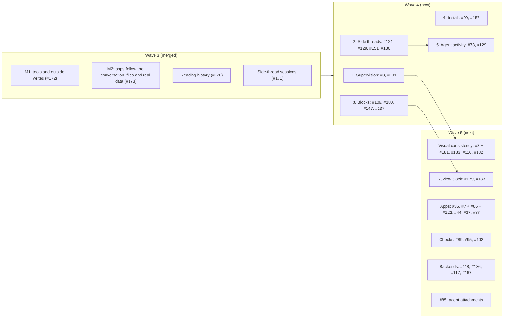

# Work prompts

Briefs for sessions that implement the plan in [#64](https://github.com/HJeon139/postbox/issues/64), in waves of sessions that run in parallel, each in its own worktree. Every session follows [engineering-practices.md](../engineering-practices.md) and the rules on this page. Prompts for issues that are still blocked get written when the wave before them merges.

The plan follows the triage of 22 October 2026 (#64’s last two comments), and the wave 4 plan the two integrating sessions agreed on 23 October 2026. Two sessions integrate and merge, and each reviews the other’s pull requests before they merge:
- **The triage session:** wave 4’s side threads and blocks sessions.
- **The reviewing session:** wave 4’s supervision, install and agent activity sessions. It’s the only writer of this page.

A pull request merges once it’s approved and green. A CI failure that’s one of the known flaky checks, in a check the pull request doesn’t touch, doesn’t block it when its own checks pass locally (the person’s rule, 23 October 2026).

| Wave | Session | Prompt | Issues | Ports (server, Chrome) | Integrates |
|---|---|---|---|---|---|
| 4 | Supervision | [w4-supervision.md](w4-supervision.md) | #3, #101 (a proposal and the person’s decision first) | 4600–4649, 9800–9849 | reviewing |
| 4 | Side threads | [w4-side-threads.md](w4-side-threads.md) | #124, #128’s rest, #151, #130; then #135, #114 | 4650–4699, 9850–9899 | triage |
| 4 | Blocks | [w4-blocks.md](w4-blocks.md) | #106, #180, #147, #137 | 4700–4749, 9900–9949 | triage |
| 4 | Install | [w4-install.md](w4-install.md) | #90, #157 (release blockers) | 4750–4799, 9950–9999 | reviewing |
| 4 | Agent activity | [w4-agent-activity.md](w4-agent-activity.md) | #73 (elements 1–3 and 7), #129’s rest | 4800–4849, 10100–10149 | reviewing |
| 5 | Visual consistency | to write | #8 with #181 (what amber means), #183, #116; #182 if time allows | — | — |
| 5 | Review block | to write | #179, with selection comments, and #133: agents comment on a review through the same comment model | — | — |
| 5 | Apps | to write | #36, #7 with #86 and #122, #44, #37, #87 | — | — |
| 5 | Checks | to write | #89, #95, #102 | — | — |
| 5 | Backends | to write | #118, #136, #117’s rest (Codex, OpenCode), #167 | — | — |
| 5 | Attachments | to write | #85 | — | — |
| — | Needs a decision first | — | #9 (a worktree per conversation), #84, #120 | — | — |
| — | Backlog | — | #11, #13, #14, #15, #16, #21, #28, #41, #76, #99, #100, #103, #107, #111, #113, #115, #131, #134, #177 | — | — |

**Wave 4’s overlaps:**
- **Blocks and supervision:** #106 clears `needs` through the existing paths, and the supervision session owns how the overview and the sidebar draw needs-you.
- **Side threads and agent activity:** both change `app/js/agents.mjs`. #73 adds subagents as children in #171’s tree, and rebases on the side-threads session.
- **Blocks and install:** the blocks session owns `server/index.mjs`’s CSP line, and the install session owns its startup and paths.
- **Closed or held:** #6 is closed, since #105 shipped its recommendation. #150 stays open for the person’s `--compat` Codex run.

**End of wave 4:** a Claude-only UAT pass on Haiku, which the person approves with its estimated cost:
- `longresearch`, which confirms #63 live;
- `workroom`, for #178’s personas and the room roster;
- a `p0` recheck.

## Wave 2 (merged)

| Session | Prompt | Issues | Ports (server, Chrome) |
|---|---|---|---|
| M1 core | [m1-core.md](m1-core.md) | #59 #5 #66 #10 #67 #74 #63 #50 #52 #94 #75 #60 #12 #72 | 4400–4499, 9600–9699 |
| Transcript and threads | [transcript-threads.md](transcript-threads.md) | #88 #91 #83 #93 #81 #82 | 4500–4599, 9700–9799 |

Merge order: M1 core, then transcript and threads.

## Wave 1 (merged)

| Session | Prompt | Issues | Ports (server, Chrome) |
|---|---|---|---|
| Now: hotfixes | [now-hotfixes.md](now-hotfixes.md) | #61 #57 #38 #45 #48 | 4400–4499, 9600–9699 |
| M1: no #57 needed | [m1-blocks-and-first-run.md](m1-blocks-and-first-run.md) | #62 #70 #71 #43 | 4500–4599, 9700–9799 |
| M3: checks | [m3-checks.md](m3-checks.md) | #46 #53 #55 #56 #58 | 4600–4699, 9800–9899 |
| M4: shell | [m4-shell.md](m4-shell.md) | #4 #26 #29 #69 | 4700–4799, 9900–9999 |

## Rules for every session

**Ports and data.** Use only your ports, for any server you start (`node server/index.mjs --port …`) and any headless Chrome (`launch({ port })` in `tools/cdp.mjs`). Give every server you start `--data` with a folder of your own, such as one in your scratchpad: without it, Postbox uses `~/.postbox`, which every clone, worktree and installed copy shares (#90). Never touch the preview on 4173, another tool’s server on 4320, the clone’s `data/`, or `~/.postbox`.

**Files.** Each prompt lists the files the session owns, and the files it shares with another session.
- In a shared file, change only the function or block the prompt names, so the merges stay small.
- Never reformat code you didn’t change, and never move code between files in wave 1.

**Branches.**
- Branch from `main` at the start, and stay based on it.
- Don’t rebase onto another session’s branch.
- One commit per issue, as a Conventional Commit (`feat(scope): …`, `fix(scope): …`, `type!: …` for a breaking change; see engineering-practices.md, “Commits and versions”), with `Fixes #n` on its own line, ending with `Co-Authored-By: Claude Opus 5.5 <noreply@anthropic.com>`. CI releases each merge to main (`.github/workflows/release.yml`).

**Gate.** Before you hand off, these pass in your worktree:
- `npm run check`
- `npm run check:browser`, which runs every headless Chrome check in parallel, with ports of its own. A change you can see in the UI adds or extends a check (`tools/check-*.mjs`, reporting through `tools/harness.mjs`), and the run picks it up.
- `node tools/check-all.mjs <your checks> --lag 300` for each check you add or change. It holds the server’s events back 300 ms, so a check that reads the page before it has heard a change fails here rather than now and then on main (#174). Wait with `page.synced(store.state.seq)`, never a fixed time. Both arrive with #174: until it’s on `main`, merge `main` into your branch once it lands, then run this.

Then an adversarial review subagent goes through your diff against the practices doc, and you fix what it confirms, under the scope rule below.

**Scope.** Fix any bug the review finds in your own change. Anything that adds scope (a new behavior, a new check, a wider fix, more test matrix) needs both of these before you take it on:
- **Evidence:** a repro, a measurement, a UAT result, an issue, or the person’s own request. A guess that something might happen isn’t evidence.
- **Intent:** why it serves [intent.md](../intent.md): one person directing two to four agents on their own computer, with the loop right before the looks.

If it costs more than it gives back to that intent, decline it. Put it under “Declined” in the pull request with the reason, or file a follow-up issue that carries its evidence. Two examples:
- **Accepted:** showing what subagents say and think. The person was waiting, the screen looked idle, and a subagent was busy. The evidence was a UAT run, and it’s a gap in the loop.
- **Declined:** phone-only polish (touch, phone sheets, phone screenshots). Postbox runs on localhost on your own computer, so it doesn’t run on a phone. The 375 px checks stay only because narrow windows and the thread panel squeeze the column the same way. Update the text of the UAT docs your change affects (`tests/uat/`). Don’t refresh their screenshots.

**End-to-end scenarios in an integration pass are Claude only:** scifact and hotpotqa, the M1 exit scenarios (wikisearch, announcement, papersurvey), workroom for the Agents section and the right pane, and p0 when Stop or blocks change. Scenarios that put an agent on another backend (mixedroom with the Kiro CLI, later agy or Codex) are compatibility runs: `tools/uat-run.mjs` refuses them without `--compat`. They’re run only occasionally, never as part of a wave’s pass, with a model that `kiro-cli chat --list-models` offers. Agents in a pass run on Haiku at low effort (the runner’s default, from the merge of #142), except in the M1 exit scenarios, which keep the personas’ model to measure what agents choose.

**Don’t run the screenshot tools or the end-to-end UAT** (`tools/shoot-app.mjs`, `tools/shoot-uat.mjs`, `tools/uat-run.mjs`). The reviewing session runs all three once per wave, on an integration branch with every wave 1 pull request merged:
- the demo screenshots, with axe over every scene
- the UAT doc screenshots
- the end-to-end scenarios

That way the accessibility check and the screenshots cover the merged UI. The integration branch merges the pull requests in this order:
1. Now: hotfixes
2. M1: no #57 needed
3. M3: checks
4. M4: shell

It reports findings per pull request, including accessibility violations, and commits the refreshed screenshots. After review, it merges the pull requests in that order, and later ones may be asked to rebase.

**Hand off.**
1. Push your branch and open a pull request against `main` with `gh pr create`. Don’t merge it.
2. In the body, give each issue’s change, its tests and evidence, and what’s left. Add the practices checklist and the review findings. End the body with “🤖 Generated with [Claude Code](https://claude.com/claude-code)”.
3. Message the session that integrates you (the table’s last column) with `SendMessage`. `ListAgents` lists the reviewing session as “Agentic chat room web app” (`local_48b46372-79f5-4077-82d6-946342d2f22e`) and the triage session as “Postbox issues triage” (`local_b5a731da-1fb6-4ded-ae1c-3f3b60551e3c`). Send it the pull request’s URL, its head commit, and one line per issue on how it was verified. If that fails, comment “Ready for review” on the pull request.
4. Fix what the review reports on the same branch, and message it again.

**When this page or a prompt is wrong** (a file name, a function, a flag), follow the code, and say so in the pull request.
