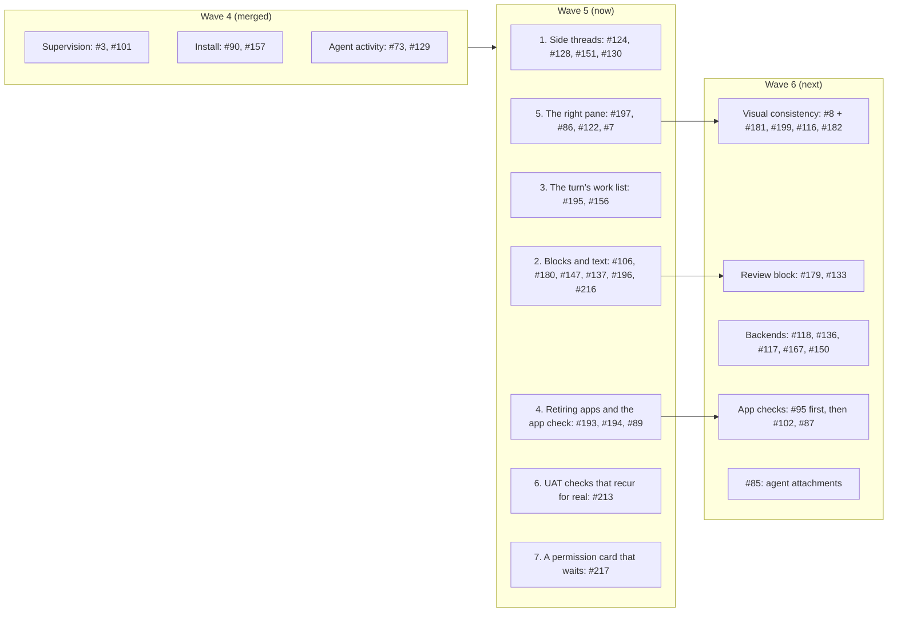

# Work prompts

Briefs for sessions that implement the plan in [#64](https://github.com/HJeon139/postbox/issues/64), in waves of sessions that run in parallel, each in its own worktree. Every session follows [engineering-practices.md](../engineering-practices.md) and the rules on this page. Prompts for issues that are still blocked get written when the wave before them merges.

The plan follows the triage of 22 October 2026 (#64’s last two comments), the wave 4 plan the two integrating sessions agreed on 23 October 2026, and the wave 5 plan the person approved the same day.

**Who integrates wave 5.** The triage session integrates and merges all seven sessions, and writes this page. The architectural review session reviews each pull request before it merges. (In wave 4 the reviewing session wrote this page and integrated three of its sessions. It isn’t running now.)

A pull request merges once it’s approved and green. A CI failure that’s one of the known flaky checks, in a check the pull request doesn’t touch, doesn’t block it when its own checks pass locally (the person’s rule, 23 October 2026).



| Wave | Session | Prompt | Issues | Ports (server, Chrome) | Integrates |
|---|---|---|---|---|---|
| 5 | Side threads | [w5-side-threads.md](w5-side-threads.md) | #124, #128’s rest, #151, #130; then #135, #114 | 4650–4699, 9850–9899 | triage |
| 5 | Blocks and text | [w5-blocks.md](w5-blocks.md) | #106, #180, #147, #137, #196; #216’s wrong answer | 4700–4749, 9900–9949 | triage |
| 5 | The turn’s work list | [w5-work-list.md](w5-work-list.md) | #195, #156; then #214 | 4850–4899, 10150–10199 | triage |
| 5 | Retiring apps and the app check | [w5-apps.md](w5-apps.md) | #193, #194, #89 | 4900–4949, 10200–10249 | triage |
| 5 | The right pane | [w5-pane.md](w5-pane.md) | #197, #86, #122, #7 | 4950–4999, 10250–10299 | triage |
| 5 | UAT checks that recur for real | [w5-uat-checks.md](w5-uat-checks.md) | #213 | 5000–5049, 10300–10349 | triage |
| 5 | A permission card that waits | [w5-permission-wait.md](w5-permission-wait.md) | #217 (P1) | 5050–5099, 10350–10399 | triage |
| 6 | Visual consistency | to write | #8 with #181 (what amber means), #199, #116; #182 if time allows | — | — |
| 6 | Review block | to write | #179, with selection comments, and #133: agents comment on a review through the same comment model | — | — |
| 6 | Backends | to write | #118, #136, #117’s rest (Codex, OpenCode), #167; #150 after the person’s `--compat` Codex run | — | — |
| 6 | App checks | to write | #95 first (P1: it recurs, and its open questions need answers), then #102, #87 | — | — |
| 6 | Attachments | to write | #85 | — | — |
| — | Needs a decision first | — | #9 (a worktree per conversation), #84, #120; #201 and #203 (catalog changes), #202 (apps that collapse on their own); #189’s last fix (a subagent’s context share, about five lines); #208 (P1: each persona’s memory); #210 with #216 (may a topic thread’s fork change its parent’s app or block?); #209 (a fork’s commitments); #212 (agents amend their messages); #206, #207 and #211 (a generative-UI eval, bundled skills, kit primitives for explorables) | — | — |
| — | Backlog | — | #11, #13, #14, #15, #16, #21, #37, #41, #44, #76, #99, #100, #103, #107, #111, #113, #115, #131, #134, #168, #177, #192, #215 | — | — |

**Wave 5’s overlaps:**
- **`server/runtime.mjs` and `biome.json`:** sessions 1, 2 and 4 each move their concern out of `runtime.mjs` first (“Length limits”, below), and session 3 does if it needs more than a call or two. The moved functions don’t overlap. Sessions add `biome.json` entries only for their own new modules, in path order, and never edit an existing file’s override, so their hunks don’t touch. After each merge, the integrator alone lowers `runtime.mjs`’s and `ledger.mjs`’s ceilings to their measured sizes, in a commit of its own.
- **`app/js/thread.mjs`:** side threads (side-thread rendering) and the work list (`workChip` and its list).
- **`app/js/shell.mjs`:** side threads (`mountThreads`) and the pane (the rail’s collapse).
- **`app/js/ui.mjs`:** blocks and text (`announceStreaming`) and the pane (routing).
- **`server/mcp.mjs`:** blocks (the block tools) and apps (`retire_app`).
- **`tools/check-work-pane.mjs`:** the work list and the pane add their own cases.
- **The work list and apps:** the list shows a retired app’s row. The apps session names the state, through the integrator.

**Why these, in this order.** Wave 5 takes the open P1s, the per-turn work list the person asked for, and the issues UAT runs keep catching. The person’s rule of 23 October 2026 is that recurring findings come first (tests/uat/e2e/README.md, “Recurring findings”). Across 15 runs, #106 and #128 recurred in three runs each and #156 in two, so they’re here. #213 comes from the same count: the issues that came back most after closing were mostly checks written before their fixes, so recurrence can’t be trusted until those checks are fixed.

**Merge order:** the permission card first, since it’s a P1 of a line or two. Then UAT checks, since it touches nothing the others do and makes the end-of-wave pass trustworthy. Then side threads, blocks and text, apps, the work list, and the pane. Each later one rebases on main as the earlier ones land.

**End of wave 5:** a Claude-only UAT pass on Haiku, which the person approves with its estimated cost. It covers wave 4 too, since wave 4’s pass didn’t run:
- `longresearch`, which confirms #63 live;
- `workroom`, for #178’s personas, the room roster, and #195’s list;
- a `p0` recheck.

## Wave 4 (merged, two sessions carried to wave 5)

Side threads and blocks never started in wave 4. Their prompts moved to wave 5, as `w5-side-threads.md` and `w5-blocks.md`.

| Session | Prompt | Issues | Ports (server, Chrome) |
|---|---|---|---|
| Supervision | [w4-supervision.md](w4-supervision.md) | #3, #101 | 4600–4649, 9800–9849 |
| Install | [w4-install.md](w4-install.md) | #90, #157 | 4750–4799, 9950–9999 |
| Agent activity | [w4-agent-activity.md](w4-agent-activity.md) | #73 (elements 1–3 and 7), #129’s rest | 4800–4849, 10100–10149 |

## Wave 2 (merged)

| Session | Prompt | Issues | Ports (server, Chrome) |
|---|---|---|---|
| M1 core | [m1-core.md](m1-core.md) | #59 #5 #66 #10 #67 #74 #63 #50 #52 #94 #75 #60 #12 #72 | 4400–4499, 9600–9699 |
| Transcript and threads | [transcript-threads.md](transcript-threads.md) | #88 #91 #83 #93 #81 #82 | 4500–4599, 9700–9799 |

Merge order: M1 core, then transcript and threads.

## Wave 1 (merged)

| Session | Prompt | Issues | Ports (server, Chrome) |
|---|---|---|---|
| Now: hotfixes | [now-hotfixes.md](now-hotfixes.md) | #61 #57 #38 #45 #48 | 4400–4499, 9600–9699 |
| M1: no #57 needed | [m1-blocks-and-first-run.md](m1-blocks-and-first-run.md) | #62 #70 #71 #43 | 4500–4599, 9700–9799 |
| M3: checks | [m3-checks.md](m3-checks.md) | #46 #53 #55 #56 #58 | 4600–4699, 9800–9899 |
| M4: shell | [m4-shell.md](m4-shell.md) | #4 #26 #29 #69 | 4700–4799, 9900–9999 |

## Rules for every session

**Ports and data.** Use only your ports, for any server you start (`node server/index.mjs --port …`) and any headless Chrome (`launch({ port })` in `tools/cdp.mjs`). Give every server you start `--data` with a folder of your own, such as one in your scratchpad: without it, Postbox uses `~/.postbox`, which every clone, worktree and installed copy shares (#90). Never touch the preview on 4173, another tool’s server on 4320, the clone’s `data/`, or `~/.postbox`.

**Length limits** (architecture.md, “Module and function size”). Biome fails any file or function past its default length (`biome.json`), and a file already past it can shrink but not grow. So:
- **Make room first.** When your change would grow a file at its ceiling, such as `server/runtime.mjs`, `server/ledger.mjs` or `app/js/thread.mjs`, first move the concern your prompt names into a module of its own, as its own commit, with no other change.
- **What the move may change** (architecture.md, “What a move may change”):
  - A method becomes a function that takes the instance first: `rt` for `Runtime`, `ledger` for `Ledger`. `this` becomes that parameter, and nothing else in its body changes.
  - The class keeps a one-line method that delegates to it (`agentWake(...a) { return agentWake(this, ...a); }`), so callers and tests don’t change.
  - A static becomes a module constant, and the class keeps an alias (`static APP_HOLD_MAX = APP_HOLD_MAX;`), since tests read `Runtime.APP_HOLD_MAX`.
  - A closure inside another function, such as a tool handler in `toolsFor`, takes the variables it read as parameters, and the commit message names them.
  - Module-level helpers and constants the moved code reads move with it, or go to a third module both files import. Never import them back from the old file: that’s a circular import.
- **Check the move before you commit it.** Use a folder of your own, since sessions run at once:

  ```bash
  d=$(mktemp -d)
  # Undo the rewrite: rt (or ledger) back to this. Skip this step for a closure such as update_block,
  # whose original already says rt (toolsFor has const rt = this): diff that one directly.
  perl -pe 's/\brt\b/this/g' server/<new module>.mjs > "$d/undone.mjs"       # for a Ledger move: s/\bledger\b/this/g
  git show HEAD:server/runtime.mjs | sed -n '<first>,<last>p' > "$d/removed.mjs"
  diff -w "$d/removed.mjs" "$d/undone.mjs"                                   # left: the delegators, imports and parameter lists
  ```

  `diff -w` ignores the change of indent from inside the class to the top level. Biome may rewrap a line after the dedent, so check any line it rewrapped by eye.
- **Ceilings move with the code.** Give your new module an override in `biome.json` at the size of the code it carries, when that’s past the default. Add only your own module’s entry, in path order. Don’t edit the override of the file you moved from: the integrator lowers it after each merge.
- **New code fits the defaults** in `biome.json`. Never raise a ceiling for it.
- **Tests too.** A new test for a test file at its ceiling goes in `tests/<module>-<concern>.test.mjs`, which must end in `.test.mjs`, or `npm test` never runs it.

**Files.** Each prompt lists the files the session owns, and the files it shares with another session.
- In a shared file, change only the function or block the prompt names, so the merges stay small.
- Never reformat code you didn’t change. (Wave 1 also never moved code between files. From wave 5, a move is how you make room: “Length limits”, above.)

**Branches.**
- Branch from `main` at the start, and stay based on it.
- Don’t rebase onto another session’s branch.
- One commit per issue, as a Conventional Commit (`feat(scope): …`, `fix(scope): …`, `type!: …` for a breaking change; see engineering-practices.md, “Commits and versions”), with `Fixes #n` on its own line, ending with `Co-Authored-By: Claude Opus 5.5 <noreply@anthropic.com>`. CI releases each merge to main (`.github/workflows/release.yml`).

**Gate.** Before you hand off, these pass in your worktree:
- `npm run check`
- `npm run check:browser`, which runs every headless Chrome check in parallel, with ports of its own. A change you can see in the UI adds or extends a check (`tools/check-*.mjs`, reporting through `tools/harness.mjs`), and the run picks it up.
- `node tools/check-all.mjs <your checks> --lag 300` for each check you add or change. It holds the server’s events back 300 ms, so a check that reads the page before it has heard a change fails here rather than now and then on main (#174). Wait with `page.synced(store.state.seq)`, never a fixed time. Both arrive with #174: until it’s on `main`, merge `main` into your branch once it lands, then run this.

Then an adversarial review subagent goes through your diff against the practices doc, and you fix what it confirms, under the scope rule below.

**Scope.** Fix any bug the review finds in your own change. Anything that adds scope (a new behavior, a new check, a wider fix, more test matrix) needs both of these before you take it on:
- **Evidence:** a repro, a measurement, a UAT result, an issue, or the person’s own request. A guess that something might happen isn’t evidence.
- **Intent:** why it serves [intent.md](../intent.md): one person directing two to four agents on their own computer, with the loop right before the looks.

If it costs more than it gives back to that intent, decline it. Put it under “Declined” in the pull request with the reason, or file a follow-up issue that carries its evidence. Two examples:
- **Accepted:** showing what subagents say and think. The person was waiting, the screen looked idle, and a subagent was busy. The evidence was a UAT run, and it’s a gap in the loop.
- **Declined:** phone-only polish (touch, phone sheets, phone screenshots). Postbox runs on localhost on your own computer, so it doesn’t run on a phone. The 375 px checks stay only because narrow windows and the thread panel squeeze the column the same way. Update the text of the UAT docs your change affects (`tests/uat/`). Don’t refresh their screenshots.

**End-to-end scenarios in an integration pass are Claude only:** scifact and hotpotqa, the M1 exit scenarios (wikisearch, announcement, papersurvey), workroom for the Agents section and the right pane, and p0 when Stop or blocks change. Scenarios that put an agent on another backend (mixedroom with the Kiro CLI, later agy or Codex) are compatibility runs: `tools/uat-run.mjs` refuses them without `--compat`. They’re run only occasionally, never as part of a wave’s pass, with a model that `kiro-cli chat --list-models` offers. Agents in a pass run on Haiku at low effort (the runner’s default, from the merge of #142), except in the M1 exit scenarios, which keep the personas’ model to measure what agents choose.

**Don’t run the screenshot tools or the end-to-end UAT** (`tools/shoot-app.mjs`, `tools/shoot-uat.mjs`, `tools/uat-run.mjs`). The reviewing session runs all three once per wave, on an integration branch with every wave 1 pull request merged:
- the demo screenshots, with axe over every scene
- the UAT doc screenshots
- the end-to-end scenarios

That way the accessibility check and the screenshots cover the merged UI. The integration branch merges the pull requests in this order:
1. Now: hotfixes
2. M1: no #57 needed
3. M3: checks
4. M4: shell

It reports findings per pull request, including accessibility violations, and commits the refreshed screenshots. After review, it merges the pull requests in that order, and later ones may be asked to rebase.

**Hand off.**
1. Push your branch and open a pull request against `main` with `gh pr create`. Don’t merge it.
2. In the body, give each issue’s change, its tests and evidence, and what’s left. Add the practices checklist and the review findings. End the body with “🤖 Generated with [Claude Code](https://claude.com/claude-code)”.
3. Message the session that integrates you (the table’s last column) with `SendMessage`. `ListAgents` lists the reviewing session as “Agentic chat room web app” (`local_48b46372-79f5-4077-82d6-946342d2f22e`) and the triage session as “Postbox issues triage” (`local_b5a731da-1fb6-4ded-ae1c-3f3b60551e3c`). Send it the pull request’s URL, its head commit, and one line per issue on how it was verified. If that fails, comment “Ready for review” on the pull request.
4. Fix what the review reports on the same branch, and message it again.

**When this page or a prompt is wrong** (a file name, a function, a flag), follow the code, and say so in the pull request.
