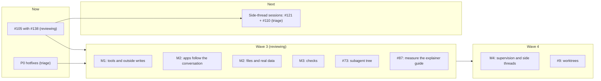

# Work prompts

Briefs for sessions that implement the plan in [#64](https://github.com/HJeon139/postbox/issues/64), in waves of sessions that run in parallel, each in its own worktree. Every session follows [engineering-practices.md](../engineering-practices.md) and the rules on this page. Prompts for issues that are still blocked get written when the wave before them merges.

The plan follows the triage of 22 October 2026 (#64’s last two comments). Two sessions integrate and merge, each owning its own pieces:
- **The triage session:** the P0 hotfixes, and then the side-thread sessions.
- **The reviewing session:** #138 with #105, then waves 3 and 4. It's the only writer of this page.

Whichever of the P0 pull request and #105 lands on main second rebases onto the other. #92 changes code the P0 hotfixes also change (`update_block`’s reopen path), so its session starts from `main` after the P0 pull request merges. #98 (Stop leaves progress steps running) is part of the P0 Stop fix.

| When | Session | Issues | Integrates |
|---|---|---|---|
| Now | P0 hotfixes | #108, #123, #125, #126 (with #129’s background-job tracking), #98, on `fix/p0-hotfixes` | triage |
| Now | #105 with #138 | #105 (agents in the sidebar), #138 (the Work ledger, #132) | reviewing |
| After #105 | Side-thread sessions (P0) | #121 (all six proposals), #110, with the part of #128 where a side thread starts copies | triage |
| 3 | M1: tools and outside writes | #63’s remaining fixes (the guide’s table rule, a review before outside writes), #104, #112 | reviewing |
| 3 | M2: apps follow the conversation | #49 with #92 (after the P0 merge), #36, #7 with #86 and #122 | reviewing |
| 3 | M2: files and real data | #90, then #85 (agent attachments), #54, #47, #51, #44, #37 | reviewing |
| 3 | M3: checks | #89, #102, #63’s block check and a long research exit scenario, #95 once decided | reviewing |
| 3 | #73 | subagent narration, thinking and tree, in #105’s Agents section beside #121’s tree | reviewing |
| 3 | #87 | measure, then calibrate, the explainer guide | reviewing |
| 4 | M4: supervision and side threads | #3 and #101 (reviewed again once P0, the P1s and wave 3 have merged), #6, #8, #11, #13, #14, #16; #85’s Files view and room menu; P1: #109, #124, #128, #106, #129’s rest; P2: #99, #107, #114, #117’s rest (Codex, OpenCode), #118, #119, #130, #133–#137; P3: #111 | reviewing |
| 4 | #9 | worktree per conversation | reviewing |
| — | Backlog | #84 (needs a decision), #15, #21, #28, #41, #76, #100, #103, #113, #115, #116, #120 (needs an intent decision), #131 | — |

## Wave 2 (merged)

| Session | Prompt | Issues | Ports (server, Chrome) |
|---|---|---|---|
| M1 core | [m1-core.md](m1-core.md) | #59 #5 #66 #10 #67 #74 #63 #50 #52 #94 #75 #60 #12 #72 | 4400–4499, 9600–9699 |
| Transcript and threads | [transcript-threads.md](transcript-threads.md) | #88 #91 #83 #93 #81 #82 | 4500–4599, 9700–9799 |

Merge order: M1 core, then transcript and threads.

## Wave 1 (merged)

| Session | Prompt | Issues | Ports (server, Chrome) |
|---|---|---|---|
| Now: hotfixes | [now-hotfixes.md](now-hotfixes.md) | #61 #57 #38 #45 #48 | 4400–4499, 9600–9699 |
| M1: no #57 needed | [m1-blocks-and-first-run.md](m1-blocks-and-first-run.md) | #62 #70 #71 #43 | 4500–4599, 9700–9799 |
| M3: checks | [m3-checks.md](m3-checks.md) | #46 #53 #55 #56 #58 | 4600–4699, 9800–9899 |
| M4: shell | [m4-shell.md](m4-shell.md) | #4 #26 #29 #69 | 4700–4799, 9900–9999 |

## Rules for every session

**Ports.** Use only your ports, for any server you start (`node server/index.mjs --port …`) and any headless Chrome (`launch({ port })` in `tools/cdp.mjs`). Never touch the preview on 4173, another tool’s server on 4320, or `data/`.

**Files.** Each prompt lists the files the session owns, and the files it shares with another session.
- In a shared file, change only the function or block the prompt names, so the merges stay small.
- Never reformat code you didn’t change, and never move code between files in wave 1.

**Branches.**
- Branch from `main` at the start, and stay based on it.
- Don’t rebase onto another session’s branch.
- One commit per issue, as a Conventional Commit (`feat(scope): …`, `fix(scope): …`, `type!: …` for a breaking change; see engineering-practices.md, “Commits and versions”), with `Fixes #n` on its own line, ending with `Co-Authored-By: Claude Opus 5.5 <noreply@anthropic.com>`. The integrator runs `npm run release` after each merge to main.

**Gate.** Before you hand off, these pass in your worktree:
- `npm run check`
- `npm run check:browser`, which runs every headless Chrome check in parallel, with ports of its own. A change you can see in the UI adds or extends a check (`tools/check-*.mjs`, reporting through `tools/harness.mjs`), and the run picks it up.

Then an adversarial review subagent goes through your diff against the practices doc, and you fix what it confirms, under the scope rule below.

**Scope.** Fix any bug the review finds in your own change. Anything that adds scope (a new behavior, a new check, a wider fix, more test matrix) needs both of these before you take it on:
- **Evidence:** a repro, a measurement, a UAT result, an issue, or the person’s own request. A guess that something might happen isn’t evidence.
- **Intent:** why it serves [intent.md](../intent.md): one person directing two to four agents on their own computer, with the loop right before the looks.

If it costs more than it gives back to that intent, decline it. Put it under “Declined” in the pull request with the reason, or file a follow-up issue that carries its evidence. Two examples:
- **Accepted:** showing what subagents say and think. The person was waiting, the screen looked idle, and a subagent was busy. The evidence was a UAT run, and it’s a gap in the loop.
- **Declined:** phone-only polish (touch, phone sheets, phone screenshots). Postbox runs on localhost on your own computer, so it doesn’t run on a phone. The 375 px checks stay only because narrow windows and the thread panel squeeze the column the same way. Update the text of the UAT docs your change affects (`tests/uat/`). Don’t refresh their screenshots.

**End-to-end scenarios in an integration pass are Claude only:** scifact and hotpotqa, the M1 exit scenarios (wikisearch, announcement, papersurvey), workroom for the Agents section and the right pane, and p0 when Stop or blocks change. Scenarios that put an agent on another backend (mixedroom with the Kiro CLI, later agy or Codex) are compatibility runs: `tools/uat-run.mjs` refuses them without `--compat`. They’re run only occasionally, never as part of a wave’s pass, with a model that `kiro-cli chat --list-models` offers. Agents in a pass run on Haiku at low effort (the runner’s default, from the merge of #142), except in the M1 exit scenarios, which keep the personas’ model to measure what agents choose.

**Don’t run the screenshot tools or the end-to-end UAT** (`tools/shoot-app.mjs`, `tools/shoot-uat.mjs`, `tools/uat-run.mjs`). The reviewing session runs all three once per wave, on an integration branch with every wave 1 pull request merged:
- the demo screenshots, with axe over every scene
- the UAT doc screenshots
- the end-to-end scenarios

That way the accessibility check and the screenshots cover the merged UI. The integration branch merges the pull requests in this order:
1. Now: hotfixes
2. M1: no #57 needed
3. M3: checks
4. M4: shell

It reports findings per pull request, including accessibility violations, and commits the refreshed screenshots. After review, it merges the pull requests in that order, and later ones may be asked to rebase.

**Hand off.**
1. Push your branch and open a pull request against `main` with `gh pr create`. Don’t merge it.
2. In the body, give each issue’s change, its tests and evidence, and what’s left. Add the practices checklist and the review findings. End the body with “🤖 Generated with [Claude Code](https://claude.com/claude-code)”.
3. Message the reviewing session with `SendMessage`. `ListAgents` lists it as “Agentic chat room web app” (session id `local_48b46372-79f5-4077-82d6-946342d2f22e`). Send it the pull request’s URL, its head commit, and one line per issue on how it was verified. If that fails, comment “Ready for UAT review” on the pull request.
4. Fix what the review reports on the same branch, and message it again.

**When this page or a prompt is wrong** (a file name, a function, a flag), follow the code, and say so in the pull request.
