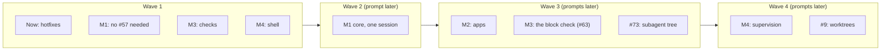

# Work prompts

Briefs for sessions that implement the plan in [#64](https://github.com/HJeon139/postbox/issues/64), in waves of sessions that run in parallel, each in its own worktree. Every session follows [engineering-practices.md](../engineering-practices.md) and the rules on this page. Prompts for issues that are still blocked get written when the wave before them merges.

M1 core runs alone, as one dedicated session, and M2 starts only after M1 core merges, as #64 decided. M1 core changes how every agent turn is built and what agents are told (the adapters, the guide, the MCP tool descriptions, `kit.js`), and M2 edits the same files. Measuring agent behavior also needs M1 settled first. #73 (subagents as a hierarchy) waits for wave 3, because it changes the stream mapper and the agent header, which M1 core is editing.

## Wave 1

| Session | Prompt | Issues | Ports (server, Chrome) |
|---|---|---|---|
| Now: hotfixes | [now-hotfixes.md](now-hotfixes.md) | #61 #57 #38 #45 #48 | 4400–4499, 9600–9699 |
| M1: no #57 needed | [m1-blocks-and-first-run.md](m1-blocks-and-first-run.md) | #62 #70 #71 #43 | 4500–4599, 9700–9799 |
| M3: checks | [m3-checks.md](m3-checks.md) | #46 #53 #55 #56 #58 | 4600–4699, 9800–9899 |
| M4: shell | [m4-shell.md](m4-shell.md) | #4 #26 #29 #69 | 4700–4799, 9900–9999 |

## Rules for every session

**Ports.** Use only your ports, for any server you start (`node server/index.mjs --port …`) and any headless Chrome (`launch({ port })` in `tools/cdp.mjs`). Never touch the preview on 4173, another tool’s server on 4320, or `data/`.

**Files.** Each prompt lists the files the session owns, and the files it shares with another session.
- In a shared file, change only the function or block the prompt names, so the merges stay small.
- Never reformat code you didn’t change, and never move code between files in wave 1.

**Branches.**
- Branch from `main` at the start, and stay based on it.
- Don’t rebase onto another session’s branch.
- One commit per issue, with `Fixes #n` on its own line, ending with `Co-Authored-By: Claude Opus 5.5 <noreply@anthropic.com>`.

**Gate.** Before you hand off, these pass in your worktree:
- `npm run check`
- a headless Chrome check (`tools/cdp.mjs`) for each change you can see in the UI

Then an adversarial review subagent goes through your diff against the practices doc, and you fix what it confirms. Update the text of the UAT docs your change affects (`tests/uat/`). Don’t refresh their screenshots.

**Don’t run the screenshot tools or the end-to-end UAT** (`tools/shoot-app.mjs`, `tools/shoot-uat.mjs`, `tools/uat-run.mjs`). The reviewing session runs all three once per wave, on an integration branch with every wave 1 pull request merged:
- the demo screenshots, with axe over every scene
- the UAT doc screenshots
- the end-to-end scenarios

That way the accessibility check and the screenshots cover the merged UI. The integration branch merges the pull requests in this order:
1. Now: hotfixes
2. M1: no #57 needed
3. M3: checks
4. M4: shell

It reports findings per pull request, including accessibility violations, and commits the refreshed screenshots. After review, it merges the pull requests in that order, and later ones may be asked to rebase.

**Hand off.**
1. Push your branch and open a pull request against `main` with `gh pr create`. Don’t merge it.
2. In the body, give each issue’s change, its tests and evidence, and what’s left. Add the practices checklist and the review findings. End the body with “🤖 Generated with [Claude Code](https://claude.com/claude-code)”.
3. Message the reviewing session with `SendMessage`. `ListAgents` lists it as “Agentic chat room web app” (session id `local_48b46372-79f5-4077-82d6-946342d2f22e`). Send it the pull request’s URL, its head commit, and one line per issue on how it was verified. If that fails, comment “Ready for UAT review” on the pull request.
4. Fix what the review reports on the same branch, and message it again.

**When this page or a prompt is wrong** (a file name, a function, a flag), follow the code, and say so in the pull request.
