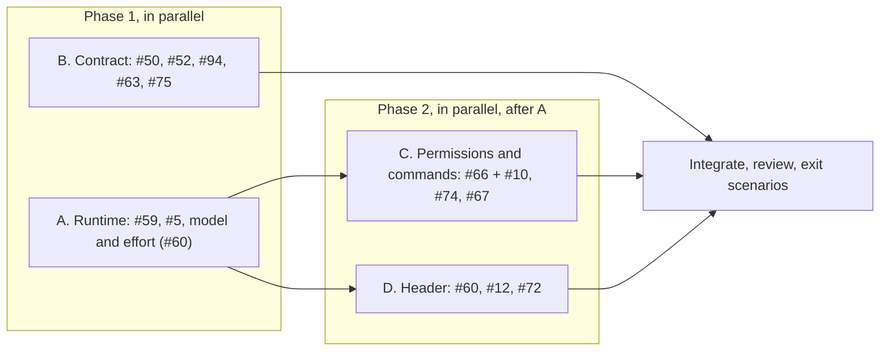

# Prompt: M1 core, one agent contract

A wave 2 session. Follow [README.md](README.md) for the rules every session shares: ports, file ownership, the scope rule, the gate and the hand-off. Your ports are 4400–4499 for servers and 9600–9699 for Chrome.

---

You’re finishing milestone M1, “One agent contract”, in one pull request on the branch `fix/m1-core`, with one commit per issue. It’s the largest piece of the plan in [#64](https://github.com/HJeon139/postbox/issues/64), so use subagents, each in its own worktree, in the phases below. Then run an adversarial review subagent. **Don’t run the end-to-end UAT or the screenshot tools.** The reviewing session runs them.

## Why this milestone

Postbox’s promise is that agents answer with blocks and apps, and that you direct them from one place. Two things stand in the way today:
- **You can’t see or change what an agent runs with without a terminal.** Its tools, MCP servers, permission rules, model and effort are invisible. The Tools checklist doesn’t even reach real backends (#5). When a rule blocks an agent, you switch to a terminal to fix it.
- **Agents aren’t told the rules the server enforces.** Nobody tells them the 64 KB event limit (#50) or the chart palettes (#52). The guide maps requests to blocks rather than replies to blocks, so agents answer in prose (#63).

Wave 1 removed the competing steering (#57: the output style is forced to the default, and personas load your setup). This wave makes the agent contract explicit, visible and generated from the code that enforces it.

**Evidence to keep in mind:**
- Wave 1’s end-to-end UAT: agents still carry `SendMessage`, `ListAgents`, `RemoteTrigger` and `CronCreate` (comment on #5). The check for a reply that should have been a block (#63) fired in both scenarios.
- Wave 1’s manual UAT: an agent reopened an answered confirm just to report a result (#94).

## Read first

1. `designs/engineering-practices.md`, `designs/prompts/README.md` (especially the scope rule) and `designs/intent.md`.
2. `designs/architecture.md`: the sections on real agents, permissions and the guide.
3. Each issue with its comments, which hold the decisions: `gh issue view <n> --repo HJeon139/postbox --comments` for #59, #5, #66, #10, #67, #74, #63, #50, #52, #94, #75, #60, #12 and #72.
4. The code wave 1 added for #57: `server/adapters/setup.mjs` (setting sources and the publishing deny list) and its tests.

## The work, in phases

Give each subagent its issues, the decisions below, the practices doc, the scope rule, its files and the files it must not touch, and the rule that it isn’t done until `npm run check` passes in its worktree, with a test for each change that fails without it.

### A. Runtime: what an agent runs with

**#59: your MCP servers.**
- **Why:** an agent can’t use a server that works in your terminal.
- **Decision (revised 21 October):** personas that use your setup load your MCP servers as your terminal does. Drop `--strict-mcp-config` and the Postbox-only config for them, and keep both for Isolated personas.
- **Persona setting:** a list of servers turned off. The persona sheet lists the servers found (user, project and local scopes, read as Claude Code reads them), each with its status, and a checkbox that’s on by default.
- **The publishing deny list** in `setup.mjs` must keep working once connectors load. Test it against a recorded `init` with a connector.

**#5: the Tools checklist reaches real backends.**
- **Why:** unticking `shell` doesn’t stop an agent from running commands, and a safety control that does nothing is worse than none.
- **Map** the persona’s tools to allow and deny rules (`--allowedTools` / `--disallowedTools`, and the SDK’s `allowedTools` / `disallowedTools`).
- **Deny by default for real backends**, unless the persona allows them, the tools that act outside Postbox’s record: `SendMessage`, `ListAgents`, `RemoteTrigger`, `CronCreate`, `CronDelete`, `ScheduleWakeup` and `Workflow`.
  - **Why:** they bypass the wake cap and the record of who woke whom (intent.md, principle 6). `schedule_wake` is Postbox’s own way to schedule.
  - Derive the exact names from a recorded `init`, as `setup.mjs` did, and keep them in one list with that comment.

**Model and effort (#60, the backend half).**
- Add an effort setting next to model in the persona.
- Pass both explicitly in both adapters. Find the real flag and option names in `claude --help` and the SDK’s types; don’t guess them.
- Record the model that actually answered each turn (the stream already reports it) on the session.

**A’s files:** `server/adapters/*`, the persona fields and validation in `server/runtime.mjs` (`createPersona`, `updatePersona`), and the persona sheet’s backend fields in `app/js/sheets.mjs`.

### B. Contract: what agents are told

**#50 and #52: generate the rules from the constants.**
- **Why:** agents guessed a limit nobody told them, and lost data without knowing.
- Move the limits agents must know (event size, app size, block sizes) and the chart palettes (`--s1`…`--s8`, `--seq-*`, `--div-*`, with when to use each, and `--good` / `--alert` for status only) into one module in `shared/`.
- The guide (`server/adapters/guide.mjs`), the MCP tool descriptions (`server/mcp.mjs`) and `app/kit/kit.js` read them from there.
- **A test fails** when a limit in that module isn’t named in the guide.
- `postbox.send` over the limit rejects inside the app with an error that names the limit.

**#94: reporting a result doesn’t reopen a question.**
- An optional `outcome` (Markdown) on choice, form and confirm. Setting it with `update_block` on an answered block shows a line under your answer, keeps the block answered, and doesn’t raise needs-you.
- The guide says: report results in your reply or with `outcome`, and update an answered block only to ask again.

**#63: the guide rewrite.**
- **Why:** agents chose blocks only when asked.
- Organize the guide by what a reply contains, not by what was asked:
  - options become a choice
  - questions become a form
  - a draft for approval becomes a review block (review blocks render Markdown since #62)
  - a long job becomes a progress block
- Keep it short. Agents follow defaults more than prose (principle 4).
- Don’t tune it against one example: #87 measures the explainer layout separately in wave 3.

**#75, in the files you’re already editing.**
- Say “conversation” where the guide, the tool descriptions and the runtime’s errors mean one.
- Say “narrow and wide windows”, not “phone”, in what agents read about the app check, and in its placeholder in `app/js/apps.mjs` (that one string only).
- Extend `tools/lint-copy.mjs` to `server/mcp.mjs` and `server/adapters/guide.mjs`.

**B’s files:** `server/adapters/guide.mjs`, `server/mcp.mjs` (descriptions, and `outcome` in `update_block`), the new limits module in `shared/`, `shared/catalog.mjs` (`outcome`), `shared/events.mjs`, `app/kit/kit.js`, `toolsFor.update_block` in `server/runtime.mjs`, rendering `outcome` in `app/js/blocks.mjs`, and `tools/lint-copy.mjs`.

### C. Permissions and commands, after A

**#66 with #10: the permissions panel and cards.**
- **Why:** an agent blocked by a rule shouldn’t send you to a terminal.
- **The panel:** reached from conversation ⋯ › Permissions, the persona sheet, and `/permissions`.
  - The mode, applied live to running sessions.
  - Allow, ask and deny rules, from the merged settings, each with its source.
  - The folders, and the MCP servers from A.
  - An effective view: which rule decides a given call.
- **Where rules are saved:** the project’s `.claude/settings.local.json` by default, as the CLI saves “don’t ask again”. A rule can also be saved for this conversation only, or to user settings.
- **The cards:**
  - Always allow, from the prompt’s own suggestions, with the rule shown in words before you click.
  - Edit (`updatedInput`).
  - Don’t allow, with a reason that goes to the agent.
  - A subagent’s prompt names the subagent.
- The persona’s Tools become rules in the same panel (#5).

**#74: writes need the page’s token.**
- **Why:** an agent can post as you with `curl`. `!` (below) will run shell commands as you, so it can’t ship without this.
- A per-launch secret in an `HttpOnly`, `SameSite=Strict` cookie, set when the page loads `/`. Writes without it get 403, with a message saying why.
- `/mcp` keeps its own session check.
- Tests cover every write route.

**#67: `/` and `!` in the composer.**
- **The `/` menu**, also opened by a visible Commands button:
  - Postbox’s commands: `/permissions`, `/mode`, `/model`, `/effort`, `/add-dir`, `/mcp`, `/compact`, `/stop`, `/rename`, `/archive`.
  - The agent’s skills and commands, from the session’s `init` (minus `terminal_slash_commands`) or the SDK’s `supportedCommands()`, with argument hints, grouped by agent in a room.
- **`!command`** runs in the conversation’s folder as you, behind #74’s token. Its output streams into a command item, with Stop, the exit code and the duration. It goes to the agent as context on its next turn, without waking it. It’s off when Postbox listens beyond localhost.

**C’s files:**
- New: `app/js/permissions.mjs`, and the permission and command routes in `server/index.mjs` (with the token guard).
- The permission and denial cards (`permissionBlock`, `denialBlock`) and the composer (`mountComposer`) in `app/js/thread.mjs`, plus a new `command` case in `renderItem`.
- The permission handling in `server/runtime.mjs`.

### D. The agent header, after A

**#60, #12 and #72: one design for the header and the card.**
- **Why:** you can’t tell which model, which effort, or whether a reply came from a model at all (#12). There isn’t room for everything at every width (#72).
- **What they show:**
  - the model that answered the last turn (marked when it differs from the setting)
  - the effort
  - a “mock” marker on mock agents, wherever their name appears
  - a “Demo mode: scripted agents” banner under `--demo`
  - on a first run without Claude Code, a line on the overview saying how to install it
- **Narrow widths:**
  - The status icon always shows. The status text and the model drop first when they don’t fit.
  - Nothing is only on hover: what drops out of the header stays in the agent’s card and the conversation’s menu.
  - Leave room for #73’s “subagents running” line in wave 3.

**D’s files:** the top bar and overview cards in `app/js/shell.mjs`, and their CSS.

## Files

The four groups above own their files. For the session as a whole:
- **Shared with the transcript and threads session** (`designs/prompts/transcript-threads.md`):
  - In `app/js/thread.mjs`, it owns `mountTranscript`, `fillWorkRow`, `messageActions`, the app case in `renderItem` and `mountSidePanel`.
  - In `server/runtime.mjs`, it owns `catchUp`, `shareToConversation` and the summarize turn’s end.
  - In `app/workbench.css`, it owns the transcript, `.working` and `.jump` rules.
  - In `shared/`, it owns `shared/markdown.mjs`.
  - Don’t touch those. Add your CSS in your own sections.
- **Not yours:** `server/seed.mjs`, `tools/uat-run.mjs` and `tools/uat/driver.mjs`, apart from adding scenarios and checks below.

## The exit check: agents pick blocks without being asked

#64’s M1 exit check is a set of real-agent scenarios. Write them, but don’t run them:
- Add three short scenarios to `tests/uat/e2e/scenarios/`, in the format of `scifact.md`, two or three phases each:
  - **Options:** the person asks something with several reasonable answers.
  - **A draft for approval:** the person asks for a draft to approve.
  - **A long job:** a task with several steps that takes minutes.

  None of them names a block. The person never asks for a choice, a form or a review.
- Extend the existing `prose-instead-of-block` check in `tools/uat/checks.mjs`, tested in `tests/uat-checks.test.mjs`, to count per scenario the replies that used the right block and the replies that should have.

The reviewing session runs these on `main` first, as the baseline, and then on your branch. The difference is M1’s result.

## How to work

1. Branch `fix/m1-core` from `main`. Run `npm ci`, then `npm run check`.
2. Start A and B in parallel. When A is done, start C and D in parallel. Cherry-pick each group’s commits onto `fix/m1-core` in the order A, B, C, D, running `npm run check` after each, and resolve conflicts yourself.
3. Real agent turns: keep them to the few you need to record fixtures (an `init` with your MCP servers and connectors, the model and effort flags, a permission prompt with suggestions), on short prompts, with your own signed-in `claude`. Never handle credentials.
4. Write headless Chrome checks (`tools/cdp.mjs`, on your ports) for:
   - the panel and the card answers
   - `/` and `!`, including a failing command and a request without the token
   - the header at 375 and 1280 px
   - the mock marker and the demo banner
5. Update the UAT docs your changes affect, as text only.
6. **Review adversarially:** a subagent goes through the full diff against the practices doc and the scope rule. Every finding needs a file, a line and a failing scenario. Fix what it confirms, and list what you declined, with its reason, under “Declined” in the pull request.
7. Open the pull request with `gh pr create`. For each issue, give what changed, the tests and evidence, and what’s left. Add the practices checklist, the review findings and the Declined list. End the body with “🤖 Generated with [Claude Code](https://claude.com/claude-code)”. Don’t merge it.
8. Message the reviewing session, as the README says, with the pull request URL, its head and one line per issue on how it was verified. Point out what the UAT should look at: the permissions round trip with the CLI, `!` from another origin, and the header in a full room.
