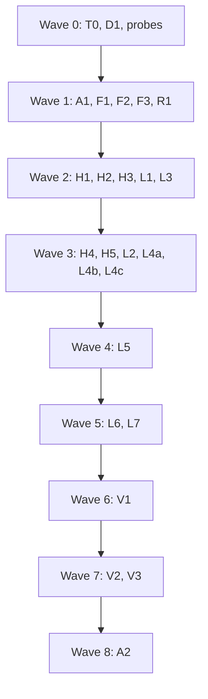
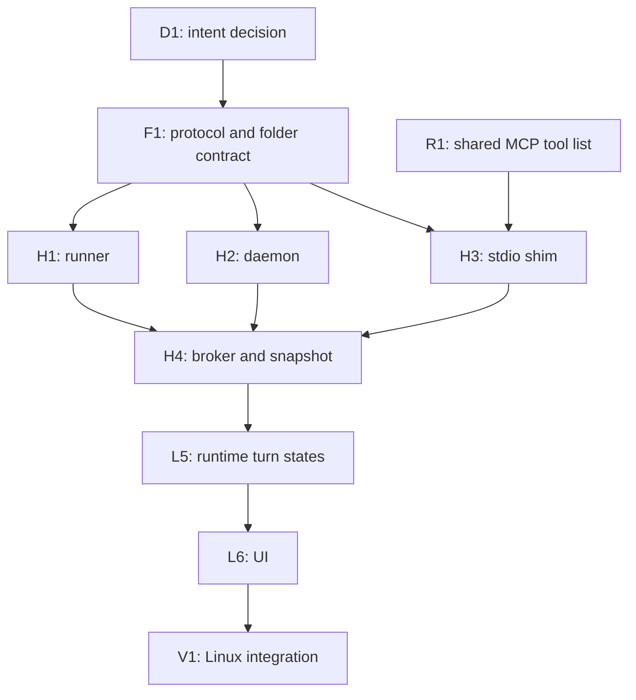

# Plan: remote hosts (#120)

The execution plan for running agents on another machine over SSH, as designed in [#120’s design comment](https://github.com/HJeon139/postbox/issues/120#issuecomment-6371251024) (“the design” below). It also uses the [probe requirements](https://github.com/HJeon139/postbox/issues/120#issuecomment-6368886246) and the [check against the official docs](https://github.com/HJeon139/postbox/issues/120#issuecomment-6371712349). [README.md](README.md) has the rules every session shares: ports, files, branches, the gate, scope and hand-off. This page adds the task graph, and what each task owns, depends on and must show.

**Status:** proposed. #120 is in the backlog as “needs an intent decision” (README.md, the wave table). Nothing past wave 0 starts until D1 below is decided.

## What the docs changed in the design

Each task that one of these affects names it again. Sources are the links in the docs comment.

| # | Change | From | Affects |
|---|---|---|---|
| C1 | The per-server MCP `timeout` is the main mechanism for a long permission wait: it’s a hard wall-clock limit, and a value of at least 1000 ms also sets a floor under the idle window. Progress notifications only back up the idle window, and their `progress` value must increase every time. | [Claude Code MCP](https://code.claude.com/docs/en/mcp), [env vars](https://code.claude.com/docs/en/env-vars), [MCP progress](https://modelcontextprotocol.io/specification/2025-06-18/basic/utilities/progress) | T0, H3, L4a |
| C2 | HTTP MCP servers have a 5-minute idle window, and stdio servers have 30 minutes (Claude Code v2.1.187 or later). HTTP servers also have a per-request timer to the first response byte: 60 seconds unless the server’s `timeout` is greater. Postbox’s own HTTP server set no `timeout` (`postboxServer()` in `server/adapters/setup.mjs`), so T0’s repro with Claude Code 2.1.308 measured a card failing after 60 seconds. | Same; T0’s repro | T0 |
| C3 | The daemon checks the host’s Claude Code version. The timeout behavior depends on it, and the repo pins only the Agent SDK. | Same | H2, L4a |
| C4 | Keepalives of 15 s × 3 drop a dead connection in about 45 s, not “about a minute”. | [ssh_config(5)](https://man.openbsd.org/ssh_config) | L1 copy |
| C5 | Stop sends SIGINT, which ends the turn. SIGTERM exits 143 with no result. | [headless](https://code.claude.com/docs/en/headless) | H2, L5 |
| C6 | `--mcp-config` and `--settings` aren’t restored on `--resume`, so every turn passes them again (the local adapter already does). | [sessions](https://code.claude.com/docs/en/sessions) | L4a |
| C7 | Stop a stdio MCP server by closing its stdin, then SIGTERM, then SIGKILL. | [MCP lifecycle](https://modelcontextprotocol.io/specification/2025-06-18/basic/lifecycle) | H1, H3 |
| C8 | `--permission-prompt-tool stdio`, the control channel kept in reserve, isn’t documented. It stays a fallback, behind P1. | [CLI reference](https://code.claude.com/docs/en/cli-reference) | H3 |
| C9 | Without lingering, a user-scope runner ends at the last logout. `Linger` isn’t a documented `show-user` property, so P3 checks the command first. | [systemd-run(1)](https://www.freedesktop.org/software/systemd/man/latest/systemd-run.html), [loginctl(1)](https://www.freedesktop.org/software/systemd/man/latest/loginctl.html) | H1, H2 |
| C10 | Two flags to decide on, not to build by default: `--permission-prompts none` (v2.1.259 or later) for unattended runs, and `CLAUDE_CODE_RESUME_INTERRUPTED_TURN=1` for resuming an interrupted turn. | Same as C1 | D2, L5 |

## The graph

Each task is one subagent in its own worktree, and a task starts when every task it depends on has merged to `main`. The table under “Tasks” is the authoritative graph; the diagrams draw it.

**Waves.** A wave is every task whose dependencies merged in earlier waves. Nine waves, 0 to 8. V2 is the person’s own run on a host, not a subagent.

**The critical path.** It runs through the runner, the shim and the daemon’s broker, since the runtime can’t show a waiting prompt until all three exist. L4a to L4c run beside H4 and don’t lengthen it.

Most parallel: wave 3, six tasks. Waves 4 and 5 are narrow because the runtime (`server/runtime.mjs`, 4,210 lines) is one file; splitting L5 would make two sessions edit it at once.

## Tasks

| ID | Task | Depends on | Owns | Wave |
|---|---|---|---|---|
| T0 | Laptop `permission_prompt` survives a long wait (its own issue) | — | `postboxServer()` in `server/adapters/setup.mjs`, its `--mcp-config` caller in `claude-code.mjs`; `tests/claude-code.test.mjs` | 0 |
| D1 | Intent decision: agents may run on another machine; Postbox stays local | — | `designs/intent.md` (the person) | 0 |
| D2 | Open questions 1 and 2: reconnect on wake, auto-resume; and C10 | — | The person | 0, needed by L5 |
| P1–P4 | Probes on a real host (below) | — | The person’s host | 0, ongoing |
| A1 | Move the design into `designs/architecture.md` as “Remote hosts”, with C1 to C10 applied | D1 | `designs/architecture.md` | 1 |
| F1 | Wire protocol and turn-folder contract, plus a fake daemon | D1 | `shared/remote-protocol.mjs`, `tests/fake-daemon.mjs`, `tests/remote-protocol.test.mjs` | 1 |
| F2 | Per-host settings and per-host project folders, validated | D1 | The project and settings functions in `server/runtime.mjs`; `tests/remote-settings.test.mjs` | 1 |
| F3 | `capabilities.remote` for the three adapters | D1 | `server/adapters/adapter.mjs` (the comment and typedef), each adapter’s `*_CAPABILITIES` constant | 1 |
| R1 | Move the MCP tool definitions out of `server/mcp.mjs`, so the shim serves the same tools | D1 | `server/mcp.mjs`, a new `shared/mcp-tools.mjs` | 1 |
| H1 | Turn runner | F1 | `server/remote/host/runner.mjs`, `tests/remote-runner.test.mjs` | 2 |
| H2 | Host daemon core | F1 | `server/remote/host/daemon.mjs`, `server/remote/host/host`, `tests/remote-daemon.test.mjs` | 2 |
| H3 | stdio MCP shim | F1, R1 | `server/remote/host/shim.mjs`, `tests/remote-shim.test.mjs` | 2 |
| L1 | SSH transport | F1, F2 | `server/remote/ssh.mjs`, `tests/remote-ssh.test.mjs` | 2 |
| L3 | Remote process: `spawn`’s shape, backed by the daemon, with no local process ID, and `stopTurn`’s remote branch | F1 | `server/remote/process.mjs`, `server/adapters/process-group.mjs` (the remote branch only), `tests/remote-process.test.mjs` | 2 |
| H4 | Daemon broker: shim calls, prompts, snapshot reads | H1, H2, H3 | `server/remote/host/broker.mjs`; the daemon’s dispatch | 3 |
| H5 | Retention, size caps, `remove`, version retirement | H1, H2 | `server/remote/host/cleanup.mjs` | 3 |
| L2 | Install the daemon on a host | L1, H2 | `server/remote/install.mjs` | 3 |
| L4a | Claude Code adapter, remote, with its Stop path | L3, F3 | `server/adapters/claude-code.mjs`, `claudeArgs` | 3 |
| L4b | Kiro CLI adapter, remote, with its Stop path | L3, F3 | `server/adapters/kiro-cli.mjs` | 3 |
| L4c | Codex adapter, remote, with its Stop path | L3, F3 | `server/adapters/codex.mjs` | 3 |
| L5 | Runtime: remote turn states, Stop, resume, replay | L4a–c, H4, D2 | `server/runtime.mjs` | 4 |
| L6 | UI: host settings, states, cards, warnings | L5, F2 | `app/js/*` it names, `tools/check-*.mjs` | 5 |
| L7 | Work ledger for remote turns, from the stream only | L5 | `server/ledger.mjs` | 5 |
| V1 | Linux integration test of the whole pipeline | H1, L6, L7, H5, L2 | `tests/remote-e2e.test.mjs`, `tests/fixtures/remote/` | 6 |
| V2 | Real-host runs for “Still to confirm” | V1 | The person’s host; results on #120 | 7 |
| V3 | Security and adversarial review | V1 | Findings only | 7 |
| A2 | Final docs: architecture results, README “Run agents on a remote host” | V1, V2 | `designs/architecture.md`, `README.md` | 8 |

**Shared files.** F2 and L5 both change `server/runtime.mjs`, in different functions and waves. T0 and L4a both change `setup.mjs` and the `--mcp-config` line of `claude-code.mjs`; T0 merges first. L3 writes the remote branch in `process-group.mjs` in wave 2, so it’s on `main` before L4a, L4b and L4c start, and they call it without changing that file. Host code lives under `server/remote/host/`, which `jsconfig.json` already type-checks (`server/**/*.mjs`). It imports only `node:` modules and `shared/`, because it ships to the host without the server. A test checks that rule (R1).

**Issues and commits.** engineering-practices.md, “Words, diagrams and commits”, puts `Fixes #NN` in every commit, which closes the issue on merge. So T0 gets an issue of its own, every remote task writes `Part of #120`, and only A2, the last task, writes `Fixes #120`.

## Wave 0: now

### T0: the laptop permission prompt survives a long wait (C1, C2)

It doesn’t depend on remote hosts, so it ships as its own fix, under its own issue, filed from #120’s docs comment (C2) after the person approves its text. Only the Claude Code CLI backend is affected: it’s the one that sends prompts through Postbox’s MCP tool (`--permission-prompt-tool mcp__postbox__permission_prompt`, `server/adapters/claude-code.mjs:126`). The Agent SDK backend uses `canUseTool` in-process, Codex uses JSON-RPC requests, and Kiro CLI doesn’t prompt headless.

1. **Reproduce it first.** Run one real Claude Code turn in default mode that needs a permission card, and leave the card unanswered for 6 minutes. Record the stream (`POSTBOX_CLAUDE_RECORD=<folder>`) and note the CLI version. Save the result and error lines as a fixture, with where they came from.
2. **Fix.** Give `postboxServer()` a `timeout` option that only the `--mcp-config` caller passes (`claude-code.mjs:105`). The Agent SDK backend builds `mcpServers` from the same function (`agent-sdk.mjs:75`) and doesn’t need the limit, so its config stays as it is. The timeout should match the remote `permissionWaitMax` default (24 h) plus a margin, kept as one constant. First check the docs for whether `timeout` applies to `type: 'http'` servers in `--mcp-config`. If it doesn’t, the repro decides between `CLAUDE_CODE_MCP_TOOL_IDLE_TIMEOUT` in the spawned turn’s environment and keeping the card open. Say which in the pull request.
3. **Show it.** A test of `claudeArgs`’ MCP config that fails before the fix, and an assertion that `sdkOptions`’ `mcpServers` is unchanged. Then the same real turn, left for 6 minutes, gets an answer.
4. If the repro shows no cut-off, record that on #120 and close the item; don’t ship a change.

### D1 and D2: decisions for the person

- **D1:** intent.md describes Postbox as a local app on your own computer. Remote turns keep Postbox local and move only the agent’s process. Record that, or decline #120.
- **D2:** the design’s open questions 1 (reconnect on wake) and 2 (auto-resume), and whether to offer `--permission-prompts none` and `CLAUDE_CODE_RESUME_INTERRUPTED_TURN=1` (C10). Answered 23 October 2026: Postbox reconnects on wake on its own; it resumes on its own after Interrupted once the host is back, and after Sign-in needed only when the host’s `signInCheck` passes (with no `signInCheck`, the default, the turn waits for the person to resume it; changed 23 October 2026 from resuming on its own after either); a resumed Claude Code turn continues the cut-off turn (`CLAUDE_CODE_RESUME_INTERRUPTED_TURN=1`); and a per-host `denyPrompts` setting (off by default) passes `--permission-prompts none`. L4a passes both flags; L5 builds the reconnect and resume policy; L6 shows the setting.

### Probes (the person’s host, already running)

| Probe | What it settles | Gates |
|---|---|---|
| P1 | A 24 h permission wait over the stdio shim: `timeout` only, progress only, both | H3’s mechanism; the control channel (C8) only if it fails |
| P2 | `--resume` a day later, and after the CLI updates itself | L5’s “can’t resume” path |
| P3 | `loginctl show-user -p Linger`, and a user-scope runner at last logout with lingering off | H1’s scope, H2’s warning (C9) |
| P4 | Kiro CLI and Codex sign-in expiry errors; Kiro’s command time limit; Kiro reading its message from stdin or a file | F3’s `signInError` and sign of work; L4b’s argument warning |

A probe that hasn’t reported doesn’t block its task. The task ships the design’s default and the open item stays in “Still to confirm”.

## Wave 1: foundations (after D1)

- **A1.** The design becomes `designs/architecture.md`, “Remote hosts”, with C1 to C10 applied and each claim linked as `developing.md` requires. Later tasks link to its sections by title.
- **F1: protocol.** Validators and constructors for every message in the design’s “Postbox and the daemon” table, in both directions. Also the runner’s socket messages (liveness with the turn ID, a held-stdin line) and the shim’s messages to the daemon. And the turn-folder layout: file names (`out.jsonl`, `in.jsonl`, `err.log`, `exit.json`, `runner.json` with process ID, boot ID and start time), `0700` folders and `0600` files. Plus the protocol version. Every message is validated where it enters the process, on both machines. `tests/fake-daemon.mjs` speaks it from fixtures, so L1 and L3 test without a host.
- **F2: settings.** The design’s settings table, per host, with ranges, and a host folder per project, which must be an absolute path. No UI yet.
- **F3: `capabilities.remote`.** `{ stdin: 'file' | 'none' | 'held', env: [names], server: 'mcp-config' | 'agent-file' | 'codex-config', work, signInError }`, documented in `adapter.mjs` beside the other capabilities (#117). Values from the design’s “The three harnesses” table; Kiro and Codex `signInError` is `null` until P4.
- **R1: one tool list.** The shim must offer exactly the laptop’s tools and limits, and host code can import only `node:` modules and `shared/`. So `TOOL_DEFS` moves into `shared/mcp-tools.mjs`, which imports only `shared/` (it needs `shared/limits.mjs`). `server/mcp.mjs` keeps its imports of `server/runtime.mjs` and `adapters/claude-stream.mjs` for the handlers, which stay there. Behavior doesn’t change: `tests/` passes unchanged, and the `tools/list` output is byte-identical before and after. A test checks the rule by following imports transitively, since `shared/catalog.mjs` imports `./urls.mjs` (`catalog.mjs:9`). It starts from `shared/mcp-tools.mjs` now, and from every file under `server/remote/host/` once that folder exists. It fails on any import outside `node:` and `shared/`, and it also fails if it finds no files to check, so it can’t pass while checking nothing.

## Wave 2: host core and laptop transport

- **H1: runner.** `spawn` with `detached: true`, stdio on files, never a shell (C7 for the shim’s stop order). A held stdin and `in.jsonl` for Codex. `exit.json` when the harness exits. A Unix socket that answers with its turn ID. `runner.json` written before the harness starts. The `systemd-run --user --scope` wrapper where logind kills at logout (C9). Tests that need `/proc` or systemd run on CI’s `ubuntu-latest`. On macOS they skip with a message that says why, which the summary shows, so a skip is never a silent pass.
- **H2: daemon.** `host attach`, refusing root. `hello` with the `0600` token and version. One writer, with takeover. `start`, `read` from an offset and follow, `ack`, and `stop` (SIGINT then SIGKILL, C5, only when process ID, boot ID and start time all match). Scanning turn folders on start. `idleTimeout`. Finding `node` (22 or later), `claude` (its version, C3), `kiro-cli` and `codex`, and reporting what it found and where it looked.
- **H3: shim.** stdio MCP serving R1’s tools. It answers `server/discover` with “method not found”. It carries the turn’s token and reconnects to the daemon’s socket. `permission_prompt` blocks, sends progress every 60 s with an increasing value (C1), and denies at `permissionWaitMax`, recording the expiry. The control channel is not built (C8).
- **L1: SSH.** The system `ssh` with the design’s fixed options and fixed command line, argument arrays only. Classifies failures: sign-in needed, host key, unreachable. Backoff reconnect while a turn runs or a prompt waits. `dedicatedConnection` and `forwardAgent` settings. Tested by injecting the program, so tests never open a connection.
- **L3: remote process.** An object with `stdin`, `stdout`, `stderr`, `kill` and exit events, matching what the adapters already take through `spawnImpl` (`claude-code.mjs`, `kiro-cli.mjs` and `codex.mjs` constructors). It keeps the last applied offset per turn, acks, and replays from offset 0 into a fresh mapper after a Postbox restart. Tested against F1’s fake daemon.
  - **No `pid`.** The adapters stop a turn with `stopTurn` and `signalGroup` (`process-group.mjs`), which signal `-child.pid` on the laptop and read the laptop’s `ps`. A host’s process ID there would stop an unrelated local process group. So the remote process leaves `pid` unset, marks itself remote, and its `kill(signal)` sends the daemon’s `stop`.
  - **`stopTurn`’s remote branch.** In `process-group.mjs`: for a remote child, `stopTurn` calls the child’s `kill`, which sends the daemon’s `stop`, and resolves `gone` when the daemon reports the turn ended. It never calls the local `kill` or `list`. No other wave 2 task changes that file.
  - A test drives `stopTurn` on a remote process with an injected local `kill` and `list`, and fails if either is called, in particular with a negative process ID.

## Wave 3: the broker and the three adapters

- **H4: broker.** The daemon serves the shim’s socket. UI tool calls are validated with `shared/catalog.mjs` and queued. Pending prompts are tracked, and `answer` resolves them. `read_conversation` and `read_message` are answered from the snapshot. `corpus_search` is forwarded when Postbox is connected, and returns an error that says so when it isn’t. Codex approval expiry goes through the runner’s held stdin.
- **H5: cleanup.** Delete logs once the turn has ended and Postbox has acked all of it, after `logRetention` regardless, and at a size cap per log. Turn files go with the turn. `remove` stops everything and deletes `~/.postbox-remote`. An old version’s daemon retires when its turns are done.
- **L2: install.** Copy `server/remote/host/` and the `shared/` files it imports to `~/.postbox-remote/<version>/` over Postbox’s own `ssh`, with a fixed command line and a checksum check, then create the token file `0600`. This is the one task that writes outside the repo on a person’s machine, so its first use shows a confirm.
- **L4a: Claude Code.** The shim in `--mcp-config` as a `stdio` server, with `timeout` set to `permissionWaitMax` plus a margin (C1), on every turn including resumes (C6). The message goes in a stdin file. `env` holds only the names `capabilities.remote` lists. The working folder is the host folder. It refuses to start on a CLI older than the version C3 needs, and says which version it found.
- **L4b: Kiro CLI.** The agent file goes over `files` to the host’s Kiro home, or to Postbox’s own under `~/.postbox-remote` for an Isolated persona. The message goes last, after `--`. A message over 128 KiB is refused before the turn starts, with the limit stated. Postbox warns that other users on the host can read the message.
- **L4c: Codex.** A held stdin through `write`. After a Postbox restart, the thread ID, turn ID, next request ID and unanswered requests are rebuilt from `out.jsonl` and `in.jsonl`. Interrupted when they can’t be.

**Stop, in all three.** Each adapter stops a remote turn through L3’s remote branch of `stopTurn`. For the first version, two Claude Code features are declined for remote turns:
- Keeping background jobs on Stop (#164, `keepJobs`): the choice is made in the runtime (`runtime.mjs:1033`), so L5 doesn’t offer it for a remote turn, and L6’s Stop control says the host’s background jobs stop with the turn. You’re told before you stop, not after. As a backstop, if `keepJobs` reaches L4a for a remote turn anyway, the adapter reports each job as stopped rather than kept.
- A background job’s own Stop (`stopJobUnder`, `claude-code.mjs:242`): it isn’t offered for a remote turn.

Routing both to the daemon is a later change: A1 adds it to the design’s “Revisit when”. Each adapter’s tests show its remote Stop goes through that branch and never calls the injected local `kill`.

Each adapter task adds tests with a fake remote process built from recorded streams. Where no recorded remote stream exists yet, it uses the local fixtures already in `tests/fixtures/` and says so.

## Waves 4 to 8

- **L5: runtime.** Running, Waiting on you, Hung, Sign-in needed, Interrupted and Done, as in the design’s “Turn states” table. Hung means no stdout event for `stallTimeout`, no prompt pending and no open tool call, judged by each adapter’s `capabilities.remote.work`. Stop goes through the daemon (C5), and a remote turn’s Stop is always a plain stop: the runtime doesn’t offer keeping background jobs, and doesn’t build a keep list for it. A resume after Sign-in needed or Interrupted starts with a line saying why. Archiving or deleting a conversation stops its remote turns. D2’s answers apply here.
- **L6: UI.** Host settings in Projects; the ring with the host and when it was last heard from; the state cards with Resume; the Stop control’s note that the host’s background jobs stop with the turn; “Sign in to <host>” versus the host-key message, each with its command; the Kiro warning; Remove from host; the Work view’s note that files on a host aren’t recorded. Every visible change adds or extends a `tools/check-*.mjs` check, at 375 and 1280 px.
- **L7: ledger.** Remote turns record commands, commits, pushes and effort from the stream, and no file diffs.
- **V1: integration.** On `ubuntu-latest`, the whole pipeline with `ssh` replaced by running `host attach` locally: the real daemon, runner and shim, and a stand-in harness that replays a recorded stream. It covers SSH drops (the transport is killed mid-turn), a daemon restart, a Postbox restart with replay, Stop, prompt expiry, and Interrupted after the runner is killed with SIGKILL. Fixtures come from P1 to P4 runs, each noting its source.
- **V2: real hosts.** The design’s “Still to confirm” table, run by the person, with results on #120.
- **V3: review.** An adversarial review of the whole diff against `designs/developing.md`, and a security pass on the design’s “Security” section: no TCP listeners, socket and file modes, no shell strings, the token on every connection, no route back to the laptop.
- **A2: docs.** Fill in “Remote hosts” in architecture.md with V2’s results, and add a README section on setting up a host.

## Running the waves with subagents

- One subagent per task, in its own worktree (`isolation: "worktree"`), briefed with this page, the task’s row and its section, and README.md’s rules. Each takes a port range from README.md’s scheme that no other task in its wave uses.
- A wave’s pull requests merge in table order. A later task rebases onto `main`, never onto another task’s branch.
- Each task passes `npm run check` before hand-off, and `npm run check:browser` too if it touches `app/`. It then gets an adversarial review subagent, as README.md describes.
- Before any merge, the integrating session reads each new test’s name in the `node --test` output and checks that the test count went up by the number added.

## Follow-ups

Still open after A2:

- **Restoring a live `.break` lock leaves its name vacant for an instant** (daemon.mjs `holdBreak`, install.mjs `unb`): make lock-owner liveness fail closed when a process’s identity facts can’t be read, or use a primitive that never vacates the name.
- **There’s no “forget a host you can’t reach” action.**
- **`add_dataset` from a host isn’t supported:** it loads a file on the laptop, which an agent on the host can’t name, and the agent is told so.
- **Codex and Kiro CLI sign-in expiry isn’t recognized yet.**
- **A Codex persona saved with a Claude model still shows that model.**
- **A stop whose start never lands while the link stays up is confirmed only by the next welcome.**
- **Kiro CLI’s message is visible through `/proc` unless it’s mounted with `hidepid`:** Postbox warns on every remote Kiro CLI turn rather than checking the mount.
- **`logindFacts` runs synchronously at each hello,** so on a host where `busctl` or `loginctl` hangs it can block the daemon for up to about 10 seconds.
