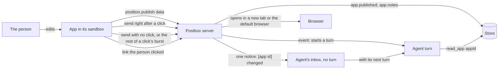

# Prototype: flexible agent apps

A prototype on its own branch, opened as a draft pull request that isn’t meant to merge as it is. After several weeks of real use, the owner found agent apps clunky and raised three issues:
1. Agents can’t see data change in an app.
2. Sharing takes several clicks: the agent builds a button that sends information back, and then the person approves it again in Postbox.
3. Isolation gives no security guarantee or benefit, so why not remove it, and allow network access?

This document says what the prototype changed, what was measured, and what to do next. Each claim names the run, file or screenshot behind it.

**Where it stands.** The branch now carries the recommendation alone: the opaque sandbox with `allow-forms`, publish and `read_app`, one click as one turn, links through the bridge, and `net.fetch` on for any app that names it (`server/net-fetch.mjs`). The flags for variants A and B were removed after the measurements below; they’re in commit 21d43a07. agent-apps.md and sandbox.md describe the new rules. To see it, send the mock librarian “Show me flexible apps” ([screenshot](flexible-apps/demo-reach.jpg)).

## What changed



**Issue 1, visibility (0 clicks).**
- `postbox.publish(data)` (in `app/kit/flex.js`) keeps the app’s current data on the app (`app.published`, up to 256 KB).
- A new agent tool, `read_app { appId }` (`server/app-flex.mjs`), returns what the app published, notes it sent on its own, and its saved state, for any app in the agent’s conversation.
- On the first change, the agent gets a notice entry (`source: 'notice'`), which never starts a turn. A burst of changes is one notice. The agent hears it with its next turn, whatever starts that turn.
- Measured in the desktop app’s pane: the person edited the reading list (Emma rated 5, Middlemarch rated 4, *Sense and Sensibility* added), then asked “What should I read next?”. The librarian’s turn read the app first and answered from the edits, with no card and “Nothing needs you” throughout ([screenshot](flexible-apps/after-read-and-one-click.jpg), the first reply).

**Issue 2, sharing (1 click).**
- A send right after the person’s click or key press in the app goes to the agent at once. There’s no limit a minute and no card (`appEvent` in `server/apps.mjs`, the `event` case in `app/js/apps.mjs`).
- A send the browser didn’t see the person make (on load, on a timer, after a long `await`) is no longer refused. It’s a note: kept on the app, folded into the same notice, read with `read_app`. There’s no turn, no line in the person’s voice, and no card (`noteApp`).
- One click starts at most one turn. A send that arrives while that app’s turn-starting event is still on its way, or within 50 ms of its answer, is the same click’s burst, and becomes a note (`sameClick` in `app/js/apps.mjs`).
- The card (`appsend`) is still reachable through an explicit `hold`, and the page never asks for one now. Removing it is a follow-up.

**Found on the way and fixed.**
- **Forms in apps never fired `submit`.** The sandbox lacked `allow-forms`, so a sandboxed form’s submission, and its `submit` event, never happened. In the pane, the reading list’s Add button and Enter did nothing until `allow-forms` was added. Then both worked ([screenshot](flexible-apps/after-reading-list-edit.jpg)). `form-action 'none'` still stops a form going anywhere. The mock asset explorer’s search box is a form, so it is likely affected on `main` too; that wasn’t checked separately.
- **Links open in a new tab** (the owner asked for this during the work). A web link in an app asks Postbox, over the bridge, to open it. Postbox opens it only right after the person’s click or key press in that app, checked as for a send. In Chrome it opens a new tab. In the Claude desktop app’s pane, Postbox’s server opens it in the default browser (`openLink`, with an argument array), because there `window.open` replaces Postbox’s own page (measured below).

## Why the approval card came back

Reproduced on `main` in the desktop app’s pane, with a probe app (`sendProbeApp` in `server/mock/flex-apps.mjs`, run on an unchanged copy of `main` plus the mock’s hook) ([screenshot](flexible-apps/before-send-probe.jpg), [the card](flexible-apps/before-burst-card.jpg)).

| What the app did | On `main` | On this branch ([screenshot](flexible-apps/after-send-probe.png)) |
|---|---|---|
| A send on load, no click | Refused | A note for the next turn |
| One click that sends 7 times | 5 sent, then 2 held on a card; the agent “needs you” | 1 sent, 6 notes |
| A fresh single click while a card is open | Held on the card (3 waiting) | Sent |
| A click, then a send 6 seconds later | Refused | A note for the next turn |

So the card came from two things:
- **The 5-a-minute limit counts sends, not clicks.** One button that sends a few events uses up the minute.
- **Once a card is open, every later send waits behind it, a real click included,** until the person answers.

What it is not:
- The pane supports `MessageEvent.userActivation`: `'userActivation' in MessageEvent.prototype` is `true`, user agent `Claude/5.11492.2 Chrome/156`.
- After the pointer hovered the frame, a click sent straight through, with no card.

Two more frictions were seen:
- A click on a frame the pointer hasn’t moved over goes to the page, not the app (`iframe.app-iframe:not(.live) { pointer-events: none }`), and so does an automated click with no hover. A real mouse usually hovers first. Touch and pen weren’t measured.
- An agent’s reply landing above an app moves it under a resting pointer.

## Isolation and network: measured

**How it was measured.**
- `tools/probe-site.mjs` stands in for another site on `127.0.0.1:4518`. Its `/login` sets three cookies: `SameSite=None; Secure`, `Lax` and `Strict`. It records whether each probe reached it and with which cookies. The same server also listened on this computer’s LAN address, `192.168.3.20:4518`.
- Postbox ran at `localhost:4517`, a different site from `127.0.0.1`, with a temp data folder and the mock agents.
- The probe app (`netProbeApp`) tries each thing on load and publishes the results. `tools/probe-apps-chrome.mjs` runs it in Google Chrome 156.0.8078.48: a fresh profile, headless, with Chrome’s popup blocker on. The same app ran in the Claude desktop app’s browser pane (Claude/5.11492.2, Chrome 156.0.8078.75).
- Each variant was a flag set when Postbox starts (`server/app-net.mjs` at commit 21d43a07; only C remains, as `server/net-fetch.mjs`):
  - **today:** the sandbox as on `main`, plus `allow-forms`;
  - **(A)** `POSTBOX_APP_NET=net`: the same opaque sandbox, with `connect-src *` and scripts, styles, fonts and images from http(s);
  - **(B)** `POSTBOX_APP_NET=open`: no sandbox, so the app is same-origin with Postbox;
  - **(C)** `POSTBOX_APP_FETCH=1`: `postbox.query('net.fetch', { url })` through Postbox’s server. It’s GET only, sends no cookies, and refuses this computer and private ranges at the socket’s DNS lookup, so rebinding can’t swap an address in. It was on in every run.

| Probe | Today, Chrome | Today, pane | A, Chrome | A, pane | B, Chrome | B, pane |
|---|---|---|---|---|---|---|
| The app’s origin | `null` | `null` | `null` | `null` | `http://localhost:4517` | `http://localhost:4517` |
| Read or change Postbox’s page | No | No | No | No | **Yes**: a banner added | **Yes** ([screenshot](flexible-apps/variant-b-pane-takeover.jpg)) |
| Read `/api/state` | No | No | No | No | **Yes**, 179,077 characters | **Yes**, 192,676 characters |
| Write to Postbox as the person (JSON POST, and a simple no-preflight POST) | No | No | No: preflight fails, and Postbox refused the simple POST | No | **Yes**, both | **Yes**, both |
| Read the page token (`document.cookie`) | No | No | No | No | `""`: it’s HttpOnly, but B sends it with every request anyway | Same |
| Fetch and read public data (CORS `*`) | No | No | **Yes** | No | **Yes** | **Yes** |
| A credentialed GET or POST, or an image, to a site the person is signed into | No | No | **Reached it with the `SameSite=None` cookie**; `Lax` and `Strict` not sent | No | Same as A, Chrome | Same as A, Chrome |
| Read a credentialed response from that site | No | No | No (CORS) | No | No (CORS) | No (CORS) |
| Read a LAN server with CORS `*`; blind POST to one without CORS | No | No | **Yes**; **reached it** | No | **Yes**; **reached it** | **Yes**; **reached it** |
| A script from another site | No | No | **Loaded and ran** | No | **Loaded and ran** | **Loaded and ran** |
| `net.fetch` of public data (C) | **Works** | **Works** | Works | Works | Works | Works |
| `net.fetch` of Postbox itself or the LAN | Refused | Refused | Refused | Refused | Refused | Refused |

In the pane under A, the stand-in site’s log shows no request from the frame at all: only `net.fetch`’s, with `Postbox-app-fetch` as the user agent.

**Popups and links.**

| What happened | Chrome (popup blocker on) | Pane |
|---|---|---|
| With `allow-popups`, an app’s `window.open` with no click | Blocked | **Replaced the Postbox tab** with the other site. Measured twice: from the hidden pre-display check frame, and on opening a conversation |
| Postbox’s own `window.open`, right after a click in the app | A new tab | **Replaced the Postbox tab** |
| This branch: no `allow-popups`; a link clicked in the app | A new tab; Postbox stays | Opened in the default browser (Safari, per the stand-in site’s log); Postbox stays |
| This branch: a link the app clicks by script, no person | Nothing opens (`tests/browser/app-flex.spec.mjs`) | Nothing opens |

### The claims, one by one

| Claim | Verdict | Measured |
|---|---|---|
| The sandbox keeps app code away from Postbox’s page and token | **Holds** | B reads all of Postbox’s state, writes as the person, and changes Postbox’s page, in both browsers. Every write route takes the same cookie. By inference, not measured: an app in B could post messages as the person, or press Allow on a permission card. |
| (a) The pane blocks requests from sandboxed pages anyway | **Holds** | A in the pane: every request blocked, none reached the stand-in site. |
| (b) Remote code makes what’s shown differ from what runs | **True, but not about safety** | A and B loaded and ran another site’s script. It matters for what `view_app`, versions and review can vouch for. The agent’s inline code is already arbitrary. |
| (c) An app can make credentialed requests to sites the person is signed into, and reach localhost and the LAN | **Holds in Chrome for A and B, narrower than stated** | Only `SameSite=None` cookies were sent; most sessions default to `Lax`. Responses couldn’t be read. LAN reads (CORS `*`) and blind writes worked. In the pane, A reached nothing. |
| (d) Data can leave without the person knowing | **Holds for A, B and C** | An image or a `net.fetch` URL carries data. Agents’ shells can already do this. |
| Owner: “there’s no security guarantee or benefit from isolation” | **Doesn’t hold** | Today against B: an app goes from no access to full control of Postbox as the person. |
| Owner: “the app can’t change HTML outside its app” | **True only because of the sandbox** | Without it (B), it did: the banner across the top of Postbox. |
| Owner: “why not allow network access?” | **Fair, through Postbox** | C gives apps public data, and works in the pane, where A can’t. |

The owner is right on one point: isolation doesn’t protect the person from the agent. An agent already runs commands as the person in its shell, with the network. What the sandbox protects is narrower and still real: Postbox’s own page, state and approvals, from code in an app. That code is written by an agent that may have read untrusted text, and in A or B it could load code from anywhere.

## Recommendation

**Keep the opaque sandbox. Take issues 1 and 2 as prototyped. Give apps the network through Postbox (C), not in the frame (A or B).**

- **B, no sandbox, gives the most and costs the most.** In the pane it’s the only variant where the frame itself has network. But any app then holds everything the person holds in Postbox. Postbox’s token and its cards rest on app code not having that.
- **A, network in the sandbox, gives nothing in the desktop app’s pane,** where the owner runs Postbox: the pane blocks it. In Chrome it adds what claim (c) warns of, and remote scripts.
- **C works in both browsers**, sends no cookies, and refuses this computer and the LAN. Its costs: GET only, 1 MB, 10 seconds, no websockets, and no request the person’s own session could make. Data can still leave in a URL, as from an agent’s shell; a line showing what was fetched would make that visible.
- **Publish and `read_app` with notices make 0 clicks the default.** The person edits, and the agent knows at its next turn. **One click is one turn**, with no limit and no card. Everything else is a note. Nothing an app does now makes the person “needs you”.

Trade-offs:
- **Bursts and real clicks.** A burst from one click becomes one turn and notes. The rule is “while its event is on its way, or within 50 ms of the answer”, so a second real click inside that window becomes a note rather than a turn. It’s never lost.
- **Abuse.** An app that sends on every key press it’s given still starts a turn per key press. The limit was the only guard against that. Watch it in real rooms before adding one back.
- **The card’s code** (`server/app-send-cards.mjs`, `app/js/app-send-card.mjs`) is now unreachable from the page. A follow-up deletes it.

## Follow-up pull requests

1. **Fix forms in apps (`allow-forms`).** It stands alone, and it fixes a bug on `main`. Check the mock asset explorer’s search box with it.
2. **`postbox.publish`, `read_app`, and the notice at the next turn.** Update agent-apps.md, “Agent-written apps”, and the guide, as this branch does.
3. **One click, one turn; other sends are notes.** Remove the 5-a-minute limit and the `appsend` card, and rewrite `tests/browser/app-send.spec.mjs` around turns and notes, as this branch starts to.
4. **Links in a new tab through the bridge**, with the server’s open for the desktop app’s pane. Update sandbox.md: never `allow-popups`, with the measurement.
5. **`net.fetch` through Postbox (C)**, with a visible line for each fetch, decided in a child of architecture.md. Update security-boundaries.md, “What it protects against”, which says apps have no network.
6. **Leave A and B out.** Record the measurements above in sandbox.md, “What it rests on”, so the question has its answer next time.

## What isn’t done

- The prototype’s rules (no limit, notes, publish, popups, `allow-forms`) aren’t in agent-apps.md, sandbox.md or security-boundaries.md yet. Those land with each follow-up.
- No real agent ran: the demo’s librarian is the mock (`server/adapters/mock-flex.mjs`), so whether a real model calls `read_app` on the notice is untested. That needs a UAT run, which wasn’t paid for here.
- Not measured: Firefox and Safari, which lack `MessageEvent.userActivation`; touch input; and a real person’s Chrome with its extensions.
- Removing the card’s code, and A and B’s flags, are for the follow-ups.

## How to run it

```bash
node tools/probe-site.mjs --port 4518
```

```bash
POSTBOX_FETCH_ALLOW=127.0.0.1:4518 node server/index.mjs --port 4517 --data <a temp folder> --demo
```

`POSTBOX_FETCH_ALLOW` lets `net.fetch` treat the local stand-in for another site as public, for the demo. Then send the librarian “Show me flexible apps” for the tour: the reading list, the chart that pulls data, and what an app can reach. “send probe” and “net probe” are the probe apps. To run the network probe in Chrome:

```bash
node tools/probe-apps-chrome.mjs
```

The tables above were measured with the variants’ flags, which commit 21d43a07 has.
