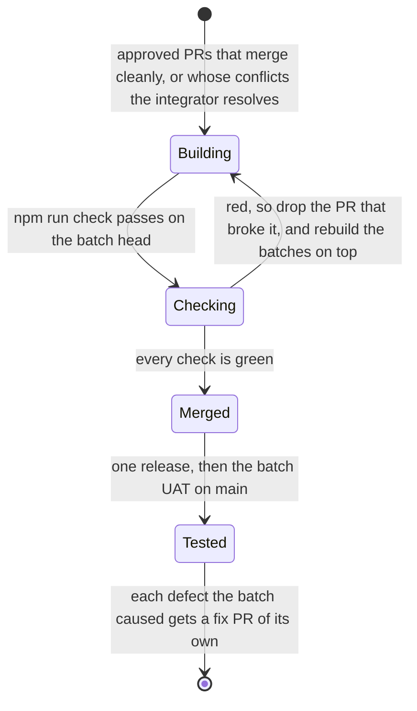

# How a pull request is reviewed

The integrator’s guide, written from what its reviews of #508’s pull requests caught (1 to 2 November 2026). Authors read it before asking for review, and readers follow it (`designs/508/execution-plan.md`, “Definition of done for a pull request”).

## How a review runs

1. State the concern in your own words. Read the PR’s overview and the issue. Write one line on what the PR claims to fix, and judge every finding against it.
2. Reproduce “fails first” yourself. Copy the new specs onto main and run them. They must fail, and for the reason the PR names. An author’s claim isn’t evidence until you’ve rerun it.
3. Probe like an adversary. Go through the checks below. For each one, try to build the input that breaks the change: a probe script, a mutant, a restart.
4. Check the PR against the others in flight. Look at what merged since it branched, and at the other open PRs: conflicts, duplicated helpers, seams.
5. Read for legibility and size. Compare Biome’s counts for main and the head, then read the new modules as a newcomer would.
6. Write it up and swap the label. Use the format in “The review comment”, below. Every claim cites a command and its exit code. Replace `ready for integrator` with `integrator approved` or `changes requested`. An approved PR then merges in the next batch (“Merging: batches”, below).

## Review rounds

Most rounds after the first were spent on the fixes, not on the original diff. Of 76 PRs reviewed from 20 to 22 November 2026, 28 (37%) were approved on their first review. Of the 56 findings in second and later reviews, 32 (57%) were new defects in the fix commits, often of the class the first review found, and 8 (14%) were base, stack or body churn. About 20 of the 43 first reviews that led to a second found an untested guard, or a spec that didn’t fail on main.

- **Authors check first.** The author’s checklist, and what a request for re-review maps, are in developing.md, “Before you ask for review”. A review that finds an item of it missing says which.
- **The first review is exhaustive.** List everything, P3s included, and sweep each finding’s class with a grep you list in the review, so the author fixes the class once. #1592 and #1574 each took another round for a case of a first finding’s class that was there at the first review.
- **A re-review checks the deltas:** each fix commit against the request’s map, the code it adds, and each finding’s class again.
- **From round 3, approve,** unless the head has a regression from main or a defect of its own that isn’t a few lines. The few-line items become integrator fixes in the batch (“Integrator fixes”, below). A defect the PR adds is never filed instead of fixed: only scope beyond the issue, and P3s, become a follow-up issue the review names.
- **One list per round.** When others review too (the room, another session), the integrator merges their findings into one numbered list on one head, each marked blocking, should fix or P3. Scope beyond the issue goes to a follow-up issue, as #1610 did. #1605’s author got two lists and worked one, and three should-fixes came back untouched.
- **Bases and stacks are the integrator’s.** Don’t ask for a rebase or a merge of `main`: the batch merges `main` and resolves conflicts, except one only the author can resolve (“Resolve conflicts for the authors”, below). Review a stacked PR for its code and approve it, and the batch takes the stack in order. Before posting, check the open PRs for overlap: #1552 made half of #1540 redundant.
- **Design PRs get the owner’s direction first.** Before a line-level review, ask the owner whether the direction is right, and check the doc’s decisions and facts against main. #1615 was redirected after its first review, and each rewrite added about four new defects. From round 3, its open questions go to the implementation issue.

## The checks

### Is the change tested?

**Does the test’s setup hide the bug?**

- How: Read the fixture before the assertions. A spec can pass only because its setup always provides the state the bug needs to be missing.
- Caught in #633. The room() fixture always set lastTurn, so no spec ran with it empty. After a restart it is empty, and answering one refusal no longer fell back to the next. The agent showed idle, which is #366’s own symptom.

**Delete a line: does anything fail?**

- How: For each guard, clear or branch the PR adds, delete it and run the whole suite. If everything still passes, that line is untested, whatever the PR body says.
- Caught in #632 and #633. Deleting rejectedOps(store).clear() left 177 specs passing, and the line hid a real stale-state bug. In #633, cutting threadsOf down to the agent’s own thread passed every spec, so side threads were never tested.

**Is every claim proved by a command?**

- How: A count of exactly 0, or a run that found nothing, says something about the harness until it’s explained. Ask how the spec could fail, and whether it ever has.
- Caught on #628. The CI failure it fixed never reproduced locally: 0 of 40 runs idle, and 0 of 30 with every core busy. So the evidence is a spec that slows each write by 50 ms and fails on the old teardown, not a green rerun.

### State and contracts

**What is in memory after a restart?**

- How: Find every Map, Set or field the change’s decision reads. Ask what it holds after a restart, a reload, or a Retry that changes the epoch. If the answer is “nothing”, derive it from the store instead.
- Caught in #633. rt.lastTurn is set only when a turn ends, so it is empty until the next turn ends.

**Who else relied on the old behavior?**

- How: When a function stops throwing, starts returning a promise, or changes shape, grep for every caller, and for every comment that describes the old behavior. A stale comment points at the reader nobody changed.
- Caught in #632. The release no longer throws for a rejected event, but the held view still did, under a comment saying it “throws here as it will at release”. While a hold lasted, every pending read of that thread threw.

**Do the docs promise more than the code does?**

- How: This matters most for security boundaries and for rules in AGENTS.md, which every later session follows. List every path the rule claims to cover, and check each one.
- Caught in #630. AGENTS.md said every path to the page goes through the new projection. Only /api/state and the live and backlog event frames did. The settings route, the create and update routes, and telemetry reports answer with state directly. That’s harmless now, but it becomes a leak once any state is private.

### Async and timing

**A function became async: does every caller await it?**

- How: Biome’s noFloatingPromises now fails this in the gate (#638). Still check that a void the PR adds means it: the promise can’t reject, or it shows its own errors.
- Caught after #628. The fixture’s done() became async, and 60 specs went on calling it bare. Every check passed. #635 fixed the calls, and #638 added the rule.

**“Waits for what’s in flight”: what starts after the wait?**

- How: Pause the code at each await on the way in, such as a stat or a read, then call the close. Whatever resumes afterwards still writes, unless it checks a closed flag.
- Caught in #629. A call paused inside queueFull’s stat held no claim and no append, so close() resolved at once. Released afterwards, the call wrote its record anyway. The doc said a caller could then safely remove the folders.

**Is a rejection handled when it happens, or only later?**

- How: A promise that rejects before any handler is attached counts as unhandled in Node, even if a .then is added later. The server has no unhandledRejection handler, so one brings it down. Attach the handler where the promise is created.
- Caught while writing #638. The three CLI adapters kept a stop’s promise and only read it when the CLI closed. A failed stop also left its turn waiting forever. The new spec caught it, even though the first fix had looked right.

### The pull request among the others

**Does it conflict with, or duplicate, work that just landed?**

- How: Run git merge-tree against main and against each open PR that touches the same files. Then ask whether a helper it adds now exists on main under another name.
- Caught in #629 and #632. #629 added a finish() teardown next to the done() that #628 had made async a day earlier, which would leave two teardowns. #632’s list of seams with #630 left out a conflict in server/live-streams.mjs.

### Legibility

**Is one decision made in two places?**

- How: Search the code for the rule the PR implements. If two files compute it, they will drift apart. Ask for one function that both call.
- Caught in #624 and #632. In #624, “the latest reply” was decided in two modules that disagreed in two cases. In #632, a rejected op’s record was built twice, with different error text each time.

**Did the PR shrink a file by splitting a concern, or by compressing it?**

- How: Sizes are a signal, not a target. Compare Biome’s counts for main and the head. Each new module should own one thing you can name, and come in under the defaults: 300 lines a file, 50 a function. Joined lines, dense one-liners and dropped names fail review even when Biome passes them. After a merge that shrinks a file, lower its ceiling.
- Done well in #633. server/card-needs.mjs holds one decision, which card an agent needs you for, and the eleven places that used to clear the need each became one line.

## The review comment

- First line: The head SHA you reviewed, and the verdict: approved or changes requested, with the one reason in a sentence.
- Does it fix the concern?: Judge it against the line from step 1, with your own rerun of the specs failing first.
- Blocking: Wrong behavior, a regression from main, or a false claim in a rule. Give the file and line, a probe or mutant that shows it, and a fix.
- Should fix: Real gaps that don’t block: an untested line, a missed caller, a missing seam.
- Separation of concerns: One concern per module, one decision in one place, nothing compressed, and the size comparison.
- Checked and sound: What you tried that held up. This shows what was covered, so the next reviewer doesn’t redo it.

## Merging: batches

The integrator merges approved pull requests into `main` in batches: it merges several into one branch, CI runs once on the branch, and the branch merges into `main`. The review above is unchanged. Each PR is reviewed and approved on its own first.

**Why.** Merged one at a time, each PR cost a full CI run, a median of 17.5 minutes for a passing pull request run on 22 November 2026, plus a rerun after each release commit moved `main`. That came to about two merges an hour, and that day twelve approved PRs waited hours. GitHub’s merge queue would do this for us, but it isn’t available here: on this repository, owned by a user rather than an organization, the API refused the `merge_queue` rule (422, invalid rule). The `merge_group` triggers #1640 added stay harmless, and ready if the repository moves to an organization (engineering-practices.md, “The gate”). #1644 is the first batch built this way.

### Build the batch

- Branch `batch/N` from `main`’s current head.
- Take approved PRs that merge cleanly with `main` and with each other (`git merge-tree`), or whose conflicts the integrator can resolve (“Resolve conflicts for the authors”, below). Take five to eight: a batch fails when any one of its PRs does, so its chance of failing grows with its size. 7 of 196 finished pull request runs of check.yml failed on 22 November (3.6%), so a batch of eight fails about a quarter of the time.
- Merge each PR at the head SHA the integrator approved, not its branch’s tip, with its own merge commit titled exactly `Merge pull request #n from <owner>/<branch>`. Then each PR’s commits and its `Fixes #n` land on `main` as they would have alone, GitHub marks the PR merged and closes its issues, and the release reads each commit.
- The next batch may be built on top of one whose CI is still running: `batch/N+1` from `batch/N`. Once batch N lands, merge `main` into it. When `batch/N` is rebuilt, rebuild `batch/N+1` on the new `batch/N`, or on `main`: merging `main` into the old one later would bring the dropped PR back.

### Resolve conflicts for the authors

- When two approved PRs conflict, the integrator resolves it in the later PR’s merge commit. The commit’s body says what each side added and what the result keeps.
- Never drop a row either side added. The shared tables, such as the held-store site tables from #1578, are where this happens most.
- A combination can break a rule no single PR did: two PRs together took one function past Biome’s limit. So run `npm run check` on the batch head, and each resolved PR’s own tests.
- Any code the integrator changes is a pure move, a conflict resolution or an integrator fix (“Integrator fixes”, below), and the batch PR’s body names each as not reviewed with the PR. A move, such as one that keeps a combined function under Biome’s limit, is its own commit on the batch branch, right after the merge it follows, never inside a merge commit: a move of code is its own commit (`AGENTS.md`, “Commits, branches and pull requests”). The merge commit holds only the conflict resolution.
- A PR whose conflict only its author can resolve waits for its author: replace `integrator approved` with `changes requested`, with a comment that says what to merge into its branch (`main`, or the PR it conflicts with once that lands).

### Integrator fixes

When a review’s finding is a few lines and the review already spells out the fix (one test, one assert, a line dropped), the integrator makes it on the batch branch instead of asking for another round. In 9 of the 15 rounds past the second on code PRs from 20 to 22 November, the item was that size.

- It’s its own commit, right after that PR’s merge commit, and its body starts “Integrator fix for #n’s review” and names the finding.
- A test or a mutant fails without it, as for any fix.
- The batch PR’s body lists the fix commits, and an independent review checks only those before the batch merges.
- A design decision, or a larger fix, goes back to the author with `changes requested`, in any round. It never becomes a follow-up issue when the PR adds the defect.

### The gate

- One pull request from `batch/N` to `main`. Its body lists each PR and each resolution.
- Before the gate, check each PR’s head is still the SHA that was approved and merged (`gh pr view <n> --json headRefOid`). A PR whose head moved leaves the batch and goes back to review: remove `integrator approved`, and the author adds `ready for integrator` when the new head is ready.
- Merge `main` into the batch first, so CI runs on `main`’s current head. `main` ahead only by release commits (`CHANGELOG.md`, `package.json` and `package-lock.json`) counts as current.
- The integrator merges it with `gh pr merge --merge --admin`, and only once every check is green.

### When a batch fails

- A failure only in CI is real until CI’s traces, counts or throttling explain it. A rerun that passes isn’t a flake verdict on its own.
- Find the PR that broke it: from the failing spec’s path, from the batch’s diff, or by running the spec on the batch and on `main`. Drop that PR, rebuild `batch/N` without it and force-push the batch branch, then rebuild any batch built on it (“Build the batch”, above). Force-push only a batch branch, never `main` or a PR’s branch.
- When the failure is `main`’s own (a flaky test, or a bug no PR in the batch touched), fix it at its cause, in its own PR with an issue, as #1627, #1633 and #1637 did.

### After the merge

- One release covers the batch: release.yml releases the commits the merge brings (engineering-practices.md, “Commits and versions”).
- Relabel each PR: one merged keeps `integrator approved`. For one dropped for breaking the batch, replace `integrator approved` with `changes requested`, with the failure in a review.
- A PR left out only because the batch was full keeps its approval and goes in the next batch.

### Batch UAT

Once a batch merges, the integrator tests its changes on `main` with real agents and real clicks, PR by PR. Batch 2’s UAT (#1650) found what its specs didn’t: #1653 and #1654.

**Agentic.**
- Pick the smallest existing scenarios (`tests/uat/e2e/scenarios/`) whose triggers exercise the batch’s visible changes. Name each PR none of them reaches.
- Run each on Claude Code and the Agent SDK, and on Codex, Kiro and Antigravity as compatibility runs (`--compat`): a compatibility scenario that covers it, or a copy that changes only its `backends:` line. Name the paths a backend can’t reach: only Claude Code asks AskUserQuestion (#1579).
- Give every run `--max-cost` with `--budget`. The agents get what’s left after the tester’s `--budget` and the verifier’s $1, and their first turn reserves $1 (tests/uat/e2e/README.md, “A run’s budget”). So set `--max-cost` to the `--budget`, plus $1 for the verifier, plus what the agents spend to reach the triggers (the scenario’s last `run.json`, or $1 a turn when it has none), plus $1 for each agent that works at the same time, since each turn at work reserves the largest turn so far ($1 before one reports). In batch 2, `--max-cost 4 --budget 2` left the agents $1 and the run stopped before step 2; `--max-cost 6 --budget 2` passed.
- Cap the batch at $20 unless the owner sets another. Batch 2 spent $6.35.
- `--max-cost` counts only dollars, so report each run’s Kiro credits and Antigravity tokens from its report, beside its cost.

**Manual.**
- Walk the steps of the UAT docs (`tests/uat/`) for each component the batch changed, against Postbox’s mock agent (`POSTBOX_BACKENDS=mock`, with a port and `--data` of your own), in Chromium, Firefox and WebKit, Playwright’s builds. Act with real clicks and key presses, arrange what the demo lacks through `tests/arrange.mjs`’s helpers, and take a screenshot at each step.
- Skip only the steps that need Chromium’s DevTools protocol. Name them, and run their spec in Chromium.
- Run the same probe on `main` before the batch. It must fail the lines each PR fixed, or it can’t tell fixed from unfixed. Batch 2’s did.

**Results.**
- For each PR: what was tested, how (agentic, manual, or neither and why), and the result per backend and engine.
- A defect found is real until explained, as a CI failure is (“When a batch fails”, above). File each with its evidence (the run’s folder or screenshots, its rate, a repro and the baseline’s result), as #1653 and #1654 did.
- A finding caught again goes up a priority, as #1591 did in batch 2. A closed one caught again is checked as a regression.

**What passing means.** Every PR’s change does what its UAT doc says on every backend and engine, and no run finds a defect the batch caused. The batch has already merged, so a failure doesn’t undo it: a defect the batch caused is fixed at its cause, in its own PR with an issue, through review and a later batch.
