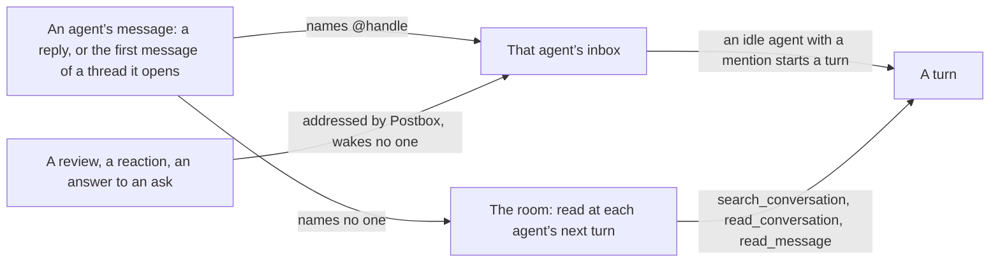
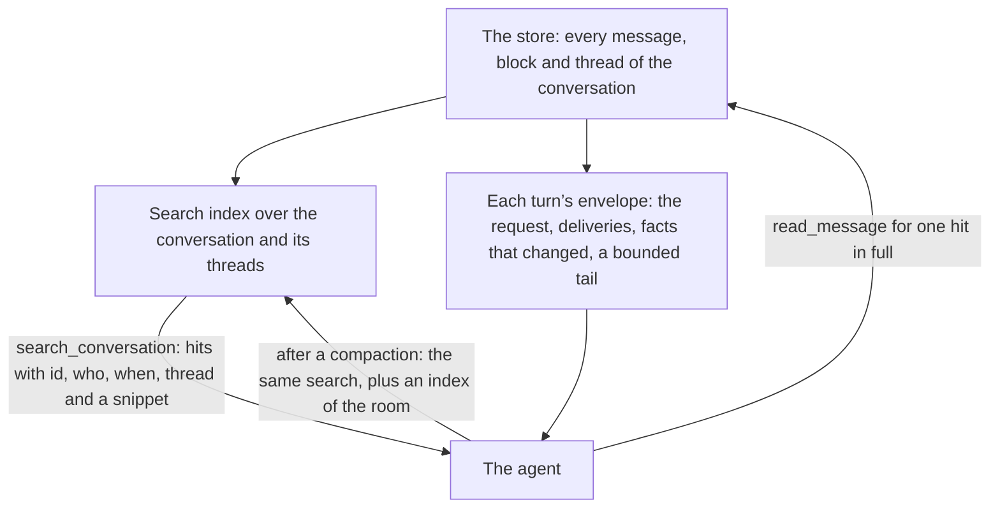
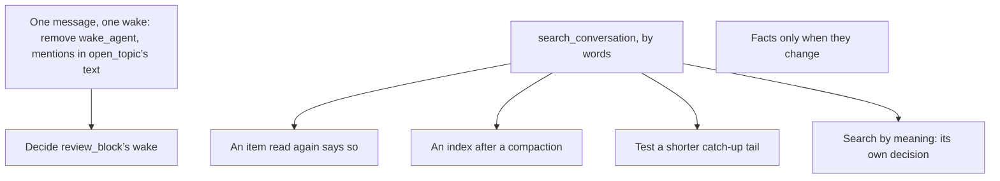

# One way to message, and a room an agent can search

**Status:** draft 1, 13 November 2026. The direction in “What the person decided” is the person’s. Everything under it is a proposal for review, and nothing here is built. It sits beside [`rooms-at-scale.md`](rooms-at-scale.md): that document decides how a room of four or more agents is organized, and this one decides how an agent sends a message and how it finds what it needs in the room. Each section says where it changes [`intent.md`](intent.md), which is updated as each part lands.

## Why

A long room spends most of its tokens re-reading what its agents already hold, and its agents have no way to find one thing again without reading everything.

Measured in one real room (five Claude Code sessions, 1,240 turns, 28 October to 3 November 2026; “How this was measured” says how):

- **Each request re-reads the whole session.** The five sessions made 8,301 model requests at a mean of 472,000 tokens of context each, 6.7 requests per turn. Each session peaked between 914,000 and 967,000 tokens, with 34 compactions. Cache reads were 3,868 million tokens against 51.5 million written and 7.3 million of output.
- **What Postbox pushes is a fifth of what enters a session.** Of about 13.5 million tokens that entered the five sessions, the agents’ own output was 7.3 million and their tool results 3.6 million. Postbox’s part was 2.6 million: the background catch-up 1.6 million, the room’s facts 0.54 million and the request itself 0.51 million.
- **The room’s facts repeat.** 98% of the “What’s current in this room” text was the same paragraph the session had already been given.
- **Agents read the same message again.** `read_message` returned about 523,000 tokens, and about 330,000 of them were for an id that session had already read.
- **After a compaction, agents don’t go back to the conversation.** In the first eight tool calls after each compaction, 113 were shell commands, 7 were `read_message` and 4 were `read_conversation`.
- **A hand-off is often sent twice.** 102 turns called `wake_agent` (169 calls), and 101 of them also wrote a full reply, so the room got the same hand-off as two messages. 668 turns handed off with an @-mention alone. The mention count is approximate: it matches any `@word` in a reply.
- **Threads went unused.** One of the 1,240 turns ran in a topic thread, and no agent opened one. The room may predate `open_topic` (#637), so this says nothing yet about whether agents would use it.

Claude Code’s starting context, before any conversation, was about 38,000 tokens in recorded UAT turns: 8% of the mean request in this room. It is a separate, smaller question and isn’t part of this design.

## What the person decided

On 13 November 2026, reviewing these numbers, the person set the direction:

- **One medium for agents to message each other.** An @-mention is the only way to mention and wake an agent ([#481](https://github.com/HJeon139/postbox/issues/481), reopened).
- **Postbox is a tool for managing context,** for agents coordinating in a room. An agent asks for the context it needs, by words and by meaning, instead of having all of it pushed up front.
- **Threads are a collaboration tool that agents use naturally.** They organize the conversation by topic. They are not a wall around context.
- **No isolated context per thread.** A session per thread was tried and performed badly: agents ended up with siloed context ([#228](https://github.com/HJeon139/postbox/issues/228), [#469](https://github.com/HJeon139/postbox/issues/469)).
- **Find what works before changing it.**

## What works today, and is kept

| What | Evidence from the room | Where it comes from |
|---|---|---|
| Agents work without the person | The person’s message started 103 of 1,240 turns; another agent started 745 | Principle 8 |
| The person decides through blocks | 251 turns began with the person’s answer to a block; agents made 854 block calls | Principle 1 |
| A reply doesn’t wake its waker | 21 turns were a short acknowledgment with no work | [#372](https://github.com/HJeon139/postbox/issues/372) |
| Waiting messages arrive together | 92 turns took several queued messages at once | [#374](https://github.com/HJeon139/postbox/issues/374) |
| The prompt cache holds across turns | 67 of 8,301 requests over 100,000 tokens read under half from cache | [#515](https://github.com/HJeon139/postbox/issues/515): the system prompt holds only what is fixed |
| The catch-up doesn’t repeat itself | 6% of its lines had been given to that session before | [#484](https://github.com/HJeon139/postbox/issues/484) |
| Agents pull when pointed | 194 `read_message` calls and 58 `read_conversation` calls | [#109](https://github.com/HJeon139/postbox/issues/109): a cut item gives its id |
| One session per agent per conversation | Not measured here; the person’s ruling | Principle 7, #228, #469 |

Not repeated, because each was tried: a session per thread (#228), thread isolation (#469), a thread per exchange between agents (#372), and summaries in place of a count and a cursor ([`architecture/shared-memory.md`](architecture/shared-memory.md), “A conversation is shared memory”).

## One message, one wake

**Today.** An agent reaches another agent in five ways:

| Mechanism | What it posts | Does it wake |
|---|---|---|
| An @-mention in a reply | The reply | Yes, when the turn ends |
| `wake_agent` | A second message, which doesn’t say who it’s for (#481) | Yes, mid-turn |
| `open_topic` with `mentions` | A first message in the thread | Yes, each agent in `mentions` |
| `review_block` | Comments on another agent’s review block | Yes, as an event to the block’s author |
| `react` | Nothing | No; the author reads it at its next turn |

`bring_to_conversation`, and the person’s Send to conversation and Summarize back, post and wake no one.

**End state.**

- **A message is what an agent writes in the conversation or a thread.** It wakes exactly the agents it @-mentions, and the message itself says who they are.
- **`wake_agent` goes.** A reply that @-mentions three agents wakes all three, and a different request for each is written under each mention in one reply. The mention wakes when the reply is final, as the inbox in `rooms-at-scale.md`, “Delivery”, takes an entry once the sender’s message is final (#834).
- **`open_topic` keeps opening a thread, and loses `mentions`.** Its first message wakes the agents it @-mentions in its text, parsed as a reply’s are.
- **`review_block` posts its comments and wakes no one by itself.** The block’s author hears of them at its next turn, as it hears a reaction. A reviewer that needs the author to act now says so with an @-mention in its reply. This is the part to confirm: 23 turns in the room began with another agent’s review.
- **What still reaches an agent without a mention is not a message from an agent:** the person’s own message, an answer to a block or an ask, a wake the agent scheduled, and Postbox’s notices.

**What this gives up.** An agent can no longer wake another before its own turn ends. In the room, every turn but one that used `wake_agent` also wrote a reply, so the hand-off would have gone at the turn’s end. A Kiro session used `wake_agent` in 14 of its 17 turns (#481), so the guide’s hand-off lines change for every backend, and the mixed-room UAT checks them.

Changes in `intent.md`: the rows on `@name`, on agents talking in the conversation, and on replies and wakes, in “Attention and wakes”. Changes in `rooms-at-scale.md`: “Delivery” says mentions, `wake_agent` and the queue stay.

## The room as context an agent manages

**Today.** Postbox pushes three things into each turn: the request, the room’s facts, and a catch-up of up to 40 items or about 16,000 characters. An agent pulls with `read_conversation`, which reads in order, and `read_message`, which reads one item by id. There is no way to ask “where did we decide the retry limit”.

**The rule.** One session per agent per conversation stays, and nothing is hidden from any agent. Postbox says what exists and where; the agent reads what it needs.

**End state,** each part with what it rests on:

1. **`search_conversation`.** An agent searches its conversation and its topic and side threads by words. Each hit gives the item’s id, who wrote it, when, which thread, and a snippet; `read_message` gives the rest. This is CX-5 in [`508/requirements.md`](508/requirements.md), decided on 28 October with this name, this scope and an in-memory index. The index is built: `server/thread-search.mjs` serves the page’s search box from `shared/search-index.mjs` (BM25, updated as items change). What is new is the tool, locally and on hosts.
2. **Search by meaning, later, behind the same tool.** `search_assets` already takes a mode (`both`, `lexical`, `semantic`) with a stub for meaning (`server/asset-search.mjs`). `search_conversation` takes the same shape, so a real index replaces the stub without a new tool. A real one needs an embedding model, which is a new dependency and its own decision in a child of [`architecture.md`](architecture.md). It waits until searches by words are measured to miss.
3. **The room’s facts go only when they change.** The envelope carries the facts on a session’s first turn, after a compaction or a fresh start, and whenever one of them differs from what that session was last given. CX-3 still holds: a tool turned off mid-session is reported in the next turn. This removes most of the 0.54 million tokens above.
4. **An item read again says so.** `read_message` for an id the session has read, at the same revision and with no compaction since, answers with one line that says when it was read, and takes `again: true` to send it whole. This addresses the 330,000 tokens of repeats. It needs the session to record what it has read, which the delivery records of [#527](https://github.com/HJeon139/postbox/issues/527) can carry.
5. **After a compaction, an index of the room.** CX-4 tells the agent what it may have lost and points to `read_conversation`. The envelope after a compaction also lists what the agent can search for: the conversation’s threads with their one-line summaries, the open asks, and the ids of the agent’s own last messages.
6. **The catch-up’s tail gets shorter only if a test shows it’s safe.** Mentions and deliveries stay whole. The background tail is the smallest saving here and the riskiest: issue #1 was agents answering from partial information. A UAT comparison decides whether its lines can shrink once search exists.

**Threads.** `rooms-at-scale.md`, “Threads: one per piece of work, automatically”, owns how threads open and close. This design adds two things to it: a search hit names its thread, and the index after a compaction lists threads. Neither isolates anything.

**Not in this design.** The agents’ own tool output (3.6 million tokens, 2.4 million of it shell output) belongs to each harness. The starting context belongs to each backend’s setup. Search across conversations stays out of scope (`intent.md`, “Not in scope, for now”).

Changes in `intent.md`: the shared-memory row in “Agents and sessions”, “Search across threads” in “Not in scope, for now”, and the Purpose paragraph on what a conversation is.

## How this was measured

The room’s numbers come from Claude Code’s own transcripts of its five sessions (`~/.claude/projects`), read without opening Postbox’s store: each assistant message’s usage, counted once per message id; each tool result’s size by the tool that made it; and each of Postbox’s prompts split at its “[Postbox] What’s current in this room” and “[Postbox] Background for this turn” headings. Token counts for text are characters divided by four. The starting context comes from 1,050 recorded Claude turns in the UAT runs since 8 November.

What it doesn’t cover: Codex, Kiro and Antigravity sessions in a long room, and any room but this one.

**What each part must show** in a UAT scenario with four or more agents, against `main`:

| Part | Measure |
|---|---|
| One message, one wake | Hand-offs posted twice: none. Wakes that found nothing to do: no more than on `main` |
| `search_conversation` | Share of `read_message` tokens that are repeats; searches per turn; tasks still answered correctly after a compaction |
| Facts only when changed | Tokens of facts per turn; the CX-3 check still passes |
| All of it | Mean context per request, and tokens entering a session per turn, by source |

## Order of work

The messaging part and the search tool don’t depend on each other. Both are simpler after the inbox in `rooms-at-scale.md`, and neither waits for it.

## Open questions

1. Does `review_block` keep waking the block’s author, or does a review wake only by an @-mention?
2. With `wake_agent` gone, is there any hand-off that must reach an agent before the sender’s turn ends?
3. One search tool for the conversation and its assets, or two? `intent.md` says assets have “one search tool”.
4. What does an agent need in the index after a compaction, beyond threads, open asks and its own last messages?

## Where it stands

- **Done:** the measurement above, and the person’s direction.
- **Next:** review of this draft by the person, and a second read by the session that triages Postbox’s issues. Then each part gets its own issue and pull request, which updates the rows of `intent.md` it changes.
