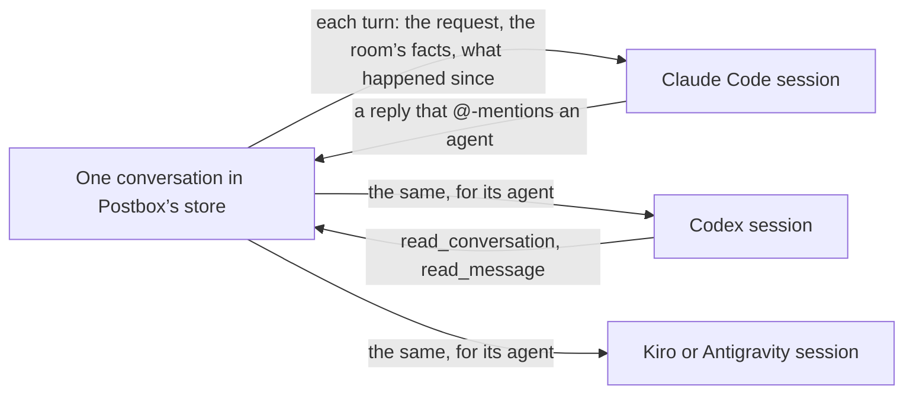

# Postbox as a context multiplexer for agent harnesses

**Status:** draft 5, 13 November 2026. The direction in “What the person decided” is the person’s; the three changes under it are proposals, and nothing here is built. Draft 3 is shorter than the first two on purpose: it keeps only changes that a measurement supports and that remove or reuse something, and it lists the rest under “Not proposed”. It sits beside [`rooms-at-scale.md`](rooms-at-scale.md), which decides how a room of four or more agents is organized.

## What Postbox does

Postbox holds one conversation and feeds it to several harnesses, each with a session of its own. That is the whole job this document is about: what goes from the one conversation into each session, and how a session asks for more.

Each harness keeps its own context, compacts it by its own rules, and re-reads all of it on every model request. Postbox can’t change that. It decides only what it puts in, and what an agent can ask for.

## What was measured

One real room: five Claude Code sessions, 1,240 turns, 28 October to 3 November 2026. “How this was measured” says how.

- **Each request re-reads the whole session.** 8,301 model requests at a mean of 472,000 tokens of context, 6.7 requests per turn. Cache reads were 3,868 million tokens, against 51.5 million written and 7.3 million of output.
- **Postbox puts in a fifth of what a session holds.** Of about 13.5 million tokens that entered the sessions, the agents’ own output was 7.3 million and their tool results 3.6 million. Postbox’s part was 2.6 million: the catch-up 1.6 million, the room’s facts 0.54 million, and the requests 0.51 million.
- **The room’s facts repeat.** 98% of that text was a paragraph the session had already been given. The largest fixed piece, 141,000 tokens, is one paragraph on sharing work that never changes (`roomText` in `server/adapters/guide.mjs`).
- **A hand-off is often sent twice.** 102 turns called `wake_agent` (169 calls), and 101 of them also wrote a full reply. 668 turns handed off with an @-mention alone; that count is approximate, since it matches any `@word`.
- **`wake_agent` rarely ran ahead of its turn’s end.** Of those 169 calls, 153 came within 60 seconds of the end of their turn, and 3 more than five minutes before it.
- **Agents can only read the conversation in order.** They called `read_message` 194 times and `read_conversation` 58 times. Nothing lets one ask where something was said.

## What the person decided

On 13 November 2026:

- **One medium for agents to message each other.** An @-mention is the only way to mention and wake an agent ([#481](https://github.com/HJeon139/postbox/issues/481), reopened). A review of an agent’s block still wakes its author: it is an action on a block, not a message.
- **Postbox manages context for a room of agents.** An agent asks for the context it needs instead of having all of it pushed up front.
- **Threads are a collaboration tool agents use naturally,** never a wall around context. A session per thread was tried and gave siloed context ([#228](https://github.com/HJeon139/postbox/issues/228), [#469](https://github.com/HJeon139/postbox/issues/469)).
- **Keep the system simple, and don’t lean on theory.** Find what works before changing it.

## What works today, and is kept

| What | Evidence from the room | Where it comes from |
|---|---|---|
| Agents work without the person | The person’s message started 103 of 1,240 turns; another agent started 745 | Principle 8 |
| The person decides through blocks | 251 turns began with the person’s answer to a block | Principle 1 |
| A reply doesn’t wake its waker | 21 turns were a short acknowledgment with no work | [#372](https://github.com/HJeon139/postbox/issues/372) |
| Waiting messages arrive together | 92 turns took several queued messages at once | [#374](https://github.com/HJeon139/postbox/issues/374) |
| The prompt cache holds across turns | 67 of 8,301 requests over 100,000 tokens read under half from cache | [#515](https://github.com/HJeon139/postbox/issues/515) |
| The catch-up doesn’t repeat itself | 6% of its lines had been given to that session before | [#484](https://github.com/HJeon139/postbox/issues/484) |
| Agents pull when pointed | The read calls above | [#109](https://github.com/HJeon139/postbox/issues/109): a cut item gives its id |
| One session per agent per conversation | The person’s ruling | Principle 7, #228, #469 |

## Three changes

Each one removes a mechanism or reuses one that exists. The first and third add no stored state; the second turned out to need some, and is on hold.

### 1. One way in: the @-mention

- **`wake_agent` goes.** A reply that @-mentions three agents wakes all three, and the message itself says who it is for.
- **`open_topic` loses its `mentions` parameter.** Its first message wakes the agents it @-mentions in its text, as a reply does.
- **Nothing else changes.** A review still wakes its block’s author, a reaction still wakes no one, and the person’s messages, answers and scheduled wakes arrive as today.

What has to change with it:
- **[#834](https://github.com/HJeon139/postbox/issues/834), open, first:** a mention handed over while its reply still streamed reached the agent cut to “I”.
- **The notice for a reply too long to hand off** tells its agent to use `wake_agent` (`server/mention-wakes.mjs`, `refusedMentions`). It says instead to post a shorter reply that @-mentions the agent.
- **What names the tool:** the guide’s lines on it, the remote shim, and the UAT scenarios that hand off with it.
- **A quoted mention wakes too.** In the first run of the search measurement, three replies quoted a seeded line that began with another agent’s `@handle`, and each woke that agent, which answered unasked. With the @-mention as the only wake, that matters more: a mention inside quoted or code text should name an agent without waking it. This needs its own issue before `wake_agent` goes.

What it gives up: an agent can no longer start an idle agent while it keeps working. In the room that mattered for 16 of 169 calls. An agent with a long job ahead ends its turn with the hand-off and schedules a wake.

Changes in `intent.md`: the rows on `@name` and on agents talking in the conversation, in “Attention and wakes”.

### 2. Say a fixed thing once: on hold

The paragraph on sharing work is the same for every agent and every turn, and it is sent with every turn. Draft 3 proposed moving it to the system prompt as a move of one string with no new state. That was wrong, found on starting to build it:

- **A resumed Claude Code session keeps the system prompt of its first request** until it compacts ([#515](https://github.com/HJeon139/postbox/issues/515), from Claude Code’s CLI reference). So every session already running would lose the paragraph: it would no longer come with the turn, and it isn’t in the prompt the session recorded. The room measured here compacted 34 times in six days across five sessions, so a session could run for days without the rule that keeps two agents from doing one task twice ([#121](https://github.com/HJeon139/postbox/issues/121)).
- **Doing it safely needs state:** a mark on each session that its recorded prompt has the paragraph, set by each of the five adapters when it starts a backend session.
- **The saving is small.** The paragraph is about 113 tokens a turn: 141,000 of the 13.5 million tokens that entered the sessions, about 1%.

It waits for the person’s call: leave it, or accept the mark on the session.

### 3. One way to find: `search_conversation`

An agent searches its conversation and its topic and side threads by words. Each hit gives the item’s id, who wrote it, when, which thread, and a snippet; `read_message` gives the rest.

- **The index exists.** `server/thread-search.mjs` already serves the page’s search box from `shared/search-index.mjs`, kept current as items change. The tool is a second reader of it.
- **It was decided.** This is CX-5 of #508, decided on 28 October with this name, this scope and an in-memory index.
- **A hit names its thread,** so an agent finds a piece of work by topic with nothing isolated.

**Built and measured** in [#1341](https://github.com/HJeon139/postbox/pull/1341) ([#1340](https://github.com/HJeon139/postbox/issues/1340)). Real agents on four harnesses were each asked, word for word, to find one item far back in a seeded room of about 1,000 items, then a second question: three runs on `main` and three on the branch (`tests/uat/e2e/scenarios/roomrecall.md`). Input tokens are what each harness reported for its asked turns, summed per run: the mean of three, with the range.

| Harness | `main` | Branch | Change | Model requests | Right answers, `main` → branch |
|---|---|---|---|---|---|
| Claude Code | 645k (361k–890k) | 425k (389k–451k) | −34% | 8.3 → 7.7 | 6 of 6 → 6 of 6 |
| Codex | 300k (229k–389k) | 187k (155k–238k) | −38% | 8.3 → 6.7 | 6 of 6 → 6 of 6 |
| Antigravity | 438k (288k–667k) | 307k (213k–440k) | −30% | 13.0 → 11.3 | 6 of 6 → 6 of 6 |
| Kiro | not reported | not reported | | | 4 of 6 → 6 of 6 |

What the runs showed beyond the table:
- **Agents took to the tool unasked.** Every harness called it in every run on the branch but one, where the Kiro agent paged instead and still answered. On `main`, the Claude Code agent tried `search_assets` in all three runs, and the Kiro agent in one, looking for a search.
- **It shrinks what enters a session.** In one pair, the Claude Code agent on `main` took a 6,636-token page of `read_conversation` to find one item; on the branch a search returned 296 tokens. Its session grew by 14,200 tokens over the run on `main` and 5,600 on the branch.
- **On Claude Code the number of requests decides the bill in a short session.** Each request re-read about 52,000 tokens before anything the agent had asked for: its starting context, and the room’s catch-up. In the first pair the branch cost 20% more than `main`, because the agent made eight requests where `main` made six. So the saving above comes from fewer and smaller requests on average, not from every run.
- **A Kiro agent did load Postbox’s tools** in all six runs ([#489](https://github.com/HJeon139/postbox/issues/489) says it may not).

What they don’t show: three runs a side is a small sample with a wide range; the scenario measures only finding one item by its words, with numbered items that let an agent on `main` jump to the right page; and no long session was measured, where a smaller footprint should matter more.

Changes in `intent.md`: “Search across threads” in “Not in scope, for now”, and the shared-memory row in “Agents and sessions”.

## Not proposed

Each of these was considered and left out, because nothing measured asks for it yet or because it adds a mechanism.

| Idea | Why it’s left out |
|---|---|
| Send the roster and the tools turned off only when they change | It needs a record, per session, of what was last given, and a way to know the session lost it. Only Claude Code reports a compaction |
| Search by meaning | It needs an embedding model, a new dependency. It waits until a search by words is measured to miss |
| A notice or an index after a compaction | Nothing shows what agents fail to find after one. The one filed loss is review thread ids ([#791](https://github.com/HJeon139/postbox/issues/791)) |
| A one-line answer when an agent reads an item again | Of 54 repeat reads, 30 were reading on through a long item. An agent that reads twice usually can’t find the item ([#499](https://github.com/HJeon139/postbox/issues/499)) |
| A shorter catch-up | Issue #1 was agents answering from partial information. It can be tried once search exists |
| A session per thread, or thread isolation | Tried and removed (#228, #469) |
| A smaller starting context | Not designed here, but the search measurement makes it the next thing to measure: a Claude Code request re-read about 52,000 tokens before any of the agent’s own reading (about 38,000 of them before any conversation, in earlier recorded turns), and the count of requests decided what a short session cost. It belongs to each backend’s setup and to the size of Postbox’s tool definitions (`search_conversation` adds about 148 tokens to every request) |

## How this was measured

The numbers come from Claude Code’s own transcripts of the room’s five sessions (`~/.claude/projects`), read without opening Postbox’s store: each assistant message’s usage, counted once per message id; each tool result’s size by the tool that made it; each of Postbox’s prompts split at its “[Postbox] What’s current in this room” and “[Postbox] Background for this turn” headings; and, for each `wake_agent` call, the time to the last assistant message before the session’s next prompt. Token counts for text are characters divided by four. 54 more `wake_agent` calls sat in turns whose end the transcripts don’t mark, and aren’t in the timing.

It covers one room and one backend. Codex, Kiro and Antigravity sessions in a long room weren’t measured.

**What each change must show,** in a UAT scenario with four or more agents, against `main`:

| Change | Measure |
|---|---|
| One way in | No hand-off posted twice, and no more wakes that found nothing to do |
| `search_conversation` | Agents use it, and read fewer pages of `read_conversation` to find one item. Measured above |

## Where it stands

- **Done:** the measurement, the person’s direction, and a second read against the backlog by the session that triages Postbox’s issues, which corrected one number and cut three parts.
- **Done:** `search_conversation`, built and measured on four harnesses (#1341, in review).
- **Next:** the person’s review of this design. Then the @-mention as the only wake, once #834 is fixed and a quoted mention no longer wakes. A long-session measurement of search, and the starting context, are the open measurements.
