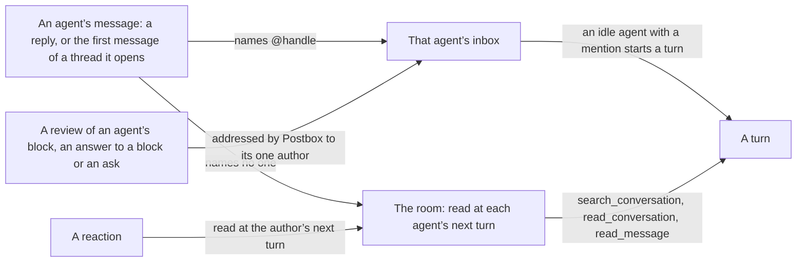
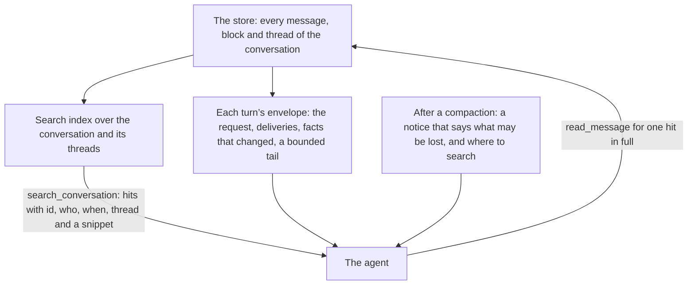
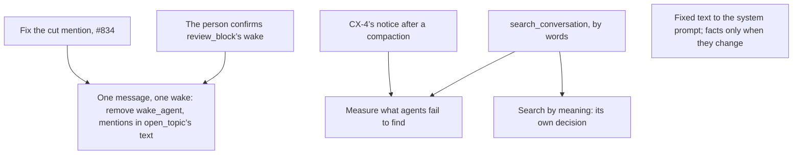

# One way to message, and a room an agent can search

**Status:** draft 2, 13 November 2026, after a second read by the session that triages Postbox’s issues (“What the second read changed”). The direction in “What the person decided” is the person’s. Everything under it is a proposal for review, and nothing here is built. It sits beside [`rooms-at-scale.md`](rooms-at-scale.md): that document decides how a room of four or more agents is organized, and this one decides how an agent sends a message and how it finds what it needs in the room. Each section says where it changes [`intent.md`](intent.md), which is updated as each part lands.

## Why

A long room spends most of its tokens re-reading what its agents already hold, and its agents have no way to find one thing again without reading everything.

Measured in one real room (five Claude Code sessions, 1,240 turns, 28 October to 3 November 2026; “How this was measured” says how):

- **Each request re-reads the whole session.** The five sessions made 8,301 model requests at a mean of 472,000 tokens of context each, 6.7 requests per turn. Each session peaked between 914,000 and 967,000 tokens, with 34 compactions. Cache reads were 3,868 million tokens against 51.5 million written and 7.3 million of output.
- **What Postbox pushes is a fifth of what enters a session.** Of about 13.5 million tokens that entered the five sessions, the agents’ own output was 7.3 million and their tool results 3.6 million. Postbox’s part was 2.6 million: the background catch-up 1.6 million, the room’s facts 0.54 million and the request itself 0.51 million.
- **The room’s facts repeat.** 98% of the “What’s current in this room” text was the same paragraph the session had already been given.
- **Reading one long item takes several calls.** `read_message` returned about 523,000 tokens. 54 of its calls were for an id that session had already read: 30 of them asked for a later part of a long item (`from`), and 24 repeated a call exactly. Three of the 54 came after a compaction.
- **After a compaction, agents don’t go back to the conversation.** In the first eight tool calls after each compaction, 113 were shell commands, 7 were `read_message` and 4 were `read_conversation`. This shows what they did, not what they failed to find.
- **A hand-off is often sent twice.** 102 turns called `wake_agent` (169 calls), and 101 of them also wrote a full reply, so the room got the same hand-off as two messages. 668 turns handed off with an @-mention alone. The mention count is approximate: it matches any `@word` in a reply.
- **`wake_agent` rarely ran ahead of its turn’s end.** Of those 169 calls, 153 came within 60 seconds of the end of their turn, 13 between one and five minutes before it, and 3 more than five minutes before it.
- **Threads went unused.** One of the 1,240 turns ran in a topic thread, and no agent opened one. The room may predate `open_topic` (#637), so this says nothing yet about whether agents would use it.

**Counted per request, not once.** A token that enters a session is read again by every later request until a compaction drops it, so what matters is what each request carries. Claude Code’s starting context, before any conversation, was about 38,000 tokens in recorded UAT turns. That is 8% of the mean request here, about 315 million tokens read over the room, and more than the room’s facts cost. It belongs to each backend’s setup and to the size of Postbox’s own tool definitions, so a change that adds to those definitions is measured per request before it merges. It isn’t designed here.

## What the person decided

On 13 November 2026, reviewing these numbers, the person set the direction:

- **One medium for agents to message each other.** An @-mention is the only way to mention and wake an agent ([#481](https://github.com/HJeon139/postbox/issues/481), reopened).
- **Postbox is a tool for managing context,** for agents coordinating in a room. An agent asks for the context it needs, by words and by meaning, instead of having all of it pushed up front.
- **Threads are a collaboration tool that agents use naturally.** They organize the conversation by topic. They are not a wall around context.
- **No isolated context per thread.** A session per thread was tried and performed badly: agents ended up with siloed context ([#228](https://github.com/HJeon139/postbox/issues/228), [#469](https://github.com/HJeon139/postbox/issues/469)).
- **Find what works before changing it.**

## What works today, and is kept

| What | Evidence from the room | Where it comes from |
|---|---|---|
| Agents work without the person | The person’s message started 103 of 1,240 turns; another agent started 745 | Principle 8 |
| The person decides through blocks | 251 turns began with the person’s answer to a block; agents made 854 block calls | Principle 1 |
| A reply doesn’t wake its waker | 21 turns were a short acknowledgment with no work | [#372](https://github.com/HJeon139/postbox/issues/372) |
| Waiting messages arrive together | 92 turns took several queued messages at once | [#374](https://github.com/HJeon139/postbox/issues/374) |
| The prompt cache holds across turns | 67 of 8,301 requests over 100,000 tokens read under half from cache | [#515](https://github.com/HJeon139/postbox/issues/515): the system prompt holds only what is fixed |
| The catch-up doesn’t repeat itself | 6% of its lines had been given to that session before | [#484](https://github.com/HJeon139/postbox/issues/484) |
| Agents pull when pointed | 194 `read_message` calls and 58 `read_conversation` calls | [#109](https://github.com/HJeon139/postbox/issues/109): a cut item gives its id |
| One session per agent per conversation | Not measured here; the person’s ruling | Principle 7, #228, #469 |

Not repeated, because each was tried: a session per thread (#228), thread isolation (#469), a thread per exchange between agents (#372), and summaries in place of a count and a cursor ([`architecture/shared-memory.md`](architecture/shared-memory.md), “A conversation is shared memory”).

## One message, one wake

**Today.** An agent reaches another agent in five ways:

| Mechanism | What it posts | Does it wake |
|---|---|---|
| An @-mention in a reply | The reply | Yes, when the turn ends |
| `wake_agent` | A second message, which doesn’t say who it’s for (#481) | Yes, mid-turn |
| `open_topic` with `mentions` | A first message in the thread | Yes, each agent in `mentions` |
| `review_block` | Comments on another agent’s review block | Yes, as an event to the block’s author, the one recipient it names |
| `react` | Nothing | No; the author reads it at its next turn |

`bring_to_conversation`, and the person’s Send to conversation and Summarize back, post and wake no one.

**End state.**

- **A message is what an agent writes in the conversation or a thread.** It wakes exactly the agents it @-mentions, and the message itself says who they are.
- **`wake_agent` goes.** A reply that @-mentions three agents wakes all three, and a different request for each is written under each mention in one reply. The mention wakes when the reply is final, as the inbox in `rooms-at-scale.md`, “Delivery”, takes an entry once the sender’s message is final (#834).
- **`open_topic` keeps opening a thread, and loses `mentions`.** Its first message wakes the agents it @-mentions in its text, parsed as a reply’s are.
- **`review_block` keeps its wake, for the person to confirm.** A review isn’t a message: it is an action on one block, and Postbox addresses it to that block’s author, as it addresses the person’s answer to a block ([#133](https://github.com/HJeon139/postbox/issues/133)). #481’s defect was a message that names no recipient, and a review names exactly one. Without the wake, a reviewer would add a reply that @-mentions the author and repeats the review, which is the double hand-off this design removes. 23 turns in the room began with another agent’s review, and sprint 1 missed a “changes requested” review for 11 hours (`rooms-at-scale.md`, “Why”). The other reading of the person’s direction is that a review wakes only by an @-mention; “Open questions” asks.
- **What still reaches an agent without a mention is not a message from an agent:** the person’s own message, an answer to a block or an ask, a review of its block, a wake the agent scheduled, and Postbox’s notices.
- **An acknowledgment is a reaction,** which wakes no one ([#331](https://github.com/HJeon139/postbox/issues/331)).

**What it depends on.**
- **[#834](https://github.com/HJeon139/postbox/issues/834), open:** a mention handed over while its reply still streamed reached the agent cut to “I”. With mentions the only wake, that is fixed first.
- **A reply too long to hand off.** A reply over 50,000 characters wakes no one, and the notice tells its agent to hand off with `wake_agent` (`server/mention-wakes.mjs`, `refusedMentions`). The notice instead says to post a shorter reply that @-mentions the agent with only what it needs.
- **What names `wake_agent` today:** the guide’s “or use wake_agent” (`server/adapters/guide.mjs`, `turnFacts`) and its Codex writing lines, the remote shim, and the UAT scenarios that hand off with it.

**What this gives up.** An agent can no longer start an idle agent while it keeps working. In the room, 153 of 169 calls came within a minute of their turn’s end, so most hand-offs lose nothing; 16 came earlier, 3 of them by more than five minutes. No issue records a hand-off that had to arrive mid-turn: [#470](https://github.com/HJeon139/postbox/issues/470) and [#472](https://github.com/HJeon139/postbox/issues/472) are closed as not planned. An agent with a long job ahead of it ends its turn with the hand-off and schedules a wake, as `rooms-at-scale.md`, “Delivery”, already asks. A Kiro session used `wake_agent` in 14 of its 17 turns (#481), so the guide’s hand-off lines change for every backend, and the mixed-room UAT checks them.

Changes in `intent.md`: the rows on `@name`, on agents talking in the conversation, and on replies and wakes, in “Attention and wakes”. Changes in `rooms-at-scale.md`: “Delivery” said mentions, `wake_agent` and the queue stay; it now says `wake_agent` goes.

## The room as context an agent manages

**Today.** Postbox pushes three things into each turn: the request, the room’s facts, and a catch-up of up to 40 items or about 16,000 characters. An agent pulls with `read_conversation`, which reads in order, and `read_message`, which reads one item by id. There is no way to ask “where did we decide the retry limit”.

**The rule.** One session per agent per conversation stays, and nothing is hidden from any agent. Postbox says what exists and where; the agent reads what it needs.

**End state,** each part with what it rests on:

1. **`search_conversation`.** An agent searches its conversation and its topic and side threads by words. Each hit gives the item’s id, who wrote it, when, which thread, and a snippet; `read_message` gives the rest. This is CX-5 in [`508/requirements.md`](508/requirements.md), decided on 28 October with this name, this scope and an in-memory index. The index is built: `server/thread-search.mjs` serves the page’s search box from `shared/search-index.mjs` (BM25, updated as items change). What is new is the tool, locally and on hosts. It is its own tool, beside `search_assets`: a conversation’s items and a room’s files are different things to cite. A Kiro agent may never load Postbox’s tools ([#489](https://github.com/HJeon139/postbox/issues/489)), so search reaches Kiro only once that is fixed.
2. **Fixed text moves to the system prompt, and the rest of the room’s facts go only when they change.** In the room, the facts were about 543,000 tokens: the tools turned off 147,000, the fixed paragraph on sharing work 141,000 (`roomText` in `server/adapters/guide.mjs`), the roster about 113,000, the other agents 39,000, and the session and project lines about 50,000. The fixed paragraph is the same for every persona and turn, so it belongs in the system prompt, which #515 keeps for what is fixed. The roster, the brief, the session’s facts and the tools turned off go on a session’s first turn, after a fresh start, after a compaction the backend reports, and whenever one differs from what that session was last given. CX-3 still holds: a tool turned off mid-session is reported in the next turn. Only Claude Code reports a compaction today (`server/adapters/claude-stream.mjs`, `compact_boundary`), so on Codex, Kiro and Antigravity the facts keep going every turn until each reports one.
3. **CX-4’s notice is built first.** The #508 design says the envelope after a compaction tells the agent that earlier messages may have been summarized and points to `read_conversation` (`508/design.md`, “Context loss (CX-4)”). It isn’t built: `508/requirements.md` marks it “Not in rev 6”, and a compaction posts only the person’s divider. With `search_conversation` it also points there. What agents fail to find after a compaction is measured after that, not guessed: the one filed loss is review thread ids ([#791](https://github.com/HJeon139/postbox/issues/791)).
4. **Search by meaning, later, behind the same tool.** The person asked for it. `search_assets` already takes a mode (`both`, `lexical`, `semantic`) with a stub for meaning (`server/asset-search.mjs`), and `search_conversation` takes the same shape, so a real index replaces the stub without a new tool. A real one needs an embedding model, which is a new dependency and its own decision in a child of [`architecture.md`](architecture.md). The second read would leave it out until a search by words is measured to miss; “Open questions” asks.

**Considered, and not proposed.** Draft 1 had three more parts. Each is left out until evidence asks for it:

| Part | Why it’s left out |
|---|---|
| `read_message` answers in one line for an item already read | Draft 1 read 330,000 tokens as repeats. 30 of the 54 repeat calls were reading on through a long item, not repeating. An agent that reads an item twice usually can’t find it, and a one-line answer costs a second request at the session’s full context. Agents asked a sender to resend rather than follow a pointer ([#499](https://github.com/HJeon139/postbox/issues/499)), and Postbox can’t see a compaction on three backends |
| An index of the room after a compaction | Nothing shows what agents fail to find, and it needs CX-4’s notice first |
| A shorter catch-up tail | The smallest saving and the riskiest: issue #1 was agents answering from partial information. It waits for search, and for the lines that name who a message was to ([#1334](https://github.com/HJeon139/postbox/pull/1334)) |

**Threads.** `rooms-at-scale.md`, “Threads: one per piece of work, automatically”, owns how threads open and close. This design adds one thing to it: a search hit names its thread, so an agent finds work by topic without anything being isolated.

**Not in this design.** The agents’ own tool output (3.6 million tokens, 2.4 million of it shell output) belongs to each harness. The starting context belongs to each backend’s setup. Search across conversations stays out of scope (`intent.md`, “Not in scope, for now”).

Changes in `intent.md`: the shared-memory row in “Agents and sessions”, and “Search across threads” in “Not in scope, for now”.

## How this was measured

The room’s numbers come from Claude Code’s own transcripts of its five sessions (`~/.claude/projects`), read without opening Postbox’s store: each assistant message’s usage, counted once per message id; each tool result’s size by the tool that made it; each of Postbox’s prompts split at its “[Postbox] What’s current in this room” and “[Postbox] Background for this turn” headings; and, for each `wake_agent` call, the time to the last assistant message before the session’s next prompt. Token counts for text are characters divided by four. 54 more `wake_agent` calls sat in turns whose end the transcripts don’t mark, and aren’t in the timing. The starting context comes from 1,050 recorded Claude turns in the UAT runs since 8 November.

What it doesn’t cover: Codex, Kiro and Antigravity sessions in a long room, and any room but this one.

**What each part must show** in a UAT scenario with four or more agents, against `main`:

| Part | Measure |
|---|---|
| One message, one wake | Hand-offs posted twice: none. Wakes that found nothing to do: no more than on `main` |
| `search_conversation` | Searches per turn; `read_conversation` pages read to find one item; tasks still answered correctly after a compaction |
| Facts only when changed | Tokens of facts per turn; the CX-3 check still passes |
| All of it | Tokens read per request, by source, and requests per turn |

## Order of work

The messaging part and the search tool don’t depend on each other. Both are simpler after the inbox in `rooms-at-scale.md`, and neither waits for it.

## Open questions

1. Does `review_block` keep waking the block’s author, as this draft recommends, or does a review wake only by an @-mention?
2. Is search by meaning designed now, as its own decision, or only once a search by words is measured to miss?
3. Do Codex, Kiro and Antigravity sessions in a long room look like the Claude Code ones measured here?

## What the second read changed

The session that triages Postbox’s issues read draft 1 against the backlog on 13 November 2026. Each point below was checked in the code or the issue before it changed the draft.

- **Two facts corrected:** CX-4’s notice isn’t built, and only Claude Code reports a compaction.
- **One number corrected:** the 330,000 tokens of repeated `read_message` calls were mostly an agent reading on through a long item. The part built on it is left out.
- **`review_block` keeps its wake** in the draft, with the other reading left to the person.
- **`wake_agent`’s timing is measured,** and what its removal depends on is listed: #834, the too-long refusal, and what names the tool today.
- **Fixed text goes to the system prompt,** rather than being sent once per change.
- **Cost is counted per request,** which makes the starting context larger than the room’s facts.
- **Three parts are left out** until evidence asks for them.

## Where it stands

- **Done:** the measurement above, and the person’s direction.
- **Done:** a second read against the backlog, taken into draft 2.
- **Next:** the person’s review, and their answers to the open questions. Then each part gets its own issue and pull request, which updates the rows of `intent.md` it changes.
