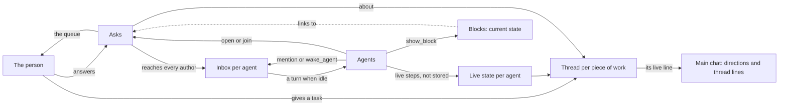
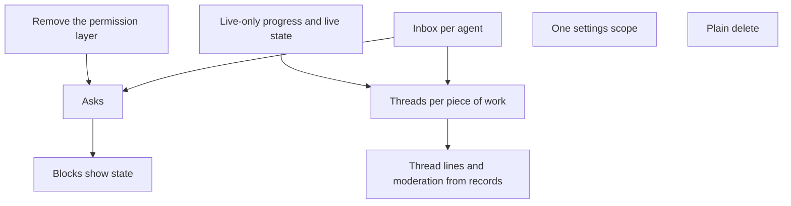

# Rooms at scale: the end state

**Status:** draft 1, 10 November 2026. The direction in “What the person decided” is the person’s. The designs under it are proposals for review, and nothing here is built yet. It is the design of record for how a room works with four or more agents, and it replaces patching each feature on its own. Each section says where it changes [`intent.md`](intent.md), and that document is updated as each part lands.

## Why

After four sprints and about 430 merged pull requests, the bugs that matter most still come from Postbox’s own mechanisms, not from the backends or the visuals. A review of the 200 merged fixes and 369 bugs (10 November 2026) put about 2.5% of fixes on true backend quirks, and most of the rest on delivery, turn state, the permission layer and the UI rebuilding as events arrive. Each fix added a mechanism instead of removing the one that caused the problem: holds led to cards, cards to held messages, and held messages to bugs after a restart.

What a busy room looks like, measured:
- **The person can’t see what agents are doing.** In the UAT run `2026-11-06T03-36-37-p0` (three agents, 132 turns in 36 minutes), a typical turn showed only a ring for its first 3 s, and no text for the first half of its time (753 of 1,482 agent-seconds in turns under a minute). The only live signal is one row at the end of the transcript, out of view once you scroll up. Postbox’s own tools, half the tool calls, never appear as steps. The tester, acting as the person, asked the agents for status instead (“is the job still running”), and those questions waited about 3 minutes in the queue, behind the turns they asked about.
- **The main chat is one stream.** In the same run the main chat took 60 agent messages, about 66,000 characters, in 5 minutes, with the three agents speaking in strict rotation. 18 of @developer’s 25 turns were some form of “nothing for me”. Agents opened no threads; the person opened both, and both turned into loops of acknowledgments.
- **Delivery isn’t visible or trusted.** One card waiting for the person held every agent’s mentions from 08:33 to 15:49 UTC on 29 October ([sprint 1 retro](https://github.com/HJeon139/postbox/blob/wip/sprint1-retro/experiments/sprint1-retro/retro/aggregate.md)). One held wake left every agent in a room waiting about 7.5 hours ([#1035](https://github.com/HJeon139/postbox/issues/1035)). Sprint 2 counted about 56 “messages crossed” in one room with no threads ([sprint 2 retro](https://github.com/HJeon139/postbox/blob/wip/sprint2-retro/experiments/sprint2-retro/retro/aggregate.md)).
- **Asks are many, separate and stale.** In sprint 3, 48 cards came in one evening, 44 of them for git or gh ([sprint 3 retro](https://github.com/HJeon139/postbox/blob/wip/sprint3-retro/experiments/sprint3-retro/retro/aggregate.md)). Every lead asked separately for the same kinds of writes, and approvals were re-asked after a head moved.
- **Dead turns look like quiet ones.** In sprint 4, subagents died on a usage block and left uncommitted fixes in three worktrees, and turns ended as empty messages ([sprint 4 retro](https://github.com/HJeon139/postbox/blob/wip/sprint4-retro/experiments/sprint4-retro/retro/aggregate.md)).
- **A person moderated every room by hand**: check-ins every 30 minutes, relayed approvals, chased stalled agents, and hand-built boards. In sprint 1 that role still missed a “changes requested” review for 11 hours, because it swept comments by time window ([researcher’s sprint 1 retro](https://github.com/HJeon139/postbox/blob/wip/sprint1-retro/experiments/sprint1-retro/retro/researcher.md)).

UAT rooms run Haiku agents, at most three of them, so these numbers are a floor. The sprints ran 4 to 12 agents and saw the same failures, larger.

## What the person decided

On 10 November 2026, reviewing this analysis, the person set the direction:
- **Core, and kept:** the five backends, remote hosts, visual-first (catalog blocks, apps, diagrams and the app check), UAT and telemetry, Postbox’s cards and automatic Markdown rendering, and mention, wake and queue as how agents work together.
- **Transparency first.** Showing what each agent is doing while its turn runs is the problem to solve, and it gets worse with four or more agents.
- **Mention, wake and queue are redesigned for the end state,** not patched.
- **Threads organize the conversation automatically,** one per topic, instead of one large stream in the main chat.
- **Needs you is an interface, not a ping.** Several agents can write one request to the person together.
- **Blocks show current state, and a click doesn’t change them.**
- **Delete is just delete,** with no archive.
- **Settings are complex because they’re inconsistent,** not because there are many of them.
- **Postbox’s own permission layer goes.** The harness decides, and Postbox shows the tool calls (principle 8).
- **Scale targets stay at 10 to 100 times real use** (#1155).

## How the parts fit

Each part below answers one of the failures above, and they lean on each other: a thread gives an ask its subject and the inbox a place to deliver, live state gives each thread its line, and asks take input off blocks. That is why fixing each feature alone kept making new bugs.

## Live state: what each agent is doing

**Today.** Every text delta and step is written to the store, and live progress (`toolCalls`, `subagents`, `glimpse`) is written as session patches. In the UAT run `2026-11-08T06-08-26-real-q1`, progress was about half the event log. Yet the page shows little of it while a turn runs: one row at the end of the transcript, steps clipped to 200 and 1,200 characters, and nothing for Postbox’s own tool calls.

**The harness’s transcript isn’t the record.** Other agents, search and catch-up read replies across backends, so an agent on Codex can’t depend on a Claude transcript. Claude Code deletes its transcripts after 30 days by default ([`architecture.md`](architecture.md), “Files and cleanup”), Antigravity keeps an SQLite file, and on a host every transcript stays on the host. Raw streams are 4 to 10 times the size of the event log.

**End state.**
- **Postbox keeps what is the conversation:** messages, replies, blocks, asks, deliveries and the Work ledger. Markdown rendering and cards stay as they are.
- **Progress is live only.** Steps, partial text, thinking and subagents go to the page on a stream that isn’t stored. The server keeps a small buffer per running turn for a page that reconnects, and writes one record of the turn’s steps when it ends.
- **Because nothing in it is stored, the live view can show more:** each tool and its input, a tail of its output, the agent’s use of Postbox’s own tools, and how long each step has run.
- **Each agent’s state is always in view,** wherever you’ve scrolled: running (and its current step), waiting on a job, waiting on another agent, waiting on you, failed, or done. It is derived from records, never from what an agent said in chat.
- **A turn that dies says so,** with what it held, instead of ending as an empty message.
- **Status questions don’t wake agents.** “Is the job still running” is answered from the agent’s state and its jobs, which Postbox already tracks.

Changes in `intent.md`: the Work rows on the per-turn list, the Layout row on the agent tree, and “The loop”.

## Threads: one per piece of work, automatically

**Today.** Threads are opened by hand. Side threads, which opened on their own for every exchange, hid the work (#372), and a single room crossed messages about 56 times in a sprint. Agents find what is addressed to them through catch-up summaries that cut items at 2,000 characters.

**End state.**
- **A thread opens for each piece of work:** when the person gives agents a task, or when a hand-off names an issue, a pull request or a block. Agents’ back-and-forth about it stays in that thread.
- **The main chat holds the person’s directions and one live line per thread:** who is in it, its state from live state, what it’s waiting on, and its last result. You see every thread’s state without opening it, which is what #372’s side threads lacked.
- **Moderation comes from records:** which thread is stalled, who must act next, what is done. It is the job a person did by hand in every sprint.
- **Agents still read the whole conversation** through `read_conversation`, so no work is hidden from them (#469).
- **Legacy side threads become read-only topic threads.**

Open question: exactly what opens a thread, and what closes one. A first rule to test in UAT: a person’s message that wakes agents opens a thread unless it is sent inside one, and a thread closes when its work is merged or the person closes it.

Changes in `intent.md`: the topic thread rows in “Agents and sessions”, the side thread row in “Attention and wakes”, and the right pane row in “Layout”.

## Delivery: mention, wake and queue on one inbox

**Today.** A message for a busy agent is queued once for all its recipients. One open card holds up to 20 other wakes. Holds kept only in memory are lost on restart. A queued wake takes its sender’s newest post in place of the older one. Turn input is a catch-up summary in which a mention can be cut or given twice. These produced #594, #1149, #1146, #1136, #484, #834 and #1108, among others.

**End state.** Mentions, `wake_agent` and the queue stay. Underneath them, each agent has one stored inbox per conversation.
- **A message addressed to an agent becomes an entry in its inbox** once the sender’s message is final, not while it streams (#834). A person’s mention, an agent’s mention, `wake_agent`, an answer to an ask and a scheduled wake all arrive the same way.
- **An idle agent with entries starts a turn.** Its input is its entries, whole and in order, with sender, time and thread, within a per-turn size budget. The rest of the room since its last turn comes after, as a bounded tail with a pointer to `read_conversation`.
- **Nothing is held, merged or dropped.** A newer post from the same sender is noted on the waiting entry (“@x posted since”) rather than replacing it. No card holds other messages.
- **The sender sees each entry’s state:** waiting behind @x’s turn since a given time, delivered, or failed.
- **A turn that fails to start leaves its entries waiting.** A network failure after the harness accepted the turn reopens them once, marked as a resend (#466). A failed session doesn’t restart on its own in a loop.
- **Fewer wakes for nothing.** An acknowledgment wakes no one: agents react instead (#331). An agent waiting on a long job ends its turn and sets a scheduled wake, so it doesn’t hold its queue. While a turn runs, its tool results say how many entries are waiting.
- **The chain cap stays (principle 6)** as a count. At the cap, entries still arrive, but no new turn starts until the person acts, shown as one line with Continue.
- **Postbox’s own notices** (“your mention woke no one”) are entries that start no turn and ride the next one.
- **Retries carry an id,** so a page’s resend or a host’s replayed tool call is stored once (#1138).

This is #508’s A2 to A4 (#527 to #529), made smaller. It drops A1’s held wakes and the revisions of sent entries.

Changes in `intent.md`: most of “Attention and wakes”: the wake card, chain limit and batching rows are replaced.

## Asks: needs you as an interface

**Today.** “Needs you” is a field on each session, set in five places, with eight kinds, six of them about Postbox’s own mechanisms. Each agent asks on its own, so the person approves the same kind of thing many times, and an answer can reach an outdated draft.

**End state.**
- **An ask is a record:** the question, what it is about (a thread, a pull request at a given head, a block), its options or content, and its authors.
- **Agents write it together.** An agent with the same need joins the open ask on that subject instead of opening another, adding its part. The person answers once.
- **Needs you is the person’s queue of open asks,** batched by thread. ⌃J, the Next button and the rings read it.
- **An ask goes stale when its subject changes,** such as a new head, and says so instead of taking an answer meant for the old one.
- **The answer reaches every author** as an inbox entry.
- **What remains as needs you:** asks, a failed turn, and the harness’s own question when it asks. Wake, hop, add-agent, app send and permission cards go.

Changes in `intent.md`: the needs-you rows in “Attention and wakes”, and principle 2’s “needs you”.

## Blocks: show current state

**Today.** In the p0 run, two agents wrote the same table id 2 s apart, it took 6 revisions in 2:45, a review update was refused over the person’s answer, and the person approved twice because they couldn’t tell their first answer had landed. Most block bugs come from agents’ input and mistakes, and from revisions racing answers.

**End state.**
- **A block is a view of state that its author owns.** It shows the latest state, and the person’s click never changes it.
- **Input goes to an ask.** A block that needs a decision links to its ask, and the person’s answer is recorded there, visibly, once.
- **Postbox assigns block ids,** so two agents can’t write the same block by accident.
- **A malformed block shows what was wrong** to its author, and the person sees its plain fallback.

Changes in `intent.md`: the block update and answer rows in “Dynamic UI”.

## Settings: one scope

**Today.** The rail’s quick panel changes model and effort for one conversation, but permission mode and tools for the persona everywhere. The persona sheet changes everything for the persona, and `/model` is a third way. `intent.md` says persona edits apply only to new sessions, while the code applies most of them at once. The sprints found models, backends and efforts shown that weren’t the ones running.

**End state.**
- **A persona’s settings are edited in one place,** the persona sheet.
- **Every change applies from the agent’s next turn,** always, and the agent’s state says when it took effect.
- **The rail shows what is running,** read from the session, with a link to the sheet. It doesn’t edit.
- **A backend failure shows once,** on the backend, not as one message from every agent that hit it.

Changes in `intent.md`: the quick panel and persona rows in “Layout” and “Agents and sessions”.

## Delete

Delete removes the conversation, session or persona at once. There is no archive and no Undo window, so nothing holds deliveries while a delete is pending ([#604](https://github.com/HJeon139/postbox/issues/604), [#599](https://github.com/HJeon139/postbox/issues/599)). A confirm says what goes.

## The permission layer

Postbox’s own modes, cards, rules panel, request judge, push on request and the Antigravity hook go. Each backend runs in its harness’s own mode, with deny rules where the harness has them, and Postbox shows every tool call in live state and Work. Whether Antigravity honors deny rules while skipping permissions is untested, and is checked first (#465).

## Order of work

The store work under #1155 and #1210 continues alongside, since it doesn’t depend on these.

## Where it stands

- **Done:** the analysis above, and the person’s direction.
- **Next:** review this draft. Then each part gets its own pull request, which updates the rows of `intent.md` it changes, and a UAT scenario with four or more agents that measures what each part claims: time before anything shows in a turn, messages crossed, wakes that found nothing to do, and asks per decision.
