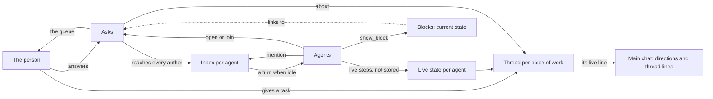
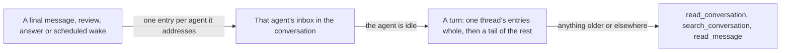
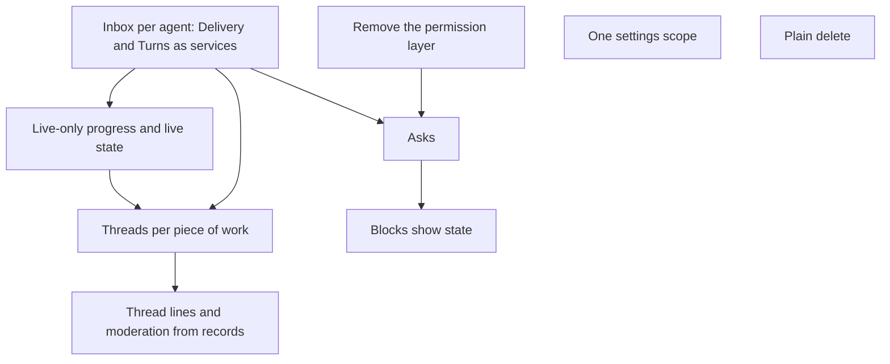

# Rooms at scale: the end state

**Status:** draft 1, 10 November 2026. The direction in “What the person decided” is the person’s. The designs under it are proposals for review. Of them, live state is partly built (#1239, “Live state”, below) and the inbox is designed (#1364); nothing else is built yet. It is the design of record for how a room works with four or more agents, and it replaces patching each feature on its own. Each section says where it changes [`intent.md`](intent.md), and that document is updated as each part lands.

## Why

After four sprints and about 430 merged pull requests, the bugs that matter most still come from Postbox’s own mechanisms, not from the backends or the visuals. A review of the 200 merged fixes and 369 bugs (10 November 2026) put about 2.5% of fixes on true backend quirks, and most of the rest on delivery, turn state, the permission layer and the UI rebuilding as events arrive. Each fix added a mechanism instead of removing the one that caused the problem: holds led to cards, cards to held messages, and held messages to bugs after a restart.

What a busy room looks like, measured:
- **The person can’t see what agents are doing.** In the UAT run `2026-11-06T03-36-37-p0` (three agents, 132 turns in 36 minutes), a typical turn showed only a ring for its first 3 s, and no text for the first half of its time (753 of 1,482 agent-seconds in turns under a minute). The only live signal is one row at the end of the transcript, out of view once you scroll up. Postbox’s own tools, half the tool calls, never appear as steps. The tester, acting as the person, asked the agents for status instead (“is the job still running”), and those questions waited about 3 minutes in the queue, behind the turns they asked about.
- **The main chat is one stream.** In the same run the main chat took 60 agent messages, about 66,000 characters, in 5 minutes, with the three agents speaking in strict rotation. 18 of @developer’s 25 turns were some form of “nothing for me”. Agents opened no threads; the person opened both, and both turned into loops of acknowledgments.
- **Delivery isn’t visible or trusted.** One card waiting for the person held every agent’s mentions from 08:33 to 15:49 UTC on 29 October ([sprint 1 retro](https://github.com/HJeon139/postbox/blob/wip/sprint1-retro/experiments/sprint1-retro/retro/aggregate.md)). One held wake left every agent in a room waiting about 7.5 hours ([#1035](https://github.com/HJeon139/postbox/issues/1035)). Sprint 2 counted about 56 “messages crossed” in one room with no threads ([sprint 2 retro](https://github.com/HJeon139/postbox/blob/wip/sprint2-retro/experiments/sprint2-retro/retro/aggregate.md)).
- **Asks are many, separate and stale.** In sprint 3, 48 cards came in one evening, 44 of them for git or gh ([sprint 3 retro](https://github.com/HJeon139/postbox/blob/wip/sprint3-retro/experiments/sprint3-retro/retro/aggregate.md)). Every lead asked separately for the same kinds of writes, and approvals were re-asked after a head moved.
- **Dead turns look like quiet ones.** In sprint 4, subagents died on a usage block and left uncommitted fixes in three worktrees, and turns ended as empty messages ([sprint 4 retro](https://github.com/HJeon139/postbox/blob/wip/sprint4-retro/experiments/sprint4-retro/retro/aggregate.md)).
- **A person moderated every room by hand**: check-ins every 30 minutes, relayed approvals, chased stalled agents, and hand-built boards. In sprint 1 that role still missed a “changes requested” review for 11 hours, because it swept comments by time window ([researcher’s sprint 1 retro](https://github.com/HJeon139/postbox/blob/wip/sprint1-retro/experiments/sprint1-retro/retro/researcher.md)).

UAT rooms run Haiku agents, at most three of them, so these numbers are a floor. The sprints ran 4 to 12 agents and saw the same failures, larger.

## What the person decided

On 10 November 2026, reviewing this analysis, the person set the direction:
- **Core, and kept:** the five backends, remote hosts, visual-first (catalog blocks, apps, diagrams and the app check), UAT and telemetry, Postbox’s cards and automatic Markdown rendering, and mention, wake and queue as how agents work together.
- **Transparency first.** Showing what each agent is doing while its turn runs is the problem to solve, and it gets worse with four or more agents.
- **Mention, wake and queue are redesigned for the end state,** not patched.
- **Threads organize the conversation automatically,** one per topic, instead of one large stream in the main chat.
- **Needs you is an interface, not a ping.** Several agents can write one request to the person together.
- **Blocks show current state, and a click doesn’t change them.**
- **Delete is just delete,** with no archive.
- **Settings are complex because they’re inconsistent,** not because there are many of them.
- **Postbox’s own permission layer goes.** The harness decides, and Postbox shows the tool calls (principle 8).
- **Scale targets stay at 10 to 100 times real use** (#1155).

## How the parts fit

Each part below answers one of the failures above, and they lean on each other: a thread gives an ask its subject and the inbox a place to deliver, live state gives each thread its line, and asks take input off blocks. That is why fixing each feature alone kept making new bugs.



## Live state: what each agent is doing

**Today.** Every text delta and step is written to the store, and live progress (`toolCalls`, `subagents`, `glimpse`) is written as session patches. In the UAT run `2026-11-08T06-08-26-real-q1`, progress was about half the event log. Until #1239, the page showed little of it while a turn ran: one row at the end of the transcript, steps clipped to 200 and 1,200 characters, and nothing for Postbox’s own tool calls.

**The harness’s transcript isn’t the record.** Other agents, search and catch-up read replies across backends, so an agent on Codex can’t depend on a Claude transcript. Claude Code deletes its transcripts after 30 days by default ([`architecture/remote-hosts.md`](architecture/remote-hosts.md), “Files and cleanup”), Antigravity keeps an SQLite file, and on a host every transcript stays on the host. Raw streams are 4 to 10 times the size of the event log.

**End state.**
- **Postbox keeps what is the conversation:** messages, replies, blocks, asks, deliveries and the Work ledger. Markdown rendering and cards stay as they are.
- **Progress is live only.** Steps, partial text, thinking and subagents go to the page on a stream that isn’t stored. The server keeps a small buffer per running turn for a page that reconnects, and writes one record of the turn’s steps when it ends.
- **Because nothing in it is stored, the live view can show more:** each tool and its input, a tail of its output, the agent’s use of Postbox’s own tools, and how long each step has run.
- **Each agent’s state is always in view,** wherever you’ve scrolled: running (and its current step), waiting on a job, waiting on another agent, waiting on you, failed, or done. It is derived from records, never from what an agent said in chat.
- **A turn that dies says so,** with what it held, instead of ending as an empty message.
- **Status questions needn’t be asked.** “Is the job still running” is answered by the agent’s state and its jobs, always in view. Postbox doesn’t try to tell a status question from work, so a question that mentions an agent still wakes it.

**Built** (#1239, 12 November 2026):
- **One harness-event contract.** Every adapter reports its harness’s stream as the same events ([`server/harness-events.mjs`](../server/harness-events.mjs)), and Postbox builds the reply, its steps, Work’s calls and the ring from them in one place, for all five backends ([`architecture/adapters.md`](architecture/adapters.md)).
- **A running reply shows the turn as it happens.** Its words and thoughts sit between its steps in the order they came, and a thought shows as it’s written. The newest call shows in full, an edit as its diff and a command with the end of its output, and older calls are a line each. Detail fades into “N earlier steps” within the reply’s share of the screen, which counts each agent’s words, name line and working row. A post landing below a running reply doesn’t split its steps from its words.
- **A crowded room fits the screen.** With eight agents or more, a running reply is its name line, a line of its newest words and its step, and “Show the whole reply” opens the rest. An agent’s working row shows only while its reply is off screen.
- **A finished turn is one line.** When a turn ends, is stopped or is cut off by a restart, its steps fold into its work record at the top of its words. The record opens to the steps and to the turn in Work, and the list under the post keeps only what the calls made.
- **What it costs,** measured against `main`: no more layout a step than `main`, but 20 to 26% more of the page’s time a turn, because it draws more. A finished turn’s stored steps are 13 to 15% bigger than on `main`, and the log grows 16 to 18% more a turn while the turn runs.

**Still to do,** after the inbox, as [`architecture/services.md`](architecture/services.md) orders it:
- **Progress is still stored.** The live view’s detail goes to the event log and folds when the turn ends. Live-only progress replaces that, with Turns owning the live buffer and the turn’s record.
- **Postbox’s own tool calls are still quiet,** and a running step doesn’t show how long it has run.
- **An agent’s state shows only as running and its step.** Waiting on a job, on another agent or on you, failed and done come from Running, Turns, Work’s jobs, Delivery’s entries and asks.
- **A turn that dies doesn’t yet say what it held.** Turns’ record of the turn will.

Changes in `intent.md`: the Work rows on the per-turn list, the Layout row on the agent tree, and “The loop”.

## Threads: one per piece of work, automatically

**Today.** Threads are opened by hand. Side threads, which opened on their own for every exchange, hid the work (#372), and a single room crossed messages about 56 times in a sprint. Agents find what is addressed to them through catch-up summaries that cut items at 2,000 characters.

**End state.**
- **A thread opens for each piece of work:** when the person gives agents a task, or when a hand-off names an issue, a pull request or a block. Agents’ back-and-forth about it stays in that thread.
- **The main chat holds the person’s directions and one live line per thread:** who is in it, its state from live state, what it’s waiting on, and its last result. You see every thread’s state without opening it, which is what #372’s side threads lacked.
- **Moderation comes from records:** which thread is stalled, who must act next, what is done. It is the job a person did by hand in every sprint.
- **Agents still read the whole conversation** through `read_conversation`, so no work is hidden from them (#469).
- **Legacy side threads become read-only topic threads.**

Open question: exactly what opens a thread, and what closes one. A first rule to test in UAT: a person’s message that wakes agents opens a thread unless it is sent inside one, and a thread closes when its work is merged or the person closes it.

Changes in `intent.md`: the topic thread rows in “Agents and sessions”, the side thread row in “Attention and wakes”, and the right pane row in “Layout”.

## Delivery: mention, wake and queue on one inbox

**Today.** A message for a busy agent is queued once for all its recipients. One open card holds up to 20 other wakes. Holds kept only in memory are lost on restart. A queued wake takes its sender’s newest post in place of the older one. Turn input is a catch-up summary in which a mention can be cut or given twice. These produced #594, #1149, #1146, #1136, #484, #834 and #1108, among others.

**End state.** Mentions and the queue stay. `wake_agent` goes: an @-mention is the only way one agent wakes another (the person’s decision of 13 November 2026, [#481](https://github.com/HJeon139/postbox/issues/481); [`room-context.md`](room-context.md), “1. One way in: the @-mention”). Underneath them, each agent has one stored inbox per conversation.
- **A message addressed to an agent becomes an entry in its inbox** once the sender’s message is final, not while it streams (#834). A person’s mention, an agent’s mention, an answer to an ask and a scheduled wake all arrive the same way.
- **An idle agent with entries starts a turn.** Its input is its waiting entries in one thread, with sender and time, each whole up to a ceiling. The rest of the room since its last turn comes after, as a bounded tail with a pointer to `read_conversation` and `search_conversation` (“What a turn is given”, below).
- **Nothing is held, merged or dropped.** A newer post from the same sender is noted on the waiting entry (“@x posted since”) rather than replacing it. No card holds other messages.
- **The sender sees each entry’s state:** waiting behind @x’s turn since a given time, taken by a turn, delivered, failed, or stopped (“What an entry is”, below).
- **A turn that fails to start leaves its entries waiting.** A network failure after the harness accepted the turn reopens them once, marked as a resend (#466). A failed session doesn’t restart on its own in a loop.
- **Fewer wakes for nothing.** An acknowledgment wakes no one: agents react instead (#331). An agent waiting on a long job ends its turn and sets a scheduled wake, so it doesn’t hold its queue. While a turn runs, its tool results say how many entries are waiting.
- **The chain cap stays (principle 6)** as a count. At the cap, entries still arrive, but no new turn starts until the person acts, shown as one line with Continue.
- **Postbox’s own notices** (“@x isn’t in this conversation, so your mention woke no one”) are entries that start no turn and ride the next one. Anything that must start a turn has another source (“What an entry is”, below).
- **Retries carry an id,** so a page’s resend or a host’s replayed tool call is stored once (#1138).

### What an entry is

An entry is one message for one agent, stored when the message it comes from is final.



| Field | What it holds |
|---|---|
| The item | The id of the message, block or card it comes from, when there is one. The entry keeps no copy of an item’s text |
| Its own text | Only for an entry with no item: a check’s findings, a scheduled wake’s note, an event, a summary’s request, a notice. Within the ceiling for one entry |
| The thread | The conversation, or the topic or side thread the item is in |
| The source | One of the nine below |
| From and when | Who wrote the item, and when it became final |
| The state | Waiting, taken by a turn, delivered, failed or stopped, and whether it is a resend. “Taken” is stored when the turn starts, so a restart knows what the turn held. An entry is failed when it can no longer reach a turn: the turn that took it was lost after the harness accepted it and its one resend was lost too. Deleting an agent’s session deletes its entries. The person’s Stop marks the agent’s waiting entries stopped: no turn starts from them, the sender sees it, and the agent’s next turn lists their ids in one line |
| Posted since | The sender’s newer posts in that thread while the entry waited, by id (“@x posted since”) |

The sources cover everything that starts a turn today (the callers of `deliver` in `server/`, read on `main` at 3b8af366). Eight start a turn; a notice never does.

| Source | What makes it | Today | Item or text |
|---|---|---|---|
| Mention | An @-mention in a final message, the person’s or an agent’s | `server/mention-wakes.mjs`, `server/message-queue.mjs` | The message |
| Person | The person’s message that names no one, for the agent that spoke last there | `targetsOf` in `server/send-message.mjs` | The message |
| Command | A `/` command, or the person’s request for a thread’s summary | `server/agent-commands.mjs`, `server/share-back.mjs` | The command’s item, or the request’s text |
| Review | A review of the agent’s block | `review_block` | The block |
| Answer | The person’s answer on a block, a card or an ask | `server/blocks.mjs`, `server/tool-ask.mjs`, `server/permission-cards.mjs`, `server/view-app/consent.mjs` | The block or card |
| Event | What an app sent | `server/app-send-cards.mjs` | The event’s text |
| Check | What a check found in the agent’s work | `server/lint-delivery.mjs` | Text |
| Scheduled | A scheduled wake coming due | `server/scheduled-wakes.mjs` | Its note, as text |
| Notice | Something Postbox tells an agent that it needn’t act on now | None rides today: a notice starts a turn of its own (`refusedMentions` in `server/mention-wakes.mjs`) | Text |

- **A review is the one entry an agent causes without an @-mention** (the person’s ruling of 13 November 2026 that a review keeps its wake). It goes through the same inbox, not a path of its own.
- **Three of today’s notices start a turn, and aren’t notices here.** The person’s answer to a tool ask, a permission card or a consent card is an answer. The request for a thread’s summary is a command.
- **A thread’s summary keeps its own destination.** Summaries makes the command’s entry and posts the reply in the parent conversation, as `summarizeTo` does today. The entry has no field for it.
- **No mention is refused for its reply’s length.** Today a reply over 50,000 characters wakes no one, and its agent gets a notice turn telling it to use `wake_agent` (`refusedMentions` in `server/mention-wakes.mjs`, #362). An entry points at its item and is cut at the ceiling with its id, so the refusal, its notice and its line in the conversation go.
- **A failed reply’s mentions are entries like any other** (#485). The entry’s line says the reply failed and may be cut off, read from the item, where today the text is prefixed (`server/turn-finish.mjs`).
- **While today’s queue stays,** during the build, the person’s message to a busy agent becomes an entry only when the queue releases it. Until then its sender sees the queue’s state, not an entry’s.

### Which mention wakes

A mention makes an entry only where it is written as part of the message. What a message quotes names an agent without waking it:
- **Code:** a code span or a code block.
- **A blockquote line.**
- **A line copied from the conversation as Postbox gives it:** an item’s id, then who wrote it, as in “[it_4kQ2xY9a] @developer: …”.

The third is the one that was measured. In the first run of the search measurement, three replies woke an agent that then answered unasked, and the two whose text the run kept were a copied line, such as “it_big0137: @developer: I reran the migration guide…”. Postbox writes who said a line as `@handle:` (`server/item-lines.mjs`), so an agent that copies a line writes a mention. A blockquote wasn’t seen to wake anyone; it is the way a person or an agent quotes on purpose. Addressing an agent with a colon, “@critic: what’s your concern?”, still wakes it. The rule is `parseMentions` in `shared/text.mjs`.

### What a turn is given

Three parts, in this order. The room’s facts that come with each turn today are not changed here.

1. **The agent’s waiting entries in one thread, oldest first.** Each has its id, who it is from and when, and its item’s whole text up to the ceiling for one entry. In a topic or side thread they start with that thread’s title and id.
2. **The tail:** the newest items since the agent’s last turn that are not among its entries, one line each, cut as `read_conversation` cuts them.
3. **One line on the rest:** how many items the tail left out, and that `read_conversation` reads them in order and `search_conversation` finds one by its words.

A turn with two entries in a topic thread reads like this:

```text
[Postbox] 2 messages for you in the thread “Search index” (th_12). Your reply posts there. 1 more waits in the conversation, and starts your next turn.

[it_881] @critic, 14:02 UTC: the whole message

[it_890] The person, 14:05 UTC: the whole message

[Postbox] Also since your last turn, not addressed to you (the last 12 of 31 items; read_conversation has the rest in order, and search_conversation finds one by its words):
[it_870] @developer: a line, cut at 2,000 characters
```

What stays from today’s catch-up, as lines of the tail: one line for each topic or side thread with something new, the person’s new reactions to the agent’s items (#251), and the message a topic thread is about on the agent’s first turn there. The lines for messages held on a wake card go with the cards (“Asks: needs you as an interface”).

What this removes from today’s catch-up (`server/catch-up.mjs`, `server/catch-up-keep.mjs`):
- **A mention given twice.** Today a mention can arrive in the summary and again as the message that starts the turn, so Postbox records which mentions a summary gave and sends a pointer the second time (`givenMentions`, `pointerIfSeen`, #484). An entry is delivered once, and the tail never holds an item that is an entry, so both go.
- **A mention cut or dropped by the summary’s caps** (#834, #484). Entries are not part of the tail’s budget.

### The budget

The budget is a ceiling no higher than today’s catch-up, not a saving. In the measured room the catch-up was about 1,300 tokens a turn, 1.6 million of the 13.5 million tokens that entered the sessions ([`room-context.md`](room-context.md), “What was measured”), so its size is not what costs. The case for whole entries is that nothing addressed to an agent is cut or repeated.

| Part | Ceiling | Today’s limit it keeps |
|---|---|---|
| One entry | 15,000 characters, then cut with its id for `read_message`. A message can be 50,000 characters (`SENDING.message`), so “whole” holds up to this ceiling | `READING.mention` (`shared/limits.mjs`) |
| All entries in one turn | 32,000 characters. Entries past it stay waiting and start the next turn | The summary’s cap on mentions (`server/catch-up-keep.mjs`) |
| The tail | 40 items and 16,000 characters, each item cut at 2,000 | `CATCH_UP_ITEMS`, `CATCH_UP_CHARS`, `READING.item` |

Two differences from today, both from “nothing is dropped”: the newest entry no longer pushes older ones out, and an entry past the ceiling waits where today the summary left it out with a count.

### Where a reply goes

A turn takes the waiting entries of one thread, the thread of its oldest waiting entry, and its reply posts there. Entries in other threads wait and start the next turn.

- **It holds by construction.** A session that resumes keeps the guide it started with ([#515](https://github.com/HJeon139/postbox/issues/515)), so a default that a guide line carries would not reach running sessions. Here the agent chooses nothing, and the input needs no line on where an answer to each entry goes.
- **It costs few turns.** In the measured room 92 of 1,240 turns took several waiting messages at once ([`room-context.md`](room-context.md), “What works today, and is kept”). At most those 7% could have held more than one thread, and each would have been two turns. That room used threads less than this design intends, so the build reports the count.
- **The other rule was considered:** one turn with every thread’s entries, the reply in the newest entry’s thread. An agent would answer an entry in a topic thread with `open_topic`, but nothing posts in the conversation from a topic thread except `bring_to_conversation`, which is for when the person asks.

### After `wake_agent` goes

- **The tool leaves the list,** and `open_topic` loses `mentions`.
- **A call to it by name is refused with what to do:** “wake_agent is gone. Post a message that @-mentions the agent; that wakes it.” A running Claude Code session still has a guide that names the tool (#515), so it may try.
- **Not verified:** whether a harness passes a call to a tool that is no longer listed through to Postbox, or answers with an error of its own. The resumed session in the measurement below shows which, and whether the agent then hands off by mention.

### What the build must show

One UAT scenario with four agents, run on `main` and on the branch, at least three runs a side, reported as a mean with its range. Three runs a side gave ranges as wide as 361,000 to 890,000 input tokens in the search measurement, so one pair proves nothing.

| Measure | How it is counted | What passes |
|---|---|---|
| Messages crossed | An agent’s reply posted after a newer message to it that its turn did not hold | Fewer than `main` |
| Wakes that found nothing to do | Turns whose only output is an acknowledgment, with no tool call | No more than `main` |
| A hand-off posted twice | A reply and a second message with the same hand-off in one turn | None |
| A quoted mention | The scenario has an agent quote a line that starts with another’s `@handle` | It wakes no one |
| Model requests per turn | The harness’s stream, per asked turn | No more than `main` |
| Reads after a wake | `read_message` and `read_conversation` calls in a woken turn before its first other action | Fewer than `main` |
| Postbox’s input per turn | Characters of the entries, tail and facts, divided by four | No more than `main` |
| Input tokens per turn | What each harness reports | Reported, not a pass mark: its range is wide |
| A resumed session | A session started on `main` and resumed on the branch hands work to another agent | The hand-off arrives, and what the call to `wake_agent` returned is recorded |
| Entries waiting in another thread when a turn starts | Counted from the inbox | Reported: it is what one thread a turn costs in turns |

What is and isn’t measured:
- **Claude Code** is the one harness with a measured long room, and it reports every figure above.
- **Codex and Antigravity** reported input tokens in the search measurement, in short sessions only. A long room on either is unmeasured.
- **Kiro** reported no token counts in the search measurement, so its rows are requests, reads and right answers only.
- **Each run uses real agents and costs real usage,** so each set of runs needs the person’s go-ahead.

This is #508’s A2 to A4 (#527 to #529), made smaller. It drops A1’s held wakes and the revisions of sent entries.

Changes in `intent.md`: most of “Attention and wakes”: the wake card, chain limit and batching rows are replaced.

## Asks: needs you as an interface

**Today.** “Needs you” is a field on each session, set in five places, with eight kinds, six of them about Postbox’s own mechanisms. Each agent asks on its own, so the person approves the same kind of thing many times, and an answer can reach an outdated draft.

**End state.**
- **An ask is a record:** the question, what it is about (a thread, a pull request at a given head, a block), its options or content, and its authors.
- **Agents write it together.** An agent with the same need joins the open ask on that subject instead of opening another, adding its part. The person answers once.
- **Needs you is the person’s queue of open asks,** batched by thread. ⌃J, the Next button and the rings read it.
- **An ask goes stale when its subject changes,** such as a new head, and says so instead of taking an answer meant for the old one.
- **The answer reaches every author** as an inbox entry.
- **What remains as needs you:** asks, a failed turn, and the harness’s own question when it asks. Wake, hop, add-agent, app send and permission cards go.

Changes in `intent.md`: the needs-you rows in “Attention and wakes”, and principle 2’s “needs you”.

## Blocks: show current state

**Today.** In the p0 run, two agents wrote the same table id 2 s apart, it took 6 revisions in 2:45, a review update was refused over the person’s answer, and the person approved twice because they couldn’t tell their first answer had landed. Most block bugs come from agents’ input and mistakes, and from revisions racing answers.

**End state.**
- **A block is a view of state that its author owns.** It shows the latest state, and the person’s click never changes it.
- **Input goes to an ask.** A block that needs a decision links to its ask, and the person’s answer is recorded there, visibly, once.
- **Postbox assigns block ids,** so two agents can’t write the same block by accident.
- **A malformed block shows what was wrong** to its author, and the person sees its plain fallback.

Changes in `intent.md`: the block update and answer rows in “Dynamic UI”.

## Settings: one scope

**Today.** The rail’s quick panel changes model and effort for one conversation, but permission mode and tools for the persona everywhere. The persona sheet changes everything for the persona, and `/model` is a third way. `intent.md` says persona edits apply only to new sessions, while the code applies most of them at once. The sprints found models, backends and efforts shown that weren’t the ones running.

**End state.**
- **A persona’s settings are edited in one place,** the persona sheet.
- **Every change applies from the agent’s next turn,** always, and the agent’s state says when it took effect.
- **The rail shows what is running,** read from the session, with a link to the sheet. It doesn’t edit.
- **A backend failure shows once,** on the backend, not as one message from every agent that hit it.

Changes in `intent.md`: the quick panel and persona rows in “Layout” and “Agents and sessions”.

## Delete

Delete removes the conversation, session or persona at once. There is no archive and no Undo window, so nothing holds deliveries while a delete is pending ([#604](https://github.com/HJeon139/postbox/issues/604), [#599](https://github.com/HJeon139/postbox/issues/599)). A confirm says what goes.

## The permission layer

Postbox’s own modes, cards, rules panel, request judge, push on request and the Antigravity hook go. Each backend runs in its harness’s own mode, with deny rules where the harness has them, and Postbox shows every tool call in live state and Work. Whether Antigravity honors deny rules while skipping permissions is untested, and is checked first (#465).

## Order of work

The store work under #1155 and #1210 continues alongside, since it doesn’t depend on these.

The inbox is not separate from the code’s structure. It is the step of the services refactor that builds Delivery and Turns ([`architecture/services.md`](architecture/services.md), “Delivery and Turns, built as the inbox”). The rest of the split of `runtime.mjs` happens in it, since most of what is left there forwards to the code it replaces (#1236). Live state comes after it, because an agent’s state is read from the inbox’s entries and Turns’ records, and live-only progress belongs to Turns.



## Where it stands

- **Done:** the analysis above, and the person’s direction.
- **Done:** the harness-event contract and the live view of running turns (#1239): what “Live state” lists as built.
- **Done:** the inbox’s design: what an entry is, what a turn is given and its budget, and what the build must show (“Delivery: mention, wake and queue on one inbox”). Nothing in it is built.
- **Next:** review this draft. Then each part gets its own pull request, which updates the rows of `intent.md` it changes, and a UAT scenario with four or more agents that measures what each part claims: time before anything shows in a turn, messages crossed, wakes that found nothing to do, and asks per decision.
