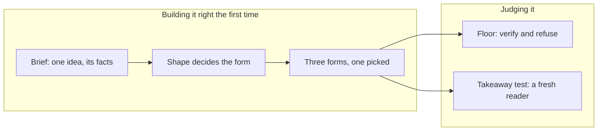

# Visual explainer skill

The skill [#207](https://github.com/HJeon139/postbox/issues/207) proposed bundling with Postbox: how an agent explains an idea with a picture, and how a reviewer judges whether the picture works. It is in the [Agent Skills](https://agentskills.io/specification) format. Postbox ships it in its own plugin, [`agent-plugin`](../../../agent-plugin), which every agent on this computer loads by default, Claude Code’s and the Agent SDK’s as `postbox:visual-explainer`, and Antigravity, Kiro and Codex agents through what Postbox writes for their turns ([architecture](../../architecture.md), “Postbox’s own skills”). This folder keeps what agents must not see: the starter briefs, which hold each test’s intended idea and traps.

| File | What it holds |
|---|---|
| [SKILL.md](../../../agent-plugin/skills/visual-explainer/SKILL.md) | The house rules (VE1 to VE13) and the run, from brief to report |
| [references/brief.md](../../../agent-plugin/skills/visual-explainer/references/brief.md) | The one-idea brief an agent writes before drawing |
| [references/shapes.md](../../../agent-plugin/skills/visual-explainer/references/shapes.md) | Content shapes, the forms each allows and refuses, and what position means in each |
| [references/critique.md](../../../agent-plugin/skills/visual-explainer/references/critique.md) | The floor (verify and refuse), the takeaway test and the report |
| [briefs/](briefs/README.md) | Seven starter briefs, one per shape plus a hard one, and three paper briefs ([briefs/papers/](briefs/papers/README.md)) |

## Why it looks like this

Every agent in the [#206](https://github.com/HJeon139/postbox/issues/206) field notes failed the same way: “text in boxes”, layouts that would lose nothing as a table. Reviews kept failing for a second reason: nobody stated what the visual was meant to say, so “is this good?” had nothing to be checked against. The skill puts the brief first and makes the takeaway test the measure.

It adapts the structure of two open-source design skills. No text is copied from either.

| Idea | From | Here |
|---|---|---|
| A context file every command reads | [impeccable](https://github.com/pbakaus/impeccable) (Apache 2.0), `PRODUCT.md` | The brief |
| A floor of “verify” and “refuse” lines, each with a rule id | impeccable, `craft-floor.md` | The floor in the critique |
| Two isolated assessments that don’t see each other, then a report ranked P0 to P3 and one question | impeccable, `critique.md` | The floor and the takeaway test, kept apart |
| A short list of house rules that win over the long references | [taste-skill](https://github.com/leonxlnx/taste-skill) (MIT), `SKILL.md` | VE1 to VE13 |
| Classify first; the class decides what’s allowed | taste-skill, the kind-of-business table | The shape table |
| Write the words before the picture | taste-skill, “Write all the copy first” | Title and labels before marks |
| Diagrams from a small spec, with one-to-three-word labels and a node limit (“crowded means it should be a list”) | taste-skill, `references/diagrams.md` | VE3, VE7; a spec-driven kit is next |

What it leaves out on purpose: both are built for marketing pages. Taste-skill bans captions under visuals and animates its diagrams on a loop; here a one-line “how to read it” caption is required, and motion is only for change (VE6), because the best explainers in the field notes (the Markov app, the treebank inspector) used both rules.

The principles behind the rules: [Larkin & Simon 1987](https://mechanism.ucsd.edu/bill/teaching/F12/cs200/Readings/larkin.whyadiagramissometimesworth.1987.pdf) (a diagram helps only when position carries information), [Tversky 2011](https://www.tc.columbia.edu/faculty/bt2158/faculty-profile/files/2011_Tversky_VisualizingThoughts.pdf) (what boxes, lines and arrows mean), [Kosslyn et al. 2012](https://www.frontiersin.org/journals/psychology/articles/10.3389/fpsyg.2012.00230/full) (capacity and salience), and [Borkin et al. 2016](https://vcg.seas.harvard.edu/publications/20150101-beyond-memorability-visualization-recognition-and-recall) (titles that state the message are what readers recall). [VisJudge-Bench](https://arxiv.org/abs/2510.22373) found model judges agree poorly with experts on open quality scores, which is why the critique uses a takeaway test and named checks instead of a 1-to-5 score.

## Where it stands

- **Done:** the rules, the brief, the shape table, the critique, seven starter briefs and three paper briefs, as a draft.
- **Tried, on November 6, 2026:** 13 UAT runs with Claude Code (Opus 5.5), each first visual scored by a blind reader, a fresh subagent shown only the screenshot ([#333’s results](https://github.com/HJeon139/postbox/issues/333#issuecomment-6692271521)).
  - The agent loaded the skill without being told to in every run that had it, and in none that didn’t.
  - Starter briefs: the baselines landed on compound interest, partly on the bill, and missed the disguised archetypes. With the skill and VE8 and VE9, all three landed or mostly landed.
  - Paper briefs: on two of three papers the agent chose a different idea from the brief’s, and the reader recovered the agent’s idea. A paper has no single idea, so the paper scenarios should ask a specific question.
  - These are development numbers, not results: one run per condition, and VE8, VE9 and the shape table’s poles row came from runs on these same briefs. Random recent papers, with the skill frozen, are the held-out test.
- **Calibrated, on November 6, 2026:** the maintainer judged 20 of those first visuals blind against their briefs, then saw the takeaway test’s grades. They agreed exactly on 8 and within one step on 15 (quadratic weighted κ 0.27). The test was more lenient on 9: it passed visuals whose words stated the idea, and missed text in boxes, missing relationships and unreadable labels. The maintainer rated the with-skill visuals 1.7 on a 0 to 3 scale against 0.9 for the others; the test, 1.9 against 1.5. Their notes became VE10 to VE12 and the shape table’s “What good looks like”.
- **Tuned, on November 7, 2026:** 75 UAT runs with Claude Code, the skill loaded from Postbox’s plugin, each first visual judged by the tester as the customer (`- judge: visual`), scored landed 3, mostly 2, partly 1, missed 0. Three runs per condition on five briefs: the bill, compound interest, the archetypes (`visualskill-*`), the traffic jam (`heldout-idea`) and sleep and running (`everyday-runs`).

  | Brief | Skill off | VE1 to VE12 | With VE13 | With VE9’s close-up |
  |---|---|---|---|---|
  | Bill | 1.33 | 2.00 | 2.00 | 2.00 |
  | Compound interest | 1.33 | 2.33 | 2.00 | 2.00 |
  | Archetypes | 1.33 | 1.67 | 1.67 | 2.00 |
  | Traffic jam | 0.33 | 1.67 | 1.33 | 1.33, then 1.67 with the frame clamp |
  | Sleep and running | 2.00 | 2.00 | 2.33 | 3.00 |

  - Most short verdicts with VE1 to VE12 showed the idea only after a click or a wait; VE13 came from them. The jam and sleep visuals then opened on the jam and the colored groups.
  - The jam’s misses with VE13 were crashes: a radius sized from a frame still 0 wide (two of six). The build step’s clamp followed, and none of three runs after it crashed.
  - Held out, on four everyday briefs not used in tuning (`everyday-pantry`, `-shelf`, `-subs`, `-tests`), two runs each with the tuned skill and one without: 1.75 against 1.25. Both misses with the skill weren’t the drawing: a first version that crashed, and a plain data table posted before the chart.
  - The tester answered Postbox’s browser card inconsistently, so some agents could see their app and some couldn’t. With the skill, it made no difference (1.80 with the browser, 2.00 without, 15 runs each).
  - Three runs per condition is noisy: one run moves a mean by up to 1. Only the sleep brief’s rise and the jam’s crashes are clear.
- **Picture or words, counted on November 8, 2026** ([#983](https://github.com/HJeon139/postbox/issues/983)): every run above judged a picture the person had asked for, so none said whether an agent chooses one. Counted from each run’s own Postbox log since November 6, the first visual after the person’s first message:

  | The person | Skill | Drew in the first reply | Drew later | Never drew |
  |---|---|---|---|---|
  | Asked for a picture (7 briefs) | off | 31 of 31 | 0 | 0 |
  | Asked for a picture (7 briefs) | on | 79 of 79 | 0 | 0 |
  | Didn’t ask (5 briefs) | off | 12 of 18 | 1 | 5 |
  | Didn’t ask (5 briefs) | on | 26 of 33 | 4 | 3 |

  - Postbox’s guide already tells every agent to write an app when one explains better than prose, so the skill-off runs measure the guide, and the difference is the skill’s.
  - Since [#996](https://github.com/HJeon139/postbox/issues/996), the guide decides whether to draw and the skill keeps how: the agent names the answer’s shape, words go to one fact, a command, a basic how-to or a step-by-step calculation, and any other shape gets a picture after a sentence or two of answer. The counts here are from before that rule, so they’re its baseline.
  - Unasked, the skill changed one brief: the book shelf drew first in 5 of 6 runs with it and 0 of 3 without. A question that reads as a decision (“Where should we start?”, “Where did the time go?”) never got a picture first, with or without it.
  - It changes what agents draw more than whether: Mermaid diagrams were 12 of 44 first visuals without the skill and 2 of 109 with it.
  - The new scenarios, four runs each with the skill and four without, on November 8: the controls got words in all 16 runs, with or without it, so the skill doesn’t make agents draw where words are right. Which subscriptions to cancel drew in the first reply in 3 of 4 with the skill (landed, mostly, mostly) and 1 of 4 without. Whether two adds at once can lose one never drew in 8: a question about the person’s own code got words and code, skill or not.
  - Every judged run now records this: the report’s “Picture or words” line and run.json’s `picture` (`tools/uat/picture-choice.mjs`). `- expects: picture` or `- expects: words` says which the first message should get. Count runs from run.json’s `picture.met` by scenario, skill on and off: the unasked scenarios (`everyday-shelf`, `everyday-tests`, `everyday-subs-cancel`, `everyday-pantry-race`) and #206’s two controls, where words are right (`control-subs-total`, `control-pantry-start`), each with a `-base` twin.
- **The guide’s rule, measured on November 9, 2026** ([#996](https://github.com/HJeon139/postbox/issues/996)): 48 UAT runs, four per condition, against the pass bar set before the change. No run crashed or stopped at its budget.

  | The person didn’t ask, on | Drew in the first reply, skill on | Verdict | Drew in the first reply, skill off | Verdict |
  |---|---|---|---|---|
  | The book shelf | 4 of 4 | 2.00 | 4 of 4 | 2.00 |
  | Which tests | 4 of 4 | 3.00 | 4 of 4 | 2.50 |
  | Which subscriptions to cancel | 4 of 4 | 2.75 | 4 of 4 | 2.50 |
  | Whether two adds can lose one | 4 of 4 | 2.50 | 1 of 4 | 2.00, one run |

  - The controls got words in all 16 runs, skill on or off, and each agent gave the answer.
  - With the skill, all four questions pass. Without it, the question about the person’s own code still gets words in 3 of 4, so that one row fails the bar. Every agent loads the skill by default, and all 16 unasked runs with it loaded it.
  - These verdicts are the tester’s, as the customer, which ran more lenient than the maintainer on November 6.
  - Not measured: the sleep and running and codebase split questions, which have no scenario on main, and the side-by-side judge below.
- **Not done:**
  - #206’s side-by-side preference, an app against a text answer to the same question, “preferred over text in 7 or more of 10 pairs”, hasn’t been run. It needs a judge shown both answers.
  - The takeaway test, now on a text-hidden screenshot with the floor’s new lines, hasn’t been rerun against the maintainer’s verdicts. Until it agrees about as well as people agree with each other (κ about 0.45 to 0.6), it informs a person’s judgment and doesn’t replace it.
  - The tester judges the first visual, so a data table posted before the picture is scored as the visual. Whether the skill should say “the picture first” is untested.
  - A first version that crashes is what the reader sees, even when a later version is good. Postbox stops an app on the browser’s harmless “ResizeObserver loop” error, which caused one of the crashes.
  - The vaccine-trial brief’s case counts are unchecked (the brief says so).
  - The countable floor lines aren’t in Postbox’s app check yet: agents shipped visuals with labels the check had flagged as overlapping or too small.
- **Next:**
  1. Rerun the takeaway test, text-hidden, on the same 20 visuals and compare it with the maintainer’s verdicts again.
  2. The countable floor lines (text in boxes, overlap, size, contrast, first-view fit) as checks in Postbox’s pre-display app check that block a version, measured from the page, with the offending elements returned to the author ([#95](https://github.com/HJeon139/postbox/issues/95)).
  3. Fix the app frame’s first-draw failures: the harmless ResizeObserver error, and #819’s check that never resizes.
  4. The held-out test: random recent papers through the `visualpaper` scenario, each with a specific question, the skill unchanged, three runs per condition.
  5. A spec-driven diagram kit for the shapes, so agents fill in labels instead of drawing boxes ([#211](https://github.com/HJeon139/postbox/issues/211)).
