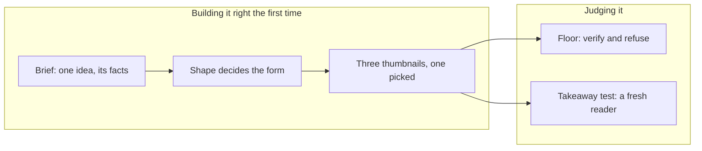

# Visual explainer skill (draft)

A draft of the skill [#207](https://github.com/HJeon139/postbox/issues/207) proposes bundling with Postbox: how an agent explains an idea with a picture, and how a reviewer judges whether the picture works. It is in the [Agent Skills](https://agentskills.io/specification) format so it can move into the bundle unchanged once #207 decides where bundled skills live. Nothing loads it yet.

| File | What it holds |
|---|---|
| [SKILL.md](SKILL.md) | The house rules (VE1 to VE12) and the run, from brief to report |
| [references/brief.md](references/brief.md) | The one-idea brief an agent writes before drawing |
| [references/shapes.md](references/shapes.md) | Content shapes, the forms each allows and refuses, and what position means in each |
| [references/critique.md](references/critique.md) | The floor (verify and refuse), the takeaway test and the report |
| [references/examples.md](references/examples.md) | The maintainer’s verdicts on 20 agent visuals, by shape, with the pictures in `references/examples/` |
| [briefs/](briefs/README.md) | Seven starter briefs, one per shape plus a hard one, and three paper briefs ([briefs/papers/](briefs/papers/README.md)) |

## Why it looks like this

Every agent in the [#206](https://github.com/HJeon139/postbox/issues/206) field notes failed the same way: “text in boxes”, layouts that would lose nothing as a table. Reviews kept failing for a second reason: nobody stated what the visual was meant to say, so “is this good?” had nothing to be checked against. The skill puts the brief first and makes the takeaway test the measure.

It adapts the structure of two open-source design skills. No text is copied from either.

| Idea | From | Here |
|---|---|---|
| A context file every command reads | [impeccable](https://github.com/pbakaus/impeccable) (Apache 2.0), `PRODUCT.md` | The brief |
| A floor of “verify” and “refuse” lines, each with a rule id | impeccable, `craft-floor.md` | The floor in the critique |
| Two isolated assessments that don’t see each other, then a report ranked P0 to P3 and one question | impeccable, `critique.md` | The floor and the takeaway test, kept apart |
| A short list of house rules that win over the long references | [taste-skill](https://github.com/leonxlnx/taste-skill) (MIT), `SKILL.md` | VE1 to VE12 |
| Classify first; the class decides what’s allowed | taste-skill, the kind-of-business table | The shape table |
| Write the words before the picture | taste-skill, “Write all the copy first” | Title and labels before marks |
| Diagrams from a small spec, with one-to-three-word labels and a node limit (“crowded means it should be a list”) | taste-skill, `references/diagrams.md` | VE3, VE7; a spec-driven kit is next |

What it leaves out on purpose: both are built for marketing pages. Taste-skill bans captions under visuals and animates its diagrams on a loop; here a one-line “how to read it” caption is required, and motion is only for change (VE6), because the best explainers in the field notes (the Markov app, the treebank inspector) used both rules.

The principles behind the rules: [Larkin & Simon 1987](https://mechanism.ucsd.edu/bill/teaching/F12/cs200/Readings/larkin.whyadiagramissometimesworth.1987.pdf) (a diagram helps only when position carries information), [Tversky 2011](https://www.tc.columbia.edu/faculty/bt2158/faculty-profile/files/2011_Tversky_VisualizingThoughts.pdf) (what boxes, lines and arrows mean), [Kosslyn et al. 2012](https://www.frontiersin.org/journals/psychology/articles/10.3389/fpsyg.2012.00230/full) (capacity and salience), and [Borkin et al. 2016](https://vcg.seas.harvard.edu/publications/20150101-beyond-memorability-visualization-recognition-and-recall) (titles that state the message are what readers recall). [VisJudge-Bench](https://arxiv.org/abs/2510.22373) found model judges agree poorly with experts on open quality scores, which is why the critique uses a takeaway test and named checks instead of a 1-to-5 score.

## Where it stands

- **Done:** the rules, the brief, the shape table, the critique, seven starter briefs and three paper briefs, as a draft.
- **Tried, on November 6, 2026:** 13 UAT runs with Claude Code (Opus 5.5), each first visual scored by a blind reader, a fresh subagent shown only the screenshot ([#333’s results](https://github.com/HJeon139/postbox/issues/333#issuecomment-6692271521)).
  - The agent loaded the skill without being told to in every run that had it, and in none that didn’t.
  - Starter briefs: the baselines landed on compound interest, partly on the bill, and missed the disguised archetypes. With the skill and VE8 and VE9, all three landed or mostly landed.
  - Paper briefs: on two of three papers the agent chose a different idea from the brief’s, and the reader recovered the agent’s idea. A paper has no single idea, so the paper scenarios should ask a specific question.
  - These are development numbers, not results: one run per condition, and VE8, VE9 and the shape table’s poles row came from runs on these same briefs. Random recent papers and the everyday briefs, with the skill frozen, are the held-out test.
- **Calibrated, on November 6, 2026:** the maintainer judged 20 of those first visuals blind against their briefs, then saw the takeaway test’s grades. They agreed exactly on 8 and within one step on 15 (quadratic weighted κ 0.27). The test was more lenient on 9: it passed visuals whose words stated the idea, and missed text in boxes, missing relationships and unreadable labels. The maintainer rated the with-skill visuals 1.7 on a 0 to 3 scale against 0.9 for the others; the test, 1.9 against 1.5. Their notes became VE10 to VE12 and the shape table’s “What good looks like”, and the 20 verdicts, with their pictures, became [references/examples.md](references/examples.md): a judge anchored on them agreed with the maintainer at weighted κ 0.44 to 0.62, against 0.34 with the rules alone ([#206’s retrospective](https://github.com/HJeon139/postbox/issues/206#issuecomment-6698888352)).
- **The examples spend the development set.** `- seed: visual-skill` copies `references/` into the agent’s folder, so an agent with the skill now sees the maintainer’s verdict on a visual made from its own brief: compound interest, the bill, Spore and its disguise, and the three papers (Sontag, Madeddu, Jia). From here on, the `visualskill-*` scenarios and the `visualpaper-*-skill` ones measure regressions only, not whether the skill works, and a comparison with their baselines is no longer fair. The held-out test set is the everyday briefs, which no example comes from ([briefs/README.md](briefs/README.md)), and new papers.
- **Three thumbnails, on November 6, 2026:** step 3 now draws three small sketches side by side and has the person pick, or picks the one where position carries the most and keeps the others in the app’s history. Before, the agent named three forms in a line each and picked alone. The maintainer’s notes on design say to see the options together before going into one ([#206](https://github.com/HJeon139/postbox/issues/206#issuecomment-6674901743)), and the [retrospective](https://github.com/HJeon139/postbox/issues/206#issuecomment-6698888352) found the agent picking alone among forms it had only named.
- **Not done:**
  - The takeaway test, now on a text-hidden screenshot with the floor’s new lines, hasn’t been rerun against the maintainer’s verdicts. Until it agrees about as well as people agree with each other (κ about 0.45 to 0.6), it informs a person’s judgment and doesn’t replace it.
  - No run has used VE10 to VE12, the examples or the three thumbnails yet.
  - The vaccine-trial brief’s case counts are unchecked (the brief says so).
  - The countable floor lines aren’t in Postbox’s app check yet: agents shipped visuals with labels the check had flagged as overlapping or too small.
- **Next:**
  1. Rerun the takeaway test, text-hidden, on the same 20 visuals and compare it with the maintainer’s verdicts again.
  2. The countable floor lines (text in boxes, overlap, size, contrast, first-view fit) as checks in Postbox’s pre-display app check that block a version, measured from the page, with the offending elements returned to the author ([#95](https://github.com/HJeon139/postbox/issues/95)).
  3. Run the everyday briefs with VE10 to VE12 and the examples, against their baselines: the development set can’t measure them now.
  4. The held-out test: random recent papers through the `visualpaper` scenario, each with a specific question, the skill unchanged, three runs per condition.
  5. A spec-driven diagram kit for the shapes, so agents fill in labels instead of drawing boxes ([#211](https://github.com/HJeon139/postbox/issues/211)).
