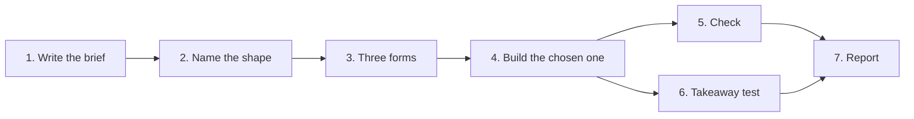

# Visual explainer

A visual is good when a reader who sees only the picture comes away with the idea you meant. Everything below serves that one test. Draft for [#207](https://github.com/HJeon139/postbox/issues/207); the reasons and sources are in [README.md](README.md).

## House rules

These win over everything else here, and over your own habits. Each has an id that a check or a critique can cite. VE8 and VE9 came from the first UAT runs (November 6, 2026): every app the skill produced cut its idea off below the first screen, and none drew how a step moves the outcome. VE10 to VE12 came from the maintainer’s blind verdicts on 20 of those visuals the same day: every diagram of labeled boxes failed, charts of a fixed answer only partly landed, and unreadable text failed whatever else was good.

- **VE1. One visual, one idea, and the title says it.** The title is the finding (“Two checks, run by two teams”), never the topic (“Book flow”).
- **VE2. Name the content’s shape before you pick a form.** Use a form that [references/shapes.md](references/shapes.md) allows for that shape, and none it refuses.
- **VE3. Labels of three words or fewer, on the parts they name.** Sentences go in the caption under the visual or in a side panel, never inside a shape.
- **VE4. Draw from the real facts, and mark what you invented.** Every number and every part comes from the brief’s facts. A toy model, an example value or your own reading is labeled as such where the reader looks.
- **VE5. The table test.** If the visual would lose nothing as a table or a list, it isn’t a visual yet: redraw it, or use the table.
- **VE6. Motion only for change.** Animate only something that changes over time in the subject itself, and give the reader a way to pause or step it.
- **VE7. Crowded means it should be a list.** About 12 parts at most in one view. More than that is a sign to split the idea, or to show an overview with detail on demand. Cut every mark that doesn’t serve the one idea: one idea at a time beats everything at once.
- **VE8. The whole idea fits the first view.** At 1000 × 680, without scrolling, the reader sees the title and every part the idea depends on: all the poles, all the branches, both ends of the comparison. The picture comes first; controls, rule lists and practice go beside it or below it. If the idea doesn’t fit, the picture is too detailed: show less, not smaller (labels stay at 12 px or more).
- **VE9. Draw the mechanism, not only the outcome.** When outcomes come from steps that add up (choices, rounds, forces, years), draw one step and how steps combine, not only where they end: an arrow per step, a path from start to end, a before and after. A map of end points answers “where”, and the reader asked “how”.
- **VE10. Draw the things, not boxes with their names.** A diagram of labeled boxes and arrows fails, however tidy, and a Mermaid flowchart is one: readers now skip them. Draw what the things are or do: an icon or a small drawing for each part, a cutaway or teardown of a mechanism, a route on a map, marks whose size, position and color carry the values. A box may group parts, never stand in for one. Reach for the look of an infographic or a textbook illustration ([references/shapes.md](references/shapes.md), “What good looks like”). A chart is drawn too: when the facts are numbers (change over time, a comparison, a distribution), a plain chart on a shared scale is the right form (VE2), and icons or an illustration in its place are decoration.
- **VE11. When the idea is how one thing depends on another, let the reader change it.** Give the visual one control for a variable the idea turns on (the rate, the starting amount, the bias), and make the picture show what moves with it. A tree, a map, a cycle or a cutaway with no such variable needs no control (VE6 still limits motion to what changes). A chart of one fixed answer shows the answer, not the relationship. Where it helps, ask the reader to predict, beside the picture and never in front of it: the idea shows before any answer (VE8).
- **VE12. Unreadable is a miss.** Text with contrast under 4.5:1, labels that overlap or are cut off, text under 12 px, and raw TeX each fail the visual, whatever else is good. Fix them before the person sees it; if you can’t, say so, and don’t call it done.

## The run

1. **Write the brief first,** before any drawing: the one idea, who it’s for, the question it answers, and the facts it must carry, each with its source. Format and an example: [references/brief.md](references/brief.md). If you can’t write the idea in one sentence, stop and ask the person what they want to understand.
2. **Name the content’s shape** from the facts, not from the topic: a flow, a cycle, a mechanism, a process with branches, change over time, a comparison, uncertainty, a space, a hierarchy, a network, a mix of a few poles or a trade-off ([references/shapes.md](references/shapes.md) tells them apart). If the facts have two shapes, the brief has two ideas: pick one, or make two visuals.
3. **Sketch three forms** the shape allows, each in one line: what sits where and what position means in it. Show the three to the person as a choice when they’re there to pick; otherwise pick the one where position carries the most of the idea, and say why in one line.
4. **Build it** as a Postbox app. Draw with `postbox.load("d3")`, or `postbox.charts` for a standard chart, at the size it will be read (1000 × 680 by default), with Postbox’s color tokens. Write the title and labels before the marks. Put a one-line caption under each view that says how to read it (“Arrow width is the flow”), not what it shows.
5. **Check** against [references/critique.md](references/critique.md), “The floor”: each line there is a check on the rendered result. Fix what fails before the person sees it.
6. **Run the takeaway test** ([references/critique.md](references/critique.md), “The takeaway test”): a reader who has seen only the screenshot writes what they learned, and you compare it with the brief’s idea. If it didn’t land, the visual changes, not the brief.
7. **Report** in two or three lines: the idea, the form and why, what you invented or assumed, and what you couldn’t check. Say “I didn’t check” rather than “verified” for anything a tool didn’t read this turn.

## When not to draw

- The content is a list of independent items (options, steps with no branching, settings). Use a list or a table, and say why in one line.
- The person asked for the numbers themselves. Use a table, and add a chart only if a pattern in the numbers is the point.
- You don’t have the facts. Ask, or say what you’d need; never fill a picture with plausible numbers.
