# Examples, by shape

On November 6, 2026, the maintainer judged 20 agent-made visuals blind, each against its brief: who it’s for, the question and the one idea ([#206, the calibration log](https://github.com/HJeon139/postbox/issues/206#issuecomment-6695330418)). They are below, grouped by the content shape of [shapes.md](shapes.md). Find your shape, look at the pictures, and read why each landed or missed before you draw. Examples say what the rules can’t: a judge anchored on these verdicts agreed with the maintainer far more often than one given only the rules (weighted κ from 0.34 to 0.62 with one model, and to 0.44 with Sonnet: [#206](https://github.com/HJeon139/postbox/issues/206#issuecomment-6698888352)).

- **The scale:** landed, mostly, partly or missed. Landed means the idea came across, not that the visual can’t be better.
- **The notes** are the maintainer’s, quoted with cuts marked. Where they left none, the verdict stands alone.
- **“What it does”** is what the picture itself carries or fails to carry, read from the screenshot.
- **No example yet** for a flow, a cycle, a comparison, uncertainty, a space, a hierarchy or a network. Use the shape’s row in [shapes.md](shapes.md), and the patterns below, which hold across shapes.

The pattern across all 20: the ones that landed let marks carry the relationship (an arrow’s width, a bar split in two, a curve with a dot on it) and moved together when one variable changed. The ones that missed put the idea in words: boxes with names in them, a ranking of one number, cards of stats, a headline that says what the picture doesn’t, or text the reader can’t read.

## Change over time: compound interest

The idea: compound interest earns interest on past interest, so it starts almost level with simple interest and then pulls away faster every year.

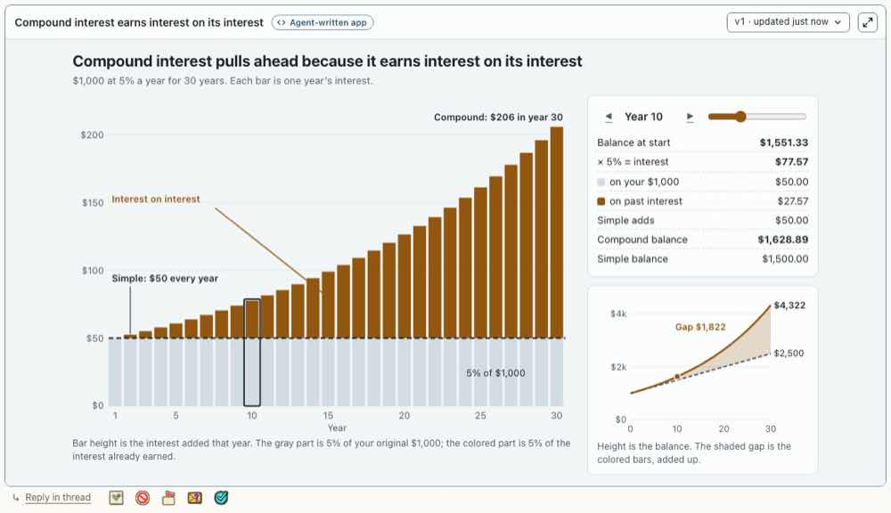

**Landed.** No note. **What it does:** each year’s bar splits into the flat $50 earned on the deposit and the part earned on past interest, so one step of the mechanism is in the marks, and the brown part visibly grows (VE9). A small balance chart beside it shows where the steps add up, and a year stepper walks through them.

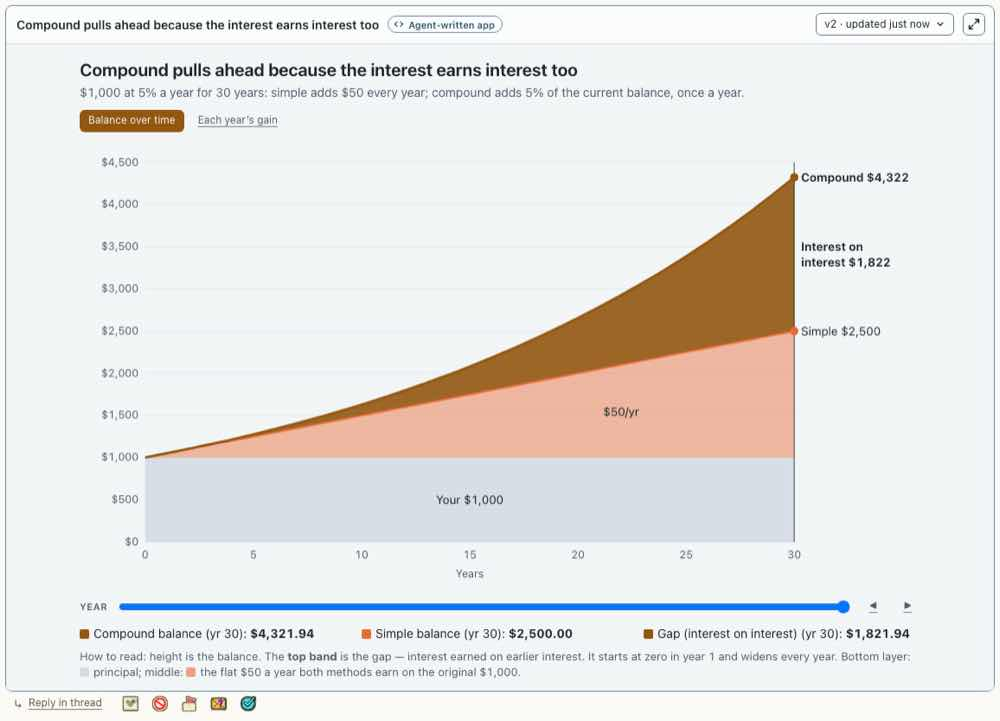

**Partly.** “This is barely better than the bar chart equivalent. However, this is just a chart. What sets this apart from any other agent? nothing. We should go a step further and show the relationship between variables (e.g. what changes when I change the starting balance? what about interest rate?).” **What it does:** a correct, readable chart of one fixed answer. Its only control is the year, so nothing shows how the gap depends on the rate or the deposit (VE11).

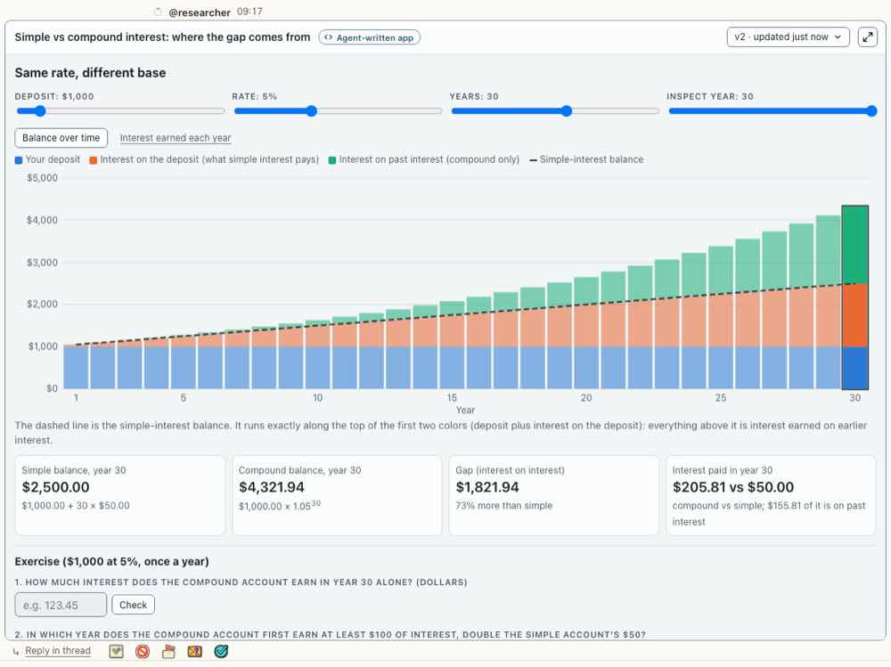

**Partly.** “Uncreative. While a bar chart can work, it doesn’t do a great job showing relationship between variables. Also, the line graph and bar charts overlap in duty.” **What it does:** it has the rate and deposit sliders, but the picture under them is a stacked bar chart with a dashed line on it that says the same thing, then four stat cards and an exercise. Controls alone don’t show a relationship; the marks have to.

## Change over time: runs that settle (Sontag’s paper)

The idea: two runs that start far apart are pulled together, because the distance between them can only shrink, so every run ends at the same balance.

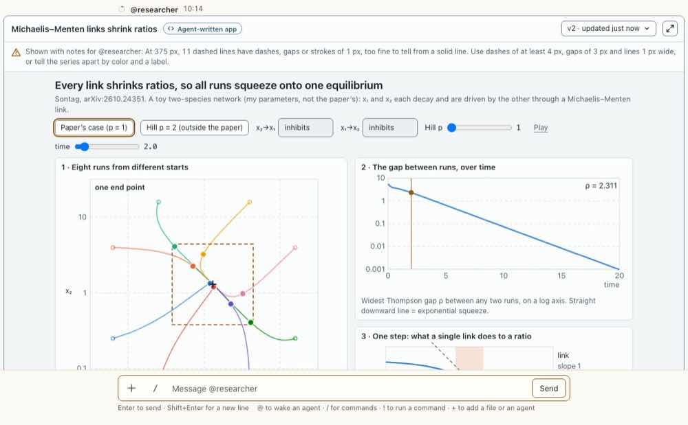

**Mostly.** “The charts showing relationship is great. However, it’s too much information. We should abstract out the idea and focus on a simplified view to help explain one idea at a time. … Just needs to be refined to fit the screen and filter out the parts that just add noise.” **What it does:** eight runs converging and the gap falling straight on a log axis carry the idea. Two rows of controls, a third panel and a line of toy parameters push it past the first view (VE7, VE8).

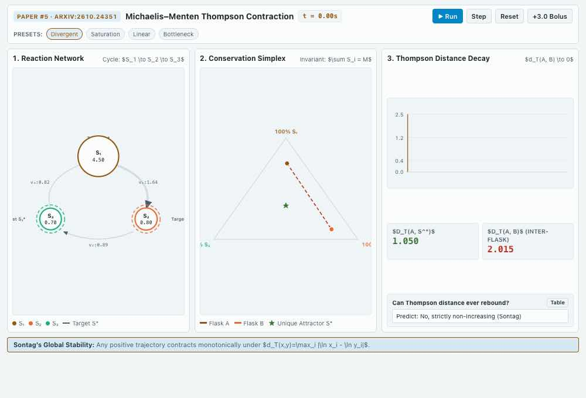

**Mostly.** “Animations show clear changes over time. Using different size shapes helps. However, the shapes and ideas are really basic and doesn’t use opportunity with icons, different shapes, and change over time in fixed image (requires animation).” **What it does:** circle size carries each amount, but the still frame shows an empty decay chart and raw TeX in the headers, so the change lives only in the animation. A still view should show change too: a trail, a before and after.

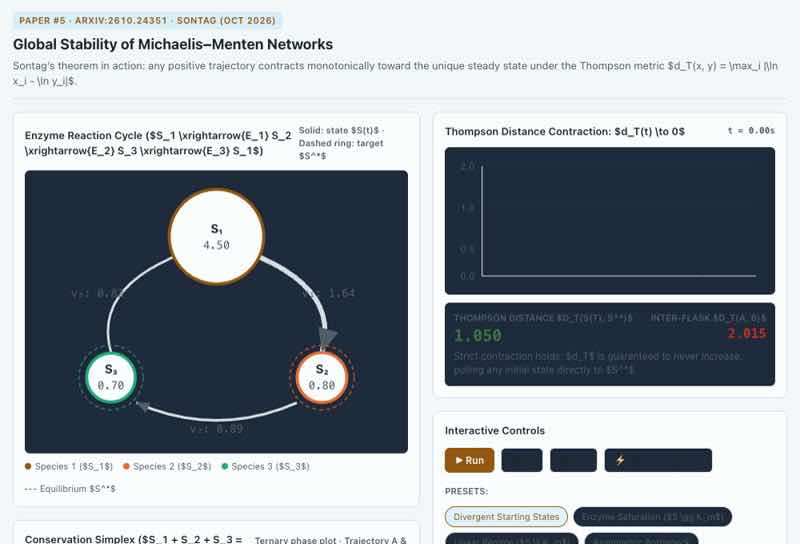

**Missed.** “color contrast is missed. impossible to read some content.” **What it does:** dark-on-dark buttons, raw TeX in every title and an empty chart. Unreadable is a miss, whatever else is good (VE12).

## Process with branches: how a bill becomes law

The idea: the same text has to pass both chambers, and then the President either signs it, lets it become law by waiting, or vetoes it, which two-thirds of each chamber can override.

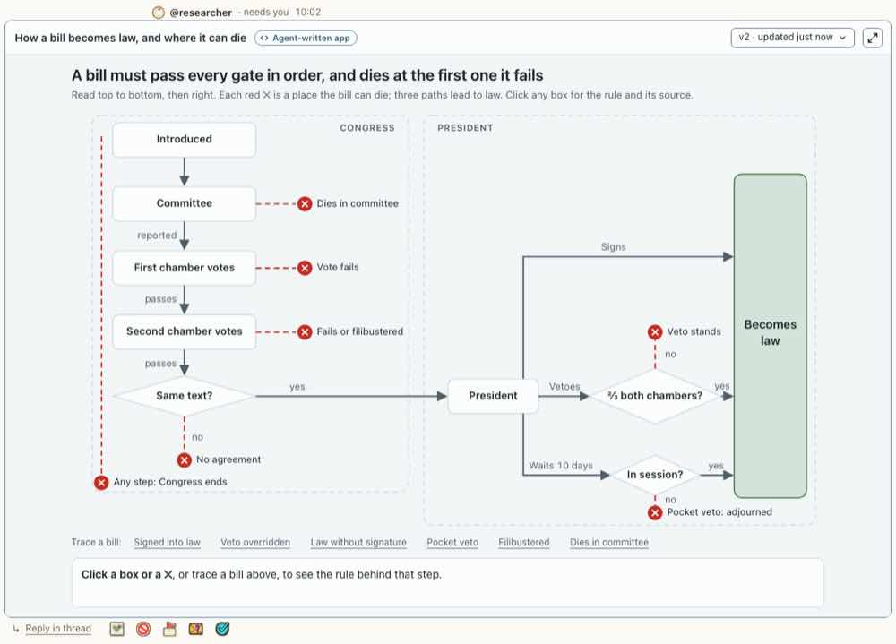

**Mostly.** “Flow diagram is useful but relies on too many ‘text in boxes’. It could be more creative in making the diagram engaging. Think of an infographic instead of a sterile flow diagram” (an illustrated [Quarterhouse poster](https://www.etsy.com/listing/1425377994/quarterhouse-illustrated-how-a-bill) of the same process). **What it does:** the whole route fits the first view, with every place a bill dies marked and three routes into law. But each step is still a box with its name in it, where a drawn route (a road, a board game) would carry the same order.

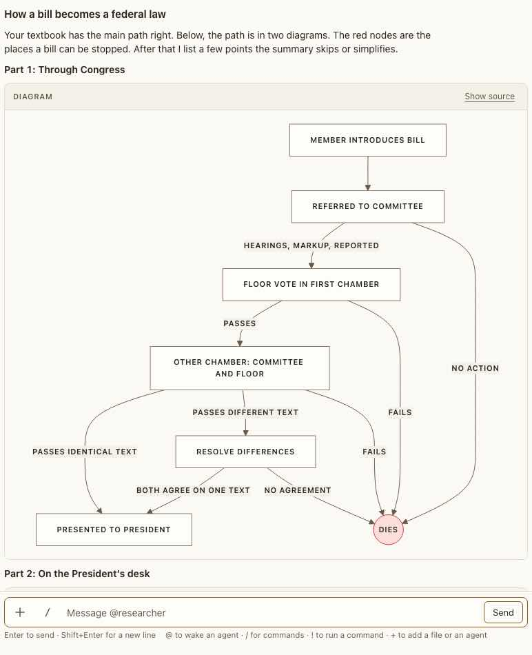

**Partly.** “while a flow chart in mermaid is acceptable and this one in particular is well designed, most readers are overwhelmed by AI slop and will immediately skip reading a mermaid diagram as a result. … The idea of a diagram is fine. The execution and format is missed.” **What it does:** a tidy Mermaid flowchart, split in two, with the President’s half below the first view. Readers skip the form however well it’s made (VE10).

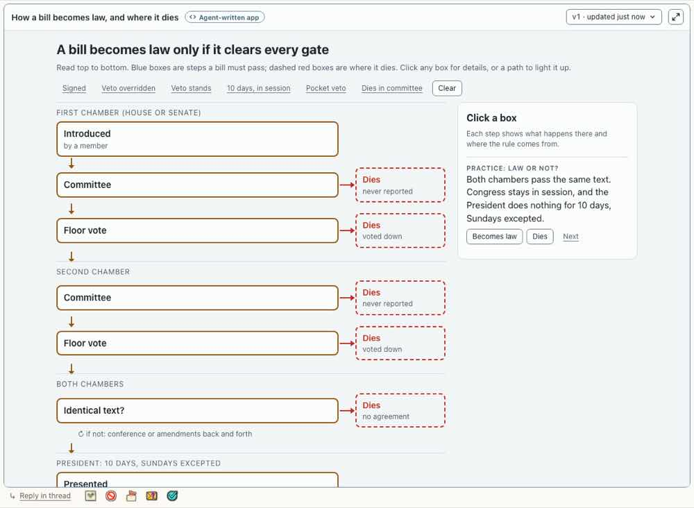

**Missed.** “text in boxes are always a miss” **What it does:** a column of steps with a “Dies” box beside each, cut off before the President. The layout says nothing a numbered list wouldn’t (VE5).

## Mechanism: high blood sugar and bone marrow (Madeddu’s paper)

The idea: high blood sugar harms the marrow through two separate branches, so a drug that cuts one branch leaves the other doing damage.

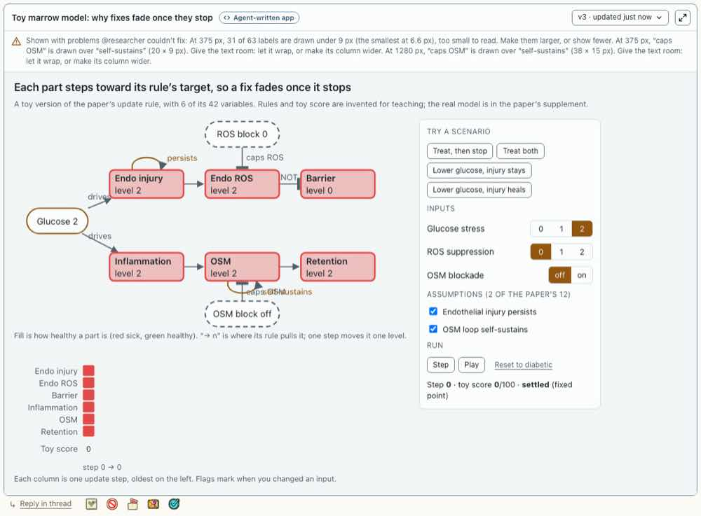

**Mostly.** “over-reliance for text in boxes. But otherwise shows information with clear relationships” **What it does:** the two branches from glucose, each with its drug block, are drawn where they act, so the structure shows. Every part is a red box with its name and level in it, two labels overlap, and Postbox’s check had flagged 31 labels as too small. (The agent chose its own idea, that a fix fades once it stops.)

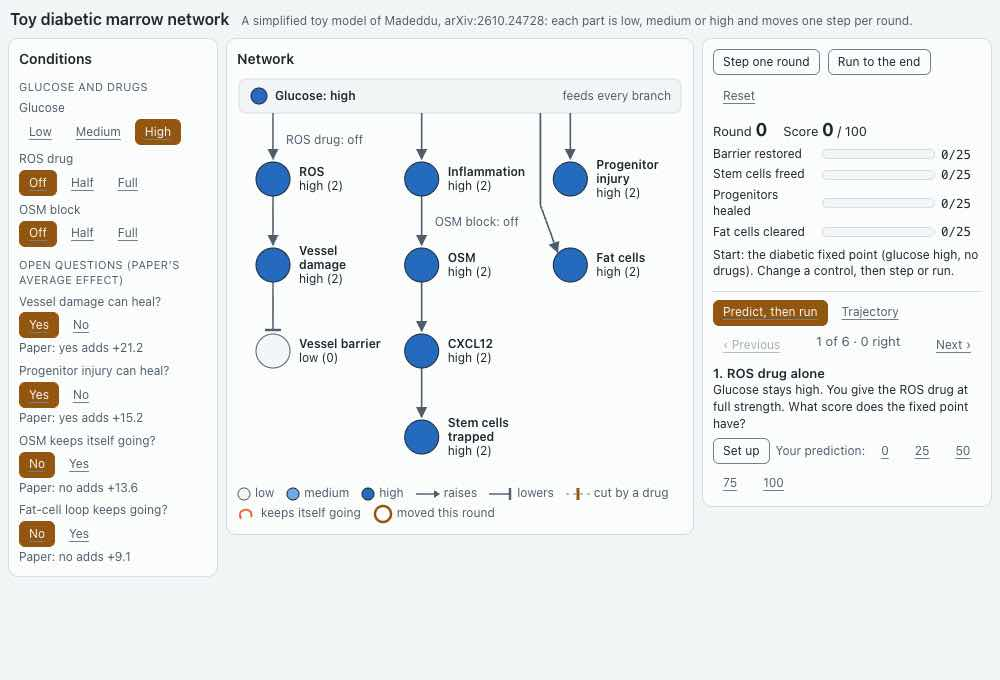

**Partly.** “This is a complex topic so it’s hard to show what happens. Maybe some visual cues might help? Here’s a similar bio-chemical concept diagram from the krebs cycle. Maybe we should use keywords like ‘cheat sheet’ or ‘infographic’ to show helpful and critical information while using visual representations instead of circles and codes for the nodes.” (The [Krebs cycle infographic](https://praxilabs.com/en/blog/2023/01/02/krebs-cycle/).) **What it does:** the branching is right, but every part is the same blue circle with a level under it, so nothing is drawn as what it is, and controls and a quiz fill half the view.

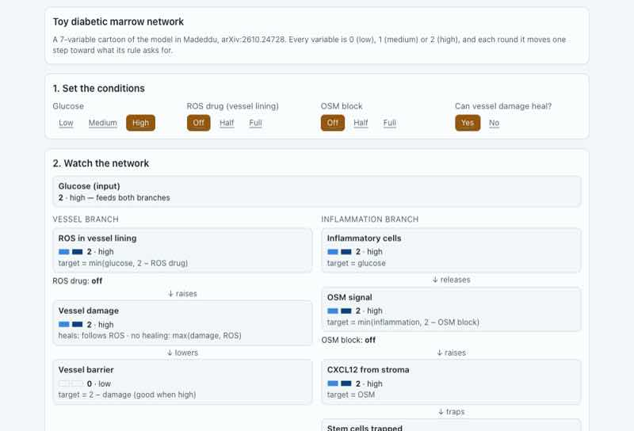

**Missed.** “Text in boxes is unacceptable. Relationships should use visual representation using charts, graphs, and visual infographics (think engineering specification teardown)” **What it does:** each variable is a card with its update rule written in it. The two branches are two columns of text, cut off before the outcome.

## Mix of a few poles: how choices decide an archetype

The idea: every stage nudges the species one step toward one of three poles. Order doesn’t matter, so all 256 ways collapse onto a small triangle: pure play at a corner, two-color play on an edge, balanced play near the center. One brief used the game’s real names (Spore); its disguise used invented ones (titles).

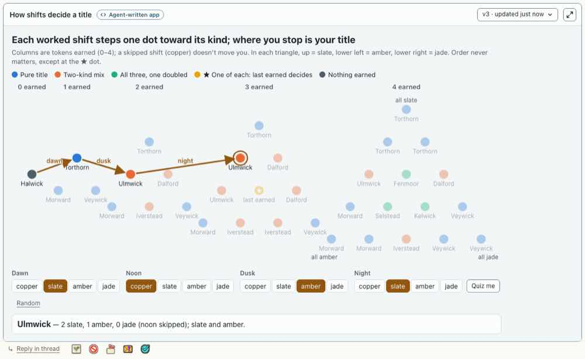

**Mostly.** No note. **What it does:** each worked shift is an arrow from one dot to the next, so the steps are drawn, not only the end (VE9). The triangles are flattened into columns by tokens earned, so the reader needs the legend to find the three poles.

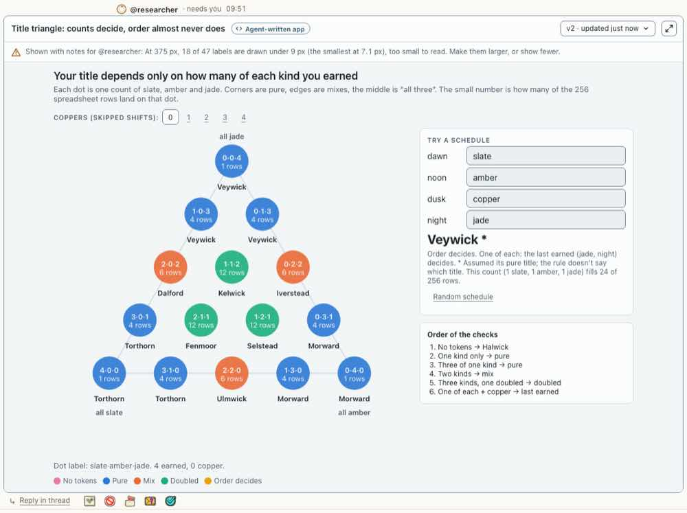

**Partly.** “Fails to show relationship between items in the spectrum. image doesn’t clearly show that the diagram is a tri-polar spectrum.” **What it does:** the dots sit in a triangle, but each is a circle with a code and a count written in it, color marks which rule fired rather than which pole, and the poles are small gray labels. Postbox’s check had flagged 18 labels under 9 px.

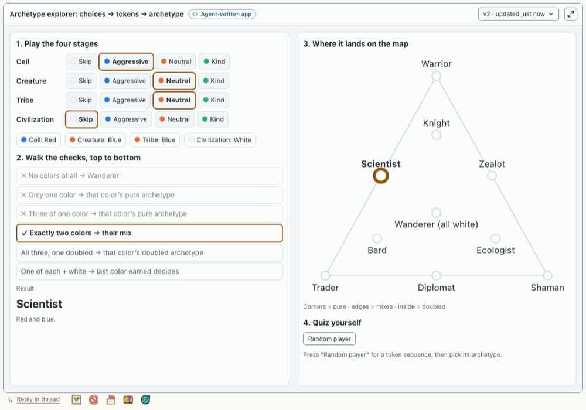

**Partly.** “It doesn’t clearly communicate relationship between components in the spectrum. It should have used color labels and shows how player action results in traversal in the tri-polar graph.” **What it does:** a correct triangle, but the dot jumps to its answer with no path from choices to place, and buttons and a checklist fill half the view.

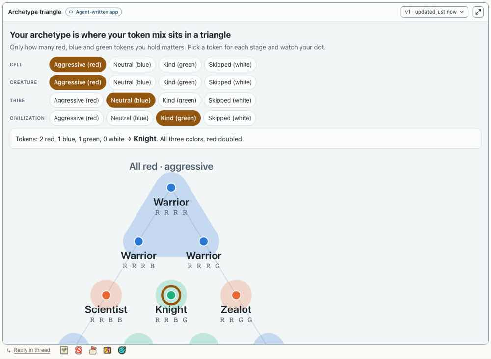

**Partly.** No note. **What it does:** the triangle starts halfway down the view and its lower rows are cut off, so two of the three poles are missing from the first view (VE8).

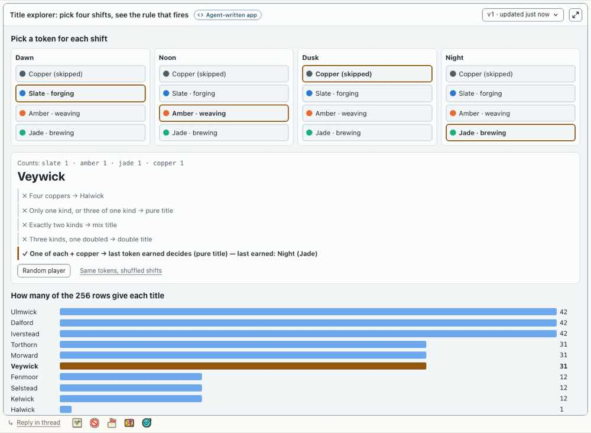

**Missed.** “text in boxes. half the screen are buttons. Other half is a bar chart. What idea are we communicating? This is somehow worse than a table.” **What it does:** a ranking of how many rows give each title: one number per category, which hides the blend of three poles the idea is about.

## Trade-off: a cell’s clock costs energy (Jia’s paper)

The idea: pushing a molecular cycle one way makes its rhythm stronger but costs more energy, and a simple four-state cycle can never get past about 17%.

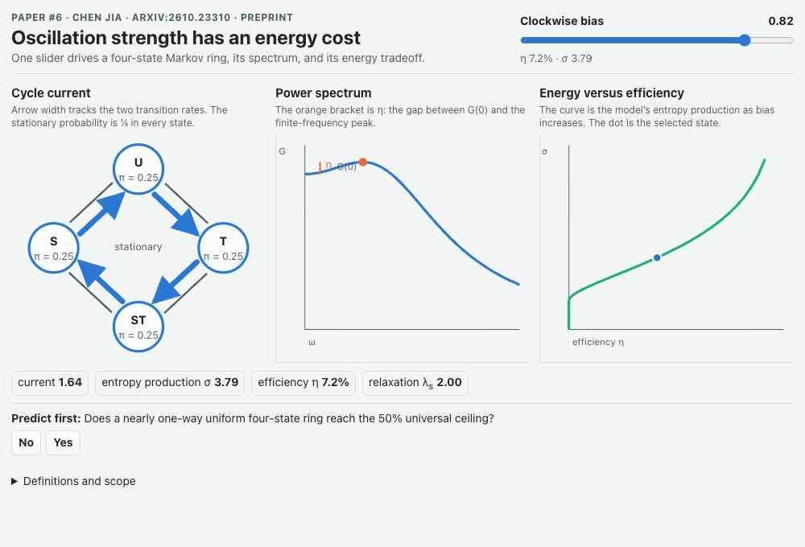

**Landed.** “simple diagram. Uses sizes and charts to show relationship between components. Users can also think about how the relationship would change over time before clicking play to verify.” **What it does:** one slider for the bias drives three views together: arrow width is the rate around the ring, the spectrum’s peak rises, and a dot moves along the energy curve (VE11). The question to predict sits below the picture, never in front of it.

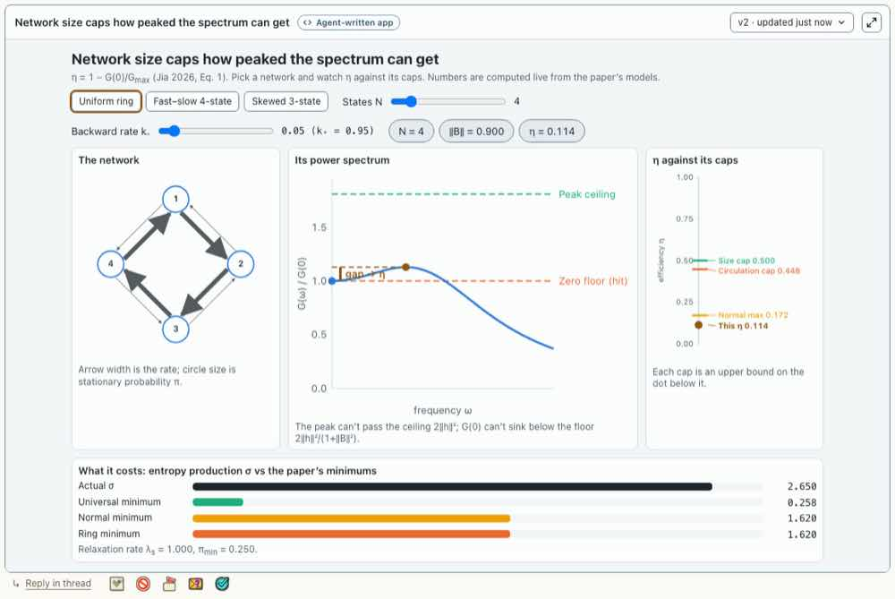

**Landed.** “shows clear relationship between concepts and changes over time.” **What it does:** the same linked views, with marks carrying each value: arrow width, a peak against its ceiling, efficiency against its caps. Its cost row is a set of bars, the one part that ranks numbers instead of relating them. (The agent chose its own idea, that network size caps the peak.)

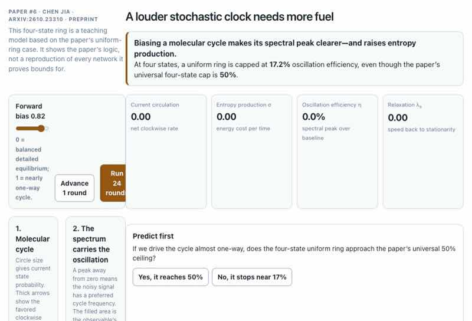

**Missed.** “typesetting failures. text in boxes is unacceptable.” **What it does:** the idea is written in a headline and a summary box, the four stat cards read zero, and narrow columns break their words. A reader can repeat the idea from the text without the picture showing any of it.
