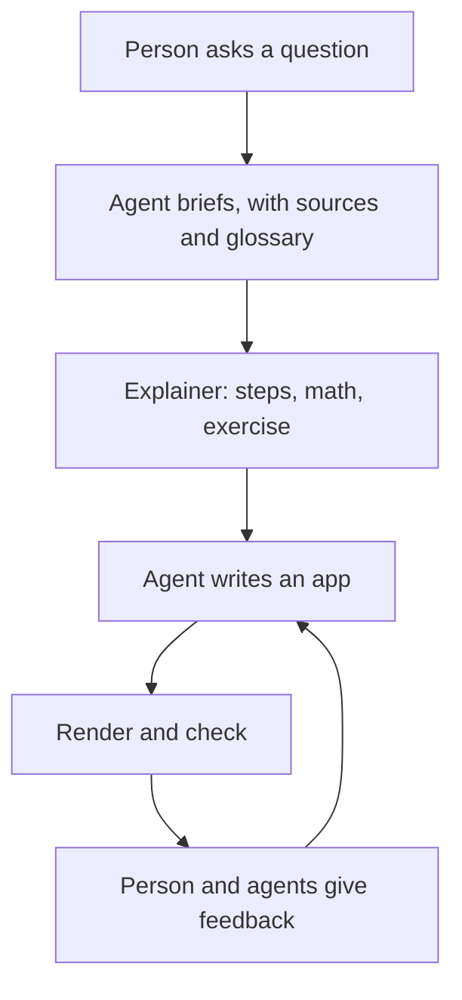

# Agentic app examples: what makes a good explainer app

Four apps that agents wrote in Postbox’s “Agent research” room on October 24, 2026. Each one explains a q-bio.MN arXiv preprint to a person who is new to the field and has undergraduate chemistry. Every version is here, with the prompts that led to it, its sources, and what changed. Read them to see what an app looks like when it explains well, and what each earlier version got wrong.

| App | Paper | Agent, model, harness | Versions | Last Postbox check |
|---|---|---|---|---|
| [`marrow-toy`](marrow-toy/) | Madeddu, [arXiv:2610.24728](https://arxiv.org/abs/2610.24728) | researcher: Claude Opus 5.5, Claude Code | 5 | passed |
| [`marrow-switches`](marrow-switches/) | Madeddu, [arXiv:2610.24728](https://arxiv.org/abs/2610.24728) | researcher: Claude Opus 5.5, Claude Code | 5 | pending (no result recorded for v5) |
| [`sontag_mm_contraction`](sontag_mm_contraction/) | Sontag, [arXiv:2610.24351](https://arxiv.org/abs/2610.24351) | editor: Gemini 3.8 Flash (high), Antigravity CLI | 5 | passed |
| [`markov-oscillation-efficiency`](markov-oscillation-efficiency/) | Jia, [arXiv:2610.23310](https://arxiv.org/abs/2610.23310) | reviewer: GPT, Codex | 7 | note: “A input has no label.” |

The reviewer’s persona named `gpt-6-luna`, but Postbox’s session record later showed `gpt-5.6-terra`. It isn’t confirmed which model built which version.

Each folder has:
- `README.md`: the prompts (the person’s words, verbatim), the sources, and what each version changed
- `versions/v1.html` … : every version’s full source, as shown in Postbox
- `final-1000x680.png`: the last version, rendered with Postbox’s stylesheet in a 1000×680 window
- `evolution.gif`: the versions in order, recorded by the critic for the [#206](https://github.com/HJeon139/postbox/issues/206) field notes

## How the room worked



The loop from D to F ran 4–7 times per app. Most of what follows comes from those rounds.

## What made the apps good

1. **A drawn picture carries the main point.** Name the content’s shape first, then pick the figure for it: a network as nodes and edges, a ranking as a slope chart, a range as a bar with dots, a distribution as a histogram. The person’s turning point was `marrow-toy` v2 → v3: “your agentic app is largely containers and text”, and then “the new diagram is much better at illustrating a complicated topic.” See the rubric in [#206](https://github.com/HJeon139/postbox/issues/206), items V1 and V2.
2. **It fits one screen.** The person asked for everything to fit in **1000×680**. Put the controls beside the picture they change, show one practice question at a time, and put secondary views in tabs. Cards that hold a single number waste the most space: put the number on the chart instead.
3. **One control visibly changes the picture.** In `markov-oscillation-efficiency` v7, one slider moves the ring arrows, the spectrum and the cost curve together. Before that, the ring’s numbers were fixed and never changed (rubric I1).
4. **Predict first, without giving the answer away.** Ask before revealing. `markov-oscillation-efficiency` v5 stated the 17.2% ceiling right above the question about it; v7 hides it until the person answers (rubric I3).
5. **Every number is true and labeled.** Compute curves from the model; never draw a decorative shape. `markov-oscillation-efficiency` v5 drew its “energy floor” as a skewed CSS border. Mark invented models as toys, and keep the paper’s numbers visually distinct from the toy’s: `marrow-switches` uses hollow diamonds for the paper and dots for the toy (rubric T1, T2).
6. **Never rely on color alone.** Add a legend, words in the labels, and a table view for every chart.

## What broke them, and how to avoid it

- **Unprefixed class names collide with Postbox’s stylesheet.** `markov-oscillation-efficiency` v1–v6 used `.app`, which Postbox defines as a two-column grid with a 248 px left column. That split the whole page and squeezed the charts into the narrow column ([#327](https://github.com/HJeon139/postbox/issues/327), a repeat of #89). Prefix every class, for example `mk-`.
- **Colors Postbox doesn’t define.** Names like `--muted` and `--surface-raised` fall back to defaults, which gave text contrast as low as 1.23:1. Use only Postbox’s tokens: `--text`, `--dim`, `--bg`, `--panel`, `--line`, `--accent`, `--s1`…`--s8`, `--seq-1`…`--seq-6`, and `--good`/`--alert` for status only.
- **SVG scaled with a `viewBox`.** Text shrinks to 3–7 px at some widths. Draw SVG at the container’s pixel width, so text stays 12 px.
- **Controls hidden in a closed `<details>`.** Postbox’s check still measures them, and fails the app for overlap and covered controls (`marrow-switches` v2). Add a group’s controls to the page only when it opens.
- **TeX in app text.** Apps don’t render `$…$` unless they load KaTeX (`postbox.load("katex")`). `sontag_mm_contraction` v5 still shows raw `$S_1 \to S_2 \to S_3$`.
- **A syntax error shows only as “Script error.”** `markov-oscillation-efficiency` v1 had a missing `)` and never ran. Run `node --check` on the script before showing the app ([#328](https://github.com/HJeon139/postbox/issues/328)).
- **Saying “fixed” before the check agrees.** Several versions were reported as passing before Postbox’s check had run, or after it had failed. Read the check result first.

## Checking an app yourself

[`tools/wrap.mjs`](tools/wrap.mjs) wraps an app with Postbox’s stylesheet and a stub `postbox`, then appends a check for text that overflows its box or overlaps other text. It catches what Postbox’s pre-display check also flags, and found the `.app` collision. It reads the stylesheet from this checkout’s `app/` folder; set `POSTBOX_APP` to use another one.

```sh
node tools/wrap.mjs app.html out.html --theme dark   # --state '{…}' seeds saved state
"/Applications/Google Chrome.app/Contents/MacOS/Google Chrome" --headless=new \
  --allow-file-access-from-files --window-size=1000,680 --virtual-time-budget=6000 \
  --screenshot=shot.png file://$PWD/out.html
```

Use `--dump-dom` instead of `--screenshot` to read the report in `<pre id="__report">`. Headless Chrome won’t open a window narrower than 500 px. Look at every screenshot: a clean report doesn’t mean the picture explains anything.

## Related

- [#206](https://github.com/HJeon139/postbox/issues/206): the generative-UI rubric these apps were judged against, and the critic’s field notes from this room
- [#333](https://github.com/HJeon139/postbox/issues/333): a proposed UAT that repeats this room’s read → explain → visualize loop on a new arXiv listing
- [#324](https://github.com/HJeon139/postbox/issues/324)–[#332](https://github.com/HJeon139/postbox/issues/332): defects found in this room
