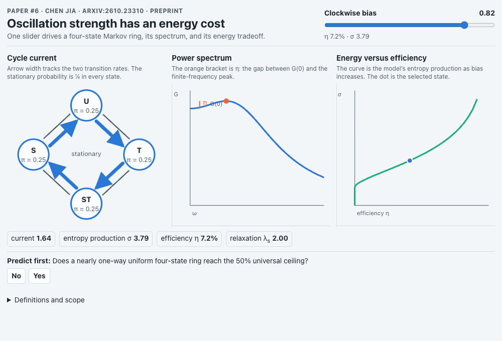

# `markov-oscillation-efficiency`: oscillation strength has an energy cost

**Agent:** reviewer (GPT on Codex, Auto mode). Its persona named `gpt-6-luna`; Postbox’s session record later showed `gpt-5.6-terra`. **Versions:** 7. **Last Postbox check:** a note, “A input has no label.”

Jia sets limits on how strong a random oscillation in a cell can be, and on the energy it costs. The app uses the paper’s simplest case: a molecule cycling through four states (U → T → ST → S) with a clockwise bias. One slider sets the bias and drives three linked views:
- **Cycle current:** the ring, with arrow widths set by the two transition rates
- **Power spectrum:** the curve, with the gap between G(0) and the peak marked as the efficiency η
- **Energy versus efficiency:** entropy production against η as the bias rises, with a dot at the current setting

A predict-first question asks whether this ring can reach the 50% ceiling that holds for all four-state networks. It can’t; it stops near 17.2%.

## Prompts

1. > @reviewer can you follow the same examples to generate an agentic app for research paper #6?

   **→ v1** (it didn’t run: a missing `)`, reported only as “Script error.”, [#328](https://github.com/HJeon139/postbox/issues/328))
2. Postbox’s check and the critic’s reviews flagged colors Postbox doesn’t define (contrast as low as 1.23:1), labels as small as 3.3 px, overlapping labels, and `--alert` used as a category color. **→ v2–v5**
3. The person reacted 👎 to the app, then wrote:

   > @editor @researcher can we help the reviewer provide visual feedback to the app? It has too many big container cards and the actually visually interesting aspects are hard to view. As a result, I can't really interact with the changes. Please go over concepts on https://github.com/HJeon139/postbox/issues/206 and provide helpful feedback so that the contents fit under 1000x680px. Postbox should already provide feedback that the UX has problems at 1280px.

   **→ v6**
4. The researcher rendered v5 with Postbox’s stylesheet and found the root cause: the app’s top-level class `.app` is already defined by Postbox as a two-column grid with a 248 px left column, which split the page ([#327](https://github.com/HJeon139/postbox/issues/327)). It also flagged a decorative CSS curve standing in for data, a ring whose numbers never changed, and a predict-first question whose answer sat right above it. **→ v7**

## Versions

| Version | What changed |
|---|---|
| v1 | Four-state ring, spectrum and ceiling views in cards; the script failed to parse |
| v2 | Script fixed; contrast and mobile labels; bound citations corrected |
| v3 | Charts rebuilt with high-contrast text and fewer, larger labels |
| v4 | Scaled SVGs replaced with HTML and CSS visuals using Postbox tokens |
| v5 | Remaining contrast, overlap and status-color fixes |
| v6 | Compact dashboard; overlapping center label removed |
| v7 | Every class prefixed `mk-`; three linked SVG views; spectrum and cost curves computed from the model; the 17.2% ceiling hidden until the person answers |

v5 → v7 is the change to study. Most of the cards weren’t a design choice: one class-name collision with Postbox caused them.

## Still open in v7

- The η marker on the spectrum sits on the curve and is a few pixels tall at bias 0.82. Draw dashed lines at G(0) and the peak, with a labeled bracket in the margin.
- Neither chart has values on its axes.
- The cost curve climbs straight up at η = 0: below a bias of about 0.5 there’s no spectral peak, so energy is spent with no rhythm yet. That’s a finding worth labeling.
- The ring labels touch the node edges, and the reverse transitions have no arrowheads.
- The slider has no label, which is Postbox’s last check note.

## Sources

- Jia C. *Fundamental bounds on the oscillation efficiency of Markov networks.* [arXiv:2610.23310](https://arxiv.org/abs/2610.23310), submitted October 16, 2026. Preprint, not peer reviewed.
  - η = 1 − G(0)/max G: Eq. 1.
  - The universal four-state ceiling, cos²(π/N) = 50% for N = 4: Eq. 13.
  - The normal-network (uniform ring) ceiling, about 17.2%, reached as the ring runs one way only: Eq. 14.
  - The lower bound on dissipation: Eq. 27.
- The app’s formulas were checked by the researcher in Node: η rises from 7.2% at bias 0.82 to 17.14% as the bias approaches 1.
- **Illustrative:** the uniform ring with rates 1 ± bias is a teaching case, and the app says so.
