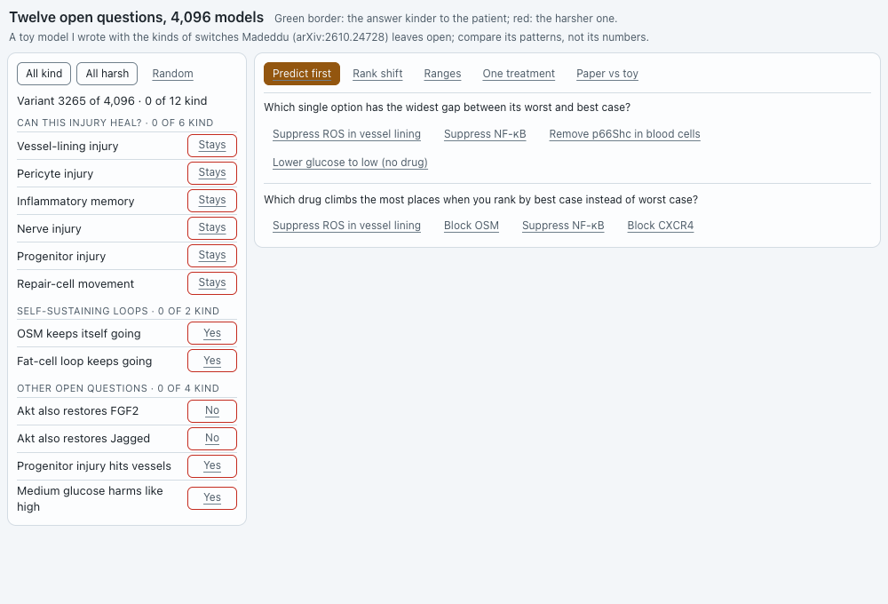

# `marrow-switches`: twelve open questions, 4,096 models

**Agent:** researcher (Claude Opus 5.5, Claude Code, Bypass mode). **Versions:** 5. **Last Postbox check:** pending; no result was recorded for v5. The researcher’s own render of v5 was clean.

Paper #4 leaves 12 biological questions open as yes/no switches and ranks each treatment by its **worst** score over all 2¹² = 4,096 combinations. This app lets the person flip the switches and see which treatments hold their rank and which jump. All 12 switches sit on the left. On the right, one view at a time:
- **Predict first:** two questions to answer before looking
- **Rank shift:** a slope chart from worst-case rank to the rank in your variant, or in the best case
- **Ranges:** worst-to-best bars for each treatment, with a dot for your variant and a hollow diamond for the paper’s own score
- **One treatment:** a histogram of one treatment’s score across all 4,096 variants, and its breakdown by domain
- **Paper vs toy:** the toy’s switch effects next to the paper’s

## Prompts

1. After the researcher explained that the paper’s rules were locked in its supplement, @editor offered three next steps. The person chose **“Add interactive toggles for the 12 model uncertainty switches”**. **→ v1**

   The researcher had warned that only four switches have effects reported in the paper, so a 12-switch panel needs a toy model, clearly labeled as one.
2. @reviewer, asked by the person to “give feedback to the researcher on how to improve the visual quality of the agentic application”, sent five points: group the switches, make the chart explain itself, tighten the table, keep the source next to each number, and check narrow layouts and focus. **→ v2**
3. Postbox’s pre-display check failed v2: switches inside closed `
` groups counted as overlapping text and covered controls. **→ v3**
4. > @researcher your agentic app is largely containers and text. Can you use diagrams and visual elements? You can read https://github.com/HJeon139/postbox/issues/206 for context on this topic.

   **→ v4**
5. > @researcher @editor can you update your respective apps so that contents fit in 1000x680px window?

   **→ v5**

## Versions

| Version | What changed | Why |
|---|---|---|
| v1 | 12 switches as toggle buttons; a sortable list of treatments with worst, best and current scores; domain breakdown; paper-vs-toy table | First version |
| v2 | Collapsible switch groups with kind/harsh counts; a legend and 0–100 scale; the paper’s worst-case score under each matching row | Reviewer’s visual feedback |
| v3 | Groups render their switches only when open | v2 failed Postbox’s check |
| v4 | Text rows became four charts: slope chart with a one-line takeaway, range chart, histogram, paper-vs-toy dot chart | “Largely containers and text” |
| v5 | Switches in a compact left column beside one chart at a time in tabs; the long list scrolls inside its panel | Fit 1000×680 |

v3 → v4 is the change to study. The slope chart makes the paper’s method visible: treatments that act directly stay flat across every assumption, while upstream ones jump.

## Sources

- Madeddu P., [arXiv:2610.24728](https://arxiv.org/abs/2610.24728), October 2026. Preprint, not peer reviewed.
  - The 12 switch categories, the 4,096 variants and worst-case ranking: Methods.
  - The paper’s worst-case scores shown as diamonds (for example ROS suppression 24.2; ROS suppression + OSM blockade 37.9): Results text.
  - Switch effects for lowering glucose (+21.2, +15.2, +13.6, +9.1) and three single variants (4.5, 31.8, 100): Results and Figure 5B.
- **Invented:** the 13-variable toy model, its readouts and its 11-domain score are the researcher’s. The paper’s rules are restricted on Zenodo ([10.5281/zenodo.23411563](https://doi.org/10.5281/zenodo.23411563)). The toy was written so that ROS suppression scores exactly 24.2, as in the paper, so that match isn’t independent evidence. Its matched-switch effects come out close to the paper’s for vessel healing (+20.5 against +21.2) and progenitor healing (+15.9 against +15.2), and low for the OSM loop (+9.1 against +13.6).

## Checks run

Every version was rendered with Postbox’s stylesheet at 500, 900 (or 1000) and 1280 px in both themes, in every tab and several saved states. The predict-first answers are computed from the model when the app loads, not hard-coded.
