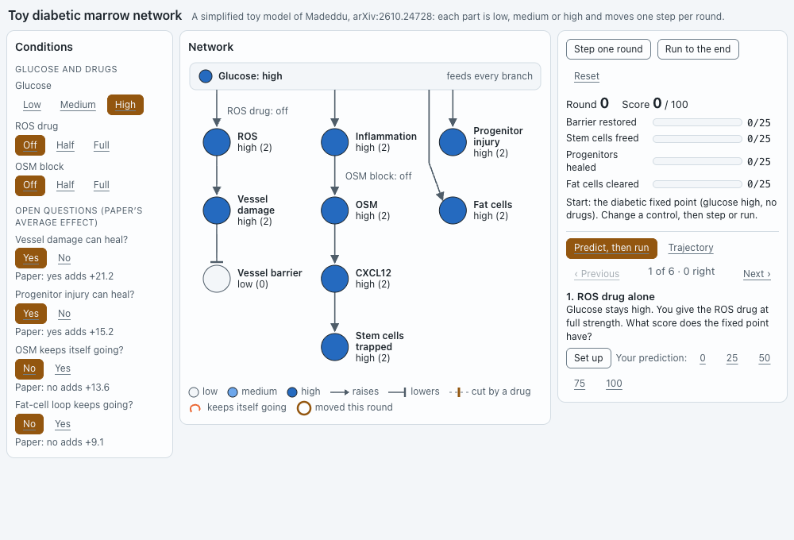

# `marrow-toy`: a simplified toy model of diabetic bone marrow

**Agent:** researcher (Claude Opus 5.5, Claude Code, Bypass mode). **Versions:** 5. **Last Postbox check:** passed.

A practice app for paper #4. Glucose feeds two branches of a small signaling network: a vessel branch (ROS → vessel damage → barrier) and an inflammation branch (OSM → CXCL12 → stem cells trapped), plus progenitor injury and fat cells. Each part is low, medium or high, and moves one step per round toward what its inputs ask for, which is the update rule the paper uses. The person sets glucose, two drugs and four open questions, then steps the model and watches the network settle. Six predict-first challenges each mirror one of the paper’s findings.

## Prompts

The researcher persona’s standing instructions, set by the person:

> Cite sources. Explain step by step, with diagrams, math and an exercise.

The person’s messages and choices, in order:

1. > Please review https://arxiv.org/list/q-bio.MN/recent and brief me on recent peer reviewed discoveries in the molecular networks field. Assume I am brand new to the field and have undergraduate level understanding of chemistry. So please apply glossary terms to terms that may be domain specific jargon.
2. Chose “Go deeper on one of these six”, then “#4 Diabetic bone marrow model”. The researcher read the full PDF and wrote a step-by-step explainer with two Mermaid diagrams, the paper’s update rule and score as math, and two exercises.
3. Chose “Build a practice app: run the toy network yourself”. **→ v1**
4. Chose @editor’s option “Both: sortable table block + app trajectory chart with 4 toggles”. **→ v2**
5. > @researcher your agentic app is largely containers and text. Can you use diagrams and visual elements? You can read https://github.com/HJeon139/postbox/issues/206 for context on this topic.

   **→ v3**
6. > Thanks! the new diagram is much better at illustrating a complicated topic.
7. > @researcher @editor can you update your respective apps so that contents fit in 1000x680px window?

   **→ v4**
8. Reacted ❓ to the message that called the app “a 7-variable cartoon”, and the critic flagged “cartoon” as easy to misread. **→ v5**

## Versions

| Version | What changed | Why |
|---|---|---|
| v1 | Seven variables in HTML boxes, stacked in two columns; five predict-first challenges | First practice app |
| v2 | Four switches for the open questions the paper measured (vessel healing, progenitor healing, OSM loop, fat-cell loop), each showing the paper’s average effect; two new nodes; round-by-round trajectory strips with a table view; six rescored challenges | The person chose this upgrade |
| v3 | The boxes became a drawn network: nodes shaded by level, arrows for “raises” and bars for “lowers”, a drug drawn as a cut on the edge it blocks, loop arcs, red “won’t heal” tags, a ring on each node that moved this round; the score as four bars | “Largely containers and text” |
| v4 | Three columns in 1000×680: conditions, network, run panel; one challenge at a time with Previous and Next; trajectory in a tab | Fit 1000×680 |
| v5 | Header says “simplified toy model” instead of “cartoon” | ❓ on the wording |

v2 → v3 is the change to study. The same state and controls went from text boxes to a picture where each control has a visible place: turning the ROS drug on cuts the line from glucose to ROS.

## Sources

- Madeddu P. *Evidence-informed dynamic modelling and intervention prioritisation in diabetic bone marrow.* [arXiv:2610.24728](https://arxiv.org/abs/2610.24728), October 2026. Preprint, not peer reviewed.
  - The update rule $x_i(t+1) = x_i(t) + \operatorname{sign}(F_i - x_i)$, the three levels, AND = min, OR = max, NOT = 2 − a, and the domain-averaged score: Methods.
  - The four switches’ average effects (+21.2, +15.2, +13.6, +9.1): Results and Figure 5B.
- The pathway links (ROS in vessel lining; OSM → CXCL12 through p66Shc and STAT3) come from the paper’s cited sources: Mangialardi et al., *ATVB* 2013; Albiero et al., *Diabetes* 2015 and 2019.
- **Invented:** the nine-variable network, its rules and the four-domain score are the researcher’s own toy model. The paper’s 42-variable rules are in its supplement, which is restricted on Zenodo ([10.5281/zenodo.23411563](https://doi.org/10.5281/zenodo.23411563)). The app says it’s a toy, and it shows the paper’s numbers only next to the switches they describe.

## Checks run

Each version was rendered in headless Chrome with Postbox’s stylesheet at 500, 900 (or 1000) and 1280 px, in light and dark mode, and in several saved states, and its screenshots were looked at before it was shown. Every challenge’s answer was checked by running the model’s code in Node.
