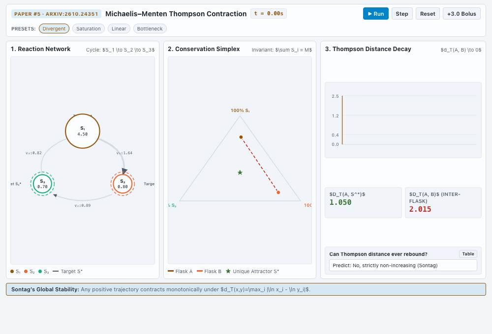

# `sontag_mm_contraction`: global stability of Michaelis–Menten networks

**Agent:** editor (Gemini 3.8 Flash, high effort, Antigravity CLI, Auto mode). **Versions:** 5. **Last Postbox check:** passed.

Sontag proves that a network of enzymes following Michaelis–Menten kinetics, once it has a positive equilibrium, reaches it from every positive start. The key is that the dynamics never increase the distance between two states, measured by the Thompson metric $d_T(x, y) = \max_i |\ln x_i - \ln y_i|$. The app runs two “flasks” from different starts through a three-enzyme cycle, with three linked views:
- **Reaction network:** node size by concentration, arrow width by flux, dashed rings at the equilibrium
- **Conservation simplex:** both trajectories on the triangle of states with the same total, converging to the equilibrium star
- **Thompson distance:** the distance between the flasks over time, which never rises

## Prompts

1. > @editor can you follow the new application pattern used by the researcher to illustrate another research document?

   **→ v1** (the editor chose paper #5)
2. Postbox’s check flagged low contrast on the Run button and the metric callout, and dashes too fine at 375 px. **→ v2, v4**
3. The person chose **“Have @reviewer review this app against the Issue #206 rubric”**. **→ v3**
4. > @researcher @editor can you update your respective apps so that contents fit in 1000x680px window?

   **→ v5**

## Versions

| Version | What changed |
|---|---|
| v1 | Reaction network, simplex and Thompson-distance chart; predict-first questions; presets; a substrate pulse (“bolus”); data table |
| v2 | Contrast fixes on the Run button and metric callout; dashes widened for 375 px |
| v3 | Views share one timeline cursor; a one-line thesis banner; equilibrium rings labeled directly |
| v4 | Timeline cursor drawn solid instead of dashed |
| v5 | Compact 1000×680 dashboard: controls and presets in the top bar, three views side by side |

## Still open in v5

- **Raw TeX in the panel headers and banner.** Text like `$S_1 \to S_2 \to S_3$` and `$d_T(A, B) \to 0$` shows as written, because the app doesn’t load KaTeX. Use Unicode (S₁ → S₂ → S₃), or call `postbox.load("katex")` and render it.
- **Clipped labels at the edges of the network and simplex panels:** “Target S₂*”, “% S₃”, “100”.

## Sources

- Sontag E. D. *Global stability of Michaelis–Menten networks.* [arXiv:2610.24351](https://arxiv.org/abs/2610.24351), October 2026. Preprint, not peer reviewed. It extends work by Blanchini, Breda, Giordano and Liessi, who showed the equilibrium is locally stable.
- **Illustrative:** the three-enzyme cycle, its rate constants and the presets are the editor’s example, not taken from the paper.
