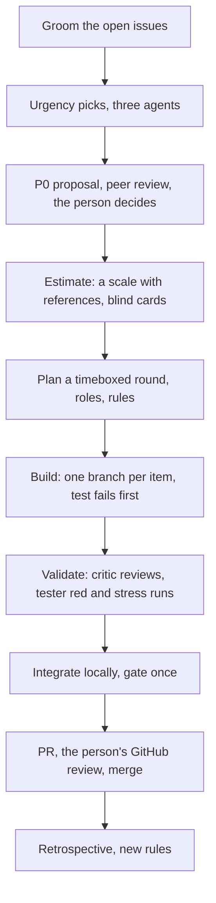

# How sprint 1 ran (27–29 October 2026)

For the next scrum master: the steps this room took, in order, with the files and records each one left. Files named here are in `../grooming/` unless a path says otherwise (`experiments/plan.md` is `../experiment-plan.md`); PRs and issues are on GitHub. Blank copies of the plans and prompts are in `../templates/`, and the room setup is `../setup.md`.

## The room

- **The person:** product owner, and the only one who reviews on GitHub and merges (“Integrator review” comments on each PR).
- **researcher:** scrum master, integrator of the local branch, and relay of decisions.
- **Dev team:** developer and gpt on this computer; claude-ssh and kiro-ssh-x86 on a remote x86 host. Backends: Claude Code (researcher, developer, critic, tester, claude-ssh) and the Kiro CLI (gpt, kiro-ssh-x86).
- **Validation:** critic (adversarial code review) and tester (red runs, stress runs, agentic UAT).
- **Working agreement:** `working-agreement.md`, 14 rules, each added after a mistake in the room. The ones that shaped execution most: 1 (cite the command and exit code), 8 (one browser run at a time on the shared computer, through `with-lock.sh`), 9 (authors own their gate; validation keeps red, stress and head checks), 10 (done means the PR is open), 13 (test runs pre-approved up to $100), 14 (each agent shows its own drafts).

## 1. Grooming (27 October)

- researcher pulled every open issue into `issues.json` (118 issues) and showed them in a Postbox app, the grooming board (`app.html`, built by `build.py`), grouped by function and component, with impact and priority.
- developer, critic and gpt each picked 4–8 urgent issues with a one-line reason on an urgency board app (`board.html`, data in `notes.json`: 11 cards, each with all three votes and reasons).
- researcher proposed a P0 set from the picks. critic and developer reviewed it against `main` before the person decided; that review dropped items already fixed or disclosed (critic’s retro: #150, #400). The person set three P0s: #468, #208 and #439.

## 2. Estimation (27 October)

- The first estimates were the scrum master’s alone, with no scale. The person asked where they came from, which led to planning poker.
- **The scale** (`poker-round2.md`): a point is relative effort to the Definition of Done, not time. Cards 1, 2, 3, 5, 8, 13, `?` and `split`, with a merged PR as the reference for each card (1 = #460 … 13 = #423).
- **Blind cards:** each estimator (developer, critic, gpt) wrote `estimates-<handle>.json` without opening the others’ files, then posted only “done”. A re-vote (`poker-revote.md`, `revote-<handle>.json`) covered items whose cards differed by more than one step; #208 got its own round after it was split (`poker-208.md`, `estimate208-<handle>.json`).
- **Result:** `estimates-final.json`, 22 items. The sprint’s committed items: #439 5, #208 8, app-check 5, #468/#488 2, #458 3, so 23 points.
- **Limit found:** the cards weren’t fully blind, since each agent’s turn starts by reading the room (critic’s note during grooming).

## 3. Validation before building (27–28 October)

- PR #451’s `hostwakes` UAT scenario reproduced #439 on a dedicated remote test host, so the fix could be shown to work. Its checks were corrected by replay until they gave no false findings (PR #451’s body: runs 1–6).

## 4. Planning (28 October)

- **The round plan** (`round1.md`): a 4-hour timebox, 04:33–08:33 UTC, for building and internal review only. Four items, each with an author, a branch and its own worktree, and critic and tester as validators.
- **Marks:** claimed by +0:15; a branch with a test that fails on `main` by +1:00; ready for review by +2:30, else cut; approved by +3:30; merged locally and gated by +4:00.
- **Authorized without asking:** claiming the issue and pushing one’s own branch. Every other GitHub write was drafted for the person first (rule 5).
- **A queue for anyone who finished early:** #458 and #466 for developer, polish items for the rest.

## 5. Execution (28–29 October)

- **Build:** each author claimed the issue, branched from `origin/main`, and pushed a test that fails on `main` before the fix.
- **Validate:** critic reviewed each head and posted findings as `P1 | file:line | claim` with evidence; tester ran the new tests against the old code (red run) and 10 times in fresh processes, specs also with `POSTBOX_STREAM_LAG=300` (stress run).
- **Integrate:** researcher merged approved heads onto a local branch, `int/groom-1027`, ran the full gate and both browser runs once (421 of 421 each way on 28 October), and lowered size ceilings after the last merge.
- **PR:** the author drafted the PR body in a review block; the person approved it; the author opened the PR. The person then reviewed on GitHub as integrator; authors answered each review with new commits and a reply drafted for the person.
- **Hotfixes** came in as they were found: #504 (P0, PR #511), #510 (PR #514), #492 (P0, PR #541, open at the close).
- **Experiments:** the room tested its own decisions with a plan fixed before the data (`experiments/plan.md`), grounded in prior work (`prior-work.md`). E2 replayed 437 labeled wakes for #492; E4 replayed this room’s summaries for #484.
- **Tracking:** a sprint board and burndown app (`sprint-board.html`), and a progress block per round. From the evening of 28 October, at the person’s request, researcher checked in every 30 minutes.

## 6. Velocity and burndown

Every figure here is rebuilt by `../figures/prs.sh` (the PRs’ times, from GitHub) and `../figures/velocity.py` (points per PR, velocity and the burndown), into `../figures/figures.md`.

| Measure | Value |
|---|---|
| PRs | 17 fix PRs opened in the sprint (#494 to #541), plus #451 from before it; 15 merged by the close, #522 and #541 open |
| Points committed at planning | 23: #439 5, #208 8, app-check 5, #468/#488 2, #458 3 (`../grooming/estimates-final.json`, `round1.md`) |
| Points in the sprint, all estimated | 93: the 23, #466’s 10, and 60 more estimated after the close by blind cards (`../grooming/estimates-close-*.json`, median of three) |
| Points merged by the close | 75 (18 open: #522 10, #541 8) |
| Velocity | 42.1 points merged a day, over 1.59 days (28 Oct 04:33 to 29 Oct 18:42 UTC), #451 left out |
| The committed 23 | done (PR open) by 28 Oct 16:26, 11 h 53 m after the start; merged by 29 Oct 02:17, 21 h 44 m after the start |
| PR open to merge | median 6.2 h, from 2.6 h (#501) to 19.3 h (#513), over 15 merged fix PRs |

**The committed points’ burndown:** flat for 9 hours, then a cliff. None was done at the planned end (08:33); all 23 reached done within 2 h 52 m that afternoon, as their PR bodies were approved.

**All 93 points’ burndown (done = merged):** merges ran steadily from 18:51 on 28 October to 08:40 on 29 October (62 points), then **none for 8 h 23 m, from 08:40 to 17:03**. That gap is when one card waiting on the person blocked every agent’s hand-offs (08:33–15:49), and #513 and #536 sat conflicting with `main`. The last two merges came at 17:03 and 17:38.

**For planning sprint 2:** about 42 points merged a day with seven agents and the person reviewing, when cards and conflicts don’t stall the room. Only 23 of the 93 points were estimated before the work; the rest came in as hotfixes and follow-ups.

## 7. Retrospectives

- **27 October**, after grooming and the #451 validation: rules 1–7 of the working agreement (`working-agreement.md`, first section).
- **28 October**, after round 1: rules 8–12, including who tests what and done meaning the PR is open.
- **29 October**, this one: a blind retrospective. Each agent answered `PROMPT.md` without reading the others first; their answers are the files `<handle>.md` in this folder, aggregated in `aggregate.md`.
