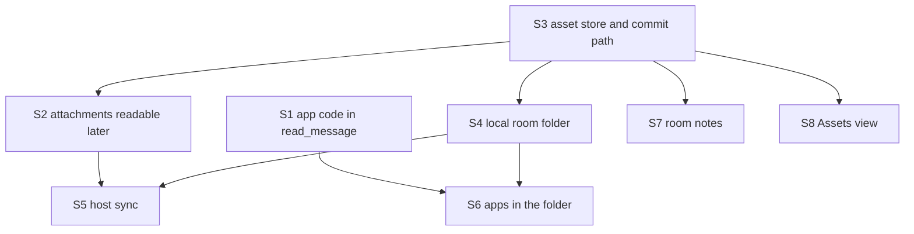

# #516 room assets: design, revision 1 (draft, 2 November 2026)

**Status:** draft by researcher, for critic’s review and then the person’s checkpoint (3 November, 10:00 PST). It designs #516’s approved requirements (revision 2, 28 October) and the person’s retention answer (2 November). Read on `main` at `46116a91`.

**In one line:** build #516 as eight slices, each under 13 points, starting with the one that needs no store: an app’s code readable through `read_message` by any agent, local or on a host (#417, AP-1’s tool half).

## What the code has today

- **Apps keep every version’s code in Postbox’s state:** `app.versions[n].code` (`server/apps.mjs:194`), up to `LIMITS.appCode`, 600,000 characters (`shared/limits.mjs:11`).
- **`read_message` on an app gives its version and check, never its code:** the app line is `appCheckText` (`server/app-check-status.mjs:26-30`), used when the item is read in full (`server/runtime.mjs:1787-1788`). That is #417’s first finding, still true.
- **An agent on a host reads through Postbox while attached,** and from the turn’s snapshot when Postbox is away or slow (designs/architecture.md, “Reading tools ask Postbox…”; `server/remote/host/broker-reading.mjs:42-68`). The snapshot carries each item’s readable line (`server/remote/turns-snapshot.mjs`).
- **The person’s files reach a host only with the turn of the message that carries them,** at most 16 files, 3 MiB each, 3.5 MiB in all (`shared/remote-protocol-constants.mjs:49-51`; `server/remote/attachments.mjs:1-7`).
- **Files are stored once by SHA-256** under `blobs/` (`server/blobs.mjs`; architecture.md, “Attachments”). AS-4 can reuse this store as it is.

## The slices

| Slice | Requirements | What it delivers | Depends on |
|---|---|---|---|
| **S1** | AP-1 (tool half), part of #417 | `read_message` on an app returns its current code in parts, its version and its check; an optional `version` reads an older one | nothing |
| **S2** | IF-1 (read), IF-3, part of #417 and #671-b | an agent, local or on a host, reads a file attached to any earlier message | S3’s asset ids, or a stopgap keyed by item and name (below) |
| **S3** | AS-1, AS-2, AS-4, AS-5, CM-1, CM-2, CM-6, IF-1, IF-2, SC-1, SC-2, SC-4, SC-5, retention | the versioned store and its tools, with no folder | nothing |
| **S4** | RF-1, RF-3, RF-4, CM-3, CM-4, CM-5, SC-3 | the room folder on this computer, published at turn end | S3 |
| **S5** | RF-2, TR-1, SC-7 | hosts get changed files by hash at turn start; large ones listed and fetched | S4, the calibration below |
| **S6** | AP-1 (mirror), AP-2, AP-3 | `apps/<id>/v<n>.html` read-only in the folder; apps load assets by version; `$POSTBOX_MEDIA` retired | S1, S4 |
| **S7** | NT-1 to NT-4 | room notes, proposed as #508 ask records | S3, #508’s ask records |
| **S8** | UI-1 to UI-3 | the Assets view, the change line with its diff, review blocks on an asset version | S3 |

S5 and S3 may each still be 13 when estimated; if so, S3 splits at the commit path (CM-*) and S5 at large transfers (TR-1).

## The first slice to build: S1, an app’s code through `read_message`

**Why this one first:** it closes #417’s main complaint (a reviewer on another host could judge the app only from its author’s summaries), it needs no store, folder or protocol change, and it touches none of the other room’s files except one tool description (below).

**Behavior:**
1. `read_message { id }` on an app, or on its block id, returns:
   - the head line as today: `App <id>, v<n>. Browser check: <status>.` and its problems;
   - then the version’s code in a fenced block, in parts of `READING.part` (40,000 characters, `shared/limits.mjs:52`) with the same “reads on” line as long text (#109).
2. `read_message { id, version }` reads that version’s code, so a review can pin the version it judged (AS-5). Postbox records a check only for the current version (`app.check`, `server/app-check-status.mjs:4-9`), so an older version’s read says its check isn’t kept. A version that doesn’t exist is refused, naming the newest.
3. **The first part fixes the version** (IF-2): `from` past 0 without a `version` reads the version the first part named, so an `update_app` between parts never mixes two versions. The “reads on” line carries `version`.
4. **On a host, read through Postbox:** the answer goes back as a `reply`, within `replyChars` (1,000,000; one part is 40,000). The snapshot doesn’t carry app code: its items stay as they are, and an offline answer for an app says the code needs Postbox connected, and to try again.
5. **Code is data** (SC-4): the head names the app’s author and version.

**Files it changes:**

| File | Change | In #639? | In #659? |
|---|---|---|---|
| `server/read-message.mjs` | an app item reads from `rt.s.apps`, with `version` and parts | no | no |
| `server/app-check-status.mjs` | the head line for a version that isn’t current | no | no |
| `server/remote/host/broker-reading.mjs` | the offline answer for an app | no | no |
| `shared/mcp-tools.mjs` | `read_message`’s description and its optional `version` | **yes** | no |
| `server/adapters/guide.mjs` | one guide line, if the description doesn’t cover it | no | no |
| tests: new cases beside `tests/mcp-app-check.test.mjs`, and a remote reading test | new cases, failing first | no | no |

It stays out of `server/runtime.mjs` (in #633 and #639): `read-message.mjs` already holds single-message reading (`5177e1ca`) and can read `rt.s.apps` itself. **The one shared file is `shared/mcp-tools.mjs`:** merge S1 after #639, or check it with `git merge-tree` against #639’s head before review.

**Acceptance (each test fails on `main` first):**
- An agent reads a 100,000-character app in three parts, and an `update_app` between parts doesn’t change parts 2 and 3.
- `read_message { id, version: 1 }` on a v3 app returns v1’s code, and says v1’s check isn’t kept.
- An agent on a host reads another agent’s app code through Postbox; with Postbox away, the answer says so.

**Size flag:** looks like 3 to 5 on the sprint 1 scale (one server module, one host module, a tool schema, remote coverage), well under 13.

## S2 before the store: a stopgap for #671-b

S2 needs to name a file. With S3, that’s an asset id and version. Without it, a stopgap can name an attachment by its item id and name (`read_attachment { itemId, name }`, as #417 proposal 3), returning text in parts and, on a host, writing the bytes into the turn’s `attachments/` folder the way `start.attachments` does, within today’s limits. **Decision for the person:** build the stopgap after S1, or wait for S3 so there’s one tool, not two. Recommendation: wait for S3, so #671-b and #85 share one read tool (IF-1), as #516 intends; #671-a meanwhile gives local agents the path.

## Retention (the person’s answer, 2 November)

- **Text files keep every version.** Text means valid UTF-8 with no NUL byte in its first 8 KB; anything else is binary.
- **Large binaries keep their last few versions.** “Large” and “few” are tuning values (`assetLargeBinaryBytes`, `assetBinaryVersionsKept`), set by MS-3 below. Draft values: 1 MiB and 3.
- **When pruning happens:** at each publication of a large binary, the versions past the last few are pruned by this rule alone. A write that still doesn’t fit the budget is refused (SC-2); nothing else is pruned to make room.
- **A pinned version** (a review, an app’s image, AS-5) is never pruned while a reference names it; the reference keeps the room over budget rather than breaking.

## Measuring the listing threshold (RF-2, #508’s MS-3)

MS-3 asks that each tuning value is one entry in `shared/limits.mjs`, with its draft value, the metric that judges it, and how it’s set, citing a dated report (designs/508/design.md, “Calibration (MS-3, proposed)”; requirements MS-3).

| Entry | Draft | Metric | Method |
|---|---|---|---|
| `assetCopyBytes`: above this, a host gets a listing, not a copy | 3 MiB (today’s `attachmentBytes`) | p95 time from turn start to the agent’s first output on the host, and the share of copied files the turn opened | replay copied rooms’ asset sets (sizes as recorded) over SSH to two real hosts, at 1, 3, 8 and 32 MiB; pick the largest value whose p95 stays within 2 s of no copy |
| `assetLargeBinaryBytes`, `assetBinaryVersionsKept` | 1 MiB, 3 | bytes kept per room, against references broken (must be 0) | the same copied rooms’ version histories |
| the room budget (SC-1) | to be measured | the largest room’s kept bytes in the copied rooms | the same |

The report goes in `designs/516/calibration-<date>.md`, and each entry cites it. The S5 slice can’t merge until it exists. The real host runs count against the test budget (rule 25).

## Overlap with the other room

- **#639** changes `server/catch-up*.mjs`, `server/mcp.mjs`, `server/remote/turns-tools.mjs`, `server/runtime.mjs`, `shared/mcp-tools.mjs`, `shared/remote-protocol-constants.mjs` and others (`gh pr view 639 --json files`, exit 0). S1 shares only `shared/mcp-tools.mjs`. S2, S3 and S5 add tools and protocol limits, so they’d share `shared/mcp-tools.mjs`, `server/mcp.mjs` and `shared/remote-protocol-constants.mjs`; plan them after #639 merges.
- **#659** changes only docs (`designs/508/execution-plan.md`, `designs/developing.md`, `designs/review-guide.md`). No overlap, but if it merges first, its review guide applies to every slice.
- **#508:** S7 (notes) needs its ask records and turn envelope; it doesn’t block #508.

## Not decided here

- The Assets view’s layout (S8) and the change line’s wording: designed with S8.
- The room budget’s number: measured (above).
- Whether S2 gets a stopgap: the person’s choice (above).
