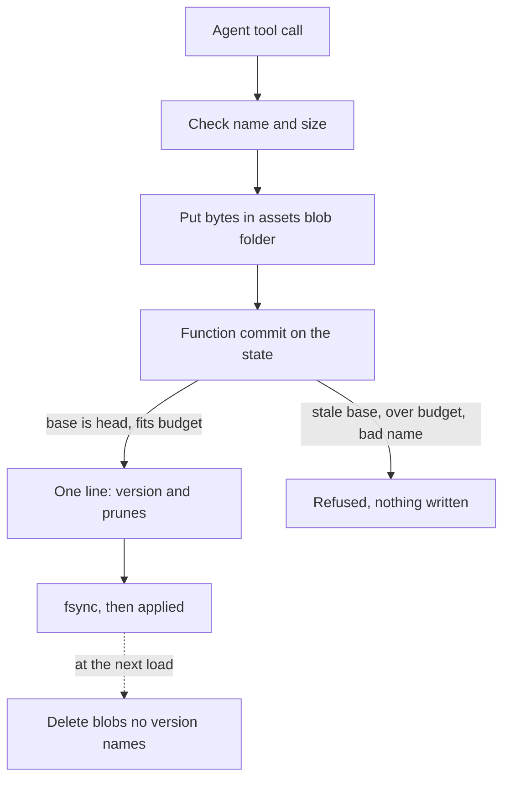

# #516 S3: the asset store and its commit path (design, revision 1, 2 November 2026)

**Status:** draft by researcher, for critic’s review and then the person. Scoped to S3 only, as #516’s design revision 2 requires for a durable, concurrent slice (rule 13): its invariants, a failure table, and the retention rule. Read on `main` at `91112d35` (v1.12.3). The slice plan and S1 are in `design-516.md`, revision 2.

**In one line:** an asset is a list of versions in Postbox’s state, each naming its bytes by SHA-256 in a blob folder of its own; every write goes through one function commit that checks its base version, the budget and retention in the same step, so a version exists only once the disk has it.

## What S3 covers, and what it doesn’t

| In S3 | Requirement |
|---|---|
| Assets with a stable id, a name in the room’s namespace, a type, a size and an author; listing in pages | AS-1 |
| Every publication is a new version with author, time and base; a delete is a version and can be undone | AS-2 |
| Bytes stored once by hash, outside the event log | AS-4 |
| Every read can name an exact version, and a named “latest” exists | AS-5 |
| One commit path; a write names its base; a stale base is refused, naming the newer version; a repeat makes one version | CM-1, CM-2, CM-6 |
| Postbox’s tools to list, read, write, rename, delete and restore | IF-1 (local agents in full; agents on a host with text only, below) |
| Large text read in pages, the version fixed by the first page | IF-2 |
| Bounds, the budget, refusals that keep the agent’s copy | SC-1, SC-2 |
| Reads name author and version; names checked | SC-4, SC-5 |
| The person’s retention rule | #516 section 10, decision 1 |

**Not in S3:** promotion to the project (AS-3, with the Assets view, S8); the room folder and its conflicts (S4: RF-*, CM-3 to CM-5); copying to hosts, `fetch`, and files over the protocol’s limits (S5: RF-2, IF-3, TR-1); the person’s attachments as assets (S2); notes (S7); anything the page shows (S8).

## What the code has today

- **The store writes a commit as one fsynced line, and applies it only once the disk has it** (`server/store-commit.mjs:1-16`). A commit given as a function of the state runs first in its group, “so it sees every earlier batch applied” (`server/store-commit.mjs:131-138`), and a function that throws rejects that commit alone, with nothing numbered (`server/store-commit.mjs:113-119`). That is the compare-and-set S3 needs.
- **A failed write or fsync closes the store to commits** until Retry or a restart, and the next load decides what landed (`server/store-commit.mjs:13-16`).
- **A repeated `opId` resolves as a duplicate without writing** (`server/store.mjs:236-237`), but the store keeps op ids only for the commits since the latest snapshot (`server/store.mjs:51`). So op ids alone can’t make a repeat idempotent forever.
- **Blobs are published whole:** a draft, synced, renamed, then the folder synced; a failed write leaves no draft (`server/blobs.mjs:21-55`).
- **Nothing ever deletes a blob,** and seven callers store them: uploads (`server/index.mjs:492`), app data files (`server/agent-files.mjs:79`, `server/remote/turns-tools.mjs:102`), the ledger (`server/ledger.mjs:518`, `:526`), narration (`server/narration/narrator.mjs:98`) and host turns (`server/remote/turns-origin.mjs:80`). Not every reference to those blobs lives in one list of the state.
- **What reaches the browser** is decided by `PUBLIC_STATE_KEYS` and each event’s `public` flag (`shared/state.mjs:67-86`, `:109-153`). `files`, the attachments’ metadata, is public (`shared/state.mjs:79`, `:126`).

## The model

- **Its own blob folder:** asset bytes go in `assets/` under the data folder, a second `Blobs` instance (`server/blobs.mjs`), not the shared `blobs/`. Since nothing proves which of the seven callers above still names a shared blob, S3 deletes only blobs it alone owns. The cost: an attachment that becomes an asset (S2) is copied once.
- **State:** a new key, `assets`, holds `{ id, room, name, created, head, versions }`. Each version is `{ v, sha256 | null, size, type, text, author, at, base, op, pruned? }`. `sha256: null` is a delete. `room` is the conversation’s root thread, so its side and topic threads share it.
- **Events:** `asset` (created or renamed, the asset without its versions) and `asset.version` (one version appended, and any prunes it causes), written together in one commit.
- **Public:** `assets` holds metadata only, like `files`, so the recommendation is to make it public. Its contents never reach the state. This is a change to what reaches the browser, so it’s reviewed as a security change (AGENTS.md, “Security boundaries”).

## Invariants

| # | Invariant | How it holds |
|---|---|---|
| I1 | A version is visible to anyone only after its line is fsynced. | Every write goes through one function commit; the store applies nothing before the fsync (`store-commit.mjs:6-7`). |
| I2 | Every version that isn’t a delete or pruned names a blob that’s on disk. | The blob is put, and its folder synced, before the commit is queued. A blob is deleted only at load, before any write can start, and only when no version names it (below). |
| I3 | Versions are append-only: a version’s bytes, author and base never change. | `asset.version` only appends; a prune sets `pruned` and nothing else. |
| I4 | Of two writes from one base, exactly one makes the next version; the other is refused, naming it. | The commit function compares the write’s `base` with `head` on the state it’s given (CM-2). |
| I5 | Repeating a write makes no second version, however long after. | The commit function returns no events when any version of the asset has the same `op`, or the head has the same `base`, bytes and author; the tool answers with that version (CM-6). Durable, unlike the store’s op ids. Without an `op`, a repeat that arrives after another agent’s write is refused as stale (F3), not recognized. |
| I6 | After every commit, a room’s kept bytes are within its budget. | The commit function counts the room’s unpruned versions, once per distinct hash, and refuses a write that wouldn’t fit (SC-2). |
| I7 | Pruning follows the person’s rule alone. | Below. |
| I8 | Names are relative paths in the room’s namespace, unique among a room’s live assets. | Checked before the blob is put and again in the commit (SC-5). |
| I9 | Everything is bounded: an asset’s size, a room’s assets, an asset’s versions, a page. | `shared/limits.mjs` entries; a write past one is refused with the limit named. |
| I10 | A read names its author and version, and is data. | Every read’s head line (SC-4). |

**Names (I8):** UTF-8, NFC-normalized, at most 255 bytes, `/` as the only separator, no empty segment, no `.` or `..` segment, no leading `/`, no backslash, no NUL or control characters. Unique ignoring case, since the S4 folder on this computer is usually on a case-insensitive disk. That last part is a decision for the person (below).

## Retention (the person’s answer, 2 November)

- **Text keeps every version.** A version is text when the whole of it decodes as UTF-8, with no NUL byte; anything else is binary.
- **Large binaries keep their last few versions.** A binary version over `assetLargeBinaryBytes` is pruned once `assetBinaryVersionsKept` newer versions of that asset exist. Draft values: 1 MiB and 3, set by calibration (`design-516.md`, “Measuring the listing threshold”).
- **When:** in the same commit as the version that makes an older one prunable. Never at another time, never to make room.
- **Never pruned:** the head, any text version, a small binary, and a pinned version. Nothing pins a version in S3; S6 (apps) and S8 (reviews) add the pins, and the rule already holds for them.
- **A pruned version** stays listed, as pruned, with its size and hash; reading it says it was pruned under retention, and when.
- **A full budget with nothing left to prune** (text, small binaries and pinned versions only) refuses every write: the refusal says the room’s budget, the bytes the write needs, and what frees space: deleting an asset and then pruning its history (a person’s action, in S8), or the person raising the budget. The agent keeps its own copy, since the write never left it. S3 adds no automatic way out: the person’s answer rules one out.

**A delete doesn’t free space on its own:** it’s a version (AS-2), and its earlier versions stay so it can be undone. Freeing a deleted asset’s bytes is the person’s explicit action, in S8’s view.

## Failure table

Each write that can fail partway, and what the store holds after it.

| # | Failure | Store after it | What the agent is told |
|---|---|---|---|
| F1 | The name, size or a bound is wrong | Unchanged; no blob written | The rule broken, and the limit |
| F2 | Putting the blob fails (disk full, permissions) | Unchanged; no draft left (`blobs.mjs:45-49`) | The write failed, with the cause; its copy is still its own |
| F3 | The blob is put, then the commit is refused (stale base, budget, a name taken meanwhile) | Unchanged; one blob nothing names (an orphan) | The refusal: the newer version, or the bytes needed |
| F4 | Postbox stops after the blob is put, before the commit | Unchanged; one orphan | Nothing (the turn ended); a retry is F3 or a success |
| F5 | The log write or fsync fails | The store closes to commits; the line may be on disk, whole or torn, and the next load decides (`store-commit.mjs:13-16`) | “Not confirmed”: never reported as published (CM-4’s rule) |
| F6 | Postbox stops after the fsync, before the tool answers | The version exists | Nothing; the retry finds it (I5) and answers with it |
| F7 | Retry reloads the store while the commit is in flight (`ERELOADED`, `store-commit.mjs:29-31`) | Whatever the reload read back | “Not confirmed”; a retry is F3 or F6 |
| F8 | A prune commits | The version is pruned; its blob stays until the next load deletes it | Nothing: the write itself succeeded |
| F9 | Two agents write the same asset from one base at once | One version; the second commit is refused (I4) | The second agent: the newer version, to read and write again |
| F10 | Two agents create assets with the same name at once | One asset; the second refused at the commit (I8) | The name is taken, and by which asset |
| F11 | The conversation is erased (`server/thread-erase.mjs`) | Its assets leave the state in the erase’s commit; their blobs go at the next load | Not applicable |

**Orphans (F3, F4, F8, F11):** an asset blob that no unpruned version names. They’re deleted only at load: after the store holds its folder’s lock (`server/store-lock.mjs`) and has read the log, and before any tool accepts a write. Then no put can be in flight. Deleting while Postbox runs would race a write: a put of the same bytes as a pruned version finds the file already there (`server/blobs.mjs:30-36`), and a delete between that put and its commit would leave the new version naming nothing (I2). The pass reads only `assets/` and only the `assets` state, so it can’t touch a blob the seven other callers use. An orphan counts against nothing, since the budget counts versions; pruned bytes stay on disk until the next load.

**A torn line (F5):** the store’s one recovery path already decides it (`server/store-recover.mjs`). An asset event that didn’t land leaves its blob an orphan, as F4.

## The tools

| Tool | Does | Local | On a host |
|---|---|---|---|
| `list_assets { page? }` | The room’s assets, in pages, with head version, size, type and author | yes | yes |
| `read_asset { id, version?, from? }` | A text version in parts of `READING.part`, every “reads on” line naming the version, `from` over the content alone (as S1); a binary or pruned version gives its metadata | yes | yes |
| `write_asset { name or id, base, text or path }` | Creates (no `base`) or updates (`base` is the head the agent read); `path` is a file in the agent’s own folders, read as `codePath` is (`server/agent-files.mjs:31`) | yes | `text` only, within the protocol’s request limit; `path` and binaries wait for S5 |
| `rename_asset { id, base, name }` | A new version with the new name and the same bytes | yes | yes |
| `delete_asset { id, base }` | A version with no bytes | yes | yes |
| `restore_asset { id, version, base }` | A new version with an older version’s bytes, unless it was pruned | yes | yes |

Each write tool takes an optional `op` the agent chooses, so a retry after F5, F6 or F7 is recognized (I5); without one, the base, bytes and author still recognize it.

## Files it changes

| File | Change | Other room’s open PRs |
|---|---|---|
| `server/assets.mjs` (new) | the model, names, the commit function, refusals | none |
| `server/asset-retention.mjs` (new) | what a version prunes; the budget count | none |
| `server/asset-tools.mjs` (new) | the six tools’ handlers | none |
| `server/asset-orphans.mjs` (new) | the orphan pass at load | none |
| `shared/state.mjs` | the `assets` key and its two events, public | none |
| `shared/limits.mjs` | the asset bounds and the two retention values, as MS-3 entries | none |
| `shared/mcp-tools.mjs` | the six tools | **#639** |
| `server/mcp.mjs` | dispatching them | **#639** |
| `shared/remote-protocol-constants.mjs` | only if a host lists tool names or a request limit | **#639** |
| `server/thread-erase.mjs` | erasing a conversation’s assets | none |
| `server/index.mjs` | the `assets/` blob folder, and the orphan pass at load | none |
| `server/adapters/guide.mjs` | the guide’s lines for assets | none |
| `designs/architecture.md` | “The store” and “Attachments”: the asset folder, key and events | none (#615 changes only `designs/305-archive-turns.md`) |
| tests: `tests/assets*.test.mjs` (new) | the invariants and each failure row, failing first | none |

Checked with `gh pr view <n> --json files` for #615, #631, #633, #639, #656 and #659 (each exit 0). Only #633 and #639 change server files, and only #639 shares any of these. S3 stays out of `server/runtime.mjs`, which both change. So S3 merges after #639, or is checked with `git merge-tree` against #639’s head before review.

## Decisions for the person (rule 15)

1. **Names unique ignoring case** (recommended: the S4 folder on this computer usually sits on a case-insensitive disk, so `Design.md` and `design.md` would be one file there), or case-sensitive, as on a host.
2. **The room budget before calibration measures it:** a draft value for `assetRoomBytes` until the calibration report sets it. A placeholder of 1 GiB is this draft’s guess, from no source.
3. **Erasing a conversation erases its assets** (recommended, since a room owns them, and promotion is S8’s), or keeps them for the project.

## Size

As written, S3 reads like 13. It splits at the tools:
- **S3a:** the model, the commit function, retention, orphans, the state key, the events and all of the failure table’s tests, with no tools.
- **S3b:** the six tools, local and on a host, and the guide.

## Not decided here

- How the person frees space and prunes a deleted asset: S8, with the view.
- How the person’s attachments become assets: S2.
- Files over the protocol’s limits, and `fetch`: S5.
