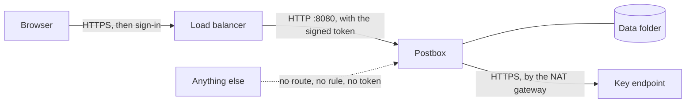

# A hosted Postbox on AWS, for a test

This folder deploys one hosted Postbox to your own AWS account, to prove its edge against a real load balancer. Why it is shaped this way is in [designs/architecture/hosted.md](../designs/architecture/hosted.md), “The test deployment on AWS”. A hosted Postbox isn’t finished: that document’s “Status” says what works, and until rooms follow membership, everyone you let sign in reaches every room.

It is a CDK app in plain JavaScript, with its own `package.json`. The `postbox` package still has no dependencies: nothing here ships in it.



## What it makes, and what it costs

With nothing of yours given: one VPC with public and private subnets and one NAT gateway, one Application Load Balancer, one Cognito user pool, one ECS cluster with one Fargate task (0.5 vCPU, 1 GB, ARM64), one EFS file system and one log group. Left running, the load balancer, the NAT gateway and the task cost about two and a half dollars a day in us-east-1, at the prices on [the load balancer’s](https://aws.amazon.com/elasticloadbalancing/pricing/), [the NAT gateway’s](https://aws.amazon.com/vpc/pricing/) and [Fargate’s](https://aws.amazon.com/fargate/pricing/) pages. Take it down when you’re done (“Take it down”).

## Use what you already have

The deployment is four constructs, each usable alone, and `HostedPostbox` (`lib/hosted-postbox.mjs`), which puts the four together in one scope:

| Construct | What it is | Why it is apart |
|---|---|---|
| `PostboxNetwork` (`lib/network.mjs`) | The VPC, and the security groups that say who reaches whom | Everything else stands on it, and it rarely changes |
| `PostboxData` (`lib/data.mjs`) | The disk the data folder is on | It is the one part that can’t be made again |
| `PostboxEdge` (`lib/edge.mjs`) | The load balancer, its name and certificate, and the sign-in | It stands without a server behind it |
| `PostboxServer` (`lib/server.mjs`) | The one task and its service | It changes with every release, and is the likeliest to fail to start |

`app.mjs` puts each in a stack of its own, so a part that fails rolls back alone: a server that doesn’t start leaves the network, the disk and the edge standing, and the next deployment makes only the server again. The server’s stack imports what the edge’s stack exports (the load balancer’s ARN, the client’s id, the target group), so the edge can’t rename or drop one of those while a server uses it: take the server’s stack down first. They make what they aren’t given and use what they are:

| You have | Give it | Else |
|---|---|---|
| A hosted zone | `address: { domainName, hostedZone }`: it requests the certificate, proves it through the zone and points the name at the load balancer | `address: { certificate, domainName? }`, a certificate of your own |
| An identity provider | `signIn: { userPool, userPoolDomain }` for a Cognito user pool, to which it adds one app client of its own; or `signIn: { oidc: { … } }` for any OIDC provider | a new user pool, whose people an administrator makes |
| A VPC | `vpc`, with private subnets that reach the internet | a new one: the load balancer in public subnets, Postbox in private ones behind one NAT gateway |

```js
new HostedPostbox(stack, 'Postbox', {
  source: { root: '/path/to/the/postbox/clone' },
  address: { domainName: 'postbox.example.com', hostedZone },
  signIn: { userPool, userPoolDomain },
  allow: { subjects: ['…'] },
});
```

**Signing in is not being let in.** The provider says who a person is. Who may use this Postbox is `allow`, Postbox’s own list, which Postbox checks on every request: people by their subject at the provider. A provider you share with other applications admits none of their people until you name them. `allow` is required, and until it names someone the app here leaves the server’s stack out. Admitting by a group’s claim (`allow.groups`) is only for an OIDC provider whose administrators alone set that claim; the construct refuses it for a Cognito user pool, where a claim is an attribute a person may be able to write for themselves through another of the pool’s clients. For the same reason, a person named by their email address must have one the provider verified: a provider whose userinfo doesn’t say `email_verified` must name people by another claim, so with an OIDC provider the app asks for `claimUsername` and has no default. And on a Cognito user pool shared with other applications, don’t set `claimUsername=preferred_username`: a person can write that attribute for themselves through another client, and so choose the name they are mentioned by.

## Deploy it with the app here

`app.mjs` is a small app around the construct. What is yours comes in as context: `-c name=value` on the command line, or a `cdk.context.json` in this folder, which git ignores, so your domain, your zone and your provider are never committed.

| Context | What it sets |
|---|---|
| `domainName`, `hostedZoneId`, `hostedZoneName` | The name people open, in a hosted zone of yours |
| `certificateArn` | Instead of a zone: a certificate of yours in ACM, with `domainName` when your DNS points one at the load balancer |
| `userPoolId`, `userPoolDomain` | A Cognito user pool of yours, and its sign-in domain (the prefix, or a full custom domain) |
| `oidcIssuer`, `oidcAuthorizationEndpoint`, `oidcTokenEndpoint`, `oidcUserInfoEndpoint`, `oidcClientId`, `oidcClientSecretName` | Another OIDC provider. The secret is read from Secrets Manager by its name as the stack deploys |
| `claimUsername`, `claimName` | The claims that hold a person’s user name and name. `email` and `name` with a Cognito user pool; with an OIDC provider `claimUsername` is required |
| `allowSubjects` | Who may sign in: their subjects at the provider, separated by commas. Until it is given, the server’s stack is left out |
| `allowGroupsClaim`, `allowGroups` | With an OIDC provider only: anyone in one of these groups, read from this claim |
| `deletionProtection` | `false` lets the load balancer be deleted, for a test you will take down. On |
| `openTo` | The addresses that reach the listener, as a CIDR. Everywhere |
| `stackName` | The stack’s name. `PostboxTest` |

You need the AWS CLI signed in to the account, the account [bootstrapped for CDK](https://docs.aws.amazon.com/cdk/v2/guide/bootstrapping.html) in the region, and Docker, or Finch with `CDK_DOCKER=finch` set, to build the image.

```bash
npm ci
```

```bash
npx cdk deploy --all
```

The outputs are `Url`, the address, and `LogGroup`, the server’s log. For a test with no name of your own, bring a self-signed certificate, and your browser will warn about it:

```bash
openssl req -x509 -newkey rsa:2048 -nodes -days 30 -keyout "$TMPDIR/postbox-key.pem" -out "$TMPDIR/postbox-cert.pem" -subj "/CN=postbox-test.invalid"
```

```bash
aws acm import-certificate --certificate "fileb://$TMPDIR/postbox-cert.pem" --private-key "fileb://$TMPDIR/postbox-key.pem" --query CertificateArn --output text
```

Delete the key file once it is imported. It is written outside this folder so it is never committed.

## Let someone in

With a new user pool, the first deployment makes the pool and leaves the server out. Make the person there, with an email address marked verified, which Postbox requires; they are sent a temporary password, and set up their authenticator app at their first sign-in:

```bash
aws cognito-idp admin-create-user --user-pool-id <the pool’s id> --username <their email> --user-attributes Name=email,Value=<their email> Name=email_verified,Value=true Name=name,Value="<their name>"
```

Then read a person’s subject at the provider. For a Cognito user pool:

```bash
aws cognito-idp list-users --user-pool-id <the pool’s id> --filter 'email = "<their email>"' --query "Users[].Attributes[?Name=='sub'].Value" --output text
```

Then deploy with it in `allowSubjects`, which changes the server’s stack alone and replaces the task with one that knows them. Someone the provider signs in who isn’t on the allow list is refused by Postbox, with a message that says so.

## What to check

- **What stands between the internet and a room,** in the order a request meets it: the load balancer signs the person in; Postbox checks the token the load balancer signed, on every request, against this load balancer, this client and this provider; and Postbox’s allow list names the person. The network rule is required: the task has no public address, and its security group admits port 8080 from the load balancer’s security group alone. Keep it so in any VPC you bring. It is what stops requests sent straight to the port with made-up key ids from using up Postbox’s key lookups and refusing sign-ins (hosted.md, “The check, whole”).
- **Why a sign-in was refused** is in the log group, one line a minute for each reason: `Postbox refused a sign-in: signer.` means the settings name another load balancer, `not-allowed` that the person isn’t on the allow list.
- **What it doesn’t do yet.** The hop from the load balancer to the task is plain HTTP inside the VPC. There is no access log, no WAF and no sign-out; a sign-in at the load balancer lasts 12 hours (`sessionTimeout`), and taking someone off the allow list is a deployment. Everyone on the allow list reaches every room, and can add an SSH host for the server to dial. An app’s `net.fetch` reaches ports 80 and 443 only.
- **One writer.** The service runs one task and stops it before starting its replacement, so a deployment drops every page’s stream for a moment and pages reconnect. Never raise the task count: a second task would take over the data folder’s lock while the first still writes (hosted.md, “One server, one disk”).

## Take it down

```bash
npx cdk destroy --all
```

The data folder’s file system is kept, and so is a user pool the stack made, so that taking a deployment down loses no one’s rooms or accounts by accident: delete them yourself when you mean to. A certificate you imported stays in ACM until you delete it there.
