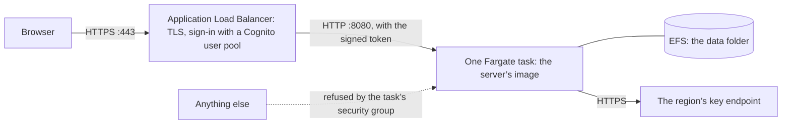

# A hosted Postbox on AWS, for a test

This folder deploys one hosted Postbox to your own AWS account, to prove its edge against a real load balancer. Why it is shaped this way is in [designs/architecture/hosted.md](../designs/architecture/hosted.md), “The test deployment on AWS”. A hosted Postbox isn’t finished: that document’s “Status” says what works, and until rooms follow membership, everyone you let sign in reaches every room.

It is a CDK app in plain JavaScript, with its own `package.json`. The `postbox` package still has no dependencies: nothing here ships in it.



## What it makes, and what it costs

One VPC with two public subnets and no NAT gateway, one Application Load Balancer, one Cognito user pool, one ECS cluster with one Fargate task (0.5 vCPU, 1 GB, ARM64), one EFS file system and one log group. Left running, the load balancer and the task cost about a dollar a day in us-east-1, at the prices on [the load balancer’s](https://aws.amazon.com/elasticloadbalancing/pricing/) and [Fargate’s](https://aws.amazon.com/fargate/pricing/) pages. Take it down when you’re done (“Take it down”).

## Use what you already have

`lib/hosted-postbox.mjs` is one construct, `HostedPostbox`, to put in a stack of your own. It makes what it isn’t given and uses what it is:

| You have | Give it | Else |
|---|---|---|
| A hosted zone | `address: { domainName, hostedZone }`: it requests the certificate, proves it through the zone and points the name at the load balancer | `address: { certificate, domainName? }`, a certificate of your own |
| An identity provider | `signIn: { userPool, userPoolDomain }` for a Cognito user pool, to which it adds one app client of its own; or `signIn: { oidc: { … } }` for any OIDC provider | a new user pool, whose people an administrator makes |
| A VPC | `vpc` | a new one with two public subnets and no NAT gateway |

```js
new HostedPostbox(stack, 'Postbox', {
  source: { root: '/path/to/the/postbox/clone' },
  address: { domainName: 'postbox.example.com', hostedZone },
  signIn: { userPool, userPoolDomain },
  allow: { subjects: ['…'] },
});
```

**Signing in is not being let in.** The provider says who a person is. Who may use this Postbox is `allow`, Postbox’s own list, which Postbox checks on every request: people by their subject at the provider, or anyone in a group a claim names. A provider you share with other applications admits none of their people until you name them. With no `allow`, no one is let in.

## Deploy it with the app here

`app.mjs` is a small app around the construct. What is yours comes in as context: `-c name=value` on the command line, or a `cdk.context.json` in this folder, which git ignores, so your domain, your zone and your provider are never committed.

| Context | What it sets |
|---|---|
| `domainName`, `hostedZoneId`, `hostedZoneName` | The name people open, in a hosted zone of yours |
| `certificateArn` | Instead of a zone: a certificate of yours in ACM, with `domainName` when your DNS points one at the load balancer |
| `userPoolId`, `userPoolDomain` | A Cognito user pool of yours, and its sign-in domain (the prefix, or a full custom domain) |
| `oidcIssuer`, `oidcAuthorizationEndpoint`, `oidcTokenEndpoint`, `oidcUserInfoEndpoint`, `oidcClientId`, `oidcClientSecretName` | Another OIDC provider. The secret is read from Secrets Manager by its name as the stack deploys |
| `claimUsername`, `claimName` | The claims that hold a person’s user name and name. `email` and `name` |
| `allowSubjects` | Who may sign in: their subjects at the provider, separated by commas |
| `allowGroupsClaim`, `allowGroups` | Or anyone in one of these groups, read from this claim |
| `openTo` | The addresses that reach the listener, as a CIDR. Everywhere |
| `stackName` | The stack’s name. `PostboxTest` |

You need the AWS CLI signed in to the account, the account [bootstrapped for CDK](https://docs.aws.amazon.com/cdk/v2/guide/bootstrapping.html) in the region, and Docker, or Finch with `CDK_DOCKER=finch` set, to build the image.

```bash
npm install
```

```bash
npx cdk deploy
```

The output `Url` is the address. For a test with no name of your own, bring a self-signed certificate, and your browser will warn about it:

```bash
openssl req -x509 -newkey rsa:2048 -nodes -days 30 -keyout key.pem -out cert.pem -subj "/CN=postbox-test.invalid"
```

```bash
aws acm import-certificate --certificate fileb://cert.pem --private-key fileb://key.pem --query CertificateArn --output text
```

## Let someone in

Read a person’s subject at the provider. For a Cognito user pool:

```bash
aws cognito-idp list-users --user-pool-id <the pool’s id> --filter 'email = "<their email>"' --query "Users[].Attributes[?Name=='sub'].Value" --output text
```

Then deploy with it in `allowSubjects`, which replaces the task with one that knows them. Someone the provider signs in who isn’t on the allow list is refused by Postbox, with a message that says so.

## What to check

- **Only the load balancer reaches Postbox’s port.** The task has a public address so it can reach ECR and the key endpoint without a NAT gateway; its security group admits port 8080 from the load balancer’s security group and from nothing else. `curl` to the task’s address on 8080 times out.
- **Why a sign-in was refused** is in the log group, one line a minute for each reason: `Postbox refused a sign-in: signer.` means the settings name another load balancer, `not-allowed` that the person isn’t on the allow list.
- **One writer.** The service runs one task and stops it before starting its replacement, so a deployment drops every page’s stream for a moment and pages reconnect. Never raise the task count: a second task would take over the data folder’s lock while the first still writes (hosted.md, “One server, one disk”).

## Take it down

```bash
npx cdk destroy
```

The data folder’s file system is kept, and so is a user pool the stack made, so that taking a deployment down loses no one’s rooms or accounts by accident: delete them yourself when you mean to. A certificate you imported stays in ACM until you delete it there.
