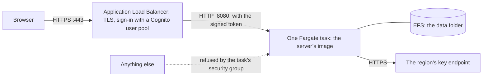

# A hosted Postbox on AWS, for a test

This folder deploys one hosted Postbox to your own AWS account, to prove its edge against a real load balancer. Why it is shaped this way is in [designs/architecture/hosted.md](../designs/architecture/hosted.md), “The test deployment on AWS”. A hosted Postbox isn’t finished: that document’s “Status” says what works, and until rooms follow membership, everyone you let sign in reaches every room.

It is a CDK app in plain JavaScript, with its own `package.json`. The `postbox` package still has no dependencies: nothing here ships in it.



## What it makes, and what it costs

One VPC with two public subnets and no NAT gateway, one Application Load Balancer, one Cognito user pool, one ECS cluster with one Fargate task (0.5 vCPU, 1 GB, ARM64), one EFS file system and one log group. Left running, the load balancer and the task cost about a dollar a day in us-east-1, at the prices on [the load balancer’s](https://aws.amazon.com/elasticloadbalancing/pricing/) and [Fargate’s](https://aws.amazon.com/fargate/pricing/) pages. Take it down when you’re done (“Take it down”).

## Before you start

- The AWS CLI signed in to the account, and the account [bootstrapped for CDK](https://docs.aws.amazon.com/cdk/v2/guide/bootstrapping.html) in the region.
- Docker, or Finch with `CDK_DOCKER=finch` set, to build the image.
- A certificate in ACM for the listener. For a name you own, request one in ACM and point the name at the load balancer once it exists. For a test with no name, a self-signed one works, and your browser will warn about it:

```bash
openssl req -x509 -newkey rsa:2048 -nodes -days 30 -keyout key.pem -out cert.pem -subj "/CN=postbox-test.invalid"
```

```bash
aws acm import-certificate --certificate fileb://cert.pem --private-key fileb://key.pem --query CertificateArn --output text
```

## Deploy

```bash
npm install
```

```bash
npx cdk deploy -c certificateArn=<the certificate’s ARN>
```

The outputs give the address (`Url`), the user pool (`UserPoolId`) and the log group. The first deployment lets no one in: Postbox doesn’t start without an allow list, and before anyone is in the pool there is no one to name.

Context you can pass with `-c`:

| Name | What it sets | Default |
|---|---|---|
| `certificateArn` | The listener’s certificate. Required | none |
| `domainName` | The name people open, when your DNS points one at the load balancer | the load balancer’s own name |
| `allowSubjects` | Who may sign in: their subjects in the user pool, separated by commas | no one |
| `openTo` | The addresses that reach the listener, as a CIDR | `0.0.0.0/0` |
| `stackName` | The stack’s name, for a second deployment in one account | `PostboxTest` |

## Let someone in

Nobody signs themselves up. Make a person in the pool, who is sent a temporary password by email:

```bash
aws cognito-idp admin-create-user --user-pool-id <UserPoolId> --username <their email> --user-attributes Name=email,Value=<their email> Name=email_verified,Value=true Name=name,Value="<their name>"
```

Read their subject:

```bash
aws cognito-idp list-users --user-pool-id <UserPoolId> --query "Users[].Attributes[?Name=='sub'].Value" --output text
```

Then deploy again with it, which replaces the task with one that knows them:

```bash
npx cdk deploy -c certificateArn=<the certificate’s ARN> -c allowSubjects=<the subject>
```

Open `Url`, sign in, and Postbox opens as that person. Someone in the pool who isn’t on the allow list is signed in by the load balancer and refused by Postbox, with a page that says so.

## What to check

- **Only the load balancer reaches Postbox’s port.** The task has a public address so it can reach ECR and the key endpoint without a NAT gateway; its security group admits port 8080 from the load balancer’s security group and from nothing else. `curl` to the task’s address on 8080 times out.
- **Why a sign-in was refused** is in the log group, one line a minute for each reason: `Postbox refused a sign-in: signer.` means the settings name another load balancer, `not-allowed` that the person isn’t on the allow list.
- **One writer.** The service runs one task and stops it before starting its replacement, so a deployment drops every page’s stream for a moment and pages reconnect. Never raise the task count: a second task would take over the data folder’s lock while the first still writes (hosted.md, “One server, one disk”).

## Take it down

```bash
npx cdk destroy
```

That deletes the data folder and the user pool with everything else. A certificate you imported stays in ACM until you delete it there.
